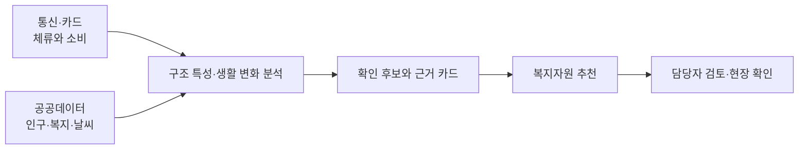

<div align="center">

# LINK-Radar

### 신고되기 전에, 먼저 살펴볼 곳을.

사회적 고립 예방을 위한 복지 담당자용 AI 에이전트


2026 빅콘테스트 · AI데이터 활용 분야

[프로젝트 소개](#about) · [서비스 화면](#demo) · [활용 데이터](#data) · [분석](#analysis) · [실행 방법](#run) · [프로젝트 구조](#structure)

</div>

<a id="about"></a>

## 사회적 고립에서 출발합니다

**사회적 고립은 개인·집단·지역사회 등 여러 수준에서 다른 사람과 맺는 관계의 양과 질이 부족한 상태입니다.** 혼자 사는지뿐 아니라, 누구와 연결되어 있고 필요할 때 도움을 받을 수 있는지를 함께 살펴야 합니다. [Zavaleta, Samuel & Mills (2017)](https://doi.org/10.1007/s11205-016-1252-2)

LINK-Radar는 이 관점을 바탕으로 통신·카드 집계 자료에서 지역과 집단의 생활 변화를 살피고, 복지 담당자가 **어디를·누구를·언제 먼저 확인할지**, **어떤 지원을 연결할지** 제안합니다.

| 사회적 고립을 보는 관점 | 분석과 서비스에 반영한 방식 |
|---|---|
| 외로움과 사회적 고립을 구분 | 감정을 추정하기보다 체류·외출·소비 등 관찰할 수 있는 생활 양상을 분석 |
| 관계의 양과 질을 함께 고려 | 데이터로 살핀 활동 양상에 복지자원·현장 확인을 연결 |
| 개인을 넘어 집단·지역 수준에서 접근 | 동네 × 성별 × 연령 집단별로 특성을 비교 |
| 지리적으로 먼 것과 관계가 부족한 것을 구분 | 동 규모·상업성·계절 방문객을 보정하고, 서비스 접근성은 별도로 확인 |

사회적 고립과 외로움의 개념 구분은 [NASEM (2020)](https://www.nationalacademies.org/read/25663/chapter/4)을 따릅니다.

### 세 가지 원칙

| 원칙 | 서비스에 담은 방식 |
|---|---|
| 어디·누구·언제 | 동·생애단계 집단과 연휴·계절을 함께 살펴, 먼저 확인할 곳과 점검 시점을 제안합니다. |
| 근거와 반대 근거를 함께 | 생활 변화의 근거뿐 아니라 공휴일·날씨·도시 전체 변화처럼 다른 설명도 확인합니다. |
| 판단은 담당자 | 담당자가 근거와 자원별 확인 사항을 검토하고, 현장 확인과 지원 연결을 결정합니다. |

<a id="demo"></a>

## 서비스 화면

**현황 확인 → 후보 조사 → 근거 검토 → 자원 연결 → 담당자 결정**을 하나의 화면 흐름으로 제공합니다. [데모 실행하기](#run)

| 화면 | 핵심 기능 |
|---|---|
| 현황 | 점검 시점, 먼저 볼 후보, 후속 확인 일정과 현장 결과 집계 |
| 지도 | 행정동별 구조 특성·행동 신호와 복지자원 위치 확인 |
| 후보 목록 | 집단·등급·후보 종류별 조회와 검토 대상 선택 |
| 후보 상세 | 등급 조건·분석 근거 검토, 추가 조사, 자원별 자격·운영 확인, 승인·보류, 인쇄 |
| 질의응답 | 질문에 맞는 자료 조회·조사와 이어 묻기 |
| 실행 기록 | 조사·검토·승인 이력 조회와 이전 작업 이어가기 |

**현황: 점검 시점, 연휴 주의 지역, 먼저 볼 후보**


<details>
<summary>후보 상세·자원 검토 화면 보기</summary>

**후보 상세: 등급 사유와 성·연령별 신호**


**자원 검토: 자격·운영을 확인한 뒤 담당자가 판정**


</details>

### 대응 등급

등급은 그 시점에 먼저 확인할 순서입니다. 판단 단위는 동 × 성 × 연령(20대~60대 이상) 470칸이고, 등급은 신한카드·SK 통신 신호로만 올라갑니다. 공공 통계와 자원 원장은 확인과 순서에 씁니다.

| 등급 | 조건 | 담당자가 할 일 |
|---|---|---|
| Level 3 · 우선 현장 확인 | 예정된 점검 시기 + 신한·SK 신호 2개 이상 + 공공 자료 확인 1개 이상 | 기존 돌봄·사례관리 명단에서 그 칸 대상자를 먼저 안부 확인 |
| Level 2 · 담당자 확인 | 동을 가리키는 통신 신호가 1개 있거나, 카드 결제 이탈이 다른 원인 검사를 통과 | 근거와 다른 원인, 연계 자원을 보고 현장 확인 여부 결정 |
| Level 1 · 변화 관찰 | 통신 신호가 없거나 다른 원인으로 설명됨 | 다음 기준일 결과와 비교 |
| Level 0 · 평소 관찰 | 점검 시기가 아님 | 정기 모니터링 |
| 판단 보류 | 필수 자료가 없거나 다른 원인 확인이 끝나지 않음 | 자료를 확보하고 다시 검토 |

| 신호 | 자료 | 무엇을 말하나 |
|---|---|---|
| 행동 고립 H | SK 통신 | 비슷한 동보다 그 성·연령이 동네에 오래 머묾 (어느 동) |
| 겨울 체류 감소 W | SK 통신 | 춘천 읍·면 60대 이상의 겨울 체류가 여름보다 줄어듦 (어느 읍·면) |
| 카드 결제 공백 C | 신한카드 | 지난 연휴에 그 성·연령의 의료 결제가 40·50대보다 더 끊김 (누구) |
| 1인 비율 S · 경제 취약 V · 거점 거리 A | 주민등록 · 수급 통계 · 자원 원장 | 확인과 순서 (등급을 올리지 않음) |

점검 시기(트리거)는 미리 알 수 있는 일정입니다. 연휴 7일 전부터 연휴 끝까지(춘천은 연휴 뒤 10일까지), 명절 당일, 폭염·호우·대설·한파 특보, 춘천 읍·면 동절기(11~2월)입니다. 연휴 7일 전은 기관이 명단을 확인할 근무일을 둔 운영 가정입니다.

모든 신호는 외부 기준과 방향을 확인했고, 확인되지 않은 칸(20·30대 행동 고립 등)은 그 신호를 Level 3 근거로 세지 않습니다. 화면에 보이는 위험 수준은 이 등급 하나입니다. 후보 상세의 칸 근거 축은 그 동의 성·연령 칸마다 어떤 신호가 섰는지와 위험 유형(이중 위험·관계 단절형·구조·경제 취약형)을 보여 줍니다. [대응 체계](docs/대응_체계.md)

**2025 추석 예시 (연휴 7일 전, 실제 자료)**

> 2025 추석 연휴 주의 지역: 강남 세곡동·역삼1동·논현1·2동, 춘천 효자2동·소양동·약사명동·조운동의 60대 이상 (Level 3, 14칸)
> - 근거: 연휴 중 60대 이상 의료 결제 공백(카드) + 이 동 60대 이상의 행동 고립(통신)과 1인 비율·경제 취약(공공 자료)
> - 할 일: 연휴 전 기존 돌봄 대상자 안부 확인, 연휴 진료기관·약국 안내. 춘천은 연휴 뒤 10일까지 이어서 확인
> - 연휴에 끊기는 연령은 2025 추석 한 번의 관측이라 2026 설 연휴로 다시 확인합니다

<a id="data"></a>

## 활용 데이터

등급은 통신·카드로 정하고, 공공데이터는 확인과 순서, 복지자원은 지원 연결에 씁니다.

| 구분 | 데이터 | 주요 활용 |
|---|---|---|
| 통신 | SK텔레콤 유동인구: 격자·월별 성·연령, 시간대, 요일 자료 | 체류 특성, 상업성 보정, 계절별 생활권 변화 |
| 소비 | 신한카드 데이터1·2: 일별 업종·성·연령·시간대별 결제 자료 | 연휴 의료·생필품 소비 공백, 생활 변화 신호 |
| 인구·가구 | 행정안전부 주민등록 인구, 세대원수별 세대수, 성·연령별 1인세대수 | 집단별 인구와 혼자 사는 비율, 구조 취약성 |
| 사회·복지 지표 | 서울 시민생활, 기초생활수급·기초연금·장애인·인구 이동 자료 | 사회경제 취약성 구성과 지표 교차 검증 |
| 환경·시점 | 기상청 ASOS, 공휴일 달력 | 기온·강수·계절·연휴에 따른 활동 변화 해석 |
| 복지·의료 자원 | 복지로, E-Gen, 지자체 시설·사업·경로당 현황, 도로명주소 좌표 | 대상·자격·운영·거리별 자원 추천 |

제공 데이터의 분석 기간은 **2025년 7~12월**, 분석 지역은 **서울 강남구·강원 춘천시**입니다. 자료별 집계 단위와 출처는 [데이터 설명](docs/데이터_설명.md), [외부 데이터 목록](external/README.md)에 정리했습니다. 대회 제공 원본은 저장소에 포함하지 않습니다.

<a id="analysis"></a>

## 분석에서 현장 검토까지



### 행동과 생활 여건을 나누어 봅니다

| 행동 고립 H | 사회경제 취약 V |
|---|---|
| 비슷한 규모·상업성의 동과 비교한 체류 특성, 겨울 체류 유지 | 성·연령별 혼자 사는 비율과 공공부조 수급 |
| 생활권 안에서 어떻게 활동하는가 | 어떤 생활 여건에 놓여 있는가 |

행동 고립(H)과 공공 자료(1인 비율 S, 경제 취약 V)로 이중 위험·관계 단절형·구조·경제 취약형을 나누고 470칸을 비교합니다. 남녀는 같은 성·연령끼리만 순위를 매겨, 전반적으로 값이 높은 쪽에 다른 쪽이 묻히지 않게 했습니다. [2축 분석](reports/t1_2축위험도/README.md) · [규칙 개정](reports/r3_규칙개정/README.md)

### 생활 변화가 지원으로 이어지는 지점

| 분석에서 살핀 현상 | 서비스에 반영한 방식 |
|---|---|
| 연휴에 60대 이상 의료 결제가 40·50대보다 28~36% 더 끊김 (추석·광복절·성탄절 같은 방향) | 연휴 점검은 60대 이상 칸에만 |
| 읍·면의 겨울 체류 변화와 자원 접근성 | 동절기 점검과 전화·찾아가는 자원 검토 |
| 같은 날 도시 전체가 함께 줄어드는 결제 | 공휴일·날씨·도시 공통 변화 등 다른 원인 확인 |
| 성·연령 집단별로 다른 소통·외출 양상 | 집단별 구조 지표와 지원 유형 비교 |

[생활 공백 분석](reports/eda5_인사이트재현/README.md) · [경보 평가](reports/eda6_사전경보재평가/README.md) · [지표 교차 검증](reports/t2_교차검증/README.md) · [집단별 지표 비교](reports/t1_5_집단별S1/README.md)

### 분석·서비스 검증

| 항목 | 검증 내용 | 결과 |
|---|---|---|
| 2축 모델 | 사전 등록한 구성·독립성·안정성 기준 | 19개 중 18개 충족 |
| 생활 변화 경보 | 집단 결제에 15% 하락을 넣은 합성 실험 | 736/817 감지, 약 90% |
| 경보 기준 선택 | LINK-Sim 합성 정답으로 고르기·평가 분리 (z −2.0, 7일 중 4일, 5%) | 평가 재현율 73.7% (이전 기준 68.4%), 배경 경보율 4.11% |
| 연휴 효과 | 추석·광복절·성탄절, 가짜 연휴 100여 개와 비교 | 60대 이상 의료 결제 공백, 세 번 모두 같은 방향 |
| 복지자원 추천 | 고정한 규칙 정답 30쌍 | k-정규화 Recall@5 0.6733 |
| 기능 검증 | 데이터 계약·에이전트·API·화면 | Python 1,191개, 웹 142개 시험 통과 |
| 결과 재현 | 리포트 CSV 해시 대조 | 122개 일치 |

평가 방법과 세부 결과는 [분석 리포트](reports/README.md), 재현 절차는 [REPRODUCE.md](REPRODUCE.md)에 있습니다.

## 에이전트 구성

React 화면과 FastAPI를 연결하고, LangGraph로 **질문 해석·자료 조회·추가 조사·보고서 생성·승인 대기**를 관리합니다.

| 역할 | 구성 |
|---|---|
| 데이터 처리·분석 | Python, DuckDB, pandas, Parquet, statsmodels, LightGBM |
| 에이전트 | LangGraph, Pydantic, Claude API |
| 서비스 | FastAPI, React, TypeScript, Vite, Tailwind CSS |
| 지도·차트 | Leaflet, Recharts |
| 상태·이력 | SQLite, LangGraph 체크포인트 |
| 품질 검증 | pytest, Vitest, GitHub Actions |

### 판정 원칙과 안전장치

- **판정은 코드, 설명은 LLM**: 신호·등급·추천 기준은 규칙으로 계산하고, LLM은 질문 해석과 근거 설명을 맡습니다.
- **개인을 판정하지 않음**: 동·집단 단위 집계로 확인 순서를 제안하며, 개인의 고립 여부를 진단하거나 대상자 명단을 만들지 않습니다.
- **모르면 보류**: 자료가 지원하지 않는 질문이나 필수 근거가 부족한 판단은 보류하고, 필요한 자료를 안내합니다.

조회와 보고서 생성 과정에는 네 가지 Guard 검사를 둡니다.

| 검사 | 확인하는 내용 |
|---|---|
| 데이터 계약 | 요청한 지역·연령·시간대가 원천 자료에 있는지, 집계 단위와 결합이 가능한지 |
| 사실 | 숫자·증감 방향·지역·기간·단위·근거 ID가 근거 카드와 일치하는지 |
| 표현 | 체류를 거주로 단정하거나 개인 진단·근거 없는 정확도를 주장하는지 |
| 자원 | 추천 자원의 출처·지역·대상·확인일이 있는지. 자격·운영 미확인 항목은 담당자에게 표시 |

자세한 흐름은 [아키텍처](docs/아키텍처.md), [에이전트 설계](docs/에이전트_설계.md), [대응 체계](docs/대응_체계.md)를 참고하세요.

<a id="run"></a>

## 실행 방법

Python 3.13 이상, uv, Node.js와 npm이 필요합니다.

### 화면 데모

레포 루트에서 API를 실행합니다.

```bash
uv sync --frozen
uv run uvicorn api.main:app --reload --workers 1
```

다른 터미널에서 화면을 실행합니다.

```bash
cd web
npm ci
npm run dev
```

**http://localhost:5173**에서 확인할 수 있습니다. 기본 모드는 화면 시연용 샘플 데이터를 사용하며, 원본 자료나 API 키가 필요하지 않습니다.

<a id="real-data"></a>

### 실제 데이터 연결

대회 원본 zip 두 개를 `data/raw/`에 두거나 `BC_RAW_DIR`로 경로를 지정하고 정리본을 만듭니다.

```bash
uv run python -m bigcontest.ingest
```

API를 종료한 뒤 실제 데이터 모드로 다시 실행합니다.

```powershell
# PowerShell · 레포 루트
$env:LINKRADAR_BACKEND = "real"
$env:LINKRADAR_TOOLS = "real"
$env:LINKRADAR_LLM = "none"
uv run uvicorn api.main:app --reload --workers 1
```

<details>
<summary>macOS / Linux</summary>

```bash
LINKRADAR_BACKEND=real LINKRADAR_TOOLS=real LINKRADAR_LLM=none \
uv run uvicorn api.main:app --reload --workers 1
```

</details>

Claude를 연결하려면 `ANTHROPIC_API_KEY`를 설정하고 `LINKRADAR_LLM=claude`로 실행합니다. LLM 없이도 규칙 계산과 템플릿 보고서를 사용할 수 있습니다. 원본 파일명·전체 분석 재현은 [재현 안내](REPRODUCE.md), API 설정은 [API 명세](docs/API_명세.md)에 있습니다.

<a id="structure"></a>

## 프로젝트 구조

```text
analysis/          2축 구조 위험도·연령 가설 분석 노트북과 재현 코드
notebooks/         생활 신호·등급·모델 비교·교차 검증 스크립트
reports/           분석 결과·검증 리포트·그림
src/bigcontest/    데이터 처리·신호·모델·등급·자원·에이전트 코드
api/               FastAPI와 실행·검토·승인 기록
web/               React 서비스 화면
configs/           분석·등급·자원·LLM 설정
external/  ref/    공개 자료·출처·행정동 코드와 경계
evaluation/        추천 평가·사용자 비교 평가 자료
tests/             Python 시험
scripts/           재현·데이터 점검 스크립트
docs/              설계·명세·데이터 설명
```

## 문서

| 주제 | 문서 |
|---|---|
| 분석 | [전체 리포트](reports/README.md) · [분석 노트북](analysis/taeyeon_2axis/README.md) · [위험 지표](docs/위험_지표.md) |
| 서비스 | [화면 설계](docs/화면_설계.md) · [에이전트 설계](docs/에이전트_설계.md) · [API 명세](docs/API_명세.md) |
| 데이터 | [데이터 설명](docs/데이터_설명.md) · [외부 자료 출처](external/README.md) · [부가 데이터](docs/부가데이터_정의.md) |
| 재현 | [재현 안내](REPRODUCE.md) · [숫자 사용 기준](docs/숫자_사용_기준.md) |

## 한계

- 연휴에 끊기는 연령(60대 이상)은 2025 추석 한 번의 관측으로 정했습니다. 2026 설 연휴 자료로 다시 확인해야 합니다. 카드 결제가 줄어든 것이 가족과 함께 있어서인지 실제 공백인지는 구분하지 못합니다.
- 결과를 본 뒤 정한 규칙이 있습니다. 연휴 연령, 카드 신호 기준(−5%p), Level 3의 공공 자료 확인 조건, 동절기 카드 대신 통신 신호 두 개로 세는 것입니다. 모두 [규칙 개정](reports/r3_규칙개정/README.md)에 적었습니다.
- 카드는 도시 × 성 × 연령 단위라 동을 가리키지 못합니다. 동은 통신 신호가 정하고, 통신 연령은 60대 이상이 한 묶음이라 70·80대를 따로 보지 못합니다.
- 1인 비율(S)은 작은 동일수록 높게 나오는 경향이 있습니다(춘천 순위상관 −0.58). 지금은 공공 자료 확인 역할로만 써서 등급에 미치는 영향은 줄였습니다.
- 신호마다 강남 시민생활 '외출·소통 적음'과 방향을 확인했습니다. 20·30대와 남성 40대 일부는 방향이 확인되지 않아, 그 칸에서는 해당 신호를 Level 3 근거로 세지 않습니다(화면에 '방향 미확인'으로 표시). 기준 자료도 추정치이고 강남 22개 동뿐이라 춘천은 강남 결과를 빌려 씁니다.
- 실제 고립 정답(현장 확인 결과)이 없어 정확도는 말할 수 없습니다. 검증은 대리 지표·합성 자료·독립 기준과의 비교입니다.
- 접근성은 2026년 원장 기준이라 2025년 당시 거점 운영 여부는 확인하지 못했습니다.

## 라이선스

코드는 [MIT 라이선스](LICENSE)를 따릅니다. 대회 제공 데이터는 재배포하지 않으며, 공개 자료의 이용 조건은 [NOTICE](NOTICE.md)에 정리했습니다.
