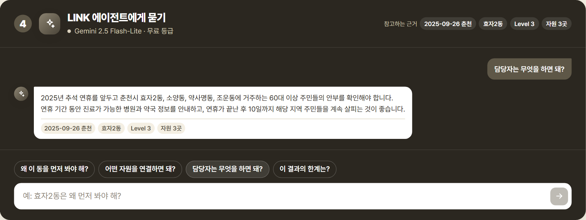
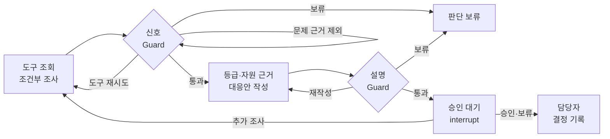

<div align="center">

# LINK-Radar

### 신고되기 전에, 먼저 살펴볼 곳을.

통신·소비·공공데이터로 먼저 살펴볼 지역과 대상을 찾는 **복지 담당자용 AI 에이전트**

2026 빅콘테스트 · AI데이터 활용 분야

**[데모 보기](https://link-radar-virid.vercel.app/?as_of=2025-09-26&city=춘천)** · [실행 방법](#run) · [분석 자료](reports/README.md)

</div>

<a id="about"></a>

## 프로젝트 소개

> 사회적 고립을 직접 관측할 수 없다면, 지역과 집단의 생활 변화에서 먼저 확인해야 할 신호를 찾을 수 있지 않을까?

LINK-Radar는 통신의 체류 양상, 카드의 소비 변화, 공공 통계의 생활 여건을 함께 분석해 **언제, 어디를, 누구부터 확인할지** 제안합니다.

담당자의 질문에 맞춰 필요한 근거와 지원 정보를 정리하고, **확인할 지역과 대상, 선정 이유, 연결할 복지자원**을 함께 제시합니다. 담당자는 이를 바탕으로 현장 점검과 지원 연결을 준비할 수 있습니다.

[](https://link-radar-virid.vercel.app/?as_of=2025-09-26&city=춘천)

<a id="approach"></a>

## 문제와 접근 방식

**사회적 고립은 다른 사람과 맺는 관계의 양과 질이 부족한 상태**를 뜻합니다. 혼자 사는지뿐 아니라, 일상에서 누구와 관계를 맺고 필요할 때 도움을 받을 수 있는지를 함께 살펴야 합니다. [Zavaleta, Samuel & Mills (2017)](https://doi.org/10.1007/s11205-016-1252-2)

LINK-Radar는 **일상의 변화와 지역의 생활 여건**을 안부 확인의 단서로 삼습니다. 지역·집단별 차이를 비교해 기존 돌봄·사례관리 업무에서 확인할 대상과 시점을 정하는 데 필요한 근거를 제공합니다.

<table>
  <tr>
    <th width="33%"><h3>지역 × 대상 × 시점</h3></th>
    <th width="33%"><h3>근거 + 다른 설명</h3></th>
    <th width="33%"><h3>최종 판단은 담당자</h3></th>
  </tr>
  <tr>
    <td align="center">어디를 · 누구부터 · 언제<br />생활권·성별·연령·연휴·계절</td>
    <td align="center">활동 감소의 배경 확인<br />날씨·귀성·여행·도시 공통 변화</td>
    <td align="center">현장 확인과 지원 결정<br />근거 검토·자원 확인·승인</td>
  </tr>
</table>

<a id="workflow"></a>
<a id="levels"></a>
<a id="대응-등급"></a>

**생활 변화 분석 → 우선 확인 대상 → 근거·복지자원 → 담당자 결정**

대응 등급은 현장 확인의 우선순위를 나타냅니다. 개인의 고립 여부를 판정하지 않으며, 자료가 부족하면 판단을 보류합니다. [등급별 의미와 판정 기준](docs/대응_체계.md)

<a id="findings"></a>
<a id="insights"></a>

## 핵심 인사이트

**같은 활동 감소도 지역·집단·시점에 따라 의미가 달랐습니다.** 2025년 하반기 강남·춘천 자료에서 확인한 차이를 바탕으로, 연휴·동절기 점검과 집단별 비교를 설계했습니다.


| 분석에서 발견한 차이 | 서비스의 설계 방향 |
|---|---|
| **연휴 × 연령** · 추석 의료 결제는 평소 대비 20대 **25~33%**, 80대 이상 **10~17%** | **연휴 전 점검** · 고령층 안부 확인과 진료기관·약국 안내 |
| **계절 × 생활권** · 춘천 주거형 구역의 60대 이상 겨울 체류는 여름 대비 읍·면 **−9.7%**, 동지역 **+0.6%** | **생활권별 점검** · 춘천 읍·면의 동절기 변화 별도 확인 |
| **성별 × 연령** · 강남 중장년(40~64세) 1인가구의 소통 부족 비율은 남 **15.5%**, 여 **8.5%** | **집단별 비교** · 성별·연령별 특성을 나누어 근거 구성 |
| **날씨 × 소비** · 33℃ 이상 폭염일, 80대 이상 생필품 결제는 평소 대비 강남 **−4.9%**, 춘천 **−5.3%** | **다른 원인 확인** · 날씨·도시 공통 변화부터 살핀 뒤 해석 |

[분석 과정·그래프·재현 결과](reports/eda5_인사이트재현/README.md)

<a id="demo"></a>

## 주요 기능

### 01. 우선 확인할 지역과 집단

지도에서 지역별 현황을 살펴보고, 후보 카드에서 **선정 이유·성별·연령별 신호·생활 여건**을 확인합니다. 서로 다른 집계 자료의 범위도 함께 표시합니다.


### 02. 근거를 바탕으로 묻고 답하기

**“담당자는 무엇을 하면 돼?”** 선택한 지역의 근거와 추천 자원을 바탕으로 다음 행동을 안내합니다. 답할 수 없는 조합은 필요한 자료와 대안을 제시합니다.



### 03. 복지자원 추천과 검토

대상과 지역에 맞는 자원을 추천하고, **공식 출처·이용 자격·운영 조건**을 함께 보여줍니다. 담당자는 자원별 판정과 메모, 후속 확인일을 남길 수 있습니다.


### 04. 대응안 검토와 후속 관리

근거와 자원 검토를 마친 뒤 **승인·보류·추가 조사**를 선택합니다. 검토 기록과 현장 확인 결과를 모아 후속 대응을 이어갑니다.


<sub>화면: 2025-09-26 춘천 자료. 자원 판정·메모는 시연 입력입니다.</sub>

<a id="agent"></a>

## AI 에이전트 설계

LangGraph가 **질문 해석 → 도구 선택·조회 → 필요 시 추가 조사 → 근거·대응안 생성 → 승인 대기**를 관리합니다. 단순히 수치를 보여 주는 데서 끝나지 않고, 담당자가 근거를 확인하고 결정할 수 있는 작업 흐름으로 연결합니다.

아래는 **조사 요청의 주요 분기**입니다. 단순 조회는 등급 계산·승인 대기를 거치지 않고, Guard를 통과한 답을 반환합니다.



[실제 분기 코드](src/bigcontest/agent/graph.py) · [데이터 계약](configs/grain_contract.yaml) · [판정 규칙](configs/rules_v2.yaml)

| 역할 | 맡는 일 |
|---|---|
| **LLM** | 질문을 자료 요청으로 정리하고, 필요한 추가 조사를 제안하며 근거 설명을 작성 |
| **코드·도구** | 자료 계약 검사, 지표·등급 계산, 다른 원인 확인, 자원 추천과 설명 검사 |
| **담당자** | 자원별 자격·운영 검토, 대응안 승인·보류·추가 조사, 현장 확인 결과 기록 |

네 가지 Guard로 자료 요청과 생성된 설명을 검사합니다.

| 검사 | 확인하는 내용 |
|---|---|
| **데이터 계약** | 요청한 지역·연령·시간대가 자료에 있는지, 집계 단위와 조합이 가능한지 |
| **사실** | 숫자·방향·지역·기간·단위·근거 ID가 근거 카드와 맞는지 |
| **표현** | 체류를 거주로 단정하거나 개인 진단·근거 없는 정확도를 주장하는지 |
| **자원** | 출처·지역·대상·확인일이 있는지. 미확인 자격·운영 조건은 담당자에게 표시 |

공개 데모의 질문창은 배포된 근거 요약을 바탕으로 답하고, 근거에 없는 숫자를 거르는 별도 경로입니다. 위 전체 조사·승인 흐름과 구분합니다. [아키텍처](docs/아키텍처.md) · [에이전트 설계](docs/에이전트_설계.md)

<a id="validation"></a>
<a id="모델링-결과"></a>

## 검증과 성과

검증은 **변화 감지·모델 선택·자원 추천·기능과 재현성**으로 나누었습니다.

| 검증 대상 | 검증 방법 | 확인 결과 |
|---|---|---|
| **활동 하락 감지** | 원래 결제 시계열과 **15% 하락을 14일간 주입한 시계열**을 짝지어 경보 비교 | 대조에서 경보가 없던 **814쌍 중 753쌍(92.5%)** 새로 감지. 전체 대조 쌍 경보율 **1.7%** |
| **모델 채택 여부** | 별도 합성 실험에서 과거로 학습하고 다음 4주를 평가. 규칙·로지스틱 회귀·LightGBM을 **5,566개 표본**에서 비교 | LightGBM의 오경보율 **13.5%**, 비교 규칙 **7.9%**. 오경보 증가로 **학습 모델 미채택** |
| **복지자원 추천** | 동·집단·필요 유형 **30사례**의 정답 자원을 사전에 정하고 상위 5개 추천과 대조 | 상위 5개 충족도(k-정규화 Recall@5) **0.6733** |
| **기능·재현성** | 질문·후보 검토·저장·오류 처리의 웹 자동 시험, 분석 결과 CSV 해시 대조 | 웹 시험 **170개 통과**, 결과 파일 **143개 일치** |

합성 실험의 92.5%는 **주입한 활동 하락의 감지율**입니다. 실제 사회적 고립의 발견 정확도나 현장 지원 성과를 뜻하지 않습니다.

[경보·모델 비교 실험](reports/m3_모델링결과/README.md) · [자원 추천 평가](reports/w2_자원추천평가/README.md) · [규칙 검증·민감도 분석](reports/r3_규칙개정/README.md)

<a id="data"></a>

## 활용 데이터

**대회 제공 통신·소비 자료에 인구·생활 여건·날씨·복지자원 정보를 결합**했습니다. 핵심 분석 범위는 **2025년 7~12월, 강남구·춘천시**입니다.

| 구분 | 출처·자료 | 활용 |
|---|---|---|
| **대회 · 통신** | SK텔레콤 50m 격자별 성·연령·시간대·요일별 유동인구 | 읍·면·동별 체류 특성과 계절 변화 |
| **대회 · 소비** | 신한카드 일별 업종·성·연령별 결제, 시간대별·고객 거주 시도별 자료 | 연휴 의료·생활 소비와 평소 대비 변화 |
| **외부 · 인구·세대** | 행정안전부 주민등록 인구·세대원수별 세대수·성연령별 1인세대수 | 집단별 인구와 1인세대 비율 |
| **외부 · 사회·복지** | 서울 시민생활 데이터, 지자체 수급·기초연금·장애인·독거노인 통계 | 소통·외출 특성 비교, 생활 여건과 지표 검증 |
| **외부 · 날씨·달력** | 기상청 ASOS 일자료, 한국천문연구원 월력요항 | 기온·강수·요일·공휴일 영향 확인 |
| **외부 · 지원 자원** | 복지로·E-Gen·지자체 시설·사업·경로당, 행안부 도로명주소 좌표 | **1,440건**의 자원 원장, 대상·지역·거리별 추천 |

통신은 **47개 읍·면·동 × 성별 2개 × 연령 5개 = 470칸**으로 비교합니다. 카드는 가맹점 도시 단위로 사용하며, 특정 동 주민의 결제량으로 해석하지 않습니다. 자원 원장은 2026년 기준입니다.

[데이터 구조·정제 방식](docs/데이터_설명.md) · [외부 데이터 출처·수집 기록](external/README.md)

<a id="run"></a>

## 실행 방법

**[설치 없이 데모 보기](https://link-radar-virid.vercel.app/?as_of=2025-09-26&city=춘천)** — 2025년 하반기 184일 × 두 도시의 사전 계산된 집계 결과를 조회합니다. '오늘 기준'도 오늘의 월·일을 2025년 자료에 대입한 결과이며 실시간 관측값이 아닙니다.

**기술 스택:** Python·DuckDB·pandas / LangGraph·Pydantic·Gemini API / FastAPI·React·TypeScript / Leaflet·Recharts / SQLite

<details>
<summary>로컬 전체 앱 실행 · Python 3.13 이상, uv, Node.js·npm</summary>

레포 루트에서 API를 실행합니다.

```bash
uv sync --frozen
uv run uvicorn api.main:app --reload --workers 1
```

다른 터미널에서 화면을 실행합니다.

```bash
cd web
npm ci
npm run dev
```

**http://localhost:5173**에서 확인합니다. 기본 실행은 샘플 데이터를 사용하며 원본이나 API 키가 필요하지 않습니다.

실제 자료는 대회 원본 zip 두 개를 `data/raw/`에 두거나 `BC_RAW_DIR`를 지정한 뒤 정리본을 만듭니다.

```bash
uv run python -m bigcontest.ingest
```

API를 종료한 뒤 실제 데이터 모드로 다시 실행합니다.

```powershell
$env:LINKRADAR_BACKEND = "real"
$env:LINKRADAR_TOOLS = "real"
$env:LINKRADAR_LLM = "none"
uv run uvicorn api.main:app --reload --workers 1
```

macOS / Linux는 같은 환경 변수를 설정해 실행합니다. Gemini 연결은 `.env`의 `GEMINI_API_KEY`와 `LINKRADAR_LLM=gemini`를 사용합니다. LLM 없이도 규칙 계산과 템플릿 대응안이 동작합니다.

[원본 파일명·전체 재현](REPRODUCE.md) · [API 설정](docs/API_명세.md) · [LLM·정적 배포 설정](docs/LLM_사용.md)

</details>

<a id="documents"></a>

## 상세 문서

| 확인할 내용 | 문서 |
|---|---|
| 최신 판정·숫자 | [rules-v2.0 결과](reports/r3_규칙개정/README.md) · [숫자 사용 기준](docs/숫자_사용_기준.md) |
| 통계·모델·민감도 | [전체 분석 목록](reports/README.md) · [2축 분석](analysis/taeyeon_2axis/README.md) · [모델링 결과](reports/m3_모델링결과/README.md) |
| 설계·동작 | [아키텍처](docs/아키텍처.md) · [에이전트 설계](docs/에이전트_설계.md) · [대응 체계](docs/대응_체계.md) |
| 실행·재현 | [재현 안내](REPRODUCE.md) · [데이터 설명](docs/데이터_설명.md) · [문서 목록](docs/README.md) |

코드는 [MIT 라이선스](LICENSE)를 따릅니다. 대회 원본은 재배포하지 않으며 공개 자료의 이용 조건은 [NOTICE](NOTICE.md)에 정리했습니다.
