<div align="center">

# 📡 LINK-Radar

### 신고되기 전에, 먼저 살펴볼 곳을.

사회적 고립 예방을 위한 복지 담당자용 AI 에이전트


2026 빅콘테스트 · AI데이터 활용 분야 · 서울 강남구 · 강원 춘천시

[대시보드](#-대시보드) · [주요 인사이트](#-주요-인사이트) · [핵심 흐름](#-핵심-흐름) · [대응 체계](#-대응-체계) · [아키텍처](#-아키텍처) · [활용 데이터](#-활용-데이터) · [기술 스택](#-기술-스택) · [시작하기](#-시작하기) · [검증](#-검증) · [라이선스](#-라이선스)

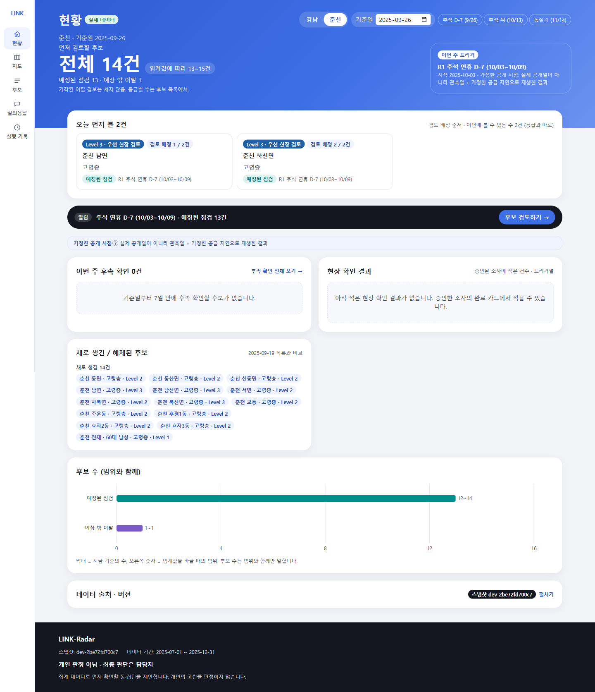

</div>

## 소개

혼자 사는 사람의 어려움은 신고나 상담으로 드러나기 전까지 잘 보이지 않습니다. 연휴, 폭염, 한파처럼 돌봄이 끊기기 쉬운 시기는 매년 돌아오지만, 복지 담당자가 관할 지역 전체를 미리 살피기는 어렵습니다.

LINK-Radar는 통신·카드 집계 데이터와 공공데이터를 함께 보고 **현장에서 먼저 확인할 동네와 집단, 그리고 확인할 영역**을 근거와 함께 제안합니다. 담당자는 이 제안을 바탕으로 고독사 위험자 판단도구를 들고 현장을 확인합니다.

| 🗺 어디를 · 누구를 · 언제 | 🔍 근거와 반대 근거를 함께 | 🙋 판단은 담당자가 |
|---|---|---|
| 1인세대가 많은 동, 거점이 먼 읍·면, 중장년·청년 남성과 고령층을 연휴·폭염·겨울 전에 먼저 살필 후보로 제안합니다. | 결제가 줄었어도 연휴·날씨·도시 전체 변화로 설명되는지 먼저 따집니다. 근거가 부족하면 결론을 내지 않고 **판단 보류**와 필요한 자료를 알려 줍니다. | 개인을 찾거나 고립을 판정하지 않습니다. 등급은 규칙이 정하고, 승인·보류·추가 조사는 담당자가 결정합니다. |

> **현재 상태** — 데이터 분석, 사전 경보 평가, 기대 활동 모델 비교, 등급 규칙(rules-v1.1), 복지자원 원장(1,068건), 에이전트(Claude 연결, 시연 사례 D1~D4), 대시보드와 실제 백엔드 연결까지 만들었습니다. 현장 결과 입력과 모아 보기도 있지만, **실제 현장 운영으로 검증하지는 않았습니다.**

---

## 🖥 대시보드

담당자가 쓰는 웹 화면입니다. 현황 → 후보 목록 → 후보 상세 → 승인 순서로 씁니다.

아래 화면은 모두 **실제 데이터**로 찍었습니다. 춘천, 기준일 2025-09-26(추석 D-7), 고령층 사례 하나를 처음부터 끝까지 따라갑니다. 거점 거리는 지금(2026) 자원 원장으로 쟀기 때문에, 이 사례의 Level 3는 **2025 생활 신호와 현재 원장을 합친 대응 우선순위 시연**입니다. 2025년 당시 Level 3를 미리 정할 수 있었다는 뜻은 아닙니다(화면 사유에 "현재 원장 기준"으로 표시). 등급은 규칙이 정하고, 설명 문장과 답은 Claude가 쓴 뒤 사실 검사를 통과한 것만 보입니다. 이 사례 하나를 조사·추가 조사·이어 묻기·질의응답까지 돌린 Claude 비용은 약 $0.05입니다.

<table>
<tr>
<td width="50%">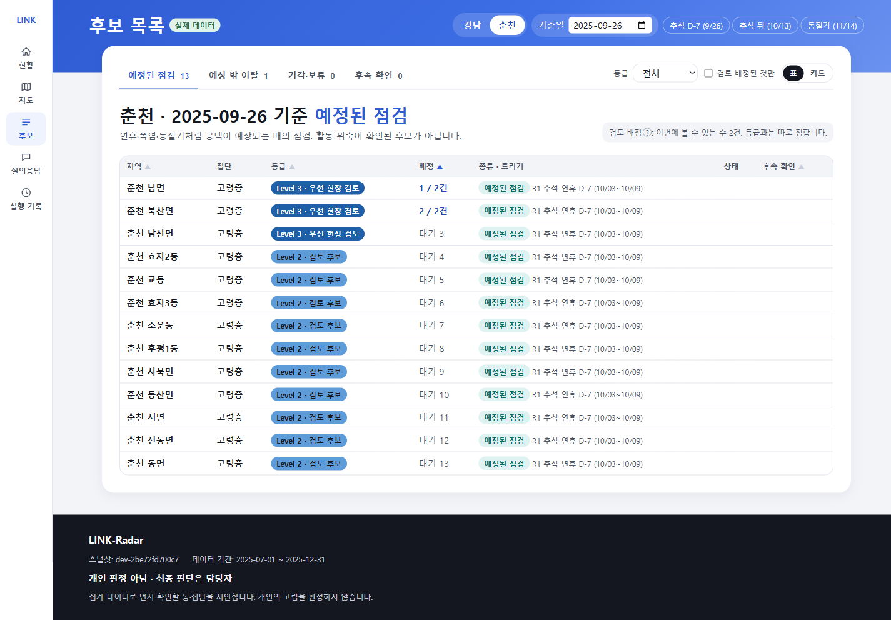<br><sub><b>후보 목록</b> — 춘천 25개 동·읍·면 중 추석 전 점검 후보 13곳. Level 3(우선 현장 검토)은 남면·북산면·남산면. 등급과 검토 배정(이번에 볼 수 있는 수)을 따로 표시</sub></td>
<td width="50%">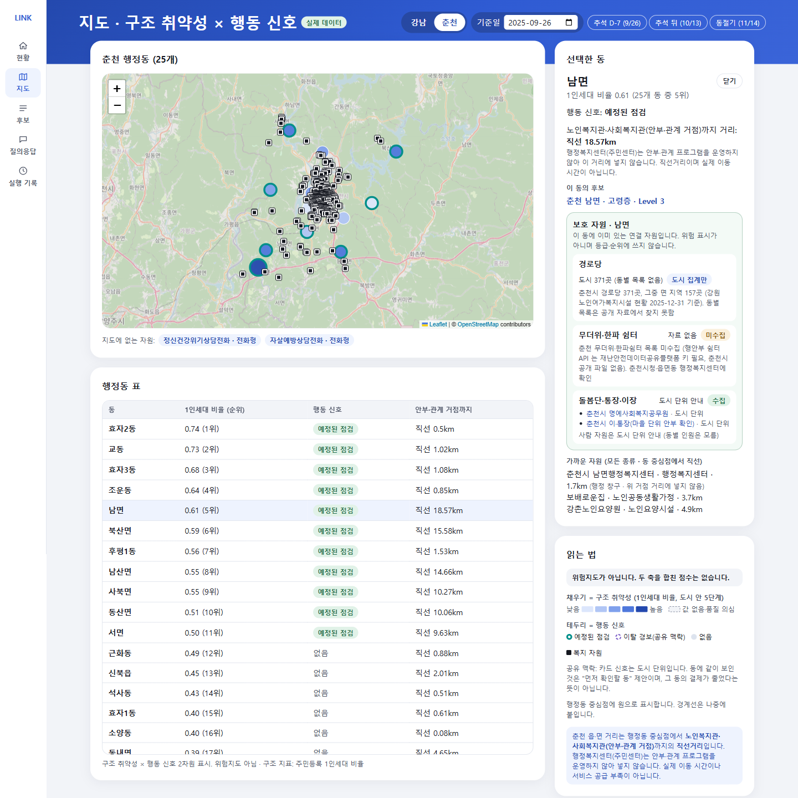<br><sub><b>지도</b> — 채우기는 1인세대 비율, 테두리는 행동 신호. 남면을 고르면 오른쪽에 순위·거점까지 직선거리·이 동의 후보·가까운 자원</sub></td>
</tr>
<tr>
<td colspan="2" align="center">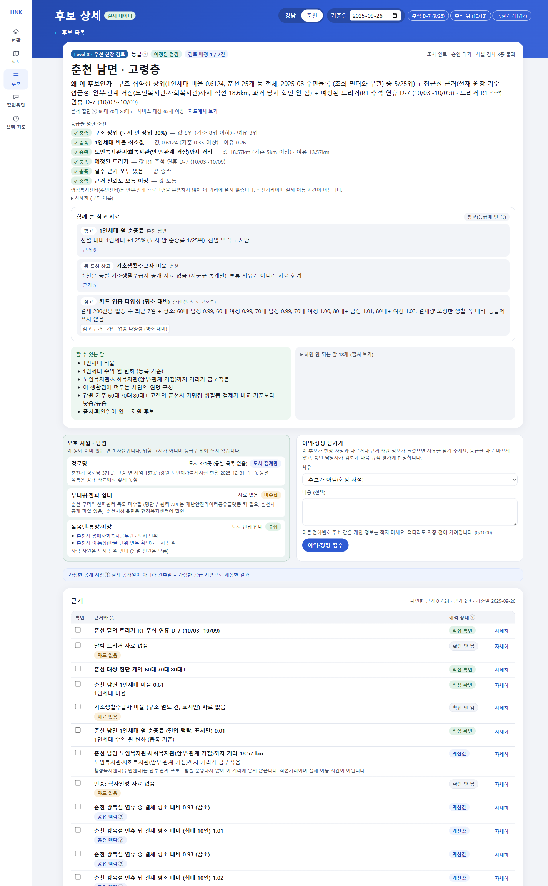<br><sub><b>후보 상세 (춘천 남면 · 고령층 · Level 3)</b> — 등급을 정한 조건(값·기준·여유), 할 수 있는 말 / 하면 안 되는 말, 근거마다 한 줄 해석과 해석 상태, 이 조사에 묶인 추천 자원과 담당자 판정</sub></td>
</tr>
<tr>
<td width="50%">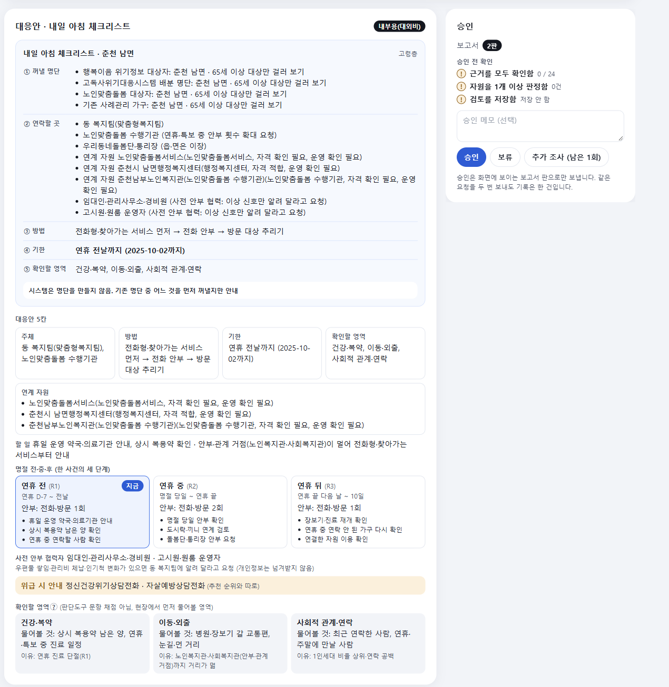<br><sub><b>내일 아침 체크리스트 · 대응안</b> — 꺼낼 명단, 연락할 곳, 방법, 기한(연휴 전날 10/02), 확인할 영역. 보고서에는 Claude 설명 문장(사실 검사 통과)과 대외용 문구</sub></td>
<td width="50%">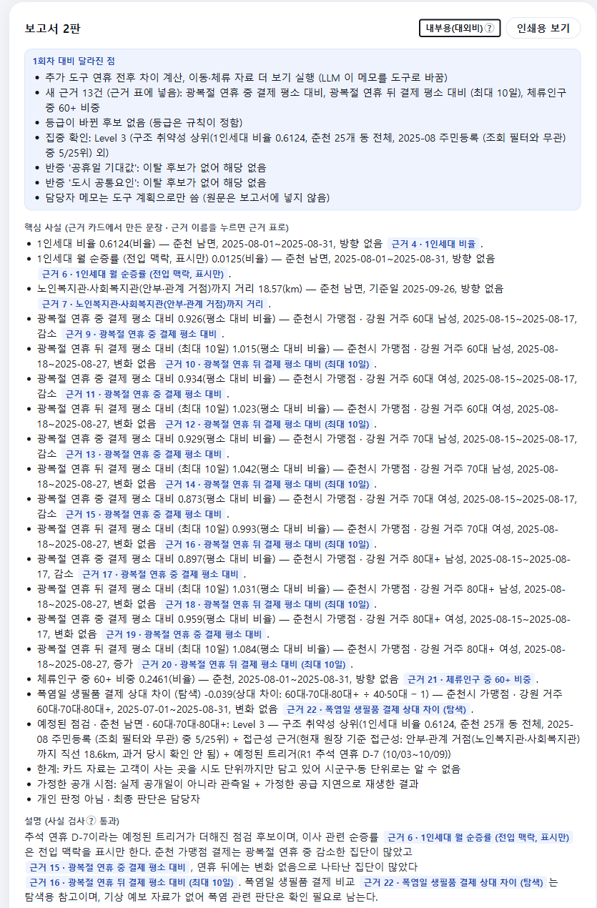<br><sub><b>추가 조사</b> — 담당자 메모("연휴 동안 병원·약국 결제가 얼마나 끊기는지")를 도구 계획으로 바꿔 다시 조사. 보고서 맨 위에 "1회차 대비 달라진 점"</sub></td>
</tr>
<tr>
<td width="50%">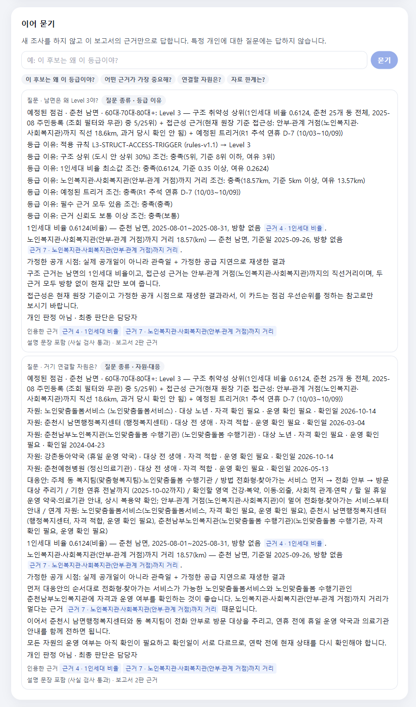<br><sub><b>이어 묻기</b> — "남면은 왜 Level 3야?" 새 조사 없이 보고서 근거만으로 답하고, 인용한 근거를 누르면 근거 표로 이동</sub></td>
<td width="50%">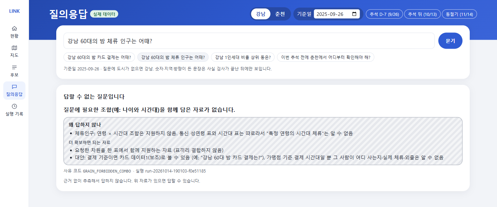<br><sub><b>질의응답</b> — 데이터에 없는 조합("강남 60대의 밤 활동")은 답하지 않고 이유와 필요한 자료를 안내</sub></td>
</tr>
<tr>
<td colspan="2" align="center">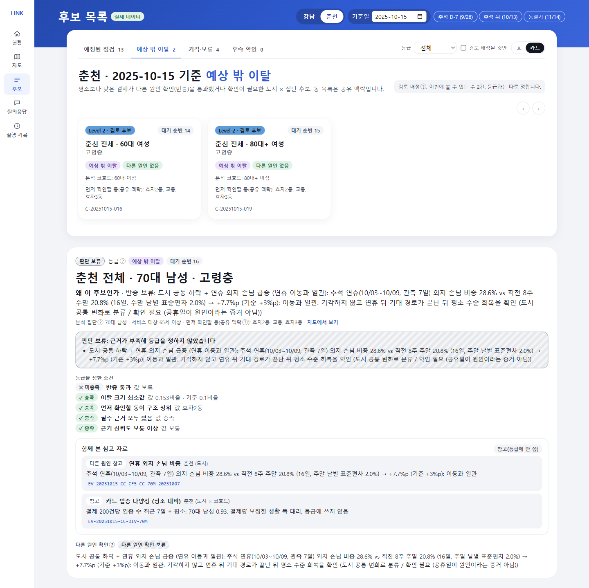<br><sub><b>추석 뒤 (기준일 2025-10-13)</b> — 춘천 고령층 생활 변화 신호 6건. 다른 원인으로 설명되지 않은 2건은 담당자 확인(Level 2), 결론이 아직 안 난 4건은 판단 보류(자료 더 필요)</sub></td>
</tr>
<tr>
<td colspan="2" align="center">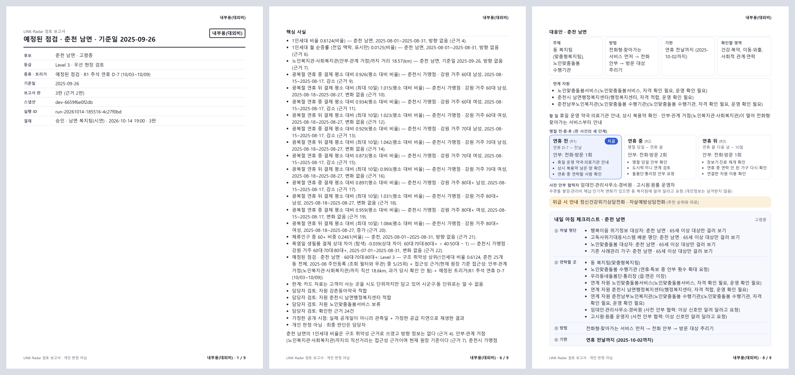<br><sub><b>인쇄용 보기</b> — 승인한 보고서를 결재용 한 장으로. 위아래에 "내부용(대외비)", 승인자·판·스냅샷·실행 ID, 자원 판정, 대응안·체크리스트</sub></td>
</tr>
</table>

<details>
<summary>시연 사례 4가지</summary>

| # | 사례 | 보여주는 것 |
|---|---|---|
| D1 | 강남 구조 취약성 검토 | 1인세대가 많은 동의 중장년 남성을 추석 전 점검 후보로 제안(22곳 중 7곳). 거리 기준 공백 근거가 약하다는 점도 스스로 밝힘 |
| D2 | 춘천 읍·면 동절기 점검 | 겨울 체류 감소와 먼 복지 거점을 근거로 전화형·찾아가는 서비스 제안. 자원 판정을 바꾸면 보고서를 다시 만들고 승인 잠금 |
| D3 | 추석 전후 결제 하락 경보 | 연휴 효과인지 반증. 도시 전체가 함께 낮으면 기각하지 않고 "도시 공통 변화 / 확인 필요" |
| D4 | 근거 부족 보류 | "강남 60대의 밤 활동은?" → 연령 × 시간대 자료가 없어 보류, 대신 볼 수 있는 자료 안내 |
</details>

---

## 💡 주요 인사이트

제공 데이터와 공공데이터로 확인한 것과, 그래서 에이전트를 어떻게 만들었는지입니다. 수치와 계산 과정은 [분석 리포트](reports/README.md)에 있습니다.

**1. 고령층 외출·소통 결핍은 '고령자가 많은 동'보다 '1인세대가 많은 동'에서 높다**
강남 22개 동에서 주민등록 1인세대 비율과 고령층 외출·소통 결핍 비율(서울 시민생활 데이터, SKT 모형 추정치)의 순위상관은 0.83이었습니다. 고령 인구 비중과는 이런 관계가 보이지 않았습니다. 다만 비교 지표가 독립된 정답 자료는 아니고 동 단위 관계라 개인의 고립을 뜻하지 않습니다.
→ 구조 취약성의 기준을 **주민등록 1인세대 비율**로 정했습니다.

**2. 숨은 집단은 중장년 남성 1인가구**
강남 중장년(40~64) 남성 1인가구의 소통 결핍은 여성의 약 1.8배였고, 지표에 결측이 없는 21개 동 모두에서 남성이 더 높았습니다. 20~29세도 같은 연령 안에서 남성이 여성보다 높았습니다(3.1% vs 2.3%).
→ 감시 대상을 **고령층, 중장년 남성 1인가구, 청년 남성** 세 집단으로 정했습니다.

**3. 연휴에 끊기는 것은 진료, 늦게 돌아오는 것은 장보기**
추석 연휴 동안 고령층의 병원·의원 결제는 평소의 10~17%로, 30~50대(20~32%)보다 더 깊게 끊겼습니다. 춘천 가맹점의 강원 거주 80대 이상 고객은 연휴 뒤 10일간 장보기 결제가 평소의 83%에 머물렀습니다. 추석 한 번의 관측입니다.
→ **연휴 D-7 예정된 점검**(휴일 운영 의료기관 안내)과 **연휴 뒤 회복 확인**을 시점 규칙으로 넣었습니다.

**4. 춘천 읍·면은 겨울에 비고, 복지 거점은 멀다**
춘천 읍·면에서 야간 체류·주말 패턴으로 **주민형으로 분류한 격자**의 겨울 고령층 체류가 9.7% 줄었습니다(읍·면 단위 신뢰구간 −18~−4%, 동지역은 +0.6%). 고령만 더 줄었는지는 불확실합니다. 면 지역은 관측된 복지 거점까지 직선거리가 5~19km입니다.
→ **동절기 점검**을 두고, 거점이 먼 곳에는 **전화형·찾아가는 서비스**를 먼저 추천합니다.

**5. 폭염일에 80대의 장보기가 더 줄었다 (탐색적)**
기상청 관측 폭염일(33℃ 이상)에 80대 이상의 생필품 결제가 다른 연령보다 3~8% 더 낮았습니다(비교 연령에 따라 강남 −3~−7%, 춘천 −6~−8%). 한 번의 여름이고 휴가·방학과 겹치며, 생필품이 아닌 업종도 함께 줄어 원인을 단정할 수 없습니다.
→ 경보가 아니라 **폭염 예보 점검**(예정된 점검)으로만 씁니다. 2025년은 예보 기록이 없어 과거 재생에서는 "확인 필요"로 두고, 실측을 쓰는 것은 상황 시연으로만 표시합니다.

**6. 결제가 줄었다고 고립은 아니다**
30~60대의 일별 결제 잔차 가운데 64~78%는 같은 날 도시 전체가 함께 움직인 변화였습니다(80대 이상은 30~45%). 실제 경보 38건을 검토하니 19건은 연휴 뒤에도 도시 전체가 함께 낮은 상태였습니다.
→ 경보는 반드시 **반증**(공휴일·도시 공통 변화·강수)을 거칩니다. 도시 전체 하락은 공휴일 탓으로 단정하지 않고 "확인 필요"로 남깁니다.

**7. 코호트 전체의 큰 하락은 빨리 잡지만, 작은 변화와 80대는 어렵다**
과거 자료만 쓰는 경보로, 도시×연령×성 코호트 **전체**의 결제를 14일간 15% 낮춘 합성 하락을 90% 잡았고(736/817, 코호트 단위 신뢰구간 81~98%) 보통 2일 만에 울렸습니다. 하락이 작으면 크게 떨어집니다(5% 32%, 3% 9%, 2% 2%). 춘천 80대 이상은 15% 하락도 17%만 잡혔습니다. 이 경보는 개인의 고립을 잡는 도구가 아니고, 평소 경보는 두 도시를 합쳐 주 1.8건 정도입니다.
→ 경보는 "생활 변화 신호"로만 쓰고, 80대 이상과 작은 변화는 하락을 기다리지 않고 **예정된 점검**으로 먼저 살핍니다.

**8. 복잡한 모델은 미리 정한 채택 기준을 넘지 못했다**
평소 결제를 예측하는 모델 4개(같은 요일 기준선 2개, STL, LightGBM)를 시간 순서대로 평가했고, 채택 기준은 결과를 보기 전에 고정했습니다. STL은 일부 칸(1일 뒤 예측)에서 더 정확했지만 기준을 모두 통과한 복잡 모델은 없었습니다. 같은 비교 구간의 하락 감지는 기존 경보 기준선 93%(539/581), STL 86%, LightGBM 88%였습니다(모델마다 분모가 조금 달라, 모든 모델에 같은 524쌍으로 맞춰도 92%·86%·87%로 순서가 같습니다). 6개월·추석 한 번이라는 조건의 결과입니다.
→ 경보는 **같은 요일 평균 기준선**을 유지합니다. "단순 모델 채택"도 정당한 결과로 기록합니다.

<details>
<summary>버린 가설</summary>

- "통신 활동이 줄어든 동 = 확인 후보": 작은 단위의 월변화는 대부분 잡음이고, 겨울 변화는 모든 지역 공통의 계절 효과였습니다.
- "고령 비중이 높은 동 = 위험": 분모를 잘못 잡은 결과였습니다.
- "강남 1인세대 밀집 동 = 서비스 공백": 다시 계산하니 재현되지 않았습니다.
- 카드 데이터로 고립·독거를 탐지: 카드는 "언제 공백이 생기나"만 봅니다.
</details>

---

## 🧭 핵심 흐름

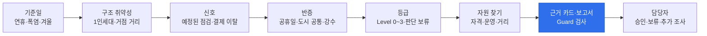

| 단계 | 담당자가 이렇게 하면 | 에이전트가 하는 일 | 대표 도구 |
|---|---|---|---|
| 정기 감시 | 기준일을 고름 (예: 추석 D-7) | 그날의 트리거 계산, 예정된 점검 후보 생성 | `get_calendar_triggers` `get_structure` |
| 이탈 확인 | — (자동) | 과거 자료로 평소 수준을 잡고 결제 하락 경보 | `calc_cohort_deviation` |
| 반증 | — (자동) | 연휴·도시 공통 변화·강수로 설명되는지 검토 | `check_confounders` |
| 등급 | 검토할 수(K)를 정함 | 규칙으로 후보마다 등급, K는 배정에만 적용 | `assign_level` |
| 자원 | 후보를 엶 | 필요 유형 → 자격 → 운영 상태 → 거리 순으로 거르기 | `find_resources` `check_eligibility` |
| 보고서 | 근거를 확인하고 자원마다 판정 | 근거 카드, 설명 문장, 사실·표현 검사 | `build_evidence_card` |
| 질의응답 | "이번 추석 전에 춘천은 어디부터?" | 질문 해석 → 데이터로 답할 수 있는지 검사 → 조사 또는 보류 | `check_request_contract` |
| 승인 | 승인 / 보류 / 추가 조사 | 보고서 판과 맞을 때만 기록, 한 번만 | — |

도구는 모두 **21개**이고, 전부 정해진 계산을 하는 Python 코드입니다. 대부분은 그래프가 정해진 순서로 부르고, LLM이 고를 수 있는 것은 **추가 조사 도구 5개**(`get_mobility_layer`·`get_validation_reference`·`calc_holiday_gap`·`calc_winter_contraction`·`calc_heat_response`)뿐입니다. 실행 기록 파일을 쓰는 `write_run_metadata`는 스크립트 경로에서만 돌고, API 경로는 실행 입력·스냅샷을 상태 DB(`run_metadata` 표)에 남깁니다(코드 커밋 칸은 아직 비어 있음). 목록은 [에이전트 설계](docs/에이전트_설계.md) §5에 있습니다.

---

## 🚦 대응 체계

후보마다 등급이 붙고, 등급마다 누가·어떻게·언제까지 할지가 정해져 있습니다. 위험 점수가 아니라 **먼저 볼 순서**입니다. 자세한 조치표는 [대응 체계](docs/대응_체계.md)에 있습니다.

| 단계 | 뜻 | 담당자가 하는 일 |
|---|---|---|
| **Level 3 · 우선 현장 확인** | 시기별 점검 + 1인세대 비율 상위 + 복지 거점이 멂 | 기한 안에 기존 명단(행복이음 위기정보, 고독사위기대응시스템 배분 명단, 노인맞춤돌봄 대상자)을 먼저 꺼내 전화 안부 → 방문 대상 추리기 |
| **Level 2 · 담당자 확인** | 근거 두 가지가 겹침 | 근거 카드와 다른 원인 확인 결과를 보고 현장 확인 여부 결정 |
| **Level 1 · 변화 관찰** | 근거가 하나뿐이거나 다른 원인으로 설명됨 | 다음 정기 감시와 비교 |
| **Level 0 · 평소 관찰** | 해당 없음 | — |
| **판단 보류 · 자료 더 필요** | 필수 근거가 없거나 결론이 아직 안 남 | 필요한 자료 확보. "이상 없음"으로 처리하지 않음 |

청년 남성은 동을 고르지 않고 **도시 단위 안내 강화** 후보 한 건(문자·SNS·청년 지원 안내)입니다. 1인세대가 많은 동일수록 청년 남성 고립 지표가 오히려 낮아, 동을 고르는 근거가 반대 방향이기 때문입니다(rules-v1.1). 기한은 시점마다 다릅니다: 연휴 준비는 연휴 전날까지, 동절기는 2주 안, 생활 변화 신호는 3일 안.

### 운영 순환

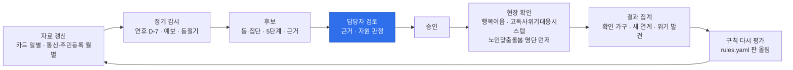

현장 결과는 개인 기록 없이 동·집단별 집계만 받아 다음 연휴 전에 임계값과 시점 규칙을 다시 평가합니다(입력: 승인한 실행의 완료 카드, `POST /runs/{id}/outcomes`. 모아 보기에서 10 미만은 "10 미만"으로 표시). 입력과 집계는 만들었고, 실제 현장 운영으로는 아직 확인하지 않았습니다. 기대효과 숫자는 [기대효과](docs/기대효과.md)에 있습니다.

---

## 🏗 아키텍처

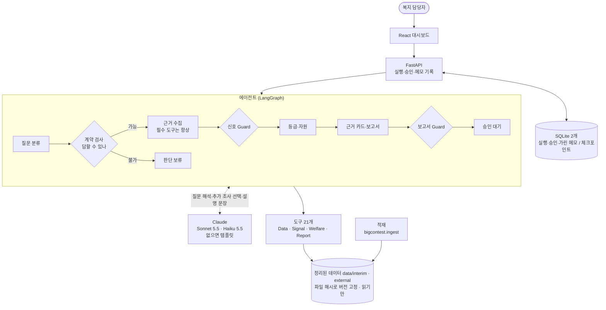

<details>
<summary><b>분기 구조 자세히</b></summary>

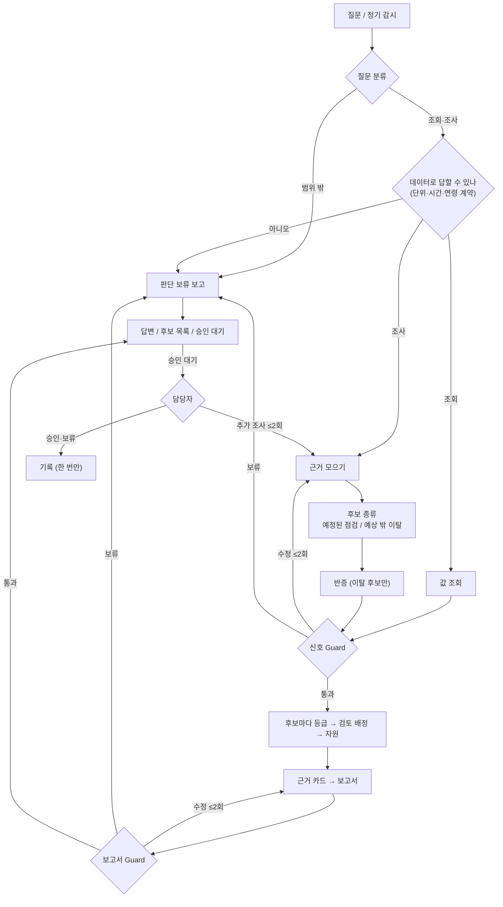

끝나는 지점은 답변, 보류 답변, 후보 목록 발행, 확정, 보류 다섯 가지입니다. 노드 18개의 입력·출력·실패 처리는 [에이전트 설계](docs/에이전트_설계.md)에 있습니다.
</details>

### 설계 원칙

- **판단은 코드, 설명은 LLM** — 신호·후보·등급은 Python과 규칙 파일이 정합니다. LLM은 질문 해석, 추가 조사 선택, 설명 문장만 맡습니다. 같은 요청이면 LLM이 무엇을 고르든, LLM이 없든 등급이 같습니다.
- **판정하지 않는다** — 개인을 찾거나 고립·고독사 확률을 계산하지 않습니다. 동·집단 단위로 "먼저 확인할 곳과 영역"만 제안하고, 최종 판단은 담당자와 현장 판단도구에 맡깁니다.
- **모르면 보류** — 데이터가 지원하지 않는 조합, 기준일 뒤의 자료, 필수 근거 결측은 억지로 답하지 않고 판단 보류와 필요한 자료를 돌려줍니다.
- **숫자는 근거 카드에서만** — 보고서의 사실 문장은 근거 카드에서 템플릿으로 만들고, Guard가 지표·지역·기간·값·단위·방향을 하나씩 대조합니다.
- **기다렸다 이어서** — 승인 대기 중 서버를 다시 켜도 이어집니다. 같은 승인을 두 번 보내도 기록은 하나, 예전 판 보고서에 대한 승인은 거절합니다.

### 🛡 Evidence & Safety Guard

| 검사 | 막는 것 |
|---|---|
| 계약 | 데이터에 없는 조합(연령 × 시간대 등), 기준일 뒤 자료 사용 |
| 사실 | 근거와 다른 숫자·방향·지역·기간·단위 (예: "감소" → "증가", "강원 거주" → "춘천 거주") |
| 표현 | 유동인구를 거주민으로 단정, 개인 진단 문장, 정답 없이 "정확도" 주장, 전국 비율을 지역 확률로 바꾸기 |
| 자원 | 출처·확인일 없는 자원, 관할 밖 거점 추천 |

규칙 14개(G-01~G-14)와 판정 방식은 [설계 문서](docs/설계_문서.md#61-guard-규칙)에 있습니다.

---

## 🗂 활용 데이터

### 제공 데이터

| 데이터 | 단위 | 쓰는 곳 |
|---|---|---|
| SK텔레콤 유동인구 | 50m 칸 × 월 (성·연령 / 시간대 / 요일 표) | 생활권 구성, 춘천 읍·면 겨울 체류 변화 |
| 신한카드 데이터2 (주력) | 가맹점 시군구 × 일 × 업종 × 고객 거주 시도 × 성 × 연령 | 연휴·폭염 시점 신호, 결제 이탈 경보 |
| 신한카드 데이터1 (보조) | 가맹점 시군구 × 일 × 시간대 4구간 × 업종 × 성 × 연령 | 시간대 활동 |

원본은 레포에 올리지 않습니다. 데이터마다 **할 수 있는 말과 하면 안 되는 말**을 정해 코드로 검사합니다. 예를 들어 카드 거주지는 시도까지만 있어서 "춘천 거주"라고 말할 수 없습니다.

### 공공데이터

| 출처 | 받는 정보 | 쓰는 곳 |
|---|---|---|
| **행정안전부** 주민등록 인구·세대 (2025년 7~12월) | 행정동 × 성 × 연령, 1인세대 | 구조 취약성 |
| **서울시** 시민생활 데이터 (OA-22266) | 강남 행정동 × 성 × 연령 고립 관련 집단 | 탐색적 검증 참고 |
| **기상청** ASOS 일자료, 기상특보 | 서울·춘천 기온·강수, 특보 | 폭염·강수 반증과 점검 트리거 |
| **국립중앙의료원** E-Gen 약국·병의원·응급의료기관 | 휴일 운영 정보 | 연휴 점검 자원 |
| **한국사회보장정보원** 복지로 중앙·지자체 서비스 | 자격·신청 방법 | 고립 관련 제도·사업 |
| **행정안전부** 도로명주소 검색·좌표 | 표준 주소, 건물 좌표 | 자원 위치 정제 (승인 대기) |

출처와 수집 방법은 [external/](external/README.md)에 있습니다.

### 복지자원 원장

강남·춘천 복지시설·서비스 745건에 휴일 운영 약국·병의원, 복지로 사업, 노인맞춤돌봄 수행기관 등 323건을 더해 **1,068건**을 정리했습니다. 자원마다 이용 방법(방문·전화·찾아가는 서비스), 좌표 상태, 자격 기준 확인 여부, 운영 상태, 출처·확인일을 둡니다. 모르는 값은 추측하지 않고 "미상 / 확인 필요"로 남깁니다.

---

## 🧰 기술 스택

| 영역 | 기술 | 선택 이유 |
|---|---|---|
| 데이터 | Python 3.13 (uv), DuckDB, pandas, Parquet | 큰 통신·카드 표를 로컬에서 빠르게 집계, 환경 고정 |
| 분석·모델 | robust z / MAD, statsmodels, LightGBM, SHAP, ruptures | 단순 기준선부터 비교하고, 나을 때만 복잡한 모델 채택 |
| 에이전트 | LangGraph + SQLite 체크포인터, Pydantic | 분기·재시도 한도·승인 대기 후 재개를 그래프로 명확히 |
| 규칙 | `configs/*.yaml` (계약·Guard·후보 근거·자원) | 판단 기준을 코드 밖에서 보고 고칠 수 있게 |
| LLM | Claude Sonnet 5.5 (질문 해석·설명), Haiku 5.5 (대량 브리핑) | 구조화 출력, 설명 품질. 없으면 규칙 기반·템플릿으로 같은 경로 |
| 서비스 | FastAPI, React + Vite + TypeScript + Tailwind, Leaflet, Recharts | 화면과 상태 기록을 분리, 담당자 업무 흐름을 한 화면에 |
| 품질 | pytest, Vitest, GitHub Actions, 외부 점검 | 회귀 방지, 작성자 편향 줄이기 |

---

## 🚀 시작하기

```bash
uv sync                                       # 환경 설치 (uv 필요)
uv run python -m bigcontest.ingest            # 대회 원본 zip → data/interim (BC_RAW_DIR 또는 configs/project.yaml 의 raw_dir)
uv run python notebooks/eda6_alarm_reeval.py  # 분석 리포트 다시 만들기 (notebooks/*.py)

uv run uvicorn api.main:app --reload --workers 1   # API (기본은 가짜 데이터, LINKRADAR_BACKEND=real 이면 실제 데이터)
cd web && npm install && npm run dev          # 대시보드 → http://localhost:5173
```

<details>
<summary><b>키 설정</b></summary>

`.env.example`을 `.env`로 복사해 채웁니다(git 제외).

```text
ANTHROPIC_API_KEY=...    # Claude (없으면 규칙 기반·템플릿)
DATA_GO_KR_API_KEY=...   # 공공데이터포털: 기상청·E-Gen·복지로
JUSO_SEARCH_KEY=...      # 도로명주소 검색
JUSO_COORD_KEY=...       # 도로명주소 좌표제공
```

API 인증(선택): 토큰을 주면 인증이 켜집니다. 역할은 조회 < 검토 < 승인이고, 실행·질의응답·이어 묻기(LLM 비용)는 검토 이상입니다.

- `LINKRADAR_API_TOKENS_FILE=<yaml>`: 사람마다 토큰과 이름·역할을 적은 파일(레포에 올리지 않음). 검토·승인 기록은 이 이름으로 남습니다.
- `LINKRADAR_API_TOKEN=<토큰>`: 여럿이 같이 쓰는 공용 토큰. 기본 역할은 **조회**이고 기록 이름은 `공용:<이름>`입니다.

> ⚠ 화면을 빌드할 때 `VITE_API_TOKEN`에 넣은 토큰은 JS 파일에 그대로 들어가 **화면을 여는 누구나 볼 수 있습니다.** 조회 역할 공용 토큰만 넣으세요. 운영(파일럿)에서는 번들에 토큰을 넣지 말고 앞단 프록시(nginx 등)에서 기관 로그인(SSO·LDAP)을 거친 뒤 사람별 토큰을 붙이는 방식을 권합니다. `LINKRADAR_ENV=prod`에서는 공용 토큰에 검토·승인 역할을 주면 서버가 켜지지 않습니다.

질문·메모는 개인정보를 가린 뒤 저장하고, 보존 기한(기본 365일)이 지나면 `uv run python -m api.retention --db data/state/linkradar.sqlite`로 비웁니다. 자세한 것은 [API 명세](docs/API_명세.md) §1에 있습니다.
</details>

---

## ✅ 검증

```bash
uv run pytest -q          # 데이터 계약·경보·Guard·그래프·승인 재개·API
cd web && npm test        # 화면 상태 (Vitest)
```

| 항목 | 결과 |
|---|---|
| pytest | **1,074 통과** (원본 데이터가 없으면 일부 건너뜀, 실제 Claude 호출 시험은 따로 켬) |
| 화면 (vitest) | **114 통과** |
| 하락 폭별 감지 | 2·3·5·10·15·20% 하락의 감지율과 코호트 단위 신뢰구간을 함께 공개 ([EDA-6](reports/eda6_사전경보재평가/)) |
| 시연 사례 D1~D4 | 실제 데이터 도구로 끝까지 동작. 가짜 LLM 6종·LLM 없음·실제 Claude에서 등급이 같음 |
| 모델 비교 | 채택 기준을 비교 전에 고정. STL·LightGBM 미채택, 단순 기준선 유지 |
| 사전 경보 평가 | 미래 자료를 바꿔도 과거 경보가 같은지 테스트로 고정. 독립 재계산과 일치 |
| Guard | 규칙 14개마다 사례, 사실 바꿔치기(감소→증가, 지역·기간·단위·근거 번호) 모두 차단 |
| 승인 재개 | 실제 프로세스를 껐다 켜도 이어짐, 중복·동시 승인 1건 |

고립 정답 데이터가 없으므로 하나의 "정확도"로 합치지 않고, 평가마다 **입증하는 것과 입증하지 못하는 것**을 함께 적습니다.

| 평가 | 입증하는 것 | 입증하지 못하는 것 |
|---|---|---|
| 일부러 넣은 하락 감지 | 정해진 크기의 하락을 얼마나 빨리 잡나 | 실제 고립 탐지율 |
| 기대 활동 예측 | 평소 활동을 얼마나 잘 예측하나 | 고립 예측 |
| 반증 기각률 | 경보 중 달력·공통 요인으로 설명된 비율 | 반증이 맞았는지 |
| 시민생활 지표와 비교 | 구조 지표와 통신 기반 지표의 연관 (강남, 탐색적) | 개인 고립, 등급의 정확도 |

---

## 📁 프로젝트 구조

```text
src/bigcontest/        분석·에이전트 코드 (Python 패키지)
├─ ingest · card · telecom · external · weather   데이터 정리·읽기
├─ signals/            사전 경보, 반증
├─ models/             기대 활동 모델 (기준선·STL·LightGBM)
├─ rules/              후보·등급 규칙, 비교안, 민감도
├─ contracts/          단위·시간·연령·주장 계약
├─ resources/          복지자원 원장, 매칭, 수집
├─ agent/              상태 · 그래프 · 노드 · Guard · 체크포인트 · LLM · 도구
└─ snapshot · runmeta  스냅샷 발행, 실행 기록
api/                   FastAPI (routes → services → store)
web/                   React 대시보드 (Vite + TypeScript + Tailwind)
configs/               규칙·계약·Guard·자원·LLM 설정, 프롬프트 (project.yaml: 원본 위치·공휴일)
notebooks/             분석 스크립트 → reports/ 리포트
reports/               분석 리포트 (README + 그림 + 집계 표)
external/  ref/        공공데이터 원본·출처, 행정동 코드표·경계
docs/                  설계·명세·설명 자료
scripts/               점검 스크립트 (리포트 CSV에 원천 값이 없는지)
tests/                 pytest (원본 데이터가 없으면 일부 건너뜀)
```

## 📚 문서

| 주제 | 문서 |
|---|---|
| 설계 | [설계 문서](docs/설계_문서.md) · [아키텍처](docs/아키텍처.md) · [에이전트 설계](docs/에이전트_설계.md) · [화면 설계](docs/화면_설계.md) |
| 명세 | [API 명세](docs/API_명세.md) · [데이터 모델](docs/데이터_모델.md) · [데이터 설명](docs/데이터_설명.md) |
| 설명 자료 | [LLM 활용 설명](docs/LLM_사용.md) · [가상 데이터 설명](docs/가상데이터_설명.md) · [LINK-Sim 생성 방식](docs/LINK-Sim_생성방식.md) · [제3자 자료·라이선스](NOTICE.md) |
| 제안 | [대응 체계](docs/대응_체계.md) (5단계 조치표·운영 순환) · [기대효과](docs/기대효과.md) · [불확실성 표](docs/불확실성_표.md) · [발표 스토리](docs/발표_스토리.md) |
| 진행 | [개발 과정](docs/개발_과정.md) (만든 순서·바꾼 결정·한계·다음 할 일) |
| 분석 | [리포트 목록과 그림 모음](reports/README.md) |
| 성과물 | [위험 지표 정의서](docs/위험_지표.md) · [위험도 결과표](reports/r2_위험도결과/README.md) · [모델링 결과](reports/m3_모델링결과/README.md) · [자원 추천 평가](reports/w2_자원추천평가/README.md) · [데이터 역할](docs/데이터_역할.md) · [성과물 대응표](docs/성과물_대응표.md) · [재현 안내](REPRODUCE.md) |

## ⚠️ 한계

- 데이터가 6개월뿐이라 매년 반복되는 계절 변화인지 확인할 수 없습니다. 연휴 효과는 추석 한 번만 봤습니다.
- 80대 이상은 표본이 작아 작은 변화는 잘 잡히지 않습니다. 예정된 점검으로 보완합니다.
- 시민생활 데이터는 강남에만 있고 동이 22개라 강한 관계만 확인할 수 있습니다. 통신사 추정치라 완전히 독립된 출처도 아닙니다.
- 날씨는 관측소 한 곳(서울·춘천) 값이라 동별 날씨가 아닙니다. 카드 데이터에서 행이 없는 날은 0건으로 가정합니다.
- 개인을 찾거나 판정하지 않고, 복지 조치를 자동으로 실행하지 않습니다. 의도된 경계입니다.

## 📄 라이선스

- 코드는 [MIT 라이선스](LICENSE)입니다. 코드에만 적용됩니다.
- 대회 제공 데이터(SK텔레콤 통신, 신한카드)는 레포에 없고 재배포할 수 없습니다.
- `external/`, `ref/`의 공공데이터는 각 원본의 이용 조건(공공누리 등)을 따릅니다. 행정동 경계(`ref/adm_boundary.geojson`)는 vuski/admdongkor, CC BY 4.0입니다. 자세한 것은 [NOTICE](NOTICE.md)에 있습니다.
