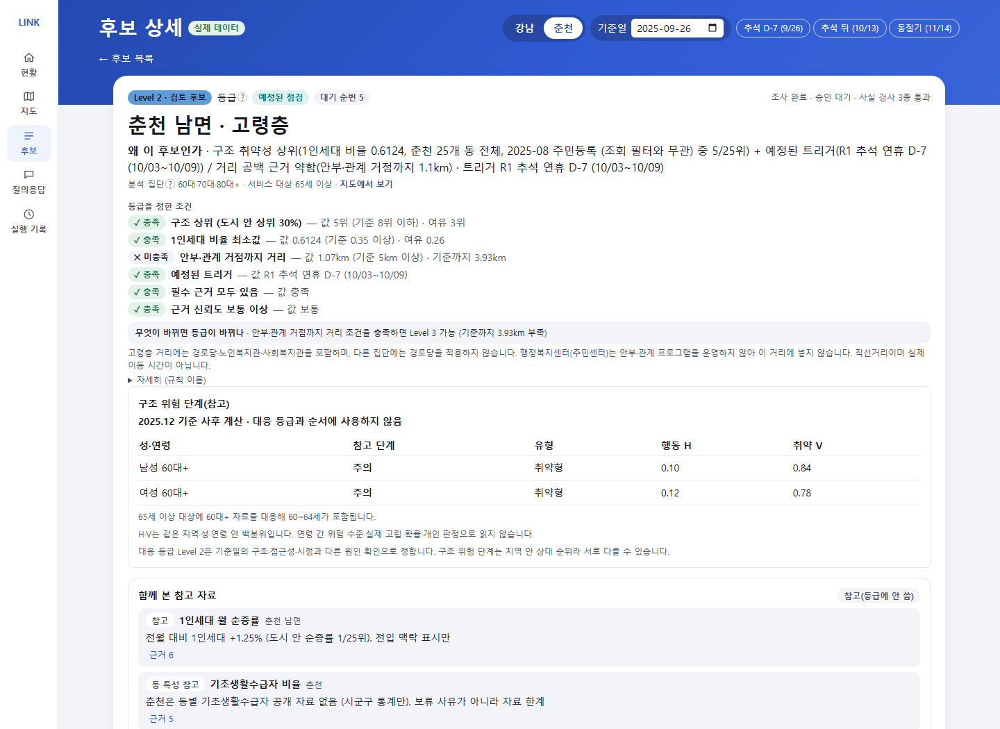
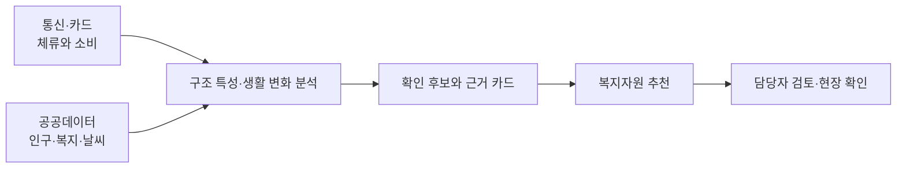

<div align="center">

# 📡 LINK-Radar

### 신고되기 전에, 먼저 살펴볼 곳을.

사회적 고립 예방을 위한 복지 담당자용 AI 에이전트


2026 빅콘테스트 · AI데이터 활용 분야

[프로젝트 소개](#about) · [서비스 화면](#demo) · [활용 데이터](#data) · [분석](#analysis) · [실행 방법](#run) · [프로젝트 구조](#structure)

</div>

<a id="about"></a>

## 사회적 고립에서 출발합니다

**사회적 고립은 개인·집단·지역사회 등 여러 수준에서 다른 사람과 맺는 관계의 양과 질이 부족한 상태입니다.** 혼자 사는지뿐 아니라, 누구와 연결되어 있고 필요할 때 도움을 받을 수 있는지를 함께 살펴야 합니다. [Zavaleta, Samuel & Mills (2017)](https://doi.org/10.1007/s11205-016-1252-2)

LINK-Radar는 이 관점을 바탕으로 통신·카드 집계 자료에서 지역과 집단의 생활 변화를 살피고, 복지 담당자가 **어디를·누구를·언제 먼저 확인할지**, **어떤 지원을 연결할지** 제안합니다.

| 사회적 고립을 보는 관점 | 분석과 서비스에 반영한 방식 |
|---|---|
| **외로움과 사회적 고립을 구분** | 감정을 추정하기보다 체류·외출·소비 등 관찰할 수 있는 생활 양상을 분석 |
| **관계의 양과 질을 함께 고려** | 데이터로 살핀 활동 양상에 복지자원·현장 확인을 연결 |
| **개인을 넘어 집단·지역 수준에서 접근** | 동네 × 성별 × 연령 집단별로 특성을 비교 |
| **지리적으로 먼 것과 관계가 부족한 것을 구분** | 동 규모·상업성·계절 방문객을 보정하고, 서비스 접근성은 별도로 확인 |

사회적 고립과 외로움의 개념 구분은 [NASEM (2020)](https://www.nationalacademies.org/read/25663/chapter/4)을 따릅니다.

<a id="demo"></a>

## 🖥 서비스 화면

**현황 확인 → 후보 조사 → 근거 검토 → 자원 연결 → 담당자 결정**을 하나의 화면 흐름으로 제공합니다. [데모 실행하기](#run)

| 화면 | 핵심 기능 |
|---|---|
| **현황** | 점검 시점, 먼저 볼 후보, 후속 확인 일정과 현장 결과 집계 |
| **지도** | 행정동별 구조 특성·행동 신호와 복지자원 위치 확인 |
| **후보 목록** | 집단·등급·후보 종류별 조회와 검토 대상 선택 |
| **후보 상세** | 등급 조건·분석 근거 검토, 추가 조사, 자원별 자격·운영 확인, 승인·보류, 인쇄 |
| **질의응답** | 질문에 맞는 자료 조회·조사와 이어 묻기 |
| **실행 기록** | 조사·검토·승인 이력 조회와 이전 작업 이어가기 |



후보 상세에서 등급을 정한 조건과 성·연령별 분석 근거를 함께 확인합니다.

<a id="data"></a>

## 🗂 활용 데이터

통신·카드는 **생활 양상과 변화**, 공공데이터는 **인구·생활 여건과 비교 기준**, 복지자원은 **지원 연결**에 사용합니다.

| 구분 | 데이터 | 주요 활용 |
|---|---|---|
| **통신** | SK텔레콤 유동인구: 격자·월별 성·연령, 시간대, 요일 자료 | 체류 특성, 상업성 보정, 계절별 생활권 변화 |
| **소비** | 신한카드 데이터1·2: 일별 업종·성·연령·시간대별 결제 자료 | 연휴 의료·생필품 소비 공백, 생활 변화 신호 |
| **인구·가구** | 행정안전부 주민등록 인구, 세대원수별 세대수, 성·연령별 1인세대수 | 집단별 인구와 혼자 사는 비율, 구조 취약성 |
| **사회·복지 지표** | 서울 시민생활, 기초생활수급·기초연금·장애인·인구 이동 자료 | 사회경제 취약성 구성과 지표 교차 검증 |
| **환경·시점** | 기상청 ASOS, 공휴일 달력 | 기온·강수·계절·연휴에 따른 활동 변화 해석 |
| **복지·의료 자원** | 복지로, E-Gen, 지자체 시설·사업·경로당 현황, 도로명주소 좌표 | 대상·자격·운영·거리별 자원 추천 |

제공 데이터의 분석 기간은 **2025년 7~12월**, 분석 지역은 **서울 강남구·강원 춘천시**입니다. 자료별 집계 단위와 출처는 [데이터 설명](docs/데이터_설명.md), [외부 데이터 목록](external/README.md)에 정리했습니다. 대회 제공 원본은 저장소에 포함하지 않습니다.

<a id="analysis"></a>

## 🔎 분석에서 현장 검토까지



### 행동과 생활 여건을 나누어 봅니다

| 행동 고립 H | 사회경제 취약 V |
|---|---|
| 비슷한 규모·상업성의 동과 비교한 체류 특성, 겨울 체류 유지 | 성·연령별 혼자 사는 비율과 공공부조 수급 |
| 생활권 안에서 어떻게 활동하는가 | 어떤 생활 여건에 놓여 있는가 |

두 축을 함께 살펴 **이중 위험·행동형·취약형·저위험**으로 구분하고, 동·성·연령별 470개 집단을 비교합니다. 후보 상세에는 구조 위험 단계와 이번 점검의 대응 등급을 함께 표시합니다. [2축 분석](reports/t1_2축위험도/README.md)

### 생활 변화가 지원으로 이어지는 지점

| 분석에서 살핀 현상 | 서비스에 반영한 방식 |
|---|---|
| 연휴 동안 줄어드는 의료 결제와 이후 장보기 회복 | 연휴 전 점검과 연휴 뒤 회복 확인 |
| 읍·면의 겨울 체류 변화와 자원 접근성 | 동절기 점검과 전화·찾아가는 자원 검토 |
| 같은 날 도시 전체가 함께 줄어드는 결제 | 공휴일·날씨·도시 공통 변화 등 다른 원인 확인 |
| 성·연령 집단별로 다른 소통·외출 양상 | 집단별 구조 지표와 지원 유형 비교 |

[생활 공백 분석](reports/eda5_인사이트재현/README.md) · [경보 평가](reports/eda6_사전경보재평가/README.md) · [지표 교차 검증](reports/t2_교차검증/README.md) · [집단별 지표 비교](reports/t1_5_집단별S1/README.md)

### 분석·서비스 검증

| 항목 | 검증 내용 | 결과 |
|---|---|---|
| **2축 모델** | 사전 등록한 구성·독립성·안정성 기준 | 19개 중 18개 충족 |
| **생활 변화 경보** | 집단 결제에 15% 하락을 넣은 합성 실험 | 736/817 감지, 약 90% |
| **복지자원 추천** | 고정한 규칙 정답 30쌍 | k-정규화 Recall@5 0.6733 |
| **기능 검증** | 데이터 계약·에이전트·API·화면 | Python 1,160개, 웹 139개 시험 통과 |
| **결과 재현** | 리포트 CSV 해시 대조 | 122개 일치 |

평가 방법과 세부 결과는 [분석 리포트](reports/README.md), 재현 절차는 [REPRODUCE.md](REPRODUCE.md)에 있습니다.

## 🏗 에이전트 구성

React 화면과 FastAPI를 연결하고, LangGraph로 **질문 해석·자료 조회·추가 조사·보고서 생성·승인 대기**를 관리합니다. 신호·등급·추천 기준은 Python과 설정 파일로 계산하며, Claude는 질문 해석과 설명을 돕습니다.

| 역할 | 구성 |
|---|---|
| 데이터 처리·분석 | Python, DuckDB, pandas, Parquet, statsmodels, LightGBM |
| 에이전트 | LangGraph, Pydantic, Claude API |
| 서비스 | FastAPI, React, TypeScript, Vite, Tailwind CSS |
| 지도·차트 | Leaflet, Recharts |
| 상태·이력 | SQLite, LangGraph 체크포인트 |
| 품질 검증 | pytest, Vitest, GitHub Actions |

자세한 흐름은 [아키텍처](docs/아키텍처.md), [에이전트 설계](docs/에이전트_설계.md), [대응 체계](docs/대응_체계.md)를 참고하세요.

<a id="run"></a>

## 🚀 실행 방법

Python 3.13 이상, uv, Node.js와 npm이 필요합니다.

### 화면 데모

레포 루트에서 API를 실행합니다.

```bash
uv sync --frozen
uv run uvicorn api.main:app --reload --workers 1
```

다른 터미널에서 화면을 실행합니다.

```bash
cd web
npm ci
npm run dev
```

**http://localhost:5173**에서 확인할 수 있습니다. 기본 모드는 화면 시연용 샘플 데이터를 사용하며, 원본 자료나 API 키가 필요하지 않습니다.

<a id="real-data"></a>

### 실제 데이터 연결

대회 원본 zip 두 개를 `data/raw/`에 두거나 `BC_RAW_DIR`로 경로를 지정하고 정리본을 만듭니다.

```bash
uv run python -m bigcontest.ingest
```

API를 종료한 뒤 실제 데이터 모드로 다시 실행합니다.

```powershell
# PowerShell · 레포 루트
$env:LINKRADAR_BACKEND = "real"
$env:LINKRADAR_TOOLS = "real"
$env:LINKRADAR_LLM = "none"
uv run uvicorn api.main:app --reload --workers 1
```

<details>
<summary>macOS / Linux</summary>

```bash
LINKRADAR_BACKEND=real LINKRADAR_TOOLS=real LINKRADAR_LLM=none \
uv run uvicorn api.main:app --reload --workers 1
```

</details>

Claude를 연결하려면 `ANTHROPIC_API_KEY`를 설정하고 `LINKRADAR_LLM=claude`로 실행합니다. LLM 없이도 규칙 계산과 템플릿 보고서를 사용할 수 있습니다. 원본 파일명·전체 분석 재현은 [재현 안내](REPRODUCE.md), API 설정은 [API 명세](docs/API_명세.md)에 있습니다.

<a id="structure"></a>

## 📁 프로젝트 구조

```text
analysis/          2축 구조 위험도·연령 가설 분석 노트북과 재현 코드
notebooks/         생활 신호·등급·모델 비교·교차 검증 스크립트
reports/           분석 결과·검증 리포트·그림
src/bigcontest/    데이터 처리·신호·모델·등급·자원·에이전트 코드
api/               FastAPI와 실행·검토·승인 기록
web/               React 서비스 화면
configs/           분석·등급·자원·LLM 설정
external/  ref/    공개 자료·출처·행정동 코드와 경계
evaluation/        추천 평가·사용자 비교 평가 자료
tests/             Python 시험
scripts/           재현·데이터 점검 스크립트
docs/              설계·명세·데이터 설명
```

## 📚 문서

| 주제 | 문서 |
|---|---|
| 분석 | [전체 리포트](reports/README.md) · [분석 노트북](analysis/taeyeon_2axis/README.md) · [위험 지표](docs/위험_지표.md) |
| 서비스 | [화면 설계](docs/화면_설계.md) · [에이전트 설계](docs/에이전트_설계.md) · [API 명세](docs/API_명세.md) |
| 데이터 | [데이터 설명](docs/데이터_설명.md) · [외부 자료 출처](external/README.md) · [부가 데이터](docs/부가데이터_정의.md) |
| 재현 | [재현 안내](REPRODUCE.md) · [숫자 사용 기준](docs/숫자_사용_기준.md) |

## 📄 라이선스

코드는 [MIT 라이선스](LICENSE)를 따릅니다. 대회 제공 데이터는 재배포하지 않으며, 공개 자료의 이용 조건은 [NOTICE](NOTICE.md)에 정리했습니다.
