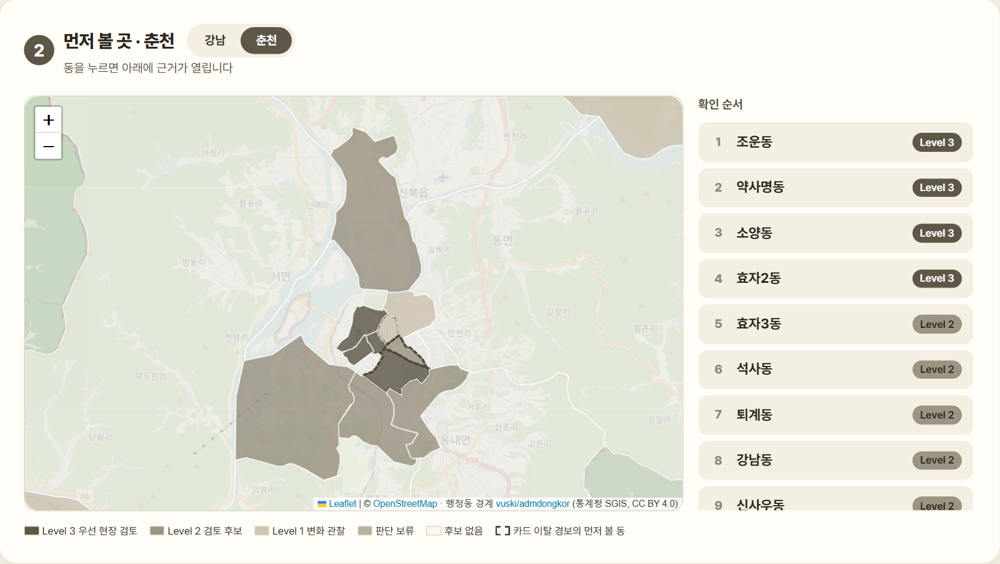
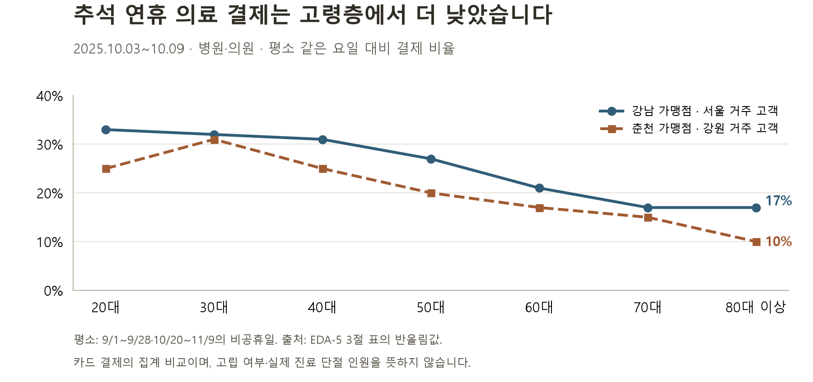
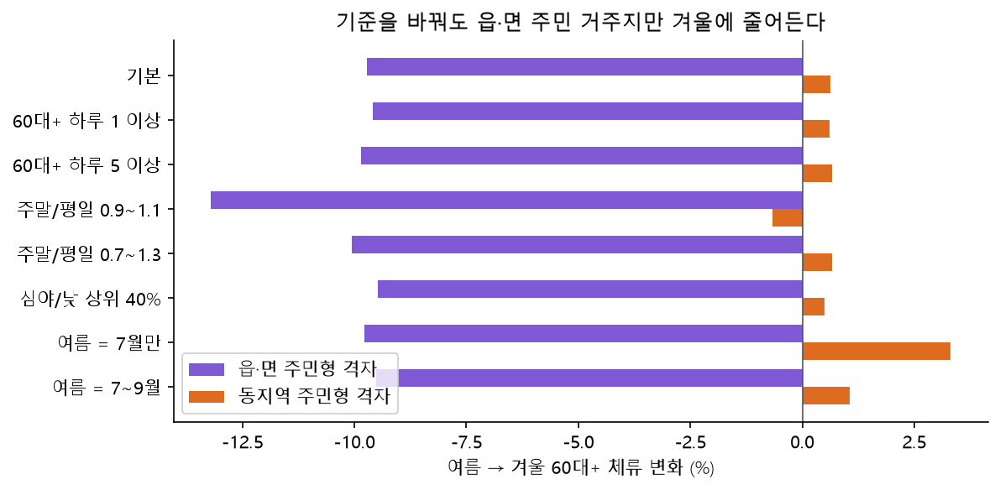
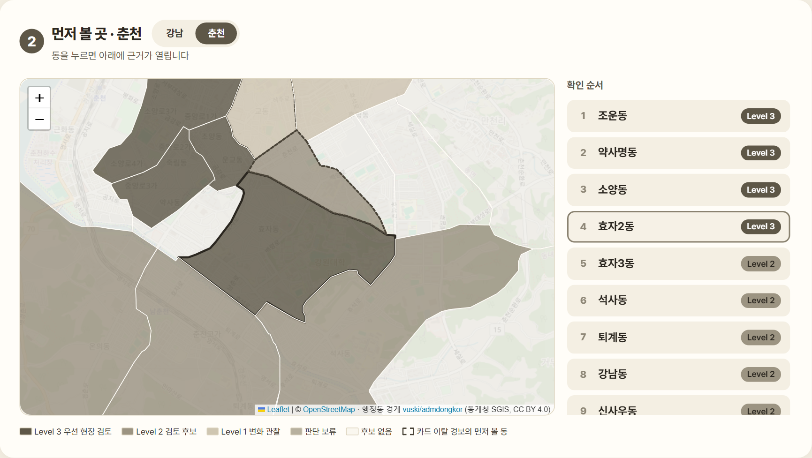
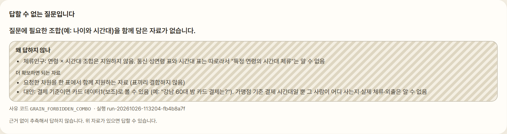
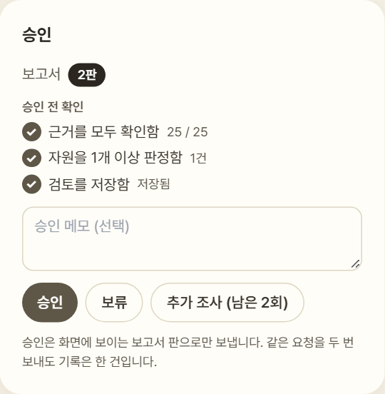
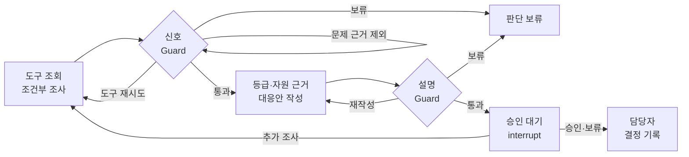

<div align="center">

# LINK-Radar

### 신고되기 전에, 먼저 살펴볼 곳을.

통신·소비·공공데이터로 복지 담당자의 지역·집단·시점별 점검을 돕는 **근거 기반 AI 에이전트**

2026 빅콘테스트 · AI데이터 활용 분야

**[서비스 둘러보기](https://link-radar-virid.vercel.app/?as_of=2025-09-26&city=춘천)** · [로컬 실행](#run) · [분석·검증 문서](reports/README.md)

공개 데모는 2025년 집계 결과를 조회합니다. 조사·검토 저장·승인은 로컬 전체 앱에서 제공합니다.

[소개](#about) · [접근](#approach) · [핵심 발견](#findings) · [작동 방식](#workflow) · [시연](#demo) · [에이전트](#agent) · [검증](#validation) · [실행·문서](#run)

</div>

<a id="about"></a>

## 프로젝트 소개

> 사회적 고립을 직접 관측할 수 없다면, 지역과 집단의 생활 변화에서 먼저 확인해야 할 신호를 찾을 수 있지 않을까?

LINK-Radar는 통신의 **체류 양상**, 카드의 **소비 변화**, 공공 통계의 **생활 여건**을 함께 살펴 **언제, 어디를, 누구부터 확인할지** 제안합니다.

에이전트는 질문에 맞는 자료와 도구를 선택하고, 추가 조사·근거 정리·자원 추천을 거쳐 담당자의 검토와 승인으로 연결합니다. **등급은 코드가 계산하고, LLM은 질문 해석과 근거 설명을 맡습니다.**

[](https://link-radar-virid.vercel.app/?as_of=2025-09-26&city=춘천)

<a id="approach"></a>

## 문제와 접근 방식

**사회적 고립은 개인·집단·지역사회 수준에서 다른 사람과 맺는 관계의 양과 질이 부족한 상태입니다.** 혼자 사는지뿐 아니라, 누구와 연결되어 있고 필요할 때 도움을 받을 수 있는지를 함께 살펴야 합니다. [Zavaleta, Samuel & Mills (2017)](https://doi.org/10.1007/s11205-016-1252-2)

이 프로젝트의 집계 자료에는 개인의 관계망이나 실제 고립 여부가 없습니다. 그래서 **생활 변화와 취약 여건이 겹치는 지역·집단을 좁히고, 현장 확인에 필요한 근거를 제공**합니다. 외로움이라는 주관적 경험과 사회적 접촉의 부족도 구분합니다. [NASEM (2020)](https://www.nationalacademies.org/read/25663/chapter/4)

**기존 복지체계의 선제 발굴·사례관리에 지역·집단·시점별 점검 근거를 더하는 보완 도구**로 설계했습니다. 담당자는 기존 돌봄·사례관리 명단과 함께 검토하고 현장 확인으로 이어갑니다.

| 원칙 | 서비스에 담은 방식 |
|---|---|
| **어디·누구·언제** | 읍·면·동 × 성별 × 연령 집단을 비교하고, 연휴·계절에 맞춰 점검 시점을 제안 |
| **근거와 반대 근거를 함께** | 생활 변화뿐 아니라 날씨·공휴일·도시 공통 변화 등 다른 설명도 확인 |
| **판단은 담당자** | 담당자가 근거와 자원의 자격·운영 조건을 검토하고 현장 확인과 지원 연결을 결정 |

<a id="findings"></a>
<a id="insights"></a>

## 핵심 발견

**같은 활동 감소도 도시·집단·시점에 따라 다르게 읽어야 했습니다.** 2025년 7~12월 강남·춘천 자료에서 확인한 차이를 점검 방식에 반영했습니다.

| 데이터에서 발견한 차이 | 에이전트에 반영한 점 |
|---|---|
| **도시·계절** · 춘천 읍·면의 주민형 격자에서 60대 이상 겨울 체류 −9.7%, 동지역 +0.6% | 동절기 점검을 춘천 읍·면에 두고 해당 읍·면의 감소 근거를 확인 |
| **성·연령** · 강남 중장년 1인가구 중 소통이 적은 비율은 남 15.5%, 여 8.5% | 같은 도시·성·연령 안에서 비교하고 집단별 지원 필요를 구분 |
| **날씨** · 33℃ 이상 폭염일의 80대 이상 생필품 결제는 평소보다 강남 −4.9%, 춘천 −5.3% | 활동 감소를 해석할 때 날씨와 도시 공통 변화를 함께 확인 |
| **연휴** · 추석 연휴 병·의원 결제는 80대 이상에서 평소의 10~17% 수준 | 고령층의 연휴 전 안부 확인과 진료기관·약국 안내를 제안 |

[도시별 체류 비교](reports/eda2_통신기초/README.md) · [집단·날씨·연휴 분석](reports/eda5_인사이트재현/README.md) · [2축 분석](reports/t1_2축위험도/README.md) · [규칙에 반영한 근거](reports/r3_규칙개정/README.md)



평소 같은 요일과 비교한 **결제 비율**입니다. 가맹점 도시 × 고객 거주 시도 기준이며, 방문 인원이나 실제 진료 단절 인원이 아닙니다. [분모·기간·원표](reports/eda5_인사이트재현/README.md) · [그래프 생성](scripts/readme_assets.py)

<details>
<summary>겨울 체류 감소는 분석 조건을 바꿔도 유지되는가?</summary>



주민형 격자 조건과 여름 기준을 바꿔도 읍·면의 60대 이상 겨울 체류 감소 방향은 유지됐습니다. 2025년 한 해의 관측입니다. [분석 조건과 결과](reports/eda5_인사이트재현/README.md)

</details>

<a id="workflow"></a>

## LINK-Radar 작동 방식

**신호 추출·다른 원인 확인 → 대응 등급·확인 순서 → 근거 카드·자원·대응안 → 담당자 검토**

활동 양상과 생활 여건을 나누어 **47개 읍·면·동 × 성별 2개 × 연령 5개 = 470칸**을 비교합니다. 통신은 확인할 지역을, 카드는 확인할 성·연령의 근거를 제공합니다. 공공 통계는 Level 3의 추가 확인 조건과 같은 등급 안 순서에 사용합니다.

<a id="levels"></a>
<a id="대응-등급"></a>

| 대응 등급 | 의미 | 담당자가 할 일 |
|---|---|---|
| **Level 3 · 우선 현장 확인** | 점검 시기 + **H·W·C 중 2개 이상** + **S·V·A 중 1개 이상** | 기존 돌봄·사례관리 명단에서 해당 집단을 우선 안부 확인 |
| **Level 2 · 담당자 확인** | 통신 근거가 있음. 카드 이탈은 다른 원인 검사도 통과해야 함 | 근거와 연계 자원을 보고 현장 확인 여부 결정 |
| **Level 1 · 변화 관찰** | 동을 가리킬 통신 근거가 없거나 다른 원인으로 설명됨 | 다음 기준일과 비교 |
| **Level 0 · 평소 관찰** | 점검 시기가 아님 | 정기 모니터링 |
| **판단 보류** | 필수 자료가 없거나 다른 원인 확인이 끝나지 않음 | 자료를 확보하고 다시 검토 |

H(행동 고립)·W(겨울 체류 감소)는 SK 통신, C(연휴 결제 공백)는 신한카드의 신호입니다. 동절기에는 **H+W 조합으로 생활 신호 2개 조건을 충족**할 수 있습니다. S·V·A는 1인 비율·경제 취약·거점 거리입니다.

<details>
<summary>신호별 역할과 불확실한 근거의 처리 · rules-v2.0</summary>

| 신호 | 자료와 역할 |
|---|---|
| 행동 고립 H | SK 통신: 비슷한 동보다 그 성·연령이 동네에 오래 머무는지 |
| 겨울 체류 감소 W | SK 통신: 춘천 해당 읍·면 고령층의 겨울 체류가 줄었는지 |
| 연휴 결제 공백 C | 신한카드: 지난 연휴 고령층 의료 결제가 40·50대보다 더 끊겼는지. 단독으로 동을 정하지 않음 |
| 1인 비율 S · 경제 취약 V · 거점 거리 A | 주민등록·수급 통계·자원 원장: Level 3의 추가 확인과 같은 등급 안 순서 |

- 추석 전인 9월 26일에는 이미 끝난 **광복절**의 카드 자료를 사용합니다. 연휴 7일 전 점검은 기관이 명단을 확인할 시간을 둔 운영 가정입니다.
- H·S는 성·연령별로 강남 시민생활의 '외출·소통 적음'과 방향을 비교했습니다. 방향 미확인 신호는 Level 3 근거에서 제외하고 담당자 검토에 남깁니다. W·C·V·A에는 이 검사를 적용하지 않았습니다.
- 필수 근거가 빠지면 판단 보류로, 일부 자료만 있거나 신뢰도가 낮으면 Level 2 이하로 제한합니다. 청년층도 같은 규칙을 적용합니다.

[대응 체계](docs/대응_체계.md) · [판정 코드](src/bigcontest/rules/levels_v2.py) · [규칙 설정](configs/rules_v2.yaml)

</details>

<a id="demo"></a>

## 서비스 시연: 추석 전 춘천 효자2동

**2025-09-26, 연휴 7일 전 → 먼저 볼 동 선택 → 근거 확인 → 자원 검토**를 하나의 사례로 보여 줍니다.

**① 어디부터 볼까?** 동별 대응 등급과 후보 목록을 함께 보고 효자2동을 선택합니다.



**② 왜 이곳일까?** 고령층의 행동·결제 신호와 생활 여건을 함께 확인합니다. 분석 집단과 실제 서비스 대상의 연령 차이도 표시합니다.


**③ 무엇을 연결할까?** 공식 안내에서 자격·운영 조건을 확인하고, 운영시간을 더 확인할 자원은 보류합니다. 메모와 후속 확인일을 남긴 뒤 대응안을 검토합니다.


위 캡처는 **실제 집계 자료를 사용한 로컬 전체 앱**입니다. 자원 판정·메모는 시연용 입력 예시입니다. **[공개 데모](https://link-radar-virid.vercel.app/?as_of=2025-09-26&city=춘천)**는 사전 계산한 지도·후보 근거와 질문 기능을 제공합니다.

<details>
<summary>근거가 없는 질문의 보류 · 담당자 결정 화면</summary>

**“강남 60대의 밤 체류는?”** 통신의 연령별 표와 시간대별 표가 따로 있어 이 조합을 계산할 수 없습니다. 필요한 자료와 카드 결제를 통한 대안을 안내합니다.



검토한 대응안의 판과 확인 상태를 보고 **승인·보류·추가 조사** 중 다음 행동을 선택합니다.



</details>

<a id="agent"></a>

## AI 에이전트 설계

LangGraph가 **질문 해석 → 도구 선택·조회 → 필요 시 추가 조사 → 근거·대응안 생성 → 승인 대기**를 관리합니다. 단순히 수치를 보여 주는 데서 끝나지 않고, 담당자가 근거를 확인하고 결정할 수 있는 작업 흐름으로 연결합니다.

아래는 **조사 요청의 주요 분기**입니다. 단순 조회는 등급 계산·승인 대기를 거치지 않고, Guard를 통과한 답을 반환합니다.



[실제 분기 코드](src/bigcontest/agent/graph.py) · [데이터 계약](configs/grain_contract.yaml) · [판정 규칙](configs/rules_v2.yaml)

| 역할 | 맡는 일 |
|---|---|
| **LLM** | 질문을 자료 요청으로 정리하고, 필요한 추가 조사를 제안하며 근거 설명을 작성 |
| **코드·도구** | 자료 계약 검사, 지표·등급 계산, 다른 원인 확인, 자원 추천과 설명 검사 |
| **담당자** | 자원별 자격·운영 검토, 대응안 승인·보류·추가 조사, 현장 확인 결과 기록 |

로컬 전체 에이전트에는 네 가지 Guard 검사를 둡니다.

| 검사 | 확인하는 내용 |
|---|---|
| **데이터 계약** | 요청한 지역·연령·시간대가 자료에 있는지, 집계 단위와 조합이 가능한지 |
| **사실** | 숫자·방향·지역·기간·단위·근거 ID가 근거 카드와 맞는지 |
| **표현** | 체류를 거주로 단정하거나 개인 진단·근거 없는 정확도를 주장하는지 |
| **자원** | 출처·지역·대상·확인일이 있는지. 미확인 자격·운영 조건은 담당자에게 표시 |

공개 데모의 질문창은 배포된 근거 요약을 바탕으로 답하고, 근거에 없는 숫자를 거르는 별도 경로입니다. 위 전체 조사·승인 흐름과 구분합니다. [아키텍처](docs/아키텍처.md) · [에이전트 설계](docs/에이전트_설계.md)

<a id="validation"></a>
<a id="모델링-결과"></a>

## 검증과 성과

**실제 자료에서 확인할 범위를 좁혔는지, 합성 자료에서 변화를 감지하는지, 같은 결과를 재현하는지를 나누어 확인했습니다.**

| 확인한 것 | 결과 | 해석 범위 |
|---|---|---|
| **실제 자료의 우선 확인 범위** | 추석 D-7 Level 3는 강남 22개 동 중 4개, 춘천 25개 동 중 4개 | 해당 날짜·규칙의 점검 범위. 업무시간 절감·고립 발견 실적과 구분 |
| **합성 하락 탐지** | 15% 하락 주입 실험에서 **753/814쌍(92.5%)** 새로 감지 | 대조에서 경보가 없던 쌍이 분모. **실제 고립 발견 정확도가 아님** |
| **자원 추천** | 고정 규칙 정답 30쌍에서 k-정규화 Recall@5 **0.6733** | 실제 자격·운영과 현장 연계 성공률은 별도 확인 |
| **기능·재현성** | 웹 시험 **170개 통과**, 결과 CSV 해시 **143개 일치** | 화면 오류 경로와 저장된 결과 파일의 일관성 점검 |

최신 수치는 **rules-v2.0** 기준입니다. 과거 v1.1의 736/817(90.1%)은 비교용 기록으로 구분합니다. [최신 수치와 조건](docs/숫자_사용_기준.md) · [합성 경보 평가](reports/m3_모델링결과/README.md) · [v2.0 실제 자료 결과](reports/r3_규칙개정/README.md)

<details>
<summary>모델·민감도 검증과 해석할 때의 한계</summary>

- **2축 구성 검증:** 사전 등록한 구성·독립성·안정성 19개 기준 중 18개 충족. 실제 고립 정답과의 정확도 검증은 아닙니다.
- **LINK-Sim:** 선택·평가를 나누어 평가 정답 19개 중 14개 감지(이전 기준 13개), 배경 경보율 4.11%. 위 15% 하락 주입 실험과 별개입니다. 한 건 차이여서 성능 개선을 확정하지 않습니다.
- **M4 위험 요인 비교:** 강남 시민생활의 '외출·소통 적음' 상위 동(60세 이상)을 1인세대 비율로 비교한 AUC 0.75(95% CI 0.64~0.83). 22개 동의 대리 지표 비교이며 등급에 직접 사용하지 않습니다.
- **민감도:** 상위 비율을 25~40%로 바꾸면 Level 3 칸은 강남 5~7, 춘천 9~26. 춘천은 기준값에 민감합니다. 화면의 후보 수 범위와 별도 분석입니다.
- 연휴 연령과 일부 규칙은 2025년 결과를 보고 정했습니다. 다음 명절·새 기간 자료로 검증해야 합니다. 동절기 H·W는 같은 통신 자료에서 나왔고, S의 작은 동 편향과 강남에서 확인한 방향을 춘천에 적용하는 제약도 있습니다.
- 통신은 60대 이상이 한 묶음이고 카드는 동 단위가 아닙니다. 자원은 2026년 원장이므로 2025년 운영 여부와 현재 이용 조건은 별도로 확인합니다. 실제 고립 여부는 현장 확인이 필요합니다.

[전체 분석](reports/README.md) · [규칙 개정·민감도](reports/r3_규칙개정/README.md) · [기대효과 계산](notebooks/r3d_impact.py) · [모델 비교](reports/m3_모델링결과/README.md)

</details>

<a id="run"></a>

## 실행·재현·문서

**[설치 없이 데모 보기](https://link-radar-virid.vercel.app/?as_of=2025-09-26&city=춘천)** — 2025년 하반기 184일 × 두 도시의 사전 계산된 집계 결과를 조회합니다. '오늘 기준'도 오늘의 월·일을 2025년 자료에 대입한 결과이며 실시간 관측값이 아닙니다.

**기술 스택:** Python·DuckDB·pandas / LangGraph·Pydantic·Gemini API / FastAPI·React·TypeScript / Leaflet·Recharts / SQLite

<details>
<summary>활용 데이터와 집계 단위</summary>

분석 기간은 **2025년 7~12월**, 지역은 **서울 강남구·강원 춘천시**입니다.

| 구분 | 데이터 | 주요 활용 |
|---|---|---|
| 통신 | SK텔레콤 격자·월별 성·연령, 시간대, 요일 자료 | 동별 체류 특성·상업성 보정·계절 변화 |
| 소비 | 신한카드 데이터1·2의 일별 업종·성·연령·시간대별 결제 | 연휴 소비 공백·평소와 다른 생활 변화 |
| 인구·가구 | 행안부 주민등록 인구·세대원수별 세대수·성연령별 1인세대수 | 집단별 인구·혼자 사는 비율 |
| 사회·복지 | 서울 시민생활, 수급·기초연금·장애인·인구 이동 자료 | 생활 여건과 지표 교차 검증 |
| 환경·시점 | 기상청 ASOS·공휴일 달력 | 날씨·요일·계절·연휴에 따른 변화 해석 |
| 복지·의료 자원 | 복지로·E-Gen·지자체 시설·사업·경로당·주소 좌표 | 자격·운영·대상·거리별 자원 추천 |

카드는 도시 × 성 × 연령 자료이므로 특정 동의 결제량으로 해석하지 않습니다. [데이터 설명](docs/데이터_설명.md) · [외부 자료 출처](external/README.md)

</details>

<details>
<summary>로컬 전체 앱 실행 · Python 3.13 이상, uv, Node.js·npm</summary>

레포 루트에서 API를 실행합니다.

```bash
uv sync --frozen
uv run uvicorn api.main:app --reload --workers 1
```

다른 터미널에서 화면을 실행합니다.

```bash
cd web
npm ci
npm run dev
```

**http://localhost:5173**에서 확인합니다. 기본 실행은 샘플 데이터를 사용하며 원본이나 API 키가 필요하지 않습니다.

실제 자료는 대회 원본 zip 두 개를 `data/raw/`에 두거나 `BC_RAW_DIR`를 지정한 뒤 정리본을 만듭니다.

```bash
uv run python -m bigcontest.ingest
```

API를 종료한 뒤 실제 데이터 모드로 다시 실행합니다.

```powershell
$env:LINKRADAR_BACKEND = "real"
$env:LINKRADAR_TOOLS = "real"
$env:LINKRADAR_LLM = "none"
uv run uvicorn api.main:app --reload --workers 1
```

macOS / Linux는 같은 환경 변수를 설정해 실행합니다. Gemini 연결은 `.env`의 `GEMINI_API_KEY`와 `LINKRADAR_LLM=gemini`를 사용합니다. LLM 없이도 규칙 계산과 템플릿 대응안이 동작합니다.

[원본 파일명·전체 재현](REPRODUCE.md) · [API 설정](docs/API_명세.md) · [LLM·정적 배포 설정](docs/LLM_사용.md)

</details>

| 확인할 내용 | 문서 |
|---|---|
| 최신 판정·숫자 | [rules-v2.0 결과](reports/r3_규칙개정/README.md) · [숫자 사용 기준](docs/숫자_사용_기준.md) |
| 통계·모델·민감도 | [전체 분석 목록](reports/README.md) · [2축 분석](analysis/taeyeon_2axis/README.md) · [모델링 결과](reports/m3_모델링결과/README.md) |
| 설계·동작 | [아키텍처](docs/아키텍처.md) · [에이전트 설계](docs/에이전트_설계.md) · [대응 체계](docs/대응_체계.md) |
| 실행·재현 | [재현 안내](REPRODUCE.md) · [데이터 설명](docs/데이터_설명.md) · [문서 목록](docs/README.md) |

코드는 [MIT 라이선스](LICENSE)를 따릅니다. 대회 원본은 재배포하지 않으며 공개 자료의 이용 조건은 [NOTICE](NOTICE.md)에 정리했습니다.
