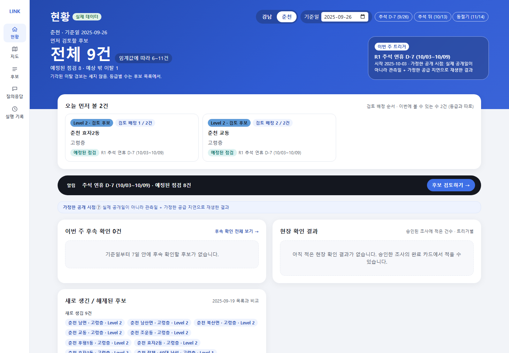
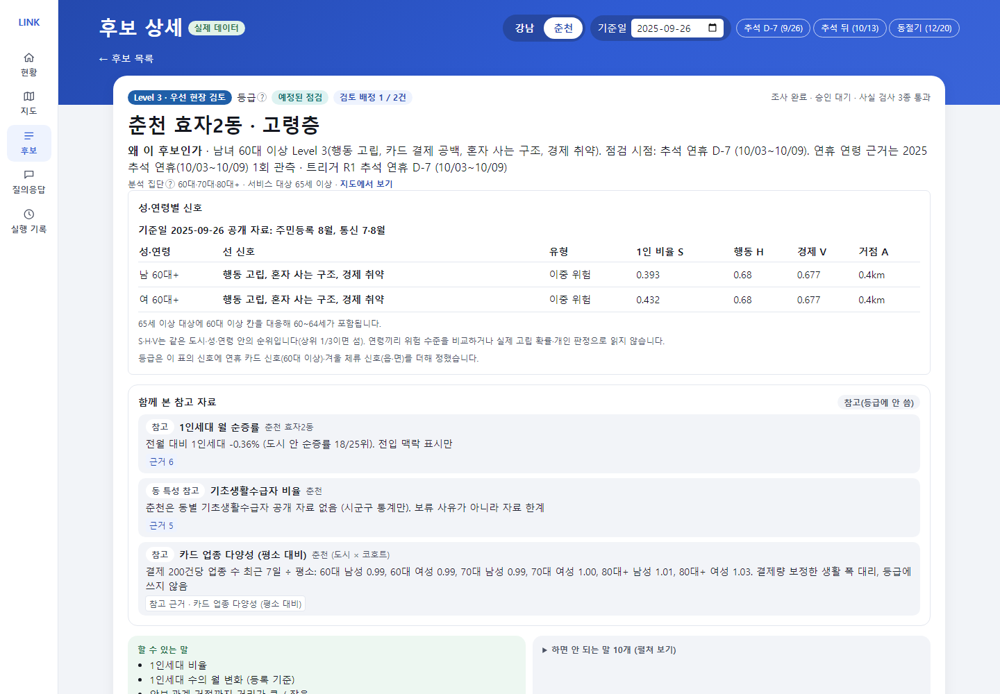
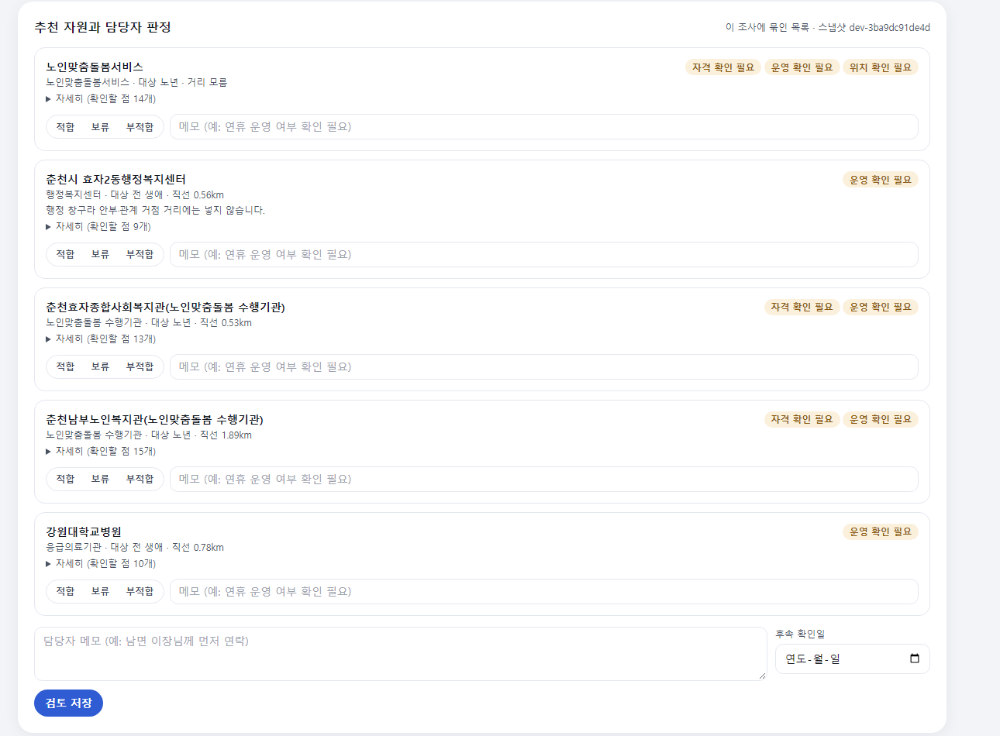
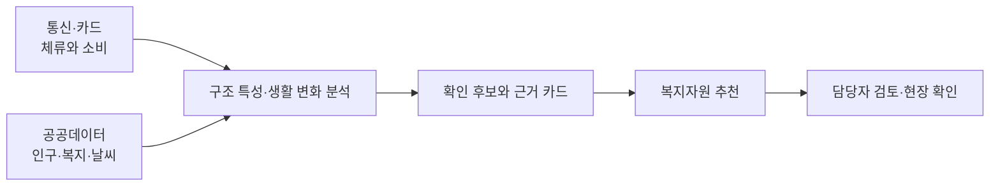
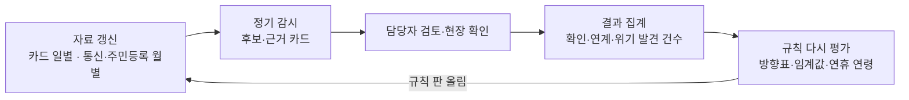

<div align="center">

# LINK-Radar

### 신고되기 전에, 먼저 살펴볼 곳을.

사회적 고립 예방을 위한 복지 담당자용 AI 에이전트


2026 빅콘테스트 · AI데이터 활용 분야

[프로젝트 소개](#about) · [서비스 화면](#demo) · [활용 데이터](#data) · [분석](#analysis) · [인사이트](#insights) · [실행 방법](#run) · [프로젝트 구조](#structure)

</div>

<a id="about"></a>

## 사회적 고립에서 출발합니다

**사회적 고립은 개인·집단·지역사회 등 여러 수준에서 다른 사람과 맺는 관계의 양과 질이 부족한 상태입니다.** 혼자 사는지뿐 아니라, 누구와 연결되어 있고 필요할 때 도움을 받을 수 있는지를 함께 살펴야 합니다. [Zavaleta, Samuel & Mills (2017)](https://doi.org/10.1007/s11205-016-1252-2)

LINK-Radar는 이 관점을 바탕으로 통신·카드 집계 자료에서 지역과 집단의 생활 변화를 살피고, 복지 담당자가 **어디를·누구를·언제 먼저 확인할지**, **어떤 지원을 연결할지** 제안합니다.

| 사회적 고립을 보는 관점 | 분석과 서비스에 반영한 방식 |
|---|---|
| 외로움과 사회적 고립을 구분 | 감정을 추정하기보다 체류·외출·소비 등 관찰할 수 있는 생활 양상을 분석 |
| 관계의 양과 질을 함께 고려 | 데이터로 살핀 활동 양상에 복지자원·현장 확인을 연결 |
| 개인을 넘어 집단·지역 수준에서 접근 | 동네 × 성별 × 연령 집단별로 특성을 비교 |
| 지리적으로 먼 것과 관계가 부족한 것을 구분 | 동 규모·상업성·계절 방문객을 보정하고, 서비스 접근성은 별도로 확인 |

사회적 고립과 외로움의 개념 구분은 [NASEM (2020)](https://www.nationalacademies.org/read/25663/chapter/4)을 따릅니다.

### 세 가지 원칙

| 원칙 | 서비스에 담은 방식 |
|---|---|
| 어디·누구·언제 | 동·생애단계 집단과 연휴·계절을 함께 살펴, 먼저 확인할 곳과 점검 시점을 제안합니다. |
| 근거와 반대 근거를 함께 | 생활 변화의 근거뿐 아니라 공휴일·날씨·도시 전체 변화처럼 다른 설명도 확인합니다. |
| 판단은 담당자 | 담당자가 근거와 자원별 확인 사항을 검토하고, 현장 확인과 지원 연결을 결정합니다. |

<a id="demo"></a>

## 서비스 화면

**현황 확인 → 후보 조사 → 근거 검토 → 자원 연결 → 담당자 결정**을 하나의 화면 흐름으로 제공합니다. [데모 실행하기](#run)

| 화면 | 핵심 기능 |
|---|---|
| 현황 | 점검 시점, 먼저 볼 후보, 후속 확인 일정과 현장 결과 집계 |
| 지도 | 행정동별 구조 특성·행동 신호와 복지자원 위치 확인 |
| 후보 목록 | 집단·등급·후보 종류별 조회와 검토 대상 선택 |
| 후보 상세 | 등급 조건·분석 근거 검토, 추가 조사, 자원별 자격·운영 확인, 승인·보류, 인쇄 |
| 질의응답 | 질문에 맞는 자료 조회·조사와 이어 묻기 |
| 실행 기록 | 조사·검토·승인 이력 조회와 이전 작업 이어가기 |

**현황: 점검 시점, 연휴 주의 지역, 먼저 볼 후보**



<details>
<summary>후보 상세·자원 검토 화면 보기</summary>

**후보 상세: 등급 사유와 성·연령별 신호**



**자원 검토: 자격·운영을 확인한 뒤 담당자가 판정**



</details>

### 대응 등급

등급은 그 시점에 먼저 확인할 순서입니다. 판단 단위는 동 × 성 × 연령(20대~60대 이상) 470칸이고, 등급은 신한카드·SK 통신 신호가 있어야 올라갑니다. 공공 통계와 자원 원장은 단독으로 등급을 올리지 않고, Level 3의 추가 확인 조건과 순서에 씁니다.

| 등급 | 조건 | 담당자가 할 일 |
|---|---|---|
| Level 3 · 우선 현장 확인 | 예정된 점검 시기 + 신한·SK 신호 2개 이상 + 공공 자료 확인 1개 이상 | 기존 돌봄·사례관리 명단에서 그 칸 대상자를 먼저 안부 확인 |
| Level 2 · 담당자 확인 | 동을 가리키는 통신 신호가 1개 있거나, 카드 결제 이탈이 다른 원인 검사를 통과 | 근거와 다른 원인, 연계 자원을 보고 현장 확인 여부 결정 |
| Level 1 · 변화 관찰 | 통신 신호가 없거나 다른 원인으로 설명됨 | 다음 기준일 결과와 비교 |
| Level 0 · 평소 관찰 | 점검 시기가 아님 | 정기 모니터링 |
| 판단 보류 | 필수 자료가 없거나 다른 원인 확인이 끝나지 않음 | 자료를 확보하고 다시 검토 |

| 신호 | 자료 | 무엇을 말하나 |
|---|---|---|
| 행동 고립 H | SK 통신 | 비슷한 동보다 그 성·연령이 동네에 오래 머묾 (어느 동) |
| 겨울 체류 감소 W | SK 통신 | 춘천 읍·면 60대 이상의 겨울 체류가 여름보다 줄어듦 (어느 읍·면) |
| 카드 결제 공백 C | 신한카드 | 지난 연휴에 그 성·연령의 의료 결제가 40·50대보다 더 끊김 (누구) |
| 1인 비율 S · 경제 취약 V · 거점 거리 A | 주민등록 · 수급 통계 · 자원 원장 | 단독으로 등급을 올리지 않음. Level 3의 추가 확인 조건과 순서에 씀 |

점검 시기(트리거)는 미리 알 수 있는 일정입니다. 연휴 7일 전부터 연휴 끝까지(춘천은 연휴 뒤 10일까지), 명절 당일, 폭염·호우·대설·한파 특보, 춘천 읍·면 동절기(11~2월)입니다. 연휴 7일 전은 기관이 명단을 확인할 근무일을 둔 운영 가정입니다.

행동 고립(H)과 1인 비율(S)은 성·연령마다 강남 시민생활 '외출·소통 적음'과 방향을 확인했습니다(W·C·V·A는 이 검사를 하지 않음). 방향이 확인되지 않은 칸(20·30대 행동 고립 등)에서는 그 신호를 Level 3 근거로 세지 않고 Level 2 근거로만 셉니다. Level 2는 담당자가 근거와 다른 원인을 보고 현장 확인 여부를 정하는 단계라, 불확실한 신호도 검토 목록에는 남기되 바로 방문 대상으로 올리지 않으려는 것입니다. 이런 후보는 화면에 '방향 미확인'을 함께 표시하고, 대응은 Level 2의 담당자 추가 분석(근거와 다른 원인을 보고 현장 확인 여부 결정)까지입니다. 화면에 보이는 위험 수준은 이 등급 하나입니다. 후보 상세의 성·연령별 신호 표는 그 동의 성·연령 칸마다 어떤 신호가 섰는지와 위험 유형(이중 위험·관계 단절형·구조·경제 취약형)을 보여 줍니다. [대응 체계](docs/대응_체계.md)

**2025 추석 예시 (연휴 7일 전, 실제 자료)**

> 2025 추석 연휴 주의 지역: 강남 세곡동·역삼1동·논현1·2동, 춘천 효자2동·소양동·약사명동·조운동의 60대 이상 (Level 3, 14칸)
> - 근거: 지난 연휴(광복절)에 60대 이상 의료 결제가 40·50대보다 더 줄었고(강남 남 −24%·여 −14%, 춘천 남 −18%·여 −26%, 신한카드), 이 동들의 60대 이상은 같은 성·연령 안에서 동네에 오래 머무는 편(SK 통신)이면서 1인 비율이나 경제 취약이 높음(공공 자료)
> - 할 일: 연휴 전 기존 돌봄 대상자 안부 확인, 연휴 진료기관·약국 안내. 춘천은 연휴 뒤 10일까지 이어서 확인
> - 연휴에 끊기는 연령은 2025 추석 한 번의 관측이라 2026 설 연휴로 다시 확인합니다

### 기대효과

도시 전체를 고르게 보는 대신, 먼저 볼 칸을 좁히고 그 칸에 혼자 사는 고령자가 몰려 있는지를 셌습니다(실제 2025 자료, 정기 감시와 같은 계산).

| 기준일 | 도시 | 후보 (Level 3 / 2) | 60대 이상 칸 중 Level 3 | 그 칸의 60대 이상 인구 비율 | 그 칸의 60대 이상 1인세대 비율 |
|---|---|---|---|---|---|
| 추석 7일 전 | 강남 | 13건 (4 / 5) | 44칸 중 6칸 (13.6%) | 14.3% (18,011명) | 19.6% (4,633세대) |
| 추석 7일 전 | 춘천 | 15건 (4 / 5) | 50칸 중 8칸 (16.0%) | 10.4% (8,966명) | 13.0% (3,171세대) |
| 추석 뒤 | 춘천 | 20건 (5 / 6) | 50칸 중 9칸 (18.0%) | 11.2% | 14.2% |
| 동절기 | 춘천 | 8건 (2 / 6) | 50칸 중 3칸 (6.0%) | 2.7% | 3.5% |

- Level 3 칸에는 인구 비율보다 1인세대 비율이 1.26~1.38배 높습니다. 같은 인원으로 연휴 전에 혼자 사는 고령자가 많은 곳부터 볼 수 있다는 뜻입니다.
- 강남 추석 뒤·동절기는 Level 3가 없습니다. 연휴 뒤 이어 보기는 춘천만, 동절기 점검은 춘천 읍·면만 대상이기 때문입니다.
- 검토 대상이 줄어든 숫자이지 업무시간 절감이나 고립 발견 실적이 아닙니다. 실제 효과는 현장 확인 결과로 재야 합니다. [기대효과](docs/기대효과.md) · [계산](notebooks/r3d_impact.py)

<a id="data"></a>

## 활용 데이터

등급은 통신·카드 신호로 올리고, 공공데이터는 Level 3의 추가 확인 조건과 순서, 복지자원은 지원 연결에 씁니다.

| 구분 | 데이터 | 주요 활용 |
|---|---|---|
| 통신 | SK텔레콤 유동인구: 격자·월별 성·연령, 시간대, 요일 자료 | 체류 특성, 상업성 보정, 계절별 생활권 변화 |
| 소비 | 신한카드 데이터1·2: 일별 업종·성·연령·시간대별 결제 자료 | 연휴 의료·생필품 소비 공백, 생활 변화 신호 |
| 인구·가구 | 행정안전부 주민등록 인구, 세대원수별 세대수, 성·연령별 1인세대수 | 집단별 인구와 혼자 사는 비율, 구조 취약성 |
| 사회·복지 지표 | 서울 시민생활, 기초생활수급·기초연금·장애인·인구 이동 자료 | 사회경제 취약성 구성과 지표 교차 검증 |
| 환경·시점 | 기상청 ASOS, 공휴일 달력 | 기온·강수·계절·연휴에 따른 활동 변화 해석 |
| 복지·의료 자원 | 복지로, E-Gen, 지자체 시설·사업·경로당 현황, 도로명주소 좌표 | 대상·자격·운영·거리별 자원 추천 |

제공 데이터의 분석 기간은 **2025년 7~12월**, 분석 지역은 **서울 강남구·강원 춘천시**입니다. 자료별 집계 단위와 출처는 [데이터 설명](docs/데이터_설명.md), [외부 데이터 목록](external/README.md)에 정리했습니다. 대회 제공 원본은 저장소에 포함하지 않습니다.

<a id="analysis"></a>

## 분석에서 현장 검토까지



### 행동과 생활 여건을 나누어 봅니다

| 행동 고립 H | 사회경제 취약 V |
|---|---|
| 비슷한 규모·상업성의 동과 비교한 체류 특성, 겨울 체류 유지 | 성·연령별 혼자 사는 비율과 공공부조 수급 |
| 생활권 안에서 어떻게 활동하는가 | 어떤 생활 여건에 놓여 있는가 |

행동 고립(H)과 공공 자료(1인 비율 S, 경제 취약 V)로 이중 위험·관계 단절형·구조·경제 취약형을 나누고 470칸을 비교합니다. 남녀는 같은 성·연령끼리만 순위를 매겨, 전반적으로 값이 높은 쪽에 다른 쪽이 묻히지 않게 했습니다. [2축 분석](reports/t1_2축위험도/README.md) · [규칙 개정](reports/r3_규칙개정/README.md)

<a id="insights"></a>

### 데이터로 본 생활 변화

네 가지를 비교했습니다: 두 도시, 성별과 연령, 날씨, 연휴. 모두 2025년 하반기 한 번의 관측입니다. 통신은 그곳에 머문 사람의 체류량이고, 카드는 같은 연령 안에서의 변화로만 읽습니다. 사람 수나 개인의 상태가 아닙니다.

#### 강남과 춘천: 같은 지표도 도시마다 다르게 읽습니다

| 비교 | 강남 | 춘천 |
|---|---|---|
| 체류 인구 중 60대 이상 | 18.9% | 24.7% |
| 고령층이 머무는 곳 | 주거지 쪽에 몰림 (밤 체류 비중과 60대 이상 비중 순위상관 0.51) | 주거지·업무지 구분과 거의 무관 (0.16). 동지역과 읍·면의 차이가 더 큼 |
| 겨울 체류 변화 | 동별 7월 대비 12월 전 연령 −8%~+5% | 읍·면 주민 거주지의 60대 이상 −9.7% (여름 대비 11·12월), 동지역 +0.6% |
| 추석 당일 결제, 평소 같은 요일 대비 | 18~33% | 25~63% |
| 연휴 뒤 10일 80대 이상 생필품 결제, 평소 대비 | 96% | 83% |

- 강남은 출퇴근 인구가 많아, 고령층 지표를 주거지 위주로 봐야 합니다. 춘천은 겨울에 읍·면이 비는 것이 가장 큰 특징입니다.
- 춘천 고령층은 연휴가 끝나도 장보기가 바로 돌아오지 않았습니다.
- **서비스에서는** 지표를 도시 안 순위로만 비교합니다. 동절기 점검은 춘천 읍·면에만, 연휴 뒤 이어서 보는 기간(10일)은 춘천에만 둡니다.

#### 성별과 연령: 고립의 모습이 집단마다 다릅니다

| 무엇을 봤나 | 결과 |
|---|---|
| 결제 중 의료 비중 | 20대 5% → 80대 이상 강남 20%, 춘천 27%. 병원이 쉬면 고령층의 생활 전체가 크게 줄어듭니다 |
| 일요일 결제, 평일 대비 | 80대 이상은 평일의 절반 (강남 0.56, 춘천 0.52). 매주 반복되는 정상 패턴입니다 |
| 1인가구 중 소통이 적은 비율 (강남 시민생활) | 중장년(40~64세) 남 15.5%, 여 8.5%로 남성이 1.8배. 22개 동 중 21곳에서 남성이 높음. 노년은 남녀 비슷(7.8%, 7.2%) |
| 연령끼리 비교한 지표 10개 | 6개에서 청년·중년이 노년과 같거나 더 높음. 혼자 사는 비율·심야 소비는 청년, 고독사 위험군 규모는 50대, 공식 고립도·소비 참여도는 노년이 두드러짐 |
| 결제의 하루하루 흔들림 | 30~60대는 64~78%가 도시 전체가 함께 움직인 변화. 80대 이상은 30~45%뿐이라 자기만의 흔들림이 큼 |

- 고립은 노년만의 문제가 아니지만, 모습이 다릅니다. 청년은 혼자 살고 늦게 활동하는 쪽, 중장년 남성은 관계와 소통이 줄어드는 쪽, 노년은 진료·소비가 끊기는 쪽입니다.
- **서비스에서는** 남녀를 같은 성·연령끼리만 순위를 매겨, 값이 전반적으로 높은 쪽에 다른 쪽이 묻히지 않게 했습니다. 470칸 모두 같은 규칙을 쓰고, 경보는 연령별 요일 효과와 도시 공통 변동을 먼저 뺀 뒤 판단합니다.

#### 날씨: 폭염에는 고령층의 외출이 먼저 줄어듭니다

| 무엇을 봤나 | 결과 |
|---|---|
| 33℃ 이상 폭염일 생필품 결제, 평소 대비 | 20~50대는 +1~4%, 80대 이상은 강남 −4.9%, 춘천 −5.3% |
| 80대 이상, 40·50대와 비교 | 강남 6.3%, 춘천 8.2% 더 줄어듦. 같은 수의 날을 무작위로 뽑았을 때와 구분됨 |
| 생필품이 아닌 업종 (외식·여가 등) | 80대 이상이 강남 4.5%, 춘천 5.5% 덜 씀 |
| 비 온 날 | 실제 결제 경보 38건 중 12건은 비로 설명되는 부분이 있었음 |

- 폭염일에는 80대 이상이 장보기만이 아니라 외출 자체를 줄이는 모습입니다. 여름 한 번, 휴가철과 겹친 관측이라 크기보다 방향으로 읽습니다.
- **서비스에서는** 폭염·호우·대설·한파 특보를 점검 시점으로 쓰고, 결제 경보마다 비로 설명되는 부분과 그 뒤에도 남는 감소를 나눠 보여 줍니다. 비 때문이라고 경보를 지우지는 않습니다.

#### 연휴: 미리 준비하지만, 연휴 중에는 진료가 끊깁니다

| 무엇을 봤나 | 결과 |
|---|---|
| 추석 전날(일요일) 60대 이상 결제 | 평소 일요일의 1.1~1.4배. 연휴 전에 미리 장을 봄 |
| 추석 연휴 7일 병원·의원 결제, 평소 대비 | 20대 25~33%, 80대 이상 10~17% |
| 60대 이상 의료 결제, 40·50대 대비 | 강남 28~30%, 춘천 31~36% 더 끊김. 가짜 연휴 100여 개 중 가장 낮음. 광복절·성탄절에도 같은 방향 |
| 연휴 뒤 10일 생필품 | 춘천 70대 남성과 80대 이상 남녀가 40·50대보다 6~13% 덜 회복 |
| 20~40대 생필품 감소 | 귀성·여행으로 도시를 떠난 효과일 가능성이 커서 고립 신호로 읽지 않음 |

- 고령층은 연휴 전에 미리 준비하지만, 연휴 동안 진료와 약 구입이 끊기는 정도가 젊은 층보다 깊습니다. 세 번의 공휴일에서 모두 같은 방향이었습니다.
- **서비스에서는** 연휴 7일 전부터 60대 이상 칸만 점검합니다. 할 일은 기존 돌봄 대상자 안부 확인과 연휴 진료기관·약국 안내입니다. 연휴 연령은 2025 추석 한 번으로 정한 것이라 2026 설 연휴로 다시 확인합니다.

#### 위험 영향 요인 한눈에

| 요인 | 무엇을 봤나 | 크기 | 방향 확인 | 등급에서의 역할 |
|---|---|---|---|---|
| 혼자 사는 구조 (S) | 1인세대 비율로 강남 시민생활 '외출·소통 적음' 상위 동 맞히기 (60세 이상) | AUC 0.75, 동 특징 8개를 섞은 모델(0.72)과 비슷 | 확인 (60대 이상 남 ρ 0.64, 여 0.79) | Level 3의 공공 자료 확인 |
| 행동 고립 (H) | 비슷한 동보다 그 성·연령이 동네에 오래 머묾 | 60대 이상 남 ρ 0.58, 여 0.38 | 확인 (20·30대 등 일부 미확인) | 동을 가리키는 신한·SK 신호 |
| 연휴 | 60대 이상 의료 결제, 40·50대 대비 | 강남 28~30%, 춘천 31~36% 더 끊김 | 공휴일 3번 모두 같은 방향 | 카드 신호(C), 연휴 7일 전 점검 |
| 겨울 | 춘천 읍·면 주민 거주지 60대 이상 체류, 여름 대비 | −9.7% (동지역 +0.6%) | 한 해 관측 | 동절기 신호(W) |
| 폭염 | 80대 이상 생필품 결제, 40·50대 대비 | 강남 6.3%, 춘천 8.2% 더 줄어듦 | 여름 한 번 | 특보 점검 시점 |
| 성별 | 중장년 1인가구 중 소통이 적은 비율 | 남 15.5%, 여 8.5% (1.8배) | 22개 동 중 21곳 같은 방향 | 남녀를 따로 순위 |
| 경제 취약 (V) | 수급 통계 | 강남 성별·춘천 60대 이상만 있음 | 검사 안 함 | Level 3의 공공 자료 확인 |
| 거점 거리 (A) | 안부·관계 거점까지 거리 | M4 계수 −0.12로 거의 영향 없음, 3~7km로 바꿔도 Level 3 칸 그대로 | 검사 안 함 | Level 3의 공공 자료 확인 |

혼자 사는 구조와 행동 고립은 서로 다른 것을 봅니다. 그래서 둘 다 선 칸(이중 위험)을 먼저 봅니다. [M4 위험 요인](reports/m3_모델링결과/M4.md) · [신호 방향 확인](reports/r3_규칙개정/README.md)

[두 도시 체류 비교](reports/eda2_통신기초/README.md) · [연령별 소비](reports/eda3_카드기초/README.md) · [생활 공백 분석](reports/eda5_인사이트재현/README.md) · [경보 평가](reports/eda6_사전경보재평가/README.md) · [연휴 효과](reports/r3_규칙개정/README.md) · [연령 간 가설 검증](reports/t1_2축위험도/README.md)

### 분석·서비스 검증

| 항목 | 검증 내용 | 결과 |
|---|---|---|
| 2축 모델 | 사전 등록한 구성·독립성·안정성 기준 | 19개 중 18개 충족 |
| 생활 변화 경보 | 집단 결제에 15% 하락을 넣은 합성 실험 | 지금 기준(z −2.0, 7일 중 4일) 753/814 감지(92.5%), 대조 쌍 경보율 1.7%. 이전 기준 736/817(90.1%) |
| 경보 기준 선택 | LINK-Sim 합성 정답으로 고르기·평가 분리 (z −2.0, 7일 중 4일, 5%) | 평가 정답 시나리오 19개 중 14개 감지(이전 기준 13개, 73.7% vs 68.4%), 배경 경보율 4.11%. 한 건 차이라 성능 개선으로 보지 않고 다음 기간 자료에서 확인 |
| 연휴 효과 | 추석·광복절·성탄절, 가짜 연휴 100여 개와 비교 | 60대 이상 의료 결제 공백, 세 번 모두 같은 방향 |
| 복지자원 추천 | 고정한 규칙 정답 30쌍 | k-정규화 Recall@5 0.6733 |
| 기능 검증 | 데이터 계약·에이전트·API·화면 | Python 1,213개, 웹 146개 시험 통과 |
| 결과 재현 | 리포트 CSV 해시 대조 | 143개 일치 |

평가 방법과 세부 결과는 [분석 리포트](reports/README.md), 재현 절차는 [REPRODUCE.md](REPRODUCE.md)에 있습니다.

### 모델링 결과

등급은 규칙이 정하고, 모델은 규칙의 근거와 검증에 씁니다. 실제 고립 정답이 없어서 성능은 합성 정답이나 독립 기준으로만 잽니다.

| 모델 | 무엇을 맞히나 | 결과 (지금 에이전트 기준) | 읽는 법 |
|---|---|---|---|
| 카드 이탈 경보 | 집단 결제에 넣은 15% 하락 | 탐지율 92.5%, 대조 쌍 경보율 1.7%, 탐지까지 중앙값 3일 | 합성 하락이라 실제 고립 탐지율이 아님 |
| 경보 기준 선택 (LINK-Sim) | 페르소나 합성 정답 19개 시나리오 | 14개 감지 (이전 기준 13개), 배경 경보율 4.11% | 한 건 차이, 다음 기간 자료에서 다시 확인 |
| 위험 요인 확인 (M4) | 강남 시민생활 '외출·소통 적음' 상위 동 (60세 이상) | 1인세대 비율 하나 AUC 0.75 (95% CI 0.64~0.83) | 22개 동이라 구간이 넓음, 등급에 쓰지 않음 |
| 2축 위험도 | 사전 등록한 구성·독립성·안정성 기준 | 19개 중 18개 충족 | 행동(H)과 구조(S·V)가 다른 것을 봄 |
| 칸 판정 민감도 | 상위 비율 25~40%, 거점 3~7km로 바꿔 다시 셈 | Level 3 칸 강남 5~7, 춘천 9~26 (기본 6 / 20), 거점 거리는 영향 없음 | 춘천은 상위 비율에 민감 |

위험도는 칸마다 선 신호를 세어 Level 0~3과 판단 보류로 나눕니다(위 [대응 등급](#대응-등급)). [모델링 결과](reports/m3_모델링결과/README.md) · [규칙 개정 5절 민감도](reports/r3_규칙개정/README.md)

## 에이전트 구성

React 화면과 FastAPI를 연결하고, LangGraph로 **질문 해석·자료 조회·추가 조사·보고서 생성·승인 대기**를 관리합니다.

| 역할 | 구성 |
|---|---|
| 데이터 처리·분석 | Python, DuckDB, pandas, Parquet, statsmodels, LightGBM |
| 에이전트 | LangGraph, Pydantic, Claude API |
| 서비스 | FastAPI, React, TypeScript, Vite, Tailwind CSS |
| 지도·차트 | Leaflet, Recharts |
| 상태·이력 | SQLite, LangGraph 체크포인트 |
| 품질 검증 | pytest, Vitest, GitHub Actions |

### 판정 원칙과 안전장치

- **판정은 코드, 설명은 LLM**: 신호·등급·추천 기준은 규칙으로 계산하고, LLM은 질문 해석과 근거 설명을 맡습니다.
- **개인을 판정하지 않음**: 동·집단 단위 집계로 확인 순서를 제안하며, 개인의 고립 여부를 진단하거나 대상자 명단을 만들지 않습니다.
- **모르면 보류**: 자료가 지원하지 않는 질문이나 필수 근거가 부족한 판단은 보류하고, 필요한 자료를 안내합니다.

조회와 보고서 생성 과정에는 네 가지 Guard 검사를 둡니다.

| 검사 | 확인하는 내용 |
|---|---|
| 데이터 계약 | 요청한 지역·연령·시간대가 원천 자료에 있는지, 집계 단위와 결합이 가능한지 |
| 사실 | 숫자·증감 방향·지역·기간·단위·근거 ID가 근거 카드와 일치하는지 |
| 표현 | 체류를 거주로 단정하거나 개인 진단·근거 없는 정확도를 주장하는지 |
| 자원 | 추천 자원의 출처·지역·대상·확인일이 있는지. 자격·운영 미확인 항목은 담당자에게 표시 |

자세한 흐름은 [아키텍처](docs/아키텍처.md), [에이전트 설계](docs/에이전트_설계.md), [대응 체계](docs/대응_체계.md)를 참고하세요.

### 현장에서 쓸 수 있나

| 항목 | 내용 |
|---|---|
| 기존 시스템과의 관계 | 고독사위기대응시스템·복지사각지대 발굴시스템(행복이음)을 대신하지 않습니다. 그 앞에서 어느 동·집단을 언제 먼저 볼지 정하고, 현장 확인은 그 시스템의 기존 명단으로 합니다 |
| 제도 근거 | 「고독사 예방 및 관리에 관한 법률」의 고독사 위험자 발굴, 「사회보장급여의 이용·제공 및 수급권자 발굴에 관한 법률」의 위기가구 발굴 업무를 돕는 도구입니다 |
| 개인정보 | 통신·카드 집계 자료와 공공 통계만 씁니다. 개인을 식별하거나 명단을 만들지 않고, 현장 확인 결과도 건수만 받습니다(10 미만은 숨김) |
| 운영 부담 | 정기 감시 한 번에 도시마다 검토 배정 2건(검토 예산 K), 추석 7일 전 후보는 도시당 13~15건(Level 3 4건) |
| 비용 | LLM 없이도 규칙 계산과 템플릿 보고서가 돌아갑니다. Claude를 쓰면 조사 1회 약 $0.03~0.06 ([LLM 활용](docs/LLM_사용.md)) |

### 데이터로 계속 고치는 방법



- 자료가 들어오면 새 스냅샷으로 고정하고(입력 파일 해시), 같은 스냅샷이면 같은 결과가 나옵니다.
- 현장 확인 결과(`POST /runs/{id}/outcomes`)와 이의 기록이 쌓이면 분기마다 임계값·신호 방향표(`configs/signal_check.csv`)·연휴 연령을 다시 계산하고, 바꾸면 `rules_v2.yaml`의 판을 올립니다. 후보마다 `rule_version`이 남아 어느 판으로 정한 등급인지 추적됩니다.
- 다음에 확인할 것: 2026 설 연휴로 연휴 연령 다시 확인, 행동 고립과 겨울 체류 감소가 같은 통신 자료에서 겹치는 문제, 칸 판정 기준값 민감도를 현황 화면 범위로 계산하기.

<a id="run"></a>

## 실행 방법

Python 3.13 이상, uv, Node.js와 npm이 필요합니다.

### 화면 데모

레포 루트에서 API를 실행합니다.

```bash
uv sync --frozen
uv run uvicorn api.main:app --reload --workers 1
```

다른 터미널에서 화면을 실행합니다.

```bash
cd web
npm ci
npm run dev
```

**http://localhost:5173**에서 확인할 수 있습니다. 기본 모드는 화면 시연용 샘플 데이터를 사용하며, 원본 자료나 API 키가 필요하지 않습니다.

첫 화면 **한눈에 보기**는 ① 두 도시 요약과 다가오는 일정 → ② 행정동 경계를 Level 색으로 칠한 '먼저 볼 곳' 지도 → ③ 고른 동의 근거와 연결할 자원 → ④ 질문 순서입니다. '오늘 기준'은 오늘의 월·일을 2025년 자료에 대입한 작년 같은 날의 결과이고, 시연용 기준일(추석 7일 전 등)도 고를 수 있습니다.

<a id="real-data"></a>

### 실제 데이터 연결

대회 원본 zip 두 개를 `data/raw/`에 두거나 `BC_RAW_DIR`로 경로를 지정하고 정리본을 만듭니다.

```bash
uv run python -m bigcontest.ingest
```

API를 종료한 뒤 실제 데이터 모드로 다시 실행합니다.

```powershell
# PowerShell · 레포 루트
$env:LINKRADAR_BACKEND = "real"
$env:LINKRADAR_TOOLS = "real"
$env:LINKRADAR_LLM = "none"
uv run uvicorn api.main:app --reload --workers 1
```

<details>
<summary>macOS / Linux</summary>

```bash
LINKRADAR_BACKEND=real LINKRADAR_TOOLS=real LINKRADAR_LLM=none \
uv run uvicorn api.main:app --reload --workers 1
```

</details>

Claude를 연결하려면 `ANTHROPIC_API_KEY`를 설정하고 `LINKRADAR_LLM=claude`로 실행합니다. LLM 없이도 규칙 계산과 템플릿 보고서를 사용할 수 있습니다. 원본 파일명·전체 분석 재현은 [재현 안내](REPRODUCE.md), API 설정은 [API 명세](docs/API_명세.md)에 있습니다.

### 정적 배포 (Vercel)

대회 자료는 재배포할 수 없어서, 배포본에는 실제 에이전트로 미리 계산한 **집계 결과(JSON)** 만 올립니다. 원자료와 서버는 올리지 않습니다.

```bash
# 1) 실제 데이터 모드에서 기준일별 첫 화면 결과를 내보냄 (2025-07-01부터 7일마다 + 시연 기준일, 약 20분)
uv run python scripts/export_static.py          # → web/public/data/home/<기준일>_<GN|CC>.json, index.json

# 2) 정적 모드로 빌드·미리보기 (VITE_STATIC=1, web/.env.static)
cd web
npm run build:static
npx vite preview --mode static

# 3) 배포 (처음 한 번 로그인·프로젝트 연결)
npx vercel           # 미리보기 주소
npx vercel --prod    # 공개 주소
```

배포본은 첫 화면만 보입니다. 질문은 이 화면의 근거 카드에서 답을 찾고(LLM 아님), 후보 상세·조사·승인은 로컬 실행에서 씁니다. 설정은 `web/vercel.json`에 있습니다.

<a id="structure"></a>

## 프로젝트 구조

```text
analysis/          2축 구조 위험도·연령 가설 분석 노트북과 재현 코드
notebooks/         생활 신호·등급·모델 비교·교차 검증 스크립트
reports/           분석 결과·검증 리포트·그림
src/bigcontest/    데이터 처리·신호·모델·등급·자원·에이전트 코드
api/               FastAPI와 실행·검토·승인 기록
web/               React 서비스 화면
configs/           분석·등급·자원·LLM 설정
external/  ref/    공개 자료·출처·행정동 코드와 경계
evaluation/        추천 평가·사용자 비교 평가 자료
tests/             Python 시험
scripts/           재현·데이터 점검 스크립트
docs/              설계·명세·데이터 설명
```

## 문서

| 주제 | 문서 |
|---|---|
| 분석 | [전체 리포트](reports/README.md) · [분석 노트북](analysis/taeyeon_2axis/README.md) · [위험 지표](docs/위험_지표.md) |
| 서비스 | [화면 설계](docs/화면_설계.md) · [에이전트 설계](docs/에이전트_설계.md) · [API 명세](docs/API_명세.md) |
| 데이터 | [데이터 설명](docs/데이터_설명.md) · [외부 자료 출처](external/README.md) · [부가 데이터](docs/부가데이터_정의.md) |
| 재현 | [재현 안내](REPRODUCE.md) · [숫자 사용 기준](docs/숫자_사용_기준.md) |

## 한계

- 연휴에 끊기는 연령(60대 이상)은 2025 추석 한 번의 관측으로 정했습니다. 2026 설 연휴 자료로 다시 확인해야 합니다. 카드 결제가 줄어든 것이 가족과 함께 있어서인지 실제 공백인지는 구분하지 못합니다.
- 결과를 본 뒤 정한 규칙이 있습니다. 연휴 연령, 카드 신호 기준(−5%p), Level 3의 공공 자료 확인 조건, 동절기 카드 대신 통신 신호 두 개로 세는 것입니다. 모두 [규칙 개정](reports/r3_규칙개정/README.md)에 적었습니다.
- 동절기 Level 3는 행동 고립(H)과 겨울 체류 감소(W)를 다른 신호로 세야 나옵니다. 둘 다 SK 통신 자료라 겹칩니다. 12/20 기준 춘천 읍·면 60대 이상 20칸에서 H가 선 4칸은 모두 W도 섰습니다. 두 신호를 하나로 묶어 세면 Level 3 3칸(남산면 남녀, 동산면 남)이 모두 Level 2가 됩니다. 묶은 뒤 공공 자료 확인을 2개 이상 요구하면 남산면 2칸만 남습니다. 동절기 Level 3는 두 통신 신호가 함께 선 읍·면을 먼저 보는 순서로 읽어야 합니다. [규칙 개정](reports/r3_규칙개정/README.md)
- 카드는 도시 × 성 × 연령 단위라 동을 가리키지 못합니다. 동은 통신 신호가 정하고, 통신 연령은 60대 이상이 한 묶음이라 70·80대를 따로 보지 못합니다.
- 1인 비율(S)은 작은 동일수록 높게 나오는 경향이 있습니다(춘천 순위상관 −0.58). 지금은 공공 자료 확인 역할로만 써서 등급에 미치는 영향은 줄였습니다.
- 행동 고립(H)과 1인 비율(S)은 성·연령마다 강남 시민생활 '외출·소통 적음'과 방향을 확인했습니다. 20·30대와 남성 40대 일부는 방향이 확인되지 않아, 그 칸에서는 해당 신호를 Level 3 근거로 세지 않습니다(화면에 '방향 미확인'으로 표시). 기준 자료도 추정치이고 강남 22개 동뿐이라 춘천은 강남 결과를 빌려 씁니다.
- 실제 고립 정답(현장 확인 결과)이 없어 정확도는 말할 수 없습니다. 검증은 대리 지표·합성 자료·독립 기준과의 비교입니다.
- 접근성은 2026년 원장 기준이라 2025년 당시 거점 운영 여부는 확인하지 못했습니다.

## 라이선스

코드는 [MIT 라이선스](LICENSE)를 따릅니다. 대회 제공 데이터는 재배포하지 않으며, 공개 자료의 이용 조건은 [NOTICE](NOTICE.md)에 정리했습니다.
