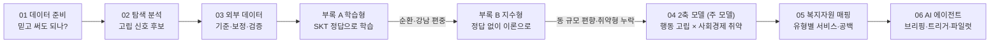

# 태연 분석: 2축 구조 위험도 · 07 가설 검증

> **태연 분석 (옮겨 온 폴더)** — 이 폴더는 태연이 만든 분석입니다. 00~06·부록 A·B는 `junseo0im/2026-big-contest` 레포 `TaeYeon's-branch`(커밋 `003adc2`, `TaeYeon_analysis/`)에서 옮겼고(T1), 07은 태연이 이 레포 `taeyeon/age-isolation-hypothesis` 브랜치(`5d7f25e`)에 올린 것을 병합했습니다. 분석 내용과 코드는 바꾸지 않았습니다.
>
> - 폴더 구조는 원래대로입니다(`csv/`, `external/`, `outputs/` 상대 경로). 노트북은 이 폴더를 작업 폴더로 두고 실행합니다.
> - 대회 원본 zip(`원본데이터/`)과 변환본(`csv/`)은 올리지 않습니다(.gitignore). 행정동 경계 geojson(34MB)도 올리지 않습니다.
> - 01·02 노트북은 대회 데이터를 거의 그대로 집계한 표·격자 그림이 많아 실행 출력을 지웠습니다. 대회 데이터를 `csv/`에 두고 다시 실행하면 볼 수 있습니다.
> - `outputs/`의 결과 파일은 LINK-Radar 리포트 목록에 맞춰 [`reports/t1_2축위험도/`](../../reports/t1_2축위험도/README.md)에 같은 내용으로 복사해 두었습니다(`sync_reports.py`, 시험으로 같은지 확인). LINK-Radar와 맞춘 표현·한계는 그 README에 있습니다.
> - LINK-Radar 문서에서는 이 분석의 "5단계"(심각·경계·주의·관심·정상)를 **구조 위험 단계(참고)**라고 부릅니다. 상대 순위 점수입니다. LINK-Radar의 "5단계 대응 체계"(Level 0~3 + 판단 보류)와 다릅니다.
> - 주 결과 CSV(`위험도_2축_강남_춘천_동x성x연령.csv`)는 **2025.12 기준 사후 계산**입니다. LINK-Radar 기준일(예: 2025-09-26) 시점 값이 아닙니다.
> - 아래 본문의 "20대 이중 위험 23~24%"는 같은 연령 안 백분위로 나눈 값이라 **연령끼리 비교하는 근거로 쓰지 않습니다.** 연령 간 주장은 07 결과(연령 간 절대 지표 10개 중 6개 성립 = 부분 지지)를 씁니다.

## 07 가설 검증 — 고립은 노년만의 문제인가

통합 계획 T1(`analysis/taeyeon_2axis/`) 전에, 연령 간 **절대 수준** 지표로 다시 판정한 결과만 먼저 올립니다. 2축 모델(00~06, 부록 A·B)은 T1에서 함께 옮깁니다.

### 판정: 부분 지지 (판정 지표 10개 중 6개에서 H1 성립)

- H0: 고립 위험 요인은 노년(60대+)에 집중되어, 청년(20~30대)·중년(40~50대)은 모든 지표에서 노년보다 낮다.
- H1: 청년·중년 중 노년과 같거나 더 위험한 지표가 있다.
- 판정 규칙(실행 전 고정, `outputs/가설_전연령고립_사전등록.json`): 10개 중 7개 이상 지지, 1~6개 부분 지지, 0개 기각.

| 결과 | 지표 | 내용 |
|---|---|---|
| H1 성립 | 혼자 사는 비율 (두 지역) | 춘천 20대 32.4% > 60대+ 27.7% / 강남 30대 35.5% > 60대+ 18.5% |
| | 심야(00~05시) 소비 비중 (두 지역) | 20~50대 모두 60대+보다 높음 |
| | 외부활동 소비 비중 (강남) | 40대 23.4% ≈ 60대+ 23.5% (차이 0.1%p, 사실상 동률) |
| | 고독사 위험군 규모 (전국) | 50대 37.3만 명 > 60대 35.5만 명 |
| H1 불성립 | 공식 사회적 고립도 (전국) | 60대+ 39.4% 최고 |
| | 외부활동 소비 비중 (춘천) | 60대+ 28.6% 최저 |
| | 소비 참여도 (두 지역) | 60대+ 0.60~0.61 최저 |

해석: 연령마다 고립의 종류가 다릅니다. 노년은 관계·활동의 양, 청년은 혼자 사는 구조와 심야 생활 리듬, 중년은 고독사 위험군 규모에서 노년과 같거나 높습니다.

### 04 '20대 이중 위험 23~24%'를 쓰지 않는 이유

04의 유형 비중은 **같은 성·연령 안 백분위**로 만든 값이라, 상위 1/3 비중이 연령마다 30~39%로 비슷하게 나오도록 설계되어 있습니다. 연령 간 비교 근거로 쓰면 순환 논리입니다. 그래서 이 판정에서는 연령 간 절대 수준을 비교할 수 있는 지표만 썼습니다.

### 한계

- 심야 소비는 약한 신호입니다(생활 리듬·직업 차이일 수 있음). 심야 지표를 빼도 8개 중 4개로 판정은 같습니다.
- 카드 지표는 가맹점 위치 기준이라 거주민만의 소비가 아닙니다.
- 공식 고립도(E1)는 언론 보도 인용분이 섞여 있고, 고독사 위험군(E4)은 전국 값이며 70대 이상 값이 없어 60대와만 비교했습니다. 제출 전 원문으로 교체가 필요합니다.
- 주민등록은 2024.12 기준입니다(2025 기준일 재생에 쓸 때는 시점 표시 필요).

### 파일

| 파일 | 내용 |
|---|---|
| `07_가설검증_전연령고립.ipynb` | 판정 노트북 (실행 결과 포함, 출력은 연령별 집계표뿐) |
| `outputs/가설_전연령고립_사전등록.json` | 실행 전에 고정한 가설·지표·판정 규칙 |
| `outputs/가설검증_전연령고립.csv` | 지표별 판정 결과 |
| `outputs/복지자원_공급공백_생애단계.csv` | 생애단계별 서비스 기능 수와 위험 유형 인구 (보조) |
| `노트북생성코드/b7.py`, `s7.md`, `flow.py` | 노트북 빌더와 섹션별 '왜/결과' 문구 |

다시 실행하려면 T1에서 옮길 파일(대회 원본 변환 `csv/`, `external/codes`·`external/mois`, `outputs/모델설정_동결.json`, `outputs/위험도_2축_강남_춘천_동x성x연령.csv`)이 필요합니다. 대회 제공 원본은 레포에 넣지 않습니다.

---

## 00~06 · 부록 A·B: 2축 구조 위험도 (T1에서 옮김)


> **2026 빅콘테스트 · AI데이터 활용 분야**
> 통신(SK 유동인구)·카드(신한카드) 데이터로 **동네 × 성별 × 연령 집단의 고립 위험**을 찾습니다. 그다음 <b>"어느 동, 어떤 집단부터 현장 조사를 나가고 어떤 복지서비스로 연결할지"</b>를 추천하는 AI 에이전트를 설계합니다.
> 분석 지역은 **서울 강남구(22개 동) · 강원 춘천시(25개 읍면동)**, 기간은 **2025년 7\~12월**입니다.

---

### 사회적 고립이란?

> 사회적 고립은 <b>"개인·집단·지역사회·더 넓은 사회 환경 등 사람 사이의 상호작용이 일어나는 여러 수준에서, 다른 사람과의 사회적 관계가 양적·질적으로 부족한 상태"</b>입니다.
> — Zavaleta, Samuel & Mills (2017), *Social Indicators Research*

이 정의에서 이 프로젝트가 따르는 관점은 네 가지입니다.

| 정의의 요소 | 근거 | 이 프로젝트에서 |
|---|---|---|
| **객관적인 상태**입니다. 외로움과 다릅니다. | 사회적 고립은 관계가 적거나 접촉이 드문 객관적 상태이고, 외로움은 고립되었다고 느끼는 주관적 감정입니다 (NASEM, 2020). | 통신·카드 데이터로는 감정을 알 수 없습니다. 대신 **외출·체류·소비라는 접촉의 흔적**을 봅니다 → '행동 고립' 축 |
| **여러 수준**에서 일어납니다. | 개인뿐 아니라 집단·지역사회 수준의 관계 부족도 포함합니다 (Zavaleta et al., 2017). | 개인을 판정하지 않고 **동네 × 성별 × 연령 집단** 단위로 위험을 봅니다 |
| **양과 질**이 모두 중요합니다. | 접촉의 양과 관계의 질은 자동으로 일치하지 않습니다 (Zavaleta et al., 2017). 국내 공식 지표도 "집안일을 부탁하거나, 이야기 상대가 필요할 때 둘 중 하나라도 도움을 받을 곳이 없는 사람의 비율"로 관계의 질을 잽니다 (통계청 사회조사, 2025년 33.0%). | 데이터는 '양'의 일부만 보여 줍니다. '질'은 현장 판단도구로 확인해야 하므로, 에이전트의 역할을 **현장 조사 우선순위 추천**으로 정했습니다 |
| **지리적·물리적 고립과 구별**됩니다. | 사회적 고립은 집단의 특성이나 지리적 위치 때문에 생긴 집단·지역의 고립과 다릅니다 (Zavaleta et al., 2017). | 외딴 면 지역의 유동 감소나 상권 크기를 고립으로 착각하지 않도록 **동 규모·상업성·계절 방문객을 보정**했습니다 |

또한 공식 통계에서 사회적 고립도는 60세 이상이 39.4%로 가장 높지만, <b>가장 낮은 19\~29세도 4명 중 1명(24.4%)</b>입니다 (통계청, 2025). 그래서 고령층만이 아니라 **전 연령**을 같은 비중으로 분석합니다.

---

### 한눈에 보기

| 질문 | 답 |
|---|---|
| 데이터로 개인의 고립을 판정할 수 있나? | **아니요.** 데이터는 집계 자료이고, 현장 판단도구 13점 중 데이터로 대신할 수 있는 문항은 2점뿐입니다. 그래서 에이전트의 역할을 <b>'현장 조사 우선순위 추천'</b>으로 좁혔습니다. |
| 그럼 데이터로 무엇을 볼 수 있나? | 집단이 **동네에 머무는 방식**(SK)과 **생활 소비**(카드)입니다. 날씨·방문객·동 규모를 보정하면 고립과 관련된 행정 지표와 같은 방향으로 움직입니다. |
| 위험도는 어떻게 만들었나? | 정답 데이터에 맞춰 학습하지 않고 이론으로 지표를 정했습니다. **행동 고립(H) × 사회경제 취약(V)** 두 축입니다. 실행 **전에** 검증 기준 19개를 고정했고, **18개를 통과**했습니다. |
| 무엇을 새로 알았나? | ① 통신 신호는 '관계가 끊긴 고립'만 잡고 '경제·돌봄 취약형'은 놓칩니다. ② <b>20대의 이중 위험 비중이 23\~24%</b>로 높습니다. 고립은 노년만의 문제가 아닙니다. ③ 지역 복지서비스는 경제 지원(230여 개)에 쏠려 있고, 구청·시청이 직접 하는 **관계 회복 서비스는 0개**입니다. |
| 에이전트는 무엇을 내놓나? | 탐지 → 판단 → 원인 분석 → 서비스 추천 → 우선 대상 순서로 동작하고, 담당 공무원용 **지역별 브리핑**을 자동으로 만듭니다. |

---

### 목차
0. [사회적 고립이란](#사회적-고립이란)
1. [문제 정의](#1-문제-정의)
2. [사용한 데이터](#2-사용한-데이터)
3. [분석 흐름 한 장 요약](#3-분석-흐름-한-장-요약)
4. [단계별 분석 과정](#4-단계별-분석-과정)
5. [데이터를 나눠서 본 이유 (총정리)](#5-데이터를-나눠서-본-이유-총정리)
6. [최종 결과](#6-최종-결과)
7. [한계와 다음 단계](#7-한계와-다음-단계)
8. [저장소 구조와 실행 방법](#8-저장소-구조와-실행-방법)
9. [데이터 출처 전체 목록](#9-데이터-출처-전체-목록)

---

### 1. 문제 정의

**대회 과제**: 사회적 고립을 미리 찾고 대응하는 AI 에이전트를 개발합니다. 필수 흐름은 '탐지 → 판단 → 원인 분석 → 추천 → 우선 대상'입니다.

**세 가지 출발점**
1. **고립은 노년만의 문제가 아닙니다.** 청년·중년도 포함해 전 연령을 같은 비중으로 봅니다.
2. **일시적인 소비 감소만으로 위험을 판단하지 않습니다.** 비, 명절, 방학, 방문객 때문에 생긴 감소일 수 있습니다. 위험 기준은 공식 통계·연구·현장 판단도구에 근거해서 잡습니다.
3. **제공 데이터가 분석의 중심입니다.** 외부 데이터는 기준점, 보정, 검증에만 씁니다.

---

### 2. 사용한 데이터

#### 2-1. 대회 제공 데이터 (원본 비공개)
대회 제공 데이터는 재배포할 수 없어 이 저장소에 **원본과 변환본(`csv/`)을 넣지 않았습니다.** 노트북 출력 중 원자료의 개별 행(격자 코드, 결제 레코드)이 보이는 4개 셀의 출력도 지웠습니다.

| 데이터 | 단위 | 주요 항목 | 받는 곳 |
|---|---|---|---|
| SK텔레콤 유동인구 (성연령 · 시간대 · 요일 3개 표) | 50m 격자 × 월 (2025.7\~12) | 성·연령별, 시간대별, 요일별 일평균 유동인구 | [빅콘테스트](https://www.bigcontest.or.kr) 참가자 제공 |
| 신한카드 결제 (데이터1 시간대별 · 데이터2 고객거주지별) | 시군구 × 일 × 업종 × 성·연령 | 결제금액, 결제건수 | 위와 같음 |

원본 zip 2개를 `원본데이터/`에 넣고 `python convert_to_csv.py`를 실행하면, 테이블 정의서대로 컬럼을 나눈 `csv/`가 만들어집니다.

#### 2-2. 외부 공공데이터 (저장소에 포함)
모두 무료 공공데이터입니다. 출처를 밝히면 재사용할 수 있는 자료만 `external/`에 넣었습니다.

| 데이터 | 기관 | 쓰임 | 위치 · 출처 |
|---|---|---|---|
| 지상(ASOS) 일자료 — 서울·춘천 | 기상청 | 비·기온이 소비를 얼마나 바꾸는지 보정 | `external/weather/` · [공공데이터포털 API](https://www.data.go.kr/data/15059093/openapi.do) (`fetch_kma_asos.py`) |
| 행정동 10개 관심집단수 (외출·소통이 적은 집단 등) | 서울시 · SKT | 강남 참고 정답(학습형), 참고 비교 | `external/seoul_interest/` · [서울 열린데이터광장 OA-22266](https://data.seoul.go.kr/dataList/OA-22266/F/1/datasetView.do) |
| 행정동 성·연령별 주민등록 인구, 세대원수별 세대수 (2026.9) | 행정안전부 | 부록 A의 동 구조 지표 | `external/mois/` · [15097972](https://www.data.go.kr/data/15097972/fileData.do), [15097974](https://www.data.go.kr/data/15097974/fileData.do) |
| 행정동 성·연령별 인구, 1인세대수 (2024.12 · 2025.12) | 행정안전부 | 주 모델의 분모·혼자 사는 비율 | `external/mois/` · [주민등록 인구통계](https://jumin.mois.go.kr) |
| 국민기초생활보장 수급자 (동별, 2024) — 강남구 | 서울시 | 사회경제 취약 축 | `external/seoul_welfare/` · [서울 열린데이터광장 통계](https://data.seoul.go.kr/dataList/DT201004O1100342020/S/2/datasetView.do) |
| 2025 춘천통계연보 (인구, 보건·사회보장) | 춘천시 | 기초연금 수급률, 장애인 비율, 인구 이동률 | `external/chuncheon/` · [춘천시 통계연보](https://www.chuncheon.go.kr/statistics/annual-report/download/?bbsId=BBSMSTR_000000000261&nttId=91&flag=view) |
| 중앙부처 · 지자체 복지서비스 목록 | 한국사회보장정보원 | 위험 유형별 연계 서비스 | `external/welfare/` · [중앙부처 API](https://www.data.go.kr/data/15090532/openapi.do), [지자체 API](https://www.data.go.kr/data/15108347/openapi.do) (`fetch_welfare.py`) |
| 강남·춘천 읍면동 코드 대응표 | (직접 작성) | 세 가지 행정 코드 연결 | `external/codes/읍면동_코드대응표_강남_춘천.csv` |
| 위험 기준 근거표 | (직접 작성, 출처는 9절) | 성·연령 기본 위험률 등 | `external/근거_기준표.csv` |

#### 2-3. 링크로만 남긴 자료 (저장소에 미포함)
| 자료 | 이유 | 링크 |
|---|---|---|
| 대회 주제설명자료 PDF | 대회 저작물 | 빅콘테스트 홈페이지 |
| 행정동 경계 geojson (34MB, 코드 대응표 생성용) | 용량 · 제3자 가공 자료 | [vuski/admdongkor `ver20250701`](https://github.com/vuski/admdongkor) → `external/codes/`에 저장 |
| 서울 시민생활 데이터 매뉴얼·컬럼 설명서 | 기관 문서 | [서울 시민생활 데이터](https://data.seoul.go.kr/dataVisual/seoul/seoulLiving.do) |
| Meteostat 일별 기상 (비교용, 최종 미사용) | CC BY-NC | [bulk.meteostat.net](https://bulk.meteostat.net/v2/daily/47108.csv.gz) |
| 위험 기준 근거로 쓴 통계·지침·기사 | 언론·기관 저작물 | 9절 목록 |

---

### 3. 분석 흐름 한 장 요약



| 단계 | 노트북 | 핵심 질문 | 한 줄 결과 |
|---|---|---|---|
| 01 | `01_데이터준비_품질점검` | 받은 데이터를 그대로 믿어도 되나? | 12월 중복, 경계 격자, 법인 결제 등 6가지 전처리 규칙 |
| 02 | `02_탐색분석_고립신호` | 연령·성별·지역별 고립 신호가 보이나? | 청년 심야·편의점, 중년 남성 외부활동 저조, 노년 의료↑·참여↓ |
| 03 | `03_외부데이터_위험기준_검증` | 그 신호가 외부 기준으로도 남나? | 날씨 보정 필수, 강남 SK ≠ 주민, 판단도구 대리는 2점뿐 |
| 부록 A | `부록A_학습형_비교모델` | SKT 정답으로 학습하면 얼마나 맞히나? | 동 순위 ρ 0.49. 다만 입력·정답이 같은 출처 |
| 부록 B | `부록B_지수형_첫검증` | 정답 없이 만든 지수도 맞히나? | ρ 0.51로 같음. 독립 지표와도 일치 |
| **04** | **`04_위험도_2축모델`** | **두 축 위험도가 미리 정한 기준을 통과하나?** | **19개 중 18개 통과, 유형 4가지** |
| 05 | `05_복지자원_매핑` | 유형별로 연결할 서비스가 있나? | 관계 회복 서비스 공백 |
| 06 | `06_AI에이전트_설계` | 에이전트를 어떻게 운영하나? | 함수 5개, 브리핑 자동 생성, 현장 파일럿 설계 |

> 노트북마다 각 섹션 제목 아래에 <b>왜(이 분석을 한 이유)</b>와 **결과**를 한 줄씩 달아 두었습니다. 위에서부터 순서대로 읽으면 됩니다.

---

### 4. 단계별 분석 과정

#### 01. 데이터 준비 · 품질 점검 — "받은 데이터를 그대로 믿어도 되나?"
**한 일**: 두 압축 파일을 테이블 정의서대로 컬럼을 나눠 CSV로 변환하고, 형식·중복·단위·범위를 점검했습니다.

| 발견 | 처리 (전처리 규칙) | 왜 |
|---|---|---|
| SK 12월 시간대·요일 파일의 **모든 행이 두 번씩** 들어 있음 | ⑥ 12월 중복 제거 | 그대로 쓰면 12월 유동이 2배가 되어 '겨울에 사람이 늘었다'고 잘못 읽힙니다 |
| 강남·춘천 밖 인접 지역의 경계 격자 60개가 섞임 | ⑤ 강남·춘천만 분석 | 카드 데이터가 두 시군구만 있어, 같은 지역 범위로 맞춰야 결합할 수 있습니다 |
| 카드 결제 중 **법인** 결제가 강남 금액의 16%, 춘천 13% | ① 법인 제외 | 회사 결제는 개인의 생활 활동이 아닙니다 |
| 세금·보험·통신요금·학교등록금·상품권·결제대행 등 8개 업종 | ② 특수 업종 제외 | 의무·정기 결제라 '외출·활동'을 반영하지 않고, 금액을 크게 왜곡합니다 |
| 결제건수가 실제 거래의 약 5\~6배로 확대 추정된 값 | ③ 건수는 비율로만 해석 | 절대 건수는 추정 배수에 좌우되므로, 집단 간 비중·변화율로만 비교합니다 |
| 금액보다 건수가 활동 빈도를 잘 보여 줌 | ④ 건수 위주 | 고립은 '얼마나 썼나'보다 '얼마나 자주 나갔나'와 관련이 깊습니다 |
| 카드 데이터2(거주지별) = 데이터1 − 법인 | 데이터1 + 법인 제외로 통일 | 두 표를 더하면 같은 결제를 두 번 셉니다 |

**SK 세 표의 관계**: 성연령·시간대·요일 표는 **같은 일평균 인구를 다른 축으로 나눈 것**입니다(합계 상관 1.00). 그래서 '연령 × 시간대'처럼 표를 교차할 수는 없습니다.

#### 02. 탐색 분석 — "연령·성별·지역별 고립 신호가 보이나?"
고립이 노년만의 문제가 아니라는 전제로 **결측 → 이상값 → 연령 → 성별 → 지역 → 결합** 순서로 봤습니다.

- **보이지 않는 결측**: 빈칸(NaN)은 없습니다. 하지만 '어린 연령·고령·심야' 조합은 대부분 행 자체가 없습니다(춘천 90대 카드 관측률 2%). → 희소한 집단의 비율 지표는 불안정하다고 표시합니다.
- **이상일 37일**: 대부분 7/16\~17 호우(−8\~−22%), 추석 당일(−25\~−72%), 방학으로 설명됩니다. → **고립 신호로 오인하기 쉬운 요인**이라 03에서 날씨·달력으로 보정합니다.
- **연령**
  - 청년: 심야(4.7\~6.8%)·편의점 비중이 높습니다.
  - 중년: 강남 40대 남성의 외부·사회활동 소비 비중(23.2%)이 청·중년 중 가장 낮습니다.
  - 노년: 의료 비중이 높고(춘천 80대 25.5%), 소비 참여도(카드 비중 ÷ 유동 비중)가 0.58\~0.81로 낮습니다.
- **성별**: 심야 비중은 남성이 약 2배입니다. 고독사 사망자의 다수가 50\~60대 남성이라는 통계와 연결해 볼 후보입니다.
- **지역**: 강남은 주말에 사람이 빠지고(일요일 지수 66), 춘천 읍·면은 주말에 오히려 늘어납니다(108\~117). 춘천 면 5곳은 겨울에 **전 연령이 함께** 30\~68% 줄었습니다. 고령층만 고립되는 것이 아니라 여름 방문객이 빠진 효과로 보입니다.

> **결과물**: 고립 신호 후보 표와 오탐 요인 목록(호우·명절·방학·방문객) → 03으로 넘김

#### 03. 외부 데이터 결합 · 검증 — "그 신호가 외부 기준으로도 남나?"
| 확인한 것 | 결과 | 그래서 바꾼 것 |
|---|---|---|
| 공식 고립률은 성·연령마다 얼마인가 | 사회적 고립도: 19\~29세 24.4%, 50대 37.2%, 60세+ 39.4%, 남 35.7%, 여 30.5% | 성·연령의 <b>기본 위험률(B)</b>로 사용 |
| 현장 판단도구를 데이터로 대신할 수 있나 | 10문항 13점 중 소통·체납 2점만 대리할 수 있음 | 에이전트 역할을 '**현장 조사 우선순위 추천**'으로 한정 |
| 소비 감소가 날씨 때문인가 | 기상청 자료로 보정하면 예측 오차가 강남 4\~10%, 춘천 13\~21% 줄어듦. 호우일은 소비 −7\~−14% | 날씨를 **보정 변수**로 채택. Meteostat은 강수 상관이 0.78\~0.80에 그쳐 기상청 자료 사용 |
| SK 유동인구가 그 동의 주민을 대표하나 | 주민등록과의 동 순위 상관: **강남 0.08**, 춘천 0.89 | 강남의 SK는 '사는 사람'이 아니라 '머문 사람'. 주민 수는 주민등록을 쓰고, SK는 비율·변화로만 씀 |
| 행정 코드가 서로 맞나 | 코드 체계가 세 가지(SGIS 8자리, 행안부 10자리, 서울 7자리)이고, 일원2동→개포3동 명칭 변경이 있음 | 47개 동 대응표 작성. 서울 관심집단 자료에서 개포3동은 일부 값이 전부 0인 결함이 있어 제외 |

#### 부록 A. 학습형 모델 — "SKT 정답으로 학습하면 얼마나 맞히나?"
- **방법**: 서울 관심집단(SKT가 '외출·소통이 모두 적다'고 분류한 사람 비율)을 정답으로 삼았습니다. SK 행동 지표 6개와 주민등록 구조 지표로 릿지 회귀를 학습했습니다. 검증은 강남 21개 동을 하나씩 빼고 했습니다.
- **결과**
  - 같은 성·연령 안의 동 순위 상관은 공식 통계만 쓰면 0인데, SK를 더하면 **0.49**가 됩니다. 제공 데이터의 기여는 49%입니다(SK 37%, 카드 12%).
  - 7\~9월로 학습해 10\~12월로 검증해도 0.46입니다.
  - 실시간 규칙 T(날씨를 보정한 카드 활동이 7일 평균 −10% 이하로 7일 지속)는 다음과 같습니다.
    - 실제 기간에 울린 경보: 0건
    - 감소를 인위로 넣은 시험의 탐지율: −15% 감소 93%, −20% 감소 100%
- **그런데 문제가 있었습니다**
  1. **순환**: 입력(SK)과 정답(SKT 관심집단)이 같은 통신사에서 나왔습니다. 성능이 실제보다 좋아 보일 수 있습니다.
  2. **강남 편중**: 정답이 강남에만 있어, 춘천 25개 읍면동은 검증 없이 쓰였습니다.

#### 부록 B. 지수형 첫 검증 — "정답 없이 만든 지수도 맞히나?"
- **방법**: 정답을 보지 않고 이론으로 지표 2개와 방향을 정했습니다.
  - '동네 체류도'(유동 ÷ 거주)
  - '겨울에도 동네에 머묾'(12월 ÷ 7\~8월)
  - 고립의 정의가 '제한된 장소에 머무름'이기 때문입니다.
- **결과**
  - 학습하지 않고도 SKT 정답을 **0.51**로 맞혔습니다(학습형 0.49). → 학습형 결과가 SKT에 과적합된 것이 아님을 보여 줍니다.
  - 출처가 다른 행정 지표와도 같은 방향이었습니다: 강남 1인 세대 비율 0.62, 춘천 인구 이동률 0.61. → **춘천도 처음으로 검증**됐습니다.
- **새로 드러난 문제**
  1. 강남에서 **작은 동일수록 점수가 높았습니다**(−0.50). 비율의 분모(주민 수)가 작고 방문객이 많은 탓입니다.
  2. 기초연금·장애인·기초생활수급자 같은 **경제·돌봄 취약 지표와는 무관하거나 반대**였습니다(0.10, −0.38, 0.27). 통신 행동으로는 이 유형의 고립이 보이지 않습니다.

#### 04. 위험도 2축 모델 (주 모델) — "두 축 위험도가 미리 정한 기준을 통과하나?"
**구조**: `우선순위 점수 = B(공식 성·연령 고립률) × H 배수 × V 배수 × C(카드 집단 소비)`

| 축 | 구성 지표 | 데이터 | 부록 B에서 고친 점 |
|---|---|---|---|
| **행동 고립 H** | 보정 체류도, 보정 겨울 체류 | SK 유동인구 + 주민등록 2025.12 | 지역마다 [성·연령, 상업성(주간/야간 유동비), 동 인구 규모]로 회귀해 **남는 부분(잔차)만** 사용. "같은 상업성·규모의 동과 비교해 더 머무는가"를 봄 |
| **사회경제 취약 V** | 혼자 사는 비율(1인세대 ÷ 인구, 성·연령별), 공공부조 수급 | 주민등록 2024.12, 강남 기초생활수급자, 춘천 기초연금 | 새로 추가 (부록 B가 놓친 유형) |

**검증 — 실행 전에 기준을 파일로 고정** (`outputs/검증프로토콜_사전등록.json`)
결과를 본 뒤 기준을 고르면 검증이 의미가 없어지기 때문입니다. p값은 **순열 검정**(값을 10,000번 섞어 우연히 나올 확률)으로 구했습니다. 확증 가설 3개는 **Holm 보정**으로 여러 번 검정한 효과를 막았습니다.

| 기준 | 강남 | 춘천 | 판정 |
|---|---|---|---|
| H1: 행동 축 ↔ 출처가 다른 행정 지표 | 혼자 사는 주민 비율 ρ 0.66 (p 0.001) | 인구 이동률 ρ 0.71 (p < 0.001) | 통과 |
| H2: 취약 축 ↔ **구성에 쓰지 않은** 지표 | — | 장애인 비율 ρ 0.51 (p 0.007) | 통과 |
| D1: 동 규모와 무관해야 함 (\|ρ\| < 0.3) | −0.24 | **0.49** | **춘천 실패** |
| D2: 두 축이 서로 다른 것을 재야 함 (ρ < 0.7) | 0.48 | −0.11 | 통과 |
| R1\~R3: 기간을 반으로 나눠도, 주민등록 시점을 바꿔도, 가중치를 바꿔도 같은가 | 0.996, 94%, 76\~97% | 0.981, 97%, 84\~97% | 통과 |

**실패한 1개는 숨기지 않고 원인을 찾았습니다** (사후 분석으로 따로 표시)
- **원인**: '겨울 체류'가 관광·상업지의 계절 방문객에 끌려갔습니다(춘천 상업성과 ρ −0.90). 여름 손님이 빠진 동이 '겨울에 덜 머무는 동'처럼 보였습니다.
- **수정**: 겨울 지표에도 체류도와 같은 보정을 적용했습니다(H_v2). 동 규모와의 상관은 0.02\~0.12로 줄었고, 독립 지표와의 관계(0.67, 0.51)는 유지됐습니다.
- **주의**: 결과를 본 뒤에 고친 것이라 2026년 자료로 다시 확인해야 합니다.

#### 05. 복지자원 매핑 — "유형별로 연결할 서비스가 있나?"
- 한국사회보장정보원 API로 중앙부처 461개, 서울·강원 지자체 798개 서비스를 받았습니다.
- 지역에서 실제로 쓸 수 있는 성인 일반 대상 서비스만 남겼습니다(강남 290, 춘천 282). 보훈·다문화·장애 등록처럼 개인 자격이 필요한 서비스는 집단 단위로 추천할 수 없어 뺐습니다.
- 서비스를 **관계·정서 / 경제·생활 / 돌봄·안전 / 건강** 네 기능으로 분류했습니다. 유형별 필요 기능에 맞춰 점수 규칙으로 추천합니다.
  - 행동형 → 관계·정서
  - 취약형 → 경제·생활
  - 이중 위험 → 돌봄·안전(사례관리)
- 첫 실행에서 핵심어 오탐을 찾아 고쳤습니다: '안부'가 '위안부'에, '외로'가 '국외로'에 걸렸습니다.

#### 06. AI 에이전트 설계 — "에이전트를 어떻게 운영하나?"
| 단계 | 하는 일 | 근거 |
|---|---|---|
| ① 탐지 | 월: 동 × 성 × 연령의 H·C 갱신 / 일: 카드 급감(T), 기상 트리거(한파·폭염) | SK·카드·기상청 |
| ② 판단 | 5단계(심각·경계·주의·관심·정상)와 위험 유형 4가지 | 04 |
| ③ 원인 분석 | "같은 성·연령의 다른 동보다 동네 체류 많음, 혼자 사는 비율 높음…" | 04 주요 요인 |
| ④ 추천 | 유형 × 생애단계별 서비스 1\~3순위, **지역 자원 공백 알림** | 05 |
| ⑤ 우선 대상 | 지역 전체 / 생애단계별 / 성별 **세 목록** → 현장 판단도구 조사 → 결과로 가중치 재조정 | 06 |

- **LLM은 문장 다듬기에만 씁니다.** 숫자·순위·서비스는 규칙으로 정해 재현할 수 있게 했습니다. 가드레일은 '없는 숫자 만들지 않기', '개인 지목 금지' 등 4개입니다.
- **실제 고립과 연결하는 현장 파일럿**: 판단도구 위험군 비율이 10%와 20%로 다르다고 가정하면 집단당 199명이 필요합니다. 가정값이므로 지자체 자료로 바꿔야 합니다.
- 결과물 예시: [`outputs/에이전트_브리핑_강남구.md`](outputs/에이전트_브리핑_강남구.md), [`outputs/에이전트_브리핑_춘천시.md`](outputs/에이전트_브리핑_춘천시.md)

---

### 5. 데이터를 나눠서 본 이유 (총정리)

분석 곳곳에서 데이터를 일부러 나눠서 봤습니다. 섞어서 보면 결론이 틀어지는 경우들입니다.

| 나눈 방식 | 어디서 | 왜 나눴나 | 나누지 않았다면 |
|---|---|---|---|
| **강남 vs 춘천** (지역별 따로 계산·검증) | 전 단계 | 두 지역은 규모와 성격이 전혀 다릅니다. 격자 유동인구 중앙값이 118명 vs 1.2명이고, 강남은 방문객 중심, 춘천은 주민 중심입니다(SK-주민 상관 0.08 vs 0.89). 대응도 구청·시청이 각자 관할에서 합니다. | 강남의 큰 숫자가 결과를 지배하고, 춘천은 거의 모두 '저위험'으로 묻힙니다 |
| **동 × 성 × 연령 집단** (470개) | 02\~06 | 고립 위험은 성·연령마다 수준이 다르고(20대 24% \~ 60대+ 39%), 같은 동 안에서도 집단마다 다릅니다. 데이터가 허용하는 가장 작은 단위입니다. | 동 평균에 청년·여성 집단의 위험이 가려집니다 |
| **같은 성·연령 안에서 비교** (백분위·순위) | 부록 A·B, 04 | 연령 간 차이는 공식 고립률(B)이 이미 반영합니다. SK·카드 지표는 '같은 성·연령의 다른 동보다 어떤가'만 봐야 이중 반영이 안 됩니다. | 고령 비중이 높은 동이 자동으로 위험해 보입니다 |
| **생애단계** (청년 20\~30대 / 중장년 40\~50대 / 노년 60대+) | 02, 04\~06 | 고립 양상과 지원 서비스가 생애단계마다 다릅니다(복지 서비스도 이 단위로 분류). 지침도 생애주기별 대상 선정을 권고합니다. | 지역 전체 순위에서 청년이 '심각'에 거의 들지 않습니다 → **생애단계 안 순위**를 따로 냄 |
| **남성 vs 여성** | 02, 04, 06 | 고독사는 남성이 다수이지만, **남성만 보면 여성 고립을 놓칩니다.** | '심각·경계'의 여성 비중이 강남 19%에 그칩니다 → 성별 안 단계로 45% |
| **동 · 읍 · 면 유형** | 02, 03 | 읍·면은 주말·여름에 방문객이 늘고, 겨울에 전 연령이 함께 줄어듭니다. | 계절 방문객 감소를 '노인 고립'으로 오인합니다 |
| **행동 고립 H vs 사회경제 취약 V** (2축) | 04\~06 | 통신 신호는 경제·돌봄 취약형을 잡지 못했습니다(부록 B). 유형에 따라 연결할 서비스도 다릅니다. | 한 점수로 섞으면 '왜 위험한지', '무엇을 지원할지'가 사라집니다 |
| **위험 유형 4가지** (이중 위험·행동형·취약형·저위험) | 04\~06 | 각 축의 상위 1/3(공식 고립률 33%에 맞춤)로 나눠 서비스 매칭의 기준으로 삼았습니다. | 점수만으로는 사례관리 대상인지, 관계 프로그램 대상인지 알 수 없습니다 |
| **구성용 지표 vs 검증용 지표** | 부록 B, 04 | 지수를 만든 지표로 다시 검증하면 당연히 맞습니다(순환). 예를 들어 장애인 비율은 V 구성에 넣지 않고 검증에만 썼습니다. | 성능이 부풀려집니다 (부록 A의 1인 세대 상관이 그런 경우) |
| **사전 등록 vs 사후 분석** | 04 | 실행 전에 정한 기준의 판정은 그대로 보고하고, 결과를 본 뒤 한 수정(H_v2)은 따로 표시했습니다. | 실패를 감추고 기준을 바꿨다는 의심을 받습니다 |
| **기간 반분** (7\~9월 vs 10\~12월) | 부록 A, 04 | 같은 기간으로 학습·검증하면 낙관적입니다. 시간이 지나도 순위가 유지되는지 봤습니다. | 일시적 패턴을 위험 신호로 착각할 수 있습니다 |
| **주민등록 시점** (행동 축 2025.12 / 취약 축 2024.12) | 04 | 비율의 분자와 분모 시점을 맞추기 위해서입니다. SK 기간 말은 2025.12이고, 수급자·연보는 2024.12입니다. | 재개발·입주가 있었던 동에서 비율이 어긋납니다 |
| **카드: 법인 vs 개인, 일반 vs 특수 업종** | 01 | 회사 결제와 의무·정기 결제는 개인의 외출·활동이 아닙니다. | 강남 업무지구 소비가 부풀려집니다 |
| **5단계 3종** (지역 안 / 생애단계 안 / 성별 안) | 04, 06 | 하나의 순위는 50\~60대 남성이 독차지합니다. 목적별로 다른 목록을 냅니다. | 청년·여성이 우선 대상 목록에서 빠집니다 |
| **서비스 제공 수준** (중앙 / 시도 / 시군구) | 05 | 현장 연계는 가까운 행정 단위일수록 쉽습니다. 지역 자체 서비스가 비어 있는지 따로 봐야 공백이 드러납니다. | 중앙 서비스 수에 가려 지역 공백이 안 보입니다 |

---

### 6. 최종 결과

**위험 유형 구성** (거주 인구 비중)

| | 이중 위험 | 행동형 | 취약형 | 저위험 |
|---|---|---|---|---|
| 강남 | 16% | 17% | 17% | 50% |
| 춘천 | 14% | 19% | 19% | 48% |

**연령별 특징**
- **20대의 이중 위험 비중**이 강남 23%, 춘천 24%입니다(춘천은 전 연령 중 최고).
- **60대+는 취약형**이 많습니다(23\~26%).

**우선 지원 대상 예시** (지역 내 '심각')
- 강남:
  - 역삼1동 · 논현1동 남성 50\~60대+ (이중 위험: 동네 체류 많음 + 혼자 거주 + 수급)
  - 수서동 남성 60대+ (취약형)
- 춘천:
  - 후평1동 · 약사명동 60대+ (이중 위험)
  - 남산면 · 동산면 남성 50대 (주민 300명 미만이라 현황 확인 우선)
- 청년 (생애단계 안 1순위): 강남 논현1동 남성 20대, 춘천 후평1동 남성 20대

**복지자원 공백**

| | 강남 | 춘천 |
|---|---|---|
| 경제·생활 서비스 | 238 | 230 |
| 관계·정서 서비스 | 50 | 47 |
| 고립에 직접 대응하는 서비스 | 5 | 3 |
| 구청·시청 자체 관계 회복 서비스 | **0** | **0** |

**참고 비교**
- 주민등록 '혼자 사는 비율'은 SKT 1인가구 추정과 0.89로 맞습니다. 등록 1인 세대가 실제 1인 가구를 잘 반영한다는 뜻입니다.
- 학습형과 상위 15% 겹침은 강남 55%, 춘천 81%입니다. 강남에서는 취약 축이 들어가 수급자가 많은 동이 새로 올라왔습니다.

---

### 7. 한계와 다음 단계

| 한계 | 다음 단계 |
|---|---|
| 모든 검증이 '고립과 관련된 다른 지표'와의 상관이라, **실제 고립과의 연결은 미확인** | 판단도구 현장 파일럿 → 결과를 정답으로 가중치 재조정 (06 설계) |
| 04의 H_v2는 결과를 본 뒤 고친 것 | 2026년 데이터로 재확인 |
| 춘천 공공부조는 기초연금 수급률로 대체 | 춘천 동별 기초생활수급자 (정보공개청구 결과 대기) |
| 기본 위험 B는 전국 평균, 카드 C 가중치는 검증하지 못한 고정값, 10대 제외 | 시도별 고립도 확보, 카드 신호는 실시간 용도 중심으로 |
| 복지서비스는 복지로 등록 공공 서비스만 포함 | 복지관·민간 프로그램 목록 추가 |
| 동 단위 검증 표본이 지역별 22\~25개 | 다른 시군구로 확장 |

자세한 주의사항은 [`문서/외부데이터로_확인한_해석주의사항.md`](문서/외부데이터로_확인한_해석주의사항.md)에 있습니다. 진행 중 결정과 수정 이력은 [`문서/프로젝트_진행노트.md`](문서/프로젝트_진행노트.md), 인사이트 요약과 다른 분석과의 비교 방법은 [`분석_인사이트_요약.md`](분석_인사이트_요약.md)에 있습니다.

---

### 8. 저장소 구조와 실행 방법

```
├─ README.md                     ← 이 문서
├─ 분석_인사이트_요약.md          ← 인사이트 · 한계 · 비교 체크리스트
├─ 00~06, 부록A·B .ipynb          ← 분석 노트북 (실행 결과 포함)
├─ convert_to_csv.py              ← 원본 zip → csv/ (테이블 정의서대로 컬럼 분리)
├─ fetch_kma_asos.py              ← 기상청 ASOS 수집 (API 키 필요)
├─ fetch_welfare.py               ← 복지서비스 목록 수집 (API 키 필요)
├─ 원본데이터/                    ← (비공개) 대회 제공 zip을 여기에 넣음
├─ external/                      ← 외부 공공데이터
├─ outputs/                       ← 결과: 위험도 · 검증 · 추천 · 브리핑
├─ 노트북생성코드/                ← 노트북을 만드는 빌더(b*.py) · 섹션별 '왜/결과' 모듈(flow.py)
└─ 문서/                          ← 진행노트, 외부 데이터 해석 주의사항
```

**실행 순서**
1. 대회 제공 zip 2개를 `원본데이터/`에 넣고 `python convert_to_csv.py`를 실행합니다.
2. `external/codes/`에 행정동 geojson이 필요한 노트북(03, 부록 A)이 있습니다. [admdongkor](https://github.com/vuski/admdongkor/tree/master/ver20250701)에서 `HangJeongDong_ver20250701.geojson`을 받아 넣습니다.
3. 노트북을 01 → 02 → 03 → 부록 A → 부록 B → 04 → 05 → 06 순서로 실행합니다. 04는 비교용으로 부록 A의 결과를 읽습니다.
4. (선택) 외부 데이터를 새로 받으려면 공공데이터포털 인증키를 `.env`에 `KMA_API_KEY=...`로 넣고 fetch 스크립트를 실행합니다. **`.env`는 커밋하지 않습니다.**

**환경**: Python 3.13 · pandas · numpy · scipy · scikit-learn · matplotlib(맑은 고딕) · openpyxl · nbformat · jupyter

**주요 결과 파일** (`outputs/`)

| 파일 | 내용 |
|---|---|
| `위험도_2축_강남_춘천_동x성x연령.csv` | **주 결과**: 470개 집단의 H·V·점수·유형·5단계·주요 요인 |
| `검증프로토콜_사전등록.json`, `검증결과_2축모델.csv` | 실행 전에 고정한 기준과 판정 |
| `복지자원_추천_유형x생애단계.csv`, `우선대상_추천서비스.csv` | 05 추천 결과 |
| `에이전트_브리핑_강남구.md`, `에이전트_브리핑_춘천시.md` | 06 에이전트가 만든 담당자용 브리핑 |
| `위험도_강남_춘천_동x성x연령.csv`, `모델설정_동결.json`, `시점신호_탐지성능.csv` | 부록 A 학습형 (비교용) |

---

### 9. 데이터 출처 전체 목록

#### 데이터
| # | 자료 | 기관 | 기준 시점 | 링크 |
|---|---|---|---|---|
| P1 | SK 유동인구, 신한카드 결제 | 빅콘테스트 제공 | 2025.7\~12 | [bigcontest.or.kr](https://www.bigcontest.or.kr) (비공개) |
| D1 | 지상(ASOS) 일자료 — 서울(108)·춘천(101) | 기상청 | 2025.7\~12 | [공공데이터포털](https://www.data.go.kr/data/15059093/openapi.do) |
| D2 | Meteostat 일별 기상 (비교용) | Meteostat | 2025.7\~12 | [bulk.meteostat.net](https://bulk.meteostat.net/v2/daily/47108.csv.gz) |
| D3 | 행정동 10개 관심집단수 | 서울시 · SKT | 2025.7\~12 | [OA-22266](https://data.seoul.go.kr/dataList/OA-22266/F/1/datasetView.do) |
| D4 | 서울 시민생활 데이터 매뉴얼 · 컬럼 설명서 | 서울시 | 2022 | [서울 시민생활 데이터](https://data.seoul.go.kr/dataVisual/seoul/seoulLiving.do) |
| D5 | 행정동 성별 연령별 주민등록 인구 | 행정안전부 | 2026.9 | [15097972](https://www.data.go.kr/data/15097972/fileData.do) |
| D6 | 행정동 세대원수별 세대수 | 행정안전부 | 2026.9 | [15097974](https://www.data.go.kr/data/15097974/fileData.do) |
| D7 | 행정동 경계 (SGIS 기반 가공) | vuski/admdongkor | 2025.7 | [GitHub](https://github.com/vuski/admdongkor) |
| D8 | 2025 춘천통계연보 | 춘천시 | 2024.12 | [춘천시](https://www.chuncheon.go.kr/statistics/annual-report/download/?bbsId=BBSMSTR_000000000261&nttId=91&flag=view) |
| D9 | 국민기초생활보장 수급자 (동별) | 서울시 | 2024.12 | [서울 열린데이터광장](https://data.seoul.go.kr/dataList/DT201004O1100342020/S/2/datasetView.do) |
| D10 | 행정동 성·연령별 주민등록 인구 | 행정안전부 | 2024.12, 2025.12 | [jumin.mois.go.kr](https://jumin.mois.go.kr) |
| D11 | 행정동 성·연령별 1인세대수 | 행정안전부 | 2024.12, 2025.12 | [jumin.mois.go.kr](https://jumin.mois.go.kr) |
| D12 | 중앙부처 · 지자체 복지서비스 목록 | 한국사회보장정보원 | 2026.10 수집 | [중앙부처](https://www.data.go.kr/data/15090532/openapi.do), [지자체](https://www.data.go.kr/data/15108347/openapi.do) |

#### 사회적 고립의 정의 (논문 · 보고서)
| # | 문헌 | 사용한 내용 |
|---|---|---|
| L1 | Zavaleta, D., Samuel, K., & Mills, C. T. (2017). Measures of Social Isolation. *Social Indicators Research, 131*(1), 367–391. [doi:10.1007/s11205-016-1252-2](https://doi.org/10.1007/s11205-016-1252-2) · [공개본](https://openaccess.city.ac.uk/id/eprint/21610/) | 사회적 고립의 정의(여러 수준, 양·질), 지리적 고립과의 구별 |
| L2 | National Academies of Sciences, Engineering, and Medicine (2020). *Social Isolation and Loneliness in Older Adults: Opportunities for the Health Care System*. The National Academies Press. [doi:10.17226/25663](https://doi.org/10.17226/25663) | 사회적 고립(객관적 상태)과 외로움(주관적 감정)의 구별 |
| L3 | 통계청(국가데이터처). 국가지표체계 '사회적 고립도' (사회조사). [index.go.kr](https://www.index.go.kr/unify/idx-info.do?idxCd=8080) | 국내 공식 정의와 2025년 수치 (= R1) |

#### 위험 기준 근거 (통계 · 지침 · 보도)
| # | 자료 | 사용한 내용 | 링크 |
|---|---|---|---|
| R1 | 국가지표체계 — 사회적 고립도 (통계청 사회조사 2025) | 전체 33.0%, 19\~29세 24.4%, 60세+ 39.4% | [index.go.kr](https://www.index.go.kr/unify/idx-info.do?idxCd=8080) |
| R2 | 사회조사 2025 보도 (세계일보) | 30대 26.5%, 40대 29.5%, 50대 37.2%, 남 35.7% · 여 30.5% | [링크](https://www.segye.com/newsView/20260809505660) |
| R3 | 고독사 위험군 152만 명 (뉴스토마토, 복지부 2022 조사) | 1인가구의 21.3% | [링크](https://newstomato.com/ReadNews.aspx?no=1188100) |
| R4 | 대구 중장년 1인가구 고독사 위험 실태 (트윅24) | 수급자 31.7% vs 비수급자 5.5% | [링크](https://www.twig24.com/news/health-welfare/2025/07/02/20250702500199) |
| R5 | 고독사 위험자 판단도구 권고안 (경북매일) | 판단도구 10개 항목 | [링크](https://kbmaeil.com/article/20250702500113) |
| R6 | 고독사 예방 지침 (판단도구 조사표 원문) | 10문항 · 13점 · 6점 이상 위험군 | [경상남도](https://welfare.gyeongnam.go.kr/board/atchDown.do?no=264) |
| R7 | 2023년 고독사 3,661명 (이투데이, 복지부 실태조사) | 남 3,053 · 여 579, 50·60대 남성 53.9% | [링크](https://www.etoday.co.kr/news/view/2410394) |
| R8 | 청년 고립·은둔 실태조사 안내 (복지로) | 고립·은둔 청년 정의 | [복지로](https://www.bokjiro.go.kr/ssis-tbu/cms/pc/news/promotion/1305254_1118.html) |
| R9 | 서울 1인가구 외출 빈도 분석 (이코노미스트) | 참고 | [링크](https://economist.co.kr/article/view/ecn202209030030) |
| R10 | 통화·외출 적은 고령 1인가구 (서울신문) | 참고 | [링크](https://m.go.seoul.co.kr/news/2022/08/30/20220830012007) |

> R2\~R5, R7, R9, R10은 정부 발표를 인용한 언론 보도입니다. 최종 제출 때는 원문(통계청 보도자료, 복지부 실태조사 보고서)으로 교체할 예정입니다.
