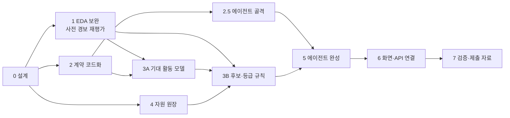

# 개발 과정

LINK-Radar를 어떤 순서로 만들었는지, 무엇이 끝났고 무엇이 남았는지 정리한 문서입니다. 무엇을 만드는지는 [설계 문서](설계_문서.md), 에이전트 구조는 [에이전트 설계](에이전트_설계.md), 분석 결과는 [리포트 목록](../reports/README.md)에 있습니다.

---

## 1. 원칙

- **판단은 코드, 설명은 LLM.** 신호·후보 종류·등급은 Python과 `configs/rules.yaml`이 정합니다. 같은 입력이면 같은 결과가 나옵니다. LLM은 질문 해석, 추가 조사 선택, 설명 문장만 맡습니다.
- **주장할 수 있는 만큼만.** 숫자마다 측정 단위·적용 범위·분모·기준 시점을 붙입니다. 근거가 모자라면 **판단 보류**입니다.
- **검증 방법을 먼저 정하고 기법을 넣음.** LightGBM·SHAP·임베딩 같은 기법은 단순한 기준선보다 나을 때만 씁니다. 채택 기준은 결과를 보기 전에 고정합니다.
- **다시 만들 수 있게.** 리포트는 모두 `notebooks/*.py`로 다시 만듭니다. 손으로 고친 숫자는 없습니다.

### 이 문서에서 쓰는 말

| 말 | 뜻 |
|---|---|
| 기준선 | 비교용으로 쓰는 가장 단순한 방법. 예: "같은 요일 평균" |
| 시간 누출 | 그 시점에는 알 수 없던 미래 자료가 계산에 섞이는 것 |
| 코호트 | 도시 × 연령대 × 성별 묶음. 카드 신호의 단위 |
| 반증 | 경보가 틀렸을 수 있는 이유(공휴일, 도시 공통 변화, 강수)를 먼저 확인하는 단계 |
| Guard | 결과를 내보내기 전 규칙 검사기. 통과 / 수정 / 보류 |
| 체크포인터 | 에이전트 실행 상태를 저장해 두었다가 중단 뒤 이어서 실행하게 하는 장치 |

---

## 2. 만든 순서

| 단계 | 한 일 | 결과물 | 상태 |
|---|---|---|---|
| EDA 0~5 | 원본 정리, 데이터 진단, 통신·카드 기초 분석, 외부 데이터 결합, 인사이트 재현 | `reports/eda0`~`eda5` | 완료 |
| 0 설계 | 설계 문서, 아키텍처, 에이전트 설계(상태·노드·분기·도구·Guard) | `docs/` | 완료 |
| 1 EDA 보완 | 과거 자료만 쓰는 사전 경보로 다시 평가, 행정동 코드 대응표, 시민생활 품질 점검, 기상청 ASOS로 폭염 재계산 | `reports/eda6_사전경보재평가`, `signals/alarm.py` | 완료 |
| 2 계약 코드화 | 단위·시간·연령·주장 계약, 필수 근거/선택 맥락, 값 상태, 스냅샷 발행, 실행 메타데이터, API 명세, CI | `contracts/`, `snapshot.py`, `runmeta.py`, `docs/API_명세.md` | 완료 |
| 2.5 에이전트 골격 | 가짜 도구로 그래프 분기·Guard·승인 대기·재시작 후 재개 확인 | `agent/graph.py`, `guard.py`, `checkpoint.py` | 완료 |
| 3A 기대 활동 모델 | 같은 요일 기준선, STL, LightGBM을 시간 순서대로 비교 | `reports/m1_기대활동모델`, `reports/m2_대리과제B` | 완료 (단순 기준선 유지) |
| 3B 후보·등급 규칙 | 후보 두 종류, Level 0~3 + 판단 보류, 비교안 A~D, 민감도, 페르소나 주입 | `configs/rules.yaml`, `reports/r1_등급규칙` | 완료 (rules-v1.0) |
| 4 자원 원장 | 상태 칸, 매칭 규칙, 수집 틀, 휴일 운영 의료기관·복지로 사업 등 보강 | `reports/w1_자원원장`, 원장 1,065건 | 1차 완료 (남은 수집은 6장) |
| 5 에이전트 완성 | 실제 도구 21개 연결, Claude 연결, 시연 사례 D1~D4 | `agent/tools/`, `configs/llm.yaml`, `configs/prompts/` | 완료 |
| 6 화면·API 연결 | React 대시보드 6개 화면, FastAPI 실제 백엔드, 승인·추가 조사·이어 묻기·인쇄·현장 결과 입력 | `web/`, `api/` | 완료 |
| 7 검증·제출 자료 | Guard·적대 질문 시험, LLM 사용 설명, 가상 데이터 설명, 기대효과, 대응 체계, 불확실성 표, 발표 스토리 | `tests/`, `docs/` | 완료 |

---

## 3. 단계별 결과 요약

### 1. 사전 경보 재평가 (EDA-6)

- 날짜 t의 기대값·중앙값·MAD는 t보다 앞선 날짜로만 계산합니다. t 뒤 자료를 바꿔도 t의 경보가 같다는 것을 테스트로 고정했습니다(`tests/test_alarm_no_leak.py`).
- 경보를 두 경로로 나눴습니다. **absolute**(코호트가 평소보다 실제로 줄었나)와 **local**(도시 공통 변화를 뺀 뒤에도 벗어났나). 도시 전체가 함께 떨어진 변화도 버리지 않고 따로 남깁니다(`tests/test_alarm_paths.py`).
- MAD가 0이거나 과거 관측일이 모자라면 점수를 만들지 않고 보류합니다. "도시보다 덜 늘어남"은 감소라고 부르지 않습니다.
- 결과: 코호트 전체 15% 하락을 90%(736/817) 잡았고 보통 2일 만에 울렸습니다. 작은 하락과 춘천 80대 이상은 잘 잡히지 않습니다.
- 연휴 뒤 회복은 **평소 수준(absolute)으로 돌아왔는지**로 봅니다. 도시 전체가 계속 낮으면 기각하지 않고 "확인 필요"로 남깁니다. 실제 경보 38건 중 19건이 여기에 해당했습니다.
- 경보 목록은 기준일마다 그날까지 본 자료로만 상태를 정합니다. 기준일 뒤에 난 결론은 "검토 중"으로 둡니다.

### 2. 계약

- **단위 계약**(`configs/grain_contract.yaml`): 데이터마다 지원하는 차원. 연령 × 시간대처럼 없는 조합은 오류·보류가 됩니다.
- **시간 계약**: 값마다 쓸 수 있게 된 날을 둡니다. 분석 모드는 `retrospective`(사후 분석) / `simulated_replay`(가정한 공개 지연으로 과거 재생) / `strict_as_of`(공개일이 확인된 자료만) 세 가지입니다.
- **연령 계약**: 분석 코호트(데이터가 지원하는 연령)와 서비스 대상 집단(정책 연령)을 나눕니다. 예: 통신 60+를 "70대 이상"으로 말하지 않습니다.
- **주장 계약**: 카드 거주지는 시도까지만 있어 "춘천 거주"라고 말할 수 없습니다. "강원 거주 고객의 춘천 가맹점 결제"로 씁니다.
- **필수 근거 / 선택 맥락**(`configs/candidate_inputs.yaml`): 필수가 빠지면 보류나 부분 판정, 선택이 빠지면 경고만 합니다.
- **스냅샷 발행**: 배치는 새 버전 폴더에 만들고 검증한 뒤 발행합니다. 실행 하나는 시작할 때 스냅샷을 고정하고 승인까지 같은 버전을 읽습니다.

### 2.5. 에이전트 골격

- 그래프 노드 18개, 끝점 5개(답변, 보류 답변, 후보 목록 발행, 확정, 보류). 모든 경로가 계약 검사를 거칩니다.
- 사실 검사와 표현 검사를 나눴습니다. 사실 검사는 (지표, 지역, 기간, 값, 단위, 방향, 근거 ID)를 근거 카드와 하나씩 대조합니다.
- Guard 수정은 최대 2회, 넘으면 보류. 추가 조사도 최대 2회.
- 승인은 보고서 판에 묶습니다. 같은 승인을 두 번 보내거나 동시에 보내도 기록은 1건, 예전 판 보고서에 대한 승인은 거절합니다. 서버를 다시 켜도 승인 대기에서 이어집니다.

### 3A. 기대 활동 모델

- 같은 요일 기준선 2개, STL, LightGBM을 시간 순서대로 평가했습니다. 채택 기준은 비교 전에 `configs/models.yaml`에 고정했습니다.
- STL은 1일 뒤 예측에서 더 정확했지만 7일 뒤 춘천에서 기준선보다 나빴고, LightGBM은 어느 칸에서도 기준을 넘지 못했습니다. 그래서 **단순 기준선을 유지**합니다.
- 하락 감지도 기존 경보 기준선이 가장 높았습니다. 같은 524쌍으로 맞춰도 순서가 같습니다.
- 대리 과제 B(통신 시간대 패턴 → 격자 고령 밀집)는 보조 과제입니다. 고립 예측 성능이 아닙니다.

### 3B. 후보·등급 규칙 (rules-v1.0)

- 후보는 두 종류입니다. **예정된 점검**(연휴 D-7, 폭염 예보, 기상특보, 동절기)과 **예상 밖 이탈**(반증을 통과한 결제 이탈).
- 등급과 검토 배정을 나눴습니다. 등급은 근거로 정하고, 검토할 수(K)는 배정·화면 목록에만 씁니다. K를 바꿔도 등급은 그대로입니다.
- 순위 모집단은 그 도시의 같은 기준월 행정동 전체로 고정했습니다. 화면 필터와 상관없이 순위가 같습니다.
- 비교안 A(주민등록 + 달력) → B(+ 통신) → C(+ 카드) → D(+ 자원)를 같은 조건에서 비교하고, 임계값 민감도와 후보 수 범위를 함께 공개합니다.
- 출력에는 확인할 영역, 내일 아침 체크리스트, 대응 템플릿이 붙습니다. 청년 남성은 방문 대신 "안내 강화"입니다.

### 4. 자원 원장

- 원장 v2: 이용 방법, 좌표 상태, 자격 기준 확인 여부, 운영 상태, 휴일 운영, 서비스 범위, 출처·확인일. 모르는 값은 "미상"입니다.
- 매칭 순서: 필요 유형 → 자격 → 운영 상태 → 거리. 관할 밖 물리 거점은 추천하지 않고, 위기 전화는 "위급 시 안내"로 목록 맨 아래에 둡니다.
- 수집 규칙: 원문 보관(레포에는 안 올림), 실행마다 기록, 실패하면 이전 값 유지, 목록에서 빠지면 "확인 필요", 손으로 고친 값은 정정 기록으로 남김.
- 보강 320건: E-Gen 휴일 운영 약국·병의원·응급의료기관, 복지로 사업, 노인맞춤돌봄 수행기관, 공식 페이지의 지역 사업·사람 자원. 원장은 745건 → 1,065건.
- 2026년 원장으로 2025년 기준일을 시연하면 사유에 "현재 원장 기준"을 표시합니다. `strict_as_of`에서는 거리를 등급 근거로 쓰지 않습니다.

### 5~6. 에이전트 완성과 화면

- 실제 도구 21개가 고정 스냅샷에서 읽습니다(`agent/tools/datasource.py`). Claude는 질문 해석·추가 조사 선택·설명 문장만 맡고, 없으면 규칙 기반·템플릿으로 같은 경로를 갑니다([LLM 사용](LLM_사용.md)).
- 가짜 LLM 6종, LLM 없음, 실제 Claude에서 시연 사례 D1~D4의 등급이 같습니다.
- 화면: 현황, 지도, 후보 목록, 후보 상세(근거·자원 판정·승인), 질의응답, 실행 기록. 추가 조사는 담당자 메모를 조사 범위로 바꾸고, 이어 묻기는 새 조사 없이 보고서 근거로만 답합니다.
- 후보로 연 조사는 그 후보만 다룹니다. 등급은 정기 감시와 같습니다(`tests/test_scope.py`).
- 상태 크기를 줄였습니다. 근거는 상태 한 곳에만 두고 카드·보고서는 ID로 가리킵니다.
- 현장 결과는 승인한 실행마다 건수만 받고, 모아 보기에서 10 미만은 숨깁니다. 등급 계산에는 쓰지 않습니다.
- 상태 관리: 그래프 확정 뒤 기록이 실패해도 재시작하면 맞춰지고, 추가 조사 범위는 재시작 뒤에도 남습니다. 후보를 바꾸면 이전 후보의 검토 값이 넘어가지 않습니다. 이어 묻기에서 맞는 대상이 없으면 다른 대상을 답하지 않고 `NO_TARGET`을 돌려줍니다.

---

## 4. 만들면서 바꾼 결정

| 결정 | 처음 | 바꾼 것 | 이유 |
|---|---|---|---|
| 경보 평가 | 6개월 전체 평균으로 사후 계산 | 과거 자료만 쓰는 사전 경보 | 사후 계산은 미래 자료가 섞여 성능 숫자로 쓸 수 없음 |
| 경보 이름 | 무주입 경보 = "오경보" | **배경 경보율** | 실제 자료에서는 진짜 이상이 없었는지 알 수 없음 |
| 공휴일 반증 | 공휴일 ±1일이면 바로 기각 | 공휴일 기대값·공통 요인·회복으로 설명되는지 계산한 뒤 결정 | 공휴일 인접만으로는 근거가 약함 |
| 강남 서비스 공백 | 1인세대 밀집 동 = 서비스 공백 | 버린 가설 | 다시 계산하니 재현되지 않음 |
| 시민생활 데이터 | 외부 검증 기준 | 탐색적 검증 참고 | 가설을 고를 때 이미 본 자료이고, 같은 SKT 모형 추정치 |
| 행정동 코드 결합 | 7자리 앞자리로 연결 | 명시적 대응표(`ref/adm_code_map.csv`) | 코드는 기관마다 다르고 바뀜 |
| 고립 정답 | 전국 고립률을 지역 확률로 | 배경 정보로만 | 전국 값이라 지역 차이가 없고, 등급은 확률이 아님 |
| 화면 | Streamlit | React + FastAPI | 담당자 업무 흐름과 상태 기록을 나누기 위해 |
| 모델 | LightGBM 채택 예정 | 같은 요일 기준선 유지 | 미리 정한 채택 기준을 넘지 못함 |
| 연휴 뒤 기대 경로 | 없음 | 명절 뒤 4일 | 2025 추석을 보고 정한 규칙. 다음 명절에서 값을 고정해 따로 확인([불확실성 표](불확실성_표.md) P-2) |

---

## 5. 알려진 한계

- 데이터가 2025년 하반기 6개월뿐입니다. 연휴는 추석 한 번, 여름·겨울도 한 번씩입니다. 인사이트는 모두 탐색적입니다([불확실성 표](불확실성_표.md)).
- 고립 정답 데이터가 없습니다. 하락 감지율은 일부러 넣은 하락에 대한 값이고, 실제 고립 탐지율이 아닙니다.
- 80대 이상과 작은 변화는 잘 잡히지 않습니다. 예정된 점검으로 보완합니다.
- 카드 데이터에서 행이 없는 날은 0건으로 가정합니다. 실제 공급 지연은 3일로 가정했습니다.
- 자원 원장의 운영 상태는 아직 모두 "미상"입니다. 좌표는 탐색용(원천 제공·지오코딩)입니다.
- 현장 결과 입력과 집계는 만들었지만, 실제 현장 운영으로 확인하지 않았습니다.
- 지도 바탕 타일은 공용 OSM 서버를 씁니다. 기관 배포 때는 바꿔야 합니다([NOTICE](../NOTICE.md)).
- 도구는 아직 불변 발행 스냅샷 폴더가 아니라 dev 파일(해시로 버전 고정)을 읽습니다. 파일이 바뀌면 진행 중 실행은 `SNAPSHOT_MISMATCH`로 멈추고 새 실행이 필요합니다.
- `bigcontest.ingest`는 고정 기간 전체를 다시 만들어 덮어씁니다. 같은 월 재적재를 거절하는 월 단위 적재는 아직 없습니다.
- 정기 감시 예약 실행(스케줄러)은 없습니다. 현황·지도·후보 목록 화면 요청이 그 기준일 실행이 없을 때 한 번 만듭니다(조회 역할로도 실행 행이 생김, LLM 비용은 없음).
- 인증은 토큰 방식입니다. 화면 빌드에 넣는 토큰은 누구나 볼 수 있어 조회 역할 공용 토큰만 넣고, 운영 로그인은 앞단 프록시에 맡깁니다([API 명세](API_명세.md) §1).

---

## 6. 다음 할 일

| 할 일 | 내용 |
|---|---|
| 쉼터 자료 | 행정안전부 무더위쉼터·한파쉼터 (재난안전데이터공유플랫폼 인증키 필요) |
| 좌표 확인 | 도로명주소 좌표 API로 탐색용 좌표를 확인 좌표로 교체 |
| 운영 상태 | 공식 목록 재수집과 전화 확인으로 "미상" 줄이기. 노인맞춤돌봄 2026 재지정·담당 구역 확인 |
| 자원 보강 | 춘천 경로당, 강남 동주민센터, 청년 자원, 푸드뱅크, 정신건강·자살예방센터 |
| 구조 취약성 보강 | 동별 기초생활수급자·임대주택·고시원 비율 (낙인 점수로 만들지 않고 따로 표시) |
| 반증 보강 | 춘천 대학 학사일정 (10~20대 변동) |
| 자원 검색 평가 | 지금은 구조화 필터만 씀(임베딩 검색은 미채택·미구현). 정답 자원 세트를 만든 뒤 키워드 검색과 임베딩 검색(KURE-v1·bge-m3) 비교. 부적격 추천이 늘면 채택하지 않음 |
| 발행 스냅샷 읽기 | 도구가 `data/snapshots/<id>/`를 읽게 바꾸고, 대기 중 실행의 스냅샷은 지우지 않기 |
| 월 단위 적재 | 새 월만 추가 적재, 같은 월 재적재는 거절 (`check_new_months`를 실제 적재 경로에 연결) |
| 정기 감시 미리 만들기 | 발행 직후 배치가 정기 감시 실행을 만들고, 현황·지도·후보 목록 GET은 읽기만 |
| 운영 로그인 | 앞단 프록시(nginx 등) + 기관 로그인(SSO·LDAP) → 사람별 토큰. 화면 번들에서 토큰 빼기 |
| 다음 명절 확인 | 연휴 뒤 기대 경로·임계값을 고정한 채 설 연휴로 다시 확인([불확실성 표](불확실성_표.md) 3절) |
| 공간 의존 민감도 | 강남 시민생활 비교에서 인접 동 영향 확인 |
| 현장 검증 | 실제 담당자 운영으로 현장 결과를 모아 규칙을 다시 평가 |

---

## 7. 평가 숫자를 말하는 규칙

- 모든 기능을 하나의 "고립 정확도"로 합치지 않습니다. 평가마다 **입증하는 것과 입증하지 못하는 것**을 함께 적습니다.
- "반증 정확도"가 아니라 **반증 기각률**입니다. 반증이 맞았는지 알 정답이 없습니다.
- 실제 자료의 무주입 경보는 **배경 경보율**, "오경보율"은 정상으로 만든 합성 시계열에서만 씁니다.
- 날씨·달력으로 경보 수가 줄면 "통계적 경보일 감소"입니다. "오탐 감소"나 "지원 불필요"라고 하지 않습니다.
- 순위상관을 "일치율"·"설명력"으로 부르지 않습니다.
- 방법이 다른 숫자끼리(예: 사후 계산 87%와 사전 경보 90%) "개선/악화"로 비교하지 않습니다.
- 후보 수는 임계값에 따라 바뀌므로 범위와 함께 말합니다.
