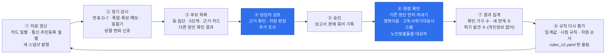

# 대응 체계와 운영 순환

LINK-Radar가 낸 후보를 받은 담당자가 **누가, 무엇을, 언제까지** 하는지 정리한 문서입니다. 등급 규칙은 [`configs/rules_v2.yaml`](../configs/rules_v2.yaml)(rules-v2.0), 대응 문구는 [`configs/action_templates.yaml`](../configs/action_templates.yaml)(action-v2)이 기준이고, 이 문서는 그 내용을 사람이 읽기 쉽게 옮긴 것입니다. 둘이 다르면 설정 파일이 맞습니다.

- 후보는 **행정동 × 집단**이고, 등급은 그 집단의 성·연령 칸(동 × 성 × 연령)으로 정합니다. 개인이 아닙니다. 시스템은 명단을 만들지 않고, **기존 명단 중 어느 것을 먼저 꺼낼지**만 안내합니다.
- 등급은 규칙 코드가 정합니다. LLM은 등급을 정하지 않습니다.
- 보고서는 내부용(대외비)입니다. 대외용 문구는 "특정 동네가 위험하다는 뜻이 아니라, 명절·계절에 돌봄이 끊기기 쉬운 이웃을 먼저 살피는 기간입니다"입니다.

## 1. 5단계 대응 체계

발표와 대외 설명에서는 주최 측 예시("고립 위험도 5단계")에 맞춰 **5단계 대응 체계**로 부릅니다(점검 결정 D-1). 다만 **위험 점수 5단계가 아닙니다.** Level 0~3은 "얼마나 먼저 볼지"의 순서이고, 판단 보류는 순서가 아니라 "자료가 모자라 아직 정하지 않음"이라는 별도 상태입니다.

| 단계 | 화면 이름 (현장 말) | 언제 이 단계가 되나 (rules-v2.0) | 대응 종류 |
|---|---|---|---|
| Level 3 | 우선 현장 확인 | 예정된 점검 시기 + 신한·SK 신호 2개 이상(행동 고립 H, 겨울 체류 감소 W, 카드 결제 공백 C 중) + 공공 자료 확인 1개 이상(1인 비율 S, 경제 취약 V, 거점 원거리 A 중) + 필수 근거 충족 + 근거 신뢰도 보통 이상 | 현장 확인 |
| Level 2 | 담당자 확인 | 동을 가리키는 통신 신호(H 또는 W)가 있지만 Level 3 조건에 못 미침, 또는 다른 원인 확인을 통과한 카드 결제 이탈(먼저 볼 동에 H) | 담당자 추가 분석 |
| Level 1 | 변화 관찰 | 통신 신호가 없음(카드 신호만·공공 자료만), 다른 원인으로 기각, 하락 폭 5% 미만 | 추세 관찰 |
| Level 0 | 평소 관찰 | 점검 시기도 이탈도 없음 | 정기 모니터링 |
| 판단 보류 | 자료 더 필요 | 필수 근거 결측, 다른 원인 확인이 아직 안 끝남(검토 중·확인 필요), 데이터가 지원하지 않는 질문 | 추가 자료 확보 |

- 외부 자료(주민등록·수급 통계·자원 원장)만으로는 등급이 오르지 않습니다. 대회 제공 데이터가 판단하고 외부 자료는 확인과 순서를 맡습니다.
- 트리거가 없는 날에는 Level 3가 나오지 않습니다. 평소에는 카드 결제 이탈만 Level 2까지 냅니다.
- 생활 변화 신호(예상 밖 이탈)는 카드가 도시 단위라 **Level 2가 상한**입니다. 먼저 볼 동은 같은 성·연령 칸의 행동 고립(통신)으로 고릅니다.
- 필수 근거 일부가 없거나(부분 판정) 근거 신뢰도가 낮으면 Level 3이 되지 않습니다.
- "1인 비율 상위"는 그 칸의 1인세대 비율(작은 칸 흔들림을 줄인 값)이 같은 도시·성·연령 칸 중 상위 1/3이고 도시 평균 이상인 경우입니다. 상위 1/3은 국가지표 사회적 고립도(2025 33.0%)에 맞춘 값입니다.
- "거점이 멂"은 지금(2026) 자원 원장 기준 거리입니다. 2025년 당시 거점이 있었는지는 확인하지 못해 확인용으로만 씁니다.
- 현장 용어: 예정된 점검 → "시기별 집중 안부 확인", 예상 밖 이탈 → "생활 변화 신호", 반증 → "다른 원인 확인".

## 2. 단계별 조치표

| | Level 3 우선 현장 확인 | Level 2 담당자 확인 | Level 1 변화 관찰 | Level 0 평소 관찰 | 판단 보류 자료 더 필요 |
|---|---|---|---|---|---|
| 뜻 | 이 동·집단을 이번 시기에 먼저 확인 | 근거가 둘 겹침. 담당자가 근거를 보고 현장 확인 여부를 정함 | 신호가 약하거나 다른 원인으로 설명됨 | 지금 볼 근거 없음 | 판단할 자료가 모자람. 안전하다는 뜻도, 위험하다는 뜻도 아님 |
| 누가 | 동 복지팀(맞춤형복지팀) + 노인맞춤돌봄 수행기관(고령층) | 동 복지팀 | 동 복지팀 (다음 정기 감시 때) | 시스템 정기 감시 | 동 복지팀 + 자료 담당 |
| 어떻게 | 기존 명단 꺼내기 → 전화 안부 → 방문 대상 추리기. 거점이 멀면 전화형·찾아가는 서비스 먼저 | 근거 카드·반증 결과 확인 → 필요하면 Level 3과 같은 순서 | 다음 기준일 결과와 비교 | — | 보고서가 알려 주는 "필요한 자료"를 확보하거나 다음 공급을 기다림 |
| 언제까지 | 시점 규칙의 기한 (아래 3절) | 같은 기한 안에 확인 여부 결정. 생활 변화 신호는 3일 안 | 다음 정기 감시 | — | 반증 결론이 나는 날(연휴 뒤 회복 확인일)까지 다시 봄 |
| 확인할 영역 | 시점 규칙·원인 유형에 따라 (아래 3절) | 같음 | — | — | — |
| 꺼낼 명단 | 행복이음 위기정보 대상자, 고독사위기대응시스템 배분 명단, 노인맞춤돌봄 대상자(고령층), 기존 사례관리 가구 | 같음 (담당자가 필요하다고 볼 때) | — | — | — |
| 연락할 곳 | 노인맞춤돌봄 수행기관(연휴·특보 중 안부 횟수 확대 요청), 우리동네돌봄단·통리장(읍·면은 이장). 주거 맥락이면 임대인·관리사무소·경비원·고시원 운영자(사전 안부 협력, 아래) | 같음 | — | — | — |
| 연계 자원 | 원인 유형별 자원 (아래 4절). 위기 전화는 맨 아래 "위급 시 안내"로 따로 | 같음 | — | — | — |
| 하지 말 것 | 동 주민 전체를 고립 위험군으로 부르기, 동 이름과 등급을 밖에 공개하기, 명단 없이 집집마다 방문하기 | "검토 후보 = 위험 가구"로 읽기, 카드 신호로 "이 동의 결제가 줄었다"고 말하기 | 기각된 신호를 "문제없음"으로 확정하기 | 등급이 없다고 기존 사례관리를 멈추기 | 보류를 "이상 없음"으로 처리하기, 보류를 풀려고 근거 없이 등급 매기기 |

- 꺼낼 명단과 연락할 곳은 집단마다 다릅니다. 중장년 남성 1인가구는 노인맞춤돌봄 명단을 빼고, 청년 남성은 청년 지원 기관(청년센터·마음건강 상담)과 문자·SNS 안내를 씁니다(`action_templates.yaml` `groups`).
- 확인할 영역은 고독사 위험자 판단도구의 영역 구조를 참고한 **현장에서 먼저 물어볼 영역**입니다. 판단도구 문항을 채점하지 않습니다.

### 사전 안부 협력자 (임대인·관리사무소·고시원 운영자)

2024 고독사 실태조사에서 최초 발견(신고)자의 임대인 범주는 43.1%였습니다([보건복지부 2025-11-27 보도자료](https://eiec.kdi.re.kr/policy/callDownload.do?num=273969&filenum=1#page=7), 7쪽). 원문 표의 범주명은 임대인 등이며 경비원·건물관리자·택배기사 등을 포함해 임대인 단독 비중은 알 수 없습니다. 이들을 **사전 안부 협력자**로 연락할 곳에 넣습니다(`action_templates.yaml` `housing_partners`).

- 붙는 때: 1인세대 비율 상위 동, 중장년·청년 남성 집단, 명절 당일(R2)·폭염(R4)·한파·대설(R6), 원인 유형 1인가구 밀집형·경제 취약형
- 부탁하는 것: 우편물 쌓임·관리비 체납·인기척 변화가 있으면 동 복지팀에 알려 달라는 것뿐. **개인정보를 넘겨받지 않고 감시를 맡기지 않습니다.**

## 3. 시점 규칙별 할 일·기한·확인할 영역

| 시점 규칙 | 할 일 | 기한 | 먼저 물어볼 영역 |
|---|---|---|---|
| R1 연휴 준비 (3일 이상 연휴 D-7) | 휴일 운영 약국·의료기관 안내, 상시 복용약 확인 | 연휴 전날까지 | 건강·복약 |
| R2 명절 당일 | 명절 당일 안부 확인, 도시락 연계 검토 | 명절 당일·다음 날 | 사회적 관계·연락, 식사·생활 |
| R3 연휴 뒤 회복 (춘천 고령층) | 연휴 뒤 장보기·진료 재개 확인 | 1주 안 | 식사·생활, 건강·복약 |
| R4 폭염 예보 | 고령층 생필품 접근 확인, 무더위 쉼터 안내 | 폭염 예보일 전까지 | 식사·생활, 건강·복약 |
| R6 기상특보 (호우·대설·한파) | 특보 전 안부 확인, 이동 지원·주거 안전·난방 창구 연계 | 특보 전까지 | 주거·안전, 이동·외출, 경제·지원 등 (하위 유형별) |
| W 동절기 (춘천 읍·면, 11~2월) | 순회 안부 확인, 경로당 운영·이동 지원 연계 검토 | 2주 안 | 이동·외출, 주거·안전 |
| 생활 변화 신호 (예상 밖 이탈) | 도시 단위 신호라 '먼저 확인할 동'부터 안부·생필품 접근 확인 | 3일 안 | 식사·생활, 건강·복약 |

- 2025년 자료에는 날씨 예보 기록이 없어 R4·R6은 과거 재생에서 "확인 필요"로 나옵니다. 운영할 때는 그날의 예보로 켭니다.
- 영역 6개: 건강·복약 / 식사·생활 / 사회적 관계·연락 / 이동·외출 / 주거·안전 / 경제·지원.

### 폭염 특보 단계별 안부 횟수 (R4)

| 단계 | 기상청 기준 (예보) | 안부 횟수 |
|---|---|---|
| 평소 | — | 노인맞춤돌봄 주 2~3회 |
| 폭염주의보 | 일 최고 체감온도 33℃ 이상 2일 이상 예상 | 격일 1회 이상 안부 전화 |
| 폭염경보 | 체감온도 35℃ 이상 2일 이상 예상 | 매일 1회 안부 전화 |
| 폭염중대경보 (2026-06 신설) | 체감온도 38℃ 또는 기온 39℃ 예보 | 하루 2회(오전·오후): 보건복지부 대응(세계일보 2026-07-02 보도) |
| 단계를 모름 | 예보 자료 없음 (2025 과거 재생 등) | "특보 단계 확인 필요": 확인 전까지 매일 1회(경보 기준) |

- 순서는 모두 **전화 → 받지 않으면 당일 방문**입니다.
- 단계는 후보의 `heat_stage` 칸(등급 규칙이 채움)을 먼저 보고, 없으면 트리거 문장의 단계 말을 찾습니다. 둘 다 없으면 단계를 지어내지 않고 "확인 필요"로 둡니다 (`report.py` `heat_stage_key`).

### 명절 전·중·후 한 묶음 (R1·R2·R3)

명절 대응은 R1·R2·R3를 따로 보이지 않고 **한 사건의 세 단계**로 함께 보입니다(대응안·후보 상세·인쇄 보고서). 지금 후보가 서 있는 단계에 "지금" 표시가 붙습니다.

| 단계 | 기간 | 할 일 | 고령층 | 중장년 남성 1인가구 | 청년 남성 |
|---|---|---|---|---|---|
| 연휴 전 (R1) | D-7 ~ 전날 | 휴일 약국·의료기관 안내, 상시 복용약, 연휴 중 연락할 사람 | 전화·방문 1회 | 안내 문자 1회 (연결 묶음 안내) | 안내 문자·SNS 1회 |
| 연휴 중 (R2) | 명절 당일 ~ 연휴 끝 | 당일 안부, 도시락·끼니, 돌봄단·통리장 안부 요청 | 전화·방문 2회 | 동의한 가구만 안부 문자·전화 1회 | 상담 창구 안내 유지 |
| 연휴 뒤 (R3) | 끝난 다음 날 ~ 10일 | 장보기·진료 재개, 연락 안 된 가구 재확인, 연결한 자원 이용 확인 | 전화·방문 1회 | 연결 확인 1회 (3단계의 확인) | 안내 유지 |

- 고령층 횟수는 **강남구 2026 추석 종합대책**(2026-09-22, 노인맞춤돌봄 대상자 연휴 전 1회·중 2회·뒤 1회, 우리동네돌봄단 연휴 중 최소 1회)과 같습니다. 같은 대책에는 **중장년 남성 1인가구 안부 확인 항목이 없습니다**: LINK-Radar가 메우는 칸입니다.
- "명절에 고독사가 늘어난다"고 말하지 않습니다(월별 통계 없음). "명절에 진료·장보기 결제가 끊기고 돌봄 인력도 쉰다"까지만 말합니다.

## 4. 원인 유형별 연계 자원

| 원인 유형 | 대표 자원 (원장에서 자격·운영 확인 후 추천) |
|---|---|
| 1인가구 밀집형 | 외로움안녕120(전화), 중장년 자조모임 |
| 달력 공백형 (연휴) | E-Gen 휴일 운영 약국·병의원·응급의료기관(명절 당일 운영은 응급의료포털에서 다시 확인), 도시락, 안부 확인 |
| 계절 공동화형 (춘천 읍·면 겨울) | 순회 안부 확인, 경로당 운영, 이동 지원 |
| 폭염형 | 무더위 쉼터, 생필품 배달 |
| 한파·대설·호우형 | 한파쉼터·에너지 지원 창구, 안부 확인, 이동 지원, 주거 안전(행정복지센터 창구) |
| 거점 원거리형 | 위기 전화가 아닌 전화형 자원 먼저(외로움안녕120, 춘천 AI케어콜 등), 찾아가는 서비스 |

- 고령층 안부·관계 자원 순서: 노인맞춤돌봄서비스(제도) → 행정복지센터 → 노인맞춤돌봄 수행기관 → 경로당·사람 자원 → … ([W-1 리포트](../reports/w1_자원원장/README.md) 5절).
- 자살예방·정신건강 위기상담 전화는 순위에 넣지 않고 맨 아래 **"위급 시 안내"**로 둡니다.
- 자원 원장은 1,440건(원래 745건 + 보강 323건 + 춘천 경로당 372건)입니다. 운영 상태·자격은 대부분 "확인 필요"라 화면에 그대로 띄우고 담당자가 판정합니다.

### 중장년 남성 연결 묶음과 3단계 연결

중장년 남성 1인가구에는 상시 안부 제도가 거의 없습니다. 방문 대신 **본인이 고르는 연결 안내**를 씁니다. 연결은 전화번호 목록이 아니라 사회적 처방의 효과 요소(처방 전 평가, 맞는 활동 연결, 연결 인력의 개별 지원)를 따른 3단계입니다.

1. **안내**: 일자리·생계 / 술·마음건강 / 사람 만남 중 무엇이 먼저인지 본인에게 묻고 맞는 곳 1개를 안내
2. **연결**: 본인이 원하면 담당자가 그 기관에 먼저 연락해 첫 상담 날을 잡아 줌 (방문 강요 아님)
3. **확인**: 1~2주 뒤 첫 상담에 갔는지, 맞지 않으면 다른 1개를 다시 안내

| 필요 | 강남 | 춘천 |
|---|---|---|
| 일자리·생계 | 서울강남고용센터(고용복지+센터) 02-3468-4794 | 춘천고용센터(고용복지+센터) 033-250-1900 |
| 술·마음건강 | 강남구중독관리통합지원센터(새빛온, 2025-11 개소), 서울강남구정신건강복지센터 | 춘천시중독관리통합지원센터(자조모임), 춘천시정신건강복지센터 |
| 사람 만남·1인가구 | 강남구 1인가구 커뮤니티센터 | 춘천시 고독사 예방(은둔청년·중장년 고립가구 지원) |

- 고용센터는 고용24 기관 찾기(2026-10-14 확인), 강남 중독관리센터는 강남구 보도자료(2025-11-05)로 넣었습니다. 원장 ID는 `action_templates.yaml` `groups.중장년 남성 1인가구.bundle`, 원장에 있는지는 테스트가 확인합니다.
- 춘천 1인가구 지원센터·중장년 자조모임은 공식 자료를 찾지 못했습니다. 중독관리통합지원센터 자조모임으로 대신합니다.

### 보호 자원 칸

후보 동을 보일 때 그 동에 **이미 있는** 경로당·무더위·한파 쉼터·돌봄단·통장·이장을 같은 화면에 함께 보입니다(지도 옆 패널, 후보 상세). 지역 표적화가 동을 "결핍의 장소"로 굳히지 않게 하려는 것입니다. **위험 칸이 아니며 등급·순위에 쓰지 않습니다.**

| 묶음 | 강남 | 춘천 |
|---|---|---|
| 경로당 | 동마다 수 (서울시 경로당 현황, 187곳) | 도시 집계만 (371곳: 읍 25·면 157·동 189). 동별 목록 없음 |
| 무더위·한파 쉼터 | 구청 목록 안내 (무더위 90·한파 83곳) | 미수집 (행안부 쉼터 API 키 필요) |
| 돌봄단·통장·이장 | 도시 단위 안내 | 도시 단위 안내 |

자료와 상태는 [`external/resources/protective/README.md`](../external/resources/protective/README.md).

## 5. 기존 시스템과의 자리

LINK-Radar는 고독사위기대응시스템(2026년 2월 개통)·복지사각지대 발굴시스템을 **대신하지 않습니다**. 그 앞 단계에서 "어느 동·집단을, 언제, 어떤 영역부터" 볼지 순서를 정합니다.

| | 고독사위기대응시스템 · 복지사각지대 발굴시스템 | LINK-Radar |
|---|---|---|
| 단위 | 개인·가구 | 행정동 × 생애단계 집단 |
| 근거 | 단전·단수·체납 등 행정 위기정보 | 통신·카드 생활 집계, 주민등록 구조, 달력·날씨 |
| 시점 | 위기정보 기반 선제 발굴·정기 배분 | 연휴 D-7 점검·동절기 해당 월 점검, 생활 변화 신호는 관측 후 (기상 예보 미연동) |
| 개인정보 | 사용 | 사용하지 않음 |
| 결과 | 확인할 대상자 명단 | 먼저 볼 동·집단·영역과 근거, 어떤 명단을 먼저 꺼낼지 |

## 6. 운영 순환

| 단계 | 주기 | 누가 | 지금 구현 |
|---|---|---|---|
| ① 자료 갱신 | 카드 일 단위(공급 지연 가정 3일), 통신·주민등록 월 단위 | 배치 | 스냅샷 버전 고정·발행 (`src/bigcontest/snapshot.py`) |
| ② 정기 감시 | 매일(생활 변화 신호), 연휴 D-7·예보일(시기별 점검) | 시스템 | 실제 그래프 정기 감시 모드 |
| ③ 후보 목록 | 정기 감시마다 | 시스템 | 등급 rules-v2.0 (칸 판정), 근거 카드, 대응 5칸·체크리스트 |
| ④ 담당자 검토 | 후보가 나올 때 | 동 복지팀 | 후보 상세, 자원 판정, 추가 조사(최대 2회), 이어 묻기 |
| ⑤ 승인 | 검토 뒤 | 결재권자 (예: 팀장, 기관마다 다름) | 보고서 판에 묶은 승인, 인쇄용 보기 |
| ⑥ 현장 확인 | 기한 안 (3절) | 동 복지팀, 수행기관, 돌봄단·통리장 | 시스템 밖 (기존 업무). 후속 확인일만 기록 |
| ⑦ 결과 집계 | 사건(연휴·계절)이 끝난 뒤 | 동 복지팀 | 승인한 실행의 완료 카드에서 입력 (`POST /runs/{id}/outcomes`), 현황의 "현장 확인 결과" 카드에서 모아 봄. 10 미만 칸은 "10 미만". 집계 값만 받고 개인 기록은 받지 않음 |
| ⑧ 규칙 다시 평가 | 분기 또는 큰 사건 뒤 | 분석 담당 | 리포트 스크립트로 다시 계산 (`notebooks/r3_rules_v2.py`, 기대효과 `notebooks/r3d_impact.py`, 신호 방향 `notebooks/r3c_signal_check.py`). 다음 자료에서 볼 것은 [불확실성 표](불확실성_표.md) 3절 |

- ⑦은 "정답 라벨이 없다"는 문제에 대한 현장형 답입니다. 연휴가 끝나면 동·집단별로 "확인한 가구 수, 새로 연계한 수, 위기를 발견한 수"만 모으고, 다음 연휴 전에 임계값과 시점 규칙을 다시 평가합니다. 개인 이름·주소는 받지 않습니다.
- 규칙을 바꾸면 `rules_v2.yaml`의 `version`을 올리고, 후보마다 `rule_id`·`rule_version`이 남아 어느 판으로 정한 등급인지 추적합니다.
- **이의·정정 기록**도 ⑧의 입력입니다. 담당자가 후보 상세에서 "이 후보는 현장 사정과 다르다" 등을 사유와 함께 남기면(`POST /objections`), 승인 담당자가 검토 중 → 반영/기각으로 처리합니다. 반영된 기록은 다음 규칙 평가 때 검토 목록으로 씁니다. 등급을 자동으로 바꾸지 않습니다([윤리 대응](윤리_대응.md)).
