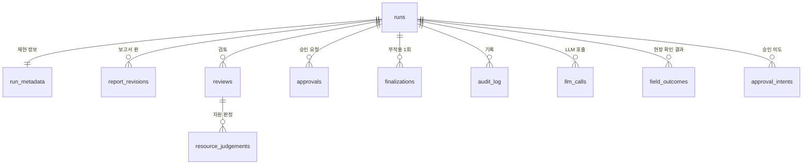

# 데이터 모델 (SQLite)

실행·승인·검토 기록을 담는 SQLite 테이블입니다. 분석 데이터(Parquet/DuckDB 스냅샷)와는 따로 둡니다.

| 저장소 | 내용 | 쓰는 주체 |
|---|---|---|
| 분석 스냅샷 `data/snapshots/<id>/` | 분석 데이터, 신호, 후보 | 배치만 (`bigcontest.snapshot.publish`). 읽기 전용 |
| SQLite `data/state/linkradar.sqlite` | 실행, 체크포인트, 보고서 버전, 검토·메모, 승인, 감사 로그, LLM 호출 | **FastAPI만**. CLI도 API를 거침 |

API 요청·응답 모양은 [API 명세](API_명세.md), 실행 흐름은 [에이전트 설계](에이전트_설계.md)에 있습니다.

## 1. 테이블 목록

| 테이블 | 한 행 | 키 | 바뀌나 |
|---|---|---|---|
| `runs` | 실행 1건 | `run_id` | 상태 칸만 바뀜 |
| `run_metadata` | 실행 1건의 재현 정보 | `run_id` | 한 번만 기록 |
| LangGraph 체크포인트 | 그래프 상태 | `thread_id` = `run_id` | LangGraph가 관리 |
| `report_revisions` | 보고서 한 판 | `run_id` + `report_revision` | 새 판은 새 행 |
| `reviews` | 담당자 검토 1회 | `review_id` | 새 검토는 새 행 |
| `resource_judgements` | 검토 1회의 자원 1건 판정 | `review_id` + `resource_id` | 새 검토는 새 행 |
| `approvals` | 승인·보류·추가 조사 요청 1건 | `approval_id`, 멱등 키 유일 | 바뀌지 않음 |
| `finalizations` | 실행의 부작용(확정 기록, 보고서 파일 저장) 1건 | `run_id` + `step` | 바뀌지 않음 |
| `audit_log` | 누가 언제 무엇을 했나 | 자동 번호 | 추가만 |
| `llm_calls` | LLM 호출 1번 | 자동 번호 | 추가만 |
| `field_outcomes` | 승인된 실행의 후보(동·집단) 하나의 현장 확인 건수 | `outcome_id`, 멱등 키 유일 | 추가만 (고쳐 적으면 새 행, 저장 순서 `seq`가 가장 큰 행이 기준) |
| `approval_intents` | 승인·보류·추가 조사 요청을 그래프보다 먼저 적은 "의도" 1건 (실제 그래프만) | 멱등 키 유일 | 대기 → 반영/거절 한 번만 |



## 2. 테이블 상세

### 2.1 `runs`

| 칸 | 타입 | 뜻 |
|---|---|---|
| `run_id` | TEXT PK | 실행 ID. LangGraph `thread_id`로도 씀 |
| `mode` | TEXT | `monitoring` / `qa` |
| `question` | TEXT NULL | 담당자 질문 (개인정보를 가린 글만, 보존 기한 지나면 NULL) |
| `candidate_id` | TEXT NULL | 후보를 열어 조사한 경우 |
| `as_of` | TEXT | 분석 기준일 `YYYY-MM-DD` |
| `analysis_mode` | TEXT | `retrospective` / `simulated_replay` / `strict_as_of` |
| `snapshot_id` | TEXT | 시작할 때 고정한 스냅샷. 바꾸지 않음 |
| `status` | TEXT | `queued` / `running` / `awaiting_approval` / `published` / `answered` / `abstained` / `approved` / `held` / `failed` |
| `route` | TEXT NULL | `lookup` / `investigate` / `out_of_scope` |
| `evidence_revision` | INTEGER | 근거 판 (추가 조사하면 올라감) |
| `report_revision` | INTEGER | 지금 보고서 판 |
| `report_stale` | INTEGER | 1이면 검토가 바뀌어 보고서를 다시 만들어야 함. 이동안 승인 거절 |
| `extra_rounds` | INTEGER | 추가 조사 횟수 (최대 2) |
| `abstain_reason` | TEXT NULL | 실행 전체 보류 사유 (계약 사유 코드 포함) |
| `error_code` | TEXT NULL | `failed`일 때 오류 코드 |
| `created_at`, `updated_at` | TEXT | 시각 |

### 2.2 `run_metadata`

`bigcontest.runmeta.RunMetadata`를 그대로 저장합니다. 같은 `run_id`로 다시 저장하면 첫 기록을 그대로 쓰고, 내용이 다르면 거절합니다.

| 칸 | 타입 | 뜻 |
|---|---|---|
| `run_id` | TEXT PK | |
| `snapshot_id` | TEXT | |
| `code_commit`, `code_dirty` | TEXT, INTEGER | 코드 커밋, 커밋 안 된 변경 여부 |
| `cleaning_rule_version` | TEXT | 예: `clean-v1` |
| `rule_version`, `ledger_version` | TEXT | 등급 규칙, 자원 원장 버전 |
| `body` | TEXT (JSON) | 원본 해시, 계약 설정 버전, 임계값 등 전체. 실제 그래프는 `inputs`에 시작 입력(질문·도시·기준일·모드·스냅샷·LLM·도구)을 고정해 두고, 재시작하면 이 값으로 이어 감 |
| `created_at` | TEXT | |

### 2.3 LangGraph 체크포인트

LangGraph SQLite 체크포인터가 만드는 테이블을 그대로 씁니다(직접 고치지 않음).
- `thread_id = run_id`. `await_approval`에서 멈춘 상태가 저장되고, API를 다시 켜도 같은 `run_id`로 이어서 실행합니다.
- 실제 그래프는 상태 DB 옆 다른 파일 `<이름>.agent.sqlite`에 둡니다(예: `linkradar.agent.sqlite`). API 트랜잭션과 그래프 저장이 서로 잠금을 기다리지 않게 하려는 것입니다. 같은 파일에 멱등 기록 `run_records`(확정·발행 1건)와 재개 키 `run_resume_keys`(추가 조사·검토 재개 1번)도 있습니다.
- 체크포인트는 실행이 끝나거나 승인 대기에서 멈출 때만 저장합니다(`durability="exit"`). 도중에 꺼지면 고정 입력으로 처음부터 다시 돌립니다(결정론이라 결과가 같음).
- 상태 안에서 근거는 `evidence`에 한 번만 둡니다. 근거 카드는 근거 ID 목록, 보고서는 카드 ID만 담습니다. `report_revisions`에는 펼친 보고서 전체(카드·근거 포함)를 저장합니다.

### 2.4 `report_revisions`

| 칸 | 타입 | 뜻 |
|---|---|---|
| `run_id` | TEXT | |
| `report_revision` | INTEGER | 1부터. PK(`run_id`, `report_revision`) |
| `evidence_revision` | INTEGER | 이 보고서가 쓴 근거 판 |
| `snapshot_id` | TEXT | |
| `body` | TEXT (JSON) | `Report` 모델 (근거 카드 + 문장) |
| `reason` | TEXT | 새 판을 만든 이유: `initial` / `review_changed` / `guard_revise` / `extra_round` |
| `created_at` | TEXT | |

옛 판은 지우지 않습니다. 이 표의 행은 **발행된 판**(화면에 보여 준 판)입니다. 승인은 `runs.report_revision`이 마지막 발행 판과 같고 `report_stale=0`일 때 그 판에만 받습니다. 실제 그래프에서는 Guard가 고친 초안을 발행하지 않으므로 판 번호가 건너뛸 수 있습니다(예: 1판이 REVISE → 처음 발행은 2판).

### 2.5 `reviews`, `resource_judgements`

담당자 업무 기록입니다.

`reviews`

| 칸 | 타입 | 뜻 |
|---|---|---|
| `review_id` | TEXT PK | |
| `run_id` | TEXT | |
| `reviewer` | TEXT | 담당자 ID |
| `checked_evidence_ids` | TEXT (JSON 배열) | 담당자가 본 근거 ID |
| `memo` | TEXT NULL | 메모 |
| `follow_up_on` | TEXT NULL | 후속 확인일 `YYYY-MM-DD` |
| `report_revision_before`, `report_revision_after` | INTEGER | 이 검토로 보고서 판이 바뀌었으면 다름 |
| `created_at` | TEXT | |

`resource_judgements`

| 칸 | 타입 | 뜻 |
|---|---|---|
| `review_id` | TEXT | PK(`review_id`, `resource_id`) |
| `resource_id` | TEXT | 자원 원장 ID |
| `judgement` | TEXT | `적합` / `보류` / `부적합` |
| `memo` | TEXT NULL | |

자원 판정이 이전 검토와 다르면 `runs.report_stale = 1`, 보고서를 다시 만들면 새 `report_revisions` 행과 `runs.report_revision` 증가. 실제 그래프는 다시 만든 보고서의 `review_ids`가 지금까지의 검토를 모두 담았는지 확인한 뒤에 `report_stale = 0`으로 바꿉니다(그 사이 새 검토가 오면 한 번 더 만듦).

### 2.6 `approvals`

| 칸 | 타입 | 뜻 |
|---|---|---|
| `approval_id` | TEXT PK | |
| `run_id` | TEXT | |
| `idempotency_key` | TEXT UNIQUE | 화면이 만드는 멱등 키. 같은 키 재전송 → 첫 결과 그대로 (`duplicate=true`) |
| `decision` | TEXT | `approved` / `held` / `more` |
| `report_revision` | INTEGER | 승인한 보고서 판. 지금 판과 다르면 거절(409) |
| `approver` | TEXT | |
| `memo` | TEXT NULL | |
| `created_at` | TEXT | |

같은 키로 다른 결정·판을 보내면 `409 IDEMPOTENCY_KEY_REUSED`.

같은 실행의 승인 행은 `created_at` 다음 넣은 순서(rowid)로 읽습니다. `approval_id` 끝자리는 무작위라 순서로 쓰지 않습니다(검토 `reviews`도 같음).

### 2.6.1 `approval_intents` (실제 그래프)

API 표와 그래프 파일(`<이름>.agent.sqlite`)은 서로 다른 DB라 한 트랜잭션으로 묶지 않습니다. 그래서 승인 요청은 그래프를 재개하기 **전에** 이 표에 먼저 적습니다.

| 칸 | 타입 | 뜻 |
|---|---|---|
| `seq` | INTEGER PK | 받은 순서 |
| `idempotency_key` | TEXT UNIQUE | 요청의 멱등 키 (`approvals`와 같은 값) |
| `run_id` | TEXT | |
| `approval_id` | TEXT | 미리 정한 승인 ID. 복구할 때도 이 값으로 `approvals` 행을 만듦 |
| `decision`, `report_revision` | | 요청한 결정·판 |
| `approver`, `memo`, `actor`, `audit_extra` | | 승인자 이름, 승인 메모, 감사 actor·추가 칸 (복구한 감사 기록도 원래 값으로) |
| `focus` | TEXT (JSON) NULL | 추가 조사만: 검증한 후보 ID·도구·확인할 반증 + 받을 때 정한 계획(`plan`)과 그 계획의 LLM 기록. **메모 원문은 없음**(마스킹해 계획을 정하는 데만 쓰고 `memo_given`만 남김) |
| `state` | TEXT | `pending`(대기) → `applied`(반영) 또는 `rejected`(거절) |
| `result` | TEXT NULL | 반영한 확정 종류(확정·보류·more) 또는 거절 코드 |
| `created_at`, `updated_at` | TEXT | `created_at`은 복구한 `approvals.created_at`에도 그대로 씀 |

승인·보류 순서: ① 의도 기록 → ② 그래프 재개(확정 기록 `run_records.finalize` 1건) → ③ API `approvals`·`finalizations`·감사 기록(한 트랜잭션) + 의도 `applied` → ④ 상태 맞춤. 어느 단계에서 멈춰도 다음 승인·검토 요청 또는 재시작(`recover`)이 맞춥니다.
- 그래프에 확정 기록이 있으면: 그 기록의 멱등 키로 의도를 찾아 빠진 승인·확정 행을 원래 결정·판·승인자·키·받은 시각으로 채움(감사 `approval_received`에 `recovered: true`). 같은 실행의 다른 대기 의도는 `approval_rejected`로 닫음. 결정·판은 그래프 기록 그대로라 반대 결정이나 새 판으로 바뀌지 않음.
- 그래프 기록이 없고 의도가 대기 중이면: 먼저 받은 의도로 그래프를 재개해 끝냄. 그래프가 거절하면(판이 바뀜 등) 의도는 `rejected`.
- 추가 조사는 승인 행·의도·`running`을 한 트랜잭션으로 적고, 재시작하면 의도의 `focus`(같은 계획)로 이어 감. 계획은 받을 때 한 번 정하므로 재시작 뒤 LLM을 다시 부르지 않음.
- 이 표가 생기기 전 파일: 의도 없이 그래프만 확정된 실행은 그래프 기록의 요청 값으로 채우고(감사 actor `system`), 추가 조사는 범위 없이 이어 감.

### 2.7 `finalizations`

재개·재시도해도 부작용이 한 번만 일어나게 하는 표입니다(에이전트 설계 §7).

| 칸 | 타입 | 뜻 |
|---|---|---|
| `run_id` | TEXT | PK(`run_id`, `step`) |
| `step` | TEXT | 예: `finalize`, `save_report:3`, `publish_candidates` |
| `result` | TEXT (JSON) | 기록한 결과 (확정/보류, 파일 경로·해시) |
| `created_at` | TEXT | |

`INSERT ... ON CONFLICT DO NOTHING` 후 저장된 행을 읽어 돌려줍니다. 동시에 두 번 승인해도 확정 기록은 1건입니다.

### 2.8 `audit_log`

| 칸 | 타입 | 뜻 |
|---|---|---|
| `id` | INTEGER PK | 자동 번호 |
| `at` | TEXT | 시각 |
| `actor` | TEXT | 담당자 ID 또는 `system` |
| `action` | TEXT | `run_created`, `review_saved`, `review_rejected`, `report_regenerated`(요청 판·발행 판·반영한 검토 ID), `approval_received`, `approval_rejected`, `snapshot_pinned`, `followup_answered`·`followup_abstained`(이어 묻기, 질문 원문 없음), `outcome_recorded`(기록 ID·후보·건수)·`outcome_rejected`(현장 확인 결과) 등 |
| `run_id` | TEXT NULL | |
| `detail` | TEXT (JSON) | 오류 코드, 판 번호 등. 개인정보·원본 값은 넣지 않음 |

추가만 하고 고치거나 지우지 않습니다.

### 2.9 `llm_calls`

에이전트 설계 §8: 호출마다 모델·토큰·비용·프롬프트 버전·소요 시간을 남깁니다.

| 칸 | 타입 | 뜻 |
|---|---|---|
| `id` | INTEGER PK | |
| `run_id` | TEXT | |
| `node` | TEXT | LLM 자리: `classify` / `choose_extra_tools` / `explain` / `brief` / `plan_more` / `followup` / `init` |
| `model_id` | TEXT | `configs/llm.yaml`의 ID |
| `prompt_version` | TEXT | `configs/prompts/` 버전 |
| `input_tokens`, `output_tokens` | INTEGER | |
| `cost_usd` | REAL | |
| `latency_ms` | INTEGER | |
| `status` | TEXT | `ok` / `error` / `fallback`(규칙 기반·템플릿으로 대신함) |
| `error_code` | TEXT NULL | |
| `created_at` | TEXT | |

### 2.10 `field_outcomes`

승인한 조사 뒤 현장에서 확인한 결과입니다. **건수만** 담고 이름·주소·전화번호·메모 칸은 없습니다.

| 칸 | 타입 | 뜻 |
|---|---|---|
| `outcome_id` | TEXT PK | `out-YYYYMMDD-HHMMSS-xxxxxxxx` |
| `run_id` | TEXT | 승인된(`approved`) 조사 실행 |
| `candidate_id` | TEXT | 그 실행의 후보 (동·집단 하나) |
| `city`, `adm_cd`, `group_label` | TEXT | 서버가 후보에서 채움 (이탈 후보는 먼저 확인할 첫 동) |
| `trigger_code`, `event_id` | TEXT | 사건 ID 둘째 칸(R1·R4·R6·W·DEV …)과 사건 ID. 모아 보기 묶음 |
| `checked_households` | INTEGER | 확인 가구 수 |
| `contacted`, `absent` | INTEGER | 연락됨, 부재 (합 ≤ 확인 가구) |
| `new_links`, `crises_found` | INTEGER | 신규 연계, 위기 발견 (각각 ≤ 확인 가구) |
| `recorded_by` | TEXT | 적은 담당자 |
| `idempotency_key` | TEXT UNIQUE | 같은 저장을 두 번 보내도 1건 |
| `created_at` | TEXT | 표시용 시각. 같은 시각이 될 수 있어 순서에는 쓰지 않음 |
| `seq` | INTEGER UNIQUE | 저장 순서 (쓰기 트랜잭션 안에서 `MAX(seq)+1`). 고쳐 적은 기록의 순서는 이 값으로만 정함. 예전 파일은 켤 때 칸을 더하고 넣은 순서(rowid)로 채움 |

**작은 칸 규칙**: 적은 건수는 그대로 저장합니다. 실행 하나의 건수는 그 실행 상세(`GET /runs/{id}/outcomes`)에서만 보이고, 모아 보기(`GET /outcomes/summary`)와 내보내기에서는 합계가 10 미만인 칸을 숫자 없이 "10 미만"으로 내보냅니다(숨긴 칸이 들어간 비율도 내지 않음). 같은 (실행, 후보)는 `seq`가 가장 큰 행만 셉니다. 실행 결과 조회·모아 보기·저장소가 모두 같은 함수(`outcomes.latest`)를 씁니다. 이 집계는 다음 규칙 평가에 입력으로 쓸 수 있지만 등급 계산에는 쓰지 않습니다(`bigcontest.rules.outcomes`).

## 3. 만들기 (DDL 초안)

```sql
CREATE TABLE runs (
  run_id TEXT PRIMARY KEY,
  mode TEXT NOT NULL CHECK (mode IN ('monitoring','qa')),
  question TEXT, candidate_id TEXT,
  as_of TEXT NOT NULL,
  analysis_mode TEXT NOT NULL CHECK (analysis_mode IN ('retrospective','simulated_replay','strict_as_of')),
  snapshot_id TEXT NOT NULL,
  status TEXT NOT NULL,
  route TEXT,
  evidence_revision INTEGER NOT NULL DEFAULT 0,
  report_revision INTEGER NOT NULL DEFAULT 0,
  report_stale INTEGER NOT NULL DEFAULT 0,
  extra_rounds INTEGER NOT NULL DEFAULT 0 CHECK (extra_rounds <= 2),
  abstain_reason TEXT, error_code TEXT,
  created_at TEXT NOT NULL, updated_at TEXT NOT NULL
);

CREATE TABLE run_metadata (
  run_id TEXT PRIMARY KEY REFERENCES runs(run_id),
  snapshot_id TEXT NOT NULL,
  code_commit TEXT, code_dirty INTEGER,
  cleaning_rule_version TEXT NOT NULL,
  rule_version TEXT, ledger_version TEXT,
  body TEXT NOT NULL,
  created_at TEXT NOT NULL
);

CREATE TABLE report_revisions (
  run_id TEXT NOT NULL REFERENCES runs(run_id),
  report_revision INTEGER NOT NULL,
  evidence_revision INTEGER NOT NULL,
  snapshot_id TEXT NOT NULL,
  body TEXT NOT NULL,
  reason TEXT NOT NULL,
  created_at TEXT NOT NULL,
  PRIMARY KEY (run_id, report_revision)
);

CREATE TABLE reviews (
  review_id TEXT PRIMARY KEY,
  run_id TEXT NOT NULL REFERENCES runs(run_id),
  reviewer TEXT NOT NULL,
  checked_evidence_ids TEXT NOT NULL DEFAULT '[]',
  memo TEXT, follow_up_on TEXT,
  report_revision_before INTEGER NOT NULL, report_revision_after INTEGER NOT NULL,
  created_at TEXT NOT NULL
);

CREATE TABLE resource_judgements (
  review_id TEXT NOT NULL REFERENCES reviews(review_id),
  resource_id TEXT NOT NULL,
  judgement TEXT NOT NULL CHECK (judgement IN ('적합','보류','부적합')),
  memo TEXT,
  PRIMARY KEY (review_id, resource_id)
);

CREATE TABLE approvals (
  approval_id TEXT PRIMARY KEY,
  run_id TEXT NOT NULL REFERENCES runs(run_id),
  idempotency_key TEXT NOT NULL UNIQUE,
  decision TEXT NOT NULL CHECK (decision IN ('approved','held','more')),
  report_revision INTEGER NOT NULL,
  approver TEXT NOT NULL, memo TEXT,
  created_at TEXT NOT NULL
);

CREATE TABLE finalizations (
  run_id TEXT NOT NULL REFERENCES runs(run_id),
  step TEXT NOT NULL,
  result TEXT NOT NULL,
  created_at TEXT NOT NULL,
  PRIMARY KEY (run_id, step)
);

CREATE TABLE audit_log (
  id INTEGER PRIMARY KEY AUTOINCREMENT,
  at TEXT NOT NULL, actor TEXT NOT NULL, action TEXT NOT NULL,
  run_id TEXT, detail TEXT NOT NULL DEFAULT '{}'
);

CREATE TABLE llm_calls (
  id INTEGER PRIMARY KEY AUTOINCREMENT,
  run_id TEXT NOT NULL, node TEXT NOT NULL,
  model_id TEXT NOT NULL, prompt_version TEXT NOT NULL,
  input_tokens INTEGER, output_tokens INTEGER, cost_usd REAL, latency_ms INTEGER,
  status TEXT NOT NULL CHECK (status IN ('ok','error','fallback')), error_code TEXT,
  created_at TEXT NOT NULL
);

CREATE TABLE field_outcomes (
  outcome_id TEXT PRIMARY KEY,
  run_id TEXT NOT NULL REFERENCES runs(run_id),
  candidate_id TEXT NOT NULL,
  city TEXT NOT NULL, adm_cd TEXT, group_label TEXT,
  trigger_code TEXT NOT NULL, event_id TEXT,
  checked_households INTEGER NOT NULL CHECK (checked_households >= 0),
  contacted INTEGER NOT NULL CHECK (contacted >= 0),
  absent INTEGER NOT NULL CHECK (absent >= 0),
  new_links INTEGER NOT NULL CHECK (new_links >= 0),
  crises_found INTEGER NOT NULL CHECK (crises_found >= 0),
  recorded_by TEXT NOT NULL,
  idempotency_key TEXT NOT NULL UNIQUE,
  created_at TEXT NOT NULL,
  seq INTEGER
);

CREATE TABLE approval_intents (
  seq INTEGER PRIMARY KEY AUTOINCREMENT,
  idempotency_key TEXT NOT NULL UNIQUE,
  run_id TEXT NOT NULL REFERENCES runs(run_id),
  approval_id TEXT NOT NULL,
  decision TEXT NOT NULL CHECK (decision IN ('approved','held','more')),
  report_revision INTEGER NOT NULL,
  approver TEXT NOT NULL, memo TEXT,
  actor TEXT NOT NULL, audit_extra TEXT NOT NULL DEFAULT '{}',
  focus TEXT,
  state TEXT NOT NULL CHECK (state IN ('pending','applied','rejected')),
  result TEXT,
  created_at TEXT NOT NULL, updated_at TEXT NOT NULL
);

CREATE INDEX idx_reviews_follow_up ON reviews(follow_up_on);
CREATE INDEX idx_audit_run ON audit_log(run_id);
CREATE INDEX idx_outcomes_run ON field_outcomes(run_id);
CREATE UNIQUE INDEX idx_outcomes_seq ON field_outcomes(seq);
CREATE INDEX idx_intents_run ON approval_intents(run_id, state);
```

## 4. 규칙 요약

- 상태를 쓰는 것은 FastAPI 하나. 화면·CLI·에이전트 도구는 SQLite에 직접 쓰지 않습니다.
- 실행의 `snapshot_id`는 처음 정한 값을 끝까지 씁니다. 새 스냅샷이 발행돼도 승인 대기 실행의 근거·등급은 그대로입니다.
- 승인은 최신 `report_revision` + 멱등 키로만. `report_stale = 1`이면 거절합니다.
- 계약 위반(Guard ABSTAIN)으로 끝난 실행(`status = abstained`)은 승인으로 풀리지 않습니다.
- 옛 보고서 판·검토·승인 요청은 지우지 않습니다(감사용).

## 운영 메모

- ID는 시각 + 무작위 값입니다(`run-YYYYMMDD-HHMMSS-xxxxxxxx`, `rev-…`, `apr-…`). 행을 지워도 겹치지 않습니다.
- 감사 로그 `actor`는 토큰으로 정한 담당자 이름, 공용 토큰이면 `공용:<이름>`, `system`, 또는 개발 모드의 `dev-unauthenticated`입니다. `action`에는 `approval_rejected`, `review_rejected`, `text_purged`(보존 기한 정리, 행 수만)도 있습니다.
- 질문(`runs.question`, `run_metadata.body.inputs.question`)·메모(`reviews`·`resource_judgements`·`approvals`·`approval_intents`의 `memo`)는 저장 전에 개인정보를 가립니다(`api/store.py` `mask_text`). 보존 기한(`LINKRADAR_TEXT_RETENTION_DAYS`, 기본 365일)이 지나면 `api/retention.py`가 글 칸만 NULL로 비웁니다.
- SQLite는 WAL, `busy_timeout` 30초입니다. uvicorn 워커 1개로 띄웁니다. 처리할 예약이 없는 조회는 쓰기 트랜잭션을 열지 않습니다.
- 추가 조사 재개의 멱등 키는 `run_resume_keys` 표에 따로 둡니다.
- 두 DB(API 표·그래프 파일)의 승인 기록은 `approval_intents`로 맞춥니다(§2.6.1). 한 트랜잭션이라고 가정하지 않습니다.
- 스냅샷 한계: 실제 그래프의 활성 스냅샷은 지금 dev 파일(`data/interim`·`external`·`ref`)의 해시 id입니다(`AgentSnapshotService`). 실행은 시작할 때 id를 고정하고 도구가 매번 해시를 다시 확인하므로, 승인 대기 중에 파일이 바뀌면 조용히 새 자료를 읽지 않고 `SNAPSHOT_MISMATCH`로 멈춥니다. 하지만 그 id의 파일을 따로 보존하지 않아, 파일이 바뀐 뒤 오래 멈춰 있던 실행(추가 조사·검토 반영)은 이어 갈 수 없고 새 실행이 필요합니다. 발행 스냅샷(`data/snapshots/<id>/`, `bigcontest.snapshot`)은 불변 폴더지만 지금 도구는 그 폴더를 읽지 않습니다. 장기 운영에서 과거 실행을 이어 가려면 도구가 발행 폴더를 읽게 바꾸고 `prune`이 대기 중 실행의 스냅샷을 지우지 않게 해야 합니다(다음 단계).
