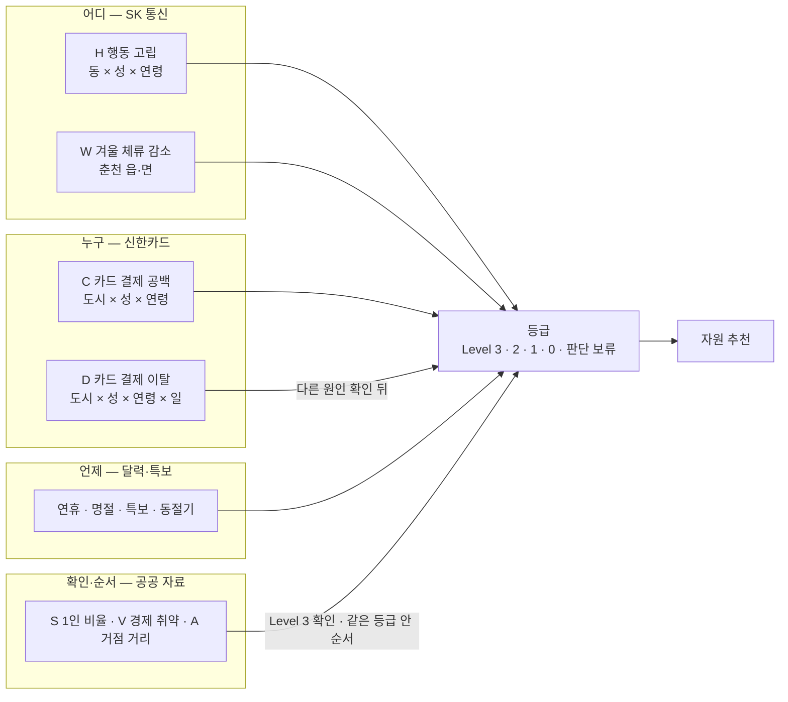

# 데이터 역할: 누구 · 어디 · 언제 · 아닌지 · 무엇을

제공 데이터(신한카드·SK 통신)와 공공데이터가 판단에서 각각 무슨 몫을 하는지 정리합니다. 규칙은 [`configs/rules_v2.yaml`](../configs/rules_v2.yaml)(rules-v2.0)이고, 숫자는 [R-3 규칙 개정](../reports/r3_규칙개정/README.md)과 실제 자료 정기 감시 결과에서 가져왔습니다.

## 1. 역할 그림

| 질문 | 답하는 자료 | 하지 않는 것 |
|---|---|---|
| **누구** (어느 성·연령) | 신한카드: 지난 연휴에 60대 이상 의료 결제가 40·50대보다 더 끊김 | 카드로 동을 고르지 않음 (카드는 도시 단위) |
| **어디** (어느 동) | SK 통신: 그 성·연령이 비슷한 동보다 동네에 오래 머묾, 읍·면 겨울 체류 감소 | 체류를 주민 수로 말하지 않음 |
| **언제** | 공휴일 달력·기상특보·동절기 | 날씨 실측을 예보 대신 쓰지 않음 |
| **아닌지** | 카드 결제 이탈의 다른 원인 확인(연휴 평소 감소·도시 전체 변화·비) | 결제 하락을 고립이라고 말하지 않음 |
| **확인·순서** | 주민등록 1인 비율, 수급 통계, 자원 원장 거리 | 이 자료만으로 등급을 올리지 않음 |
| **무엇을** | 복지자원 원장 | 자원이 실제 운영 중인지 확정하지 않음 |

## 2. 제공 데이터가 판단을 정한 사례

### 사례 1. 연휴 주의 지역: 카드가 연령을, 통신이 동을 (2025 추석 7일 전)

- 카드: 추석 7일 전에 이미 볼 수 있던 광복절 연휴에서 60대 이상 의료 결제가 40·50대보다 강남 −24%(남)·−14%(여), 춘천 −18%(남)·−26%(여) 더 줄었습니다. 그래서 연휴 점검은 60대 이상 칸에만 겁니다.
- 통신: 60대 이상 칸 중 행동 고립 상위이면서 공공 자료 확인(1인 비율·경제 취약)이 겹친 동만 Level 3입니다. 강남 세곡동·역삼1동·논현1·2동, 춘천 효자2동·소양동·약사명동·조운동(14칸, 8개 동).
- 연휴 점검을 모든 성·연령 칸에 걸던 초기 규칙에서는 같은 날 Level 3가 82칸이었습니다. 연휴에 실제로 끊기는 연령으로 좁힌 결과입니다.

### 사례 2. 공공 자료만으로는 오르지 않음 (같은 날, 강남·춘천)

- 이전 판에서 동 전체 1인세대 비율 상위라 Level 2였던 춘천 남면·남산면·북산면·교동·후평1동, 강남 삼성2동·대치4동·일원1동·수서동은 통신 신호가 없어 Level 1이 됐습니다.
- 반대로 1인세대 상위가 아니어도 통신 행동 고립이 상위인 강남 압구정·청담·신사·역삼2·개포2동, 춘천 석사·퇴계·강남·신사우동은 Level 2 후보로 들어왔습니다.

### 사례 3. 동절기: 카드가 아니라 통신 두 신호 (2025-12-20, 춘천)

- 춘천 60대 이상의 최근 4주 카드 결제는 9월보다 40·50대 대비 +2%로 겨울에 더 줄지 않았습니다. 카드 신호는 서지 않습니다.
- 대신 읍·면 60대 이상 겨울 체류 감소(통신 W)와 행동 고립(통신 H)이 함께 선 남산면·동산면이 Level 3입니다. 겨울 체류만 준 읍·면(신북읍·동면·신동면·사북면 등)은 Level 2입니다.

### 사례 4. 카드 반증이 결론을 정함 (추석 뒤 10/13, 춘천)

- 추석 뒤 춘천 60대·80대 이상 여성 카드 결제 이탈은 연휴 평소 감소와 도시 공통 변화를 빼도 남아 Level 2가 됐습니다. 먼저 볼 동은 같은 성·연령 칸의 행동 고립 상위 동(효자2동·효자3동·약사명동)입니다.
- 같은 기간 다른 경보 다수는 도시 전체가 함께 낮아 판단 보류로 남았습니다(공휴일이 원인이라는 증거는 아니라 기각하지 않음).

## 3. 한계

- 카드는 도시(가맹점 시군구) × 성 × 연령 단위라 동을 직접 가리키지 않습니다. 카드 이탈 후보는 Level 2가 상한입니다.
- 통신 연령은 60대 이상 한 묶음이고, 체류는 주민 수가 아닙니다. 6개월 자료라 겨울 변화가 매년 반복되는지 모릅니다.
- 연휴 연령 근거는 2025 추석 한 번의 관측입니다. 위 사례는 2025년 하반기 재생(simulated_replay)이고 현장 결과로 확인한 것이 아닙니다.
