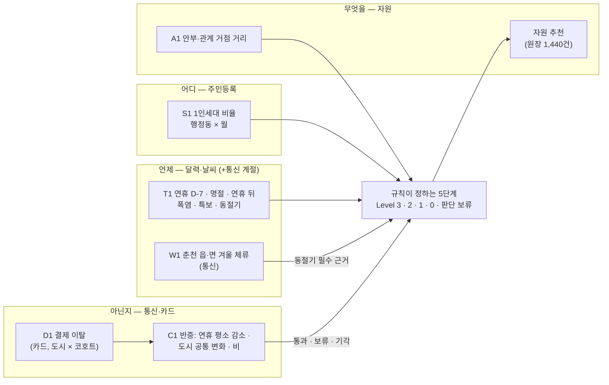

# 데이터 역할: 어디 · 언제 · 아닌지 · 무엇을

제공 데이터(통신·카드)와 공공데이터가 판단에서 각각 무슨 몫을 하는지 한 장으로 정리합니다. 숫자는 [R-2 위험도 결과](../reports/r2_위험도결과/README.md) 5절과 [EDA-6](../reports/eda6_사전경보재평가/README.md)에서 가져왔고, 노트북을 다시 돌리면 그 리포트 숫자가 기준입니다 (rules-v1.1). 행 수는 기준일·집단을 합친 **후보 행**이라 서로 다른 동·사람 수가 아닙니다([숫자 사용 기준](숫자_사용_기준.md)).

## 1. 역할 그림

| 질문 | 주로 답하는 자료 | 왜 그 자료인가 | 하지 않는 것 |
|---|---|---|---|
| **어디** (어느 동) | 주민등록 1인세대 비율 (S1), 원장 거리 (A1) | 행정동 단위로 있는 자료는 주민등록·원장뿐 | 카드로 동을 고르지 않음 (카드는 도시 단위) |
| **언제** (언제 먼저) | 공휴일 달력·날씨 (T1), 통신 겨울 체류 (W1) | 돌봄이 끊기기 쉬운 시기는 미리 알 수 있음 | 날씨 실측을 예보 대신 쓰지 않음 |
| **아닌지** (평소에도 그런가) | 카드 결제 이탈과 반증 (D1·C1), 통신 | 줄어든 게 연휴·도시 전체·비 때문인지 가려 줌 | 결제 하락을 고립이라고 말하지 않음 |
| **무엇을** (어떤 도움) | 복지자원 원장 | 필요 유형·대상·거리로 연결 | 자원이 실제 운영 중인지 확정하지 않음 |

솔직하게 적으면, **통신·카드는 "어디"를 거의 바꾸지 않습니다.** 강남 동 순위는 비교안 A~D 모두 같습니다([R-1 2절](../reports/r1_등급규칙/README.md)). 제공 데이터의 몫은 "언제 볼지"와 "그 변화가 평소에도 있는 일인지"를 가리는 데 있습니다.

## 2. 통신·카드가 판단을 바꾼 사례 3개

R-2 에서 같은 근거에서 카드·통신 근거만 빼고 규칙을 다시 돌려, 등급이 달라지는 후보를 모두 찾았습니다([`판단변화.csv`](../reports/r2_위험도결과/판단변화.csv)).

### 사례 1. 카드 반증: 실제 경보 38건 중 19건은 "도시 전체가 함께 낮았다"

- 2025년 하반기 카드 결제 이탈 경보 38건 중 19건은 도시 대비 추가 이탈이 없는 '도시 공통 변화'였습니다(추석 무렵). 반증이 없었다면 19개 코호트를 각각 "결제가 줄어든 집단"으로 올렸을 것입니다.
- 이 경보들은 기각하지 않고 '확인 필요'(판단 보류)로 둡니다. 공휴일이 원인이라는 증거는 아니기 때문입니다.
- 출처: [EDA-6 2절](../reports/eda6_사전경보재평가/README.md), `경보_목록.csv`.

### 사례 2. 카드 반증 자료가 있어야 결론이 난다: 추석 뒤 춘천 고령 여성 2건 Level 2

- 기준일 3개 × 집단 4개를 합친 예상 밖 이탈 **후보 행 25개**(같은 코호트가 여러 기준일·집단에 겹쳐 셈)는 반증 자료(연휴 기대값·도시 공통요인, 카드에서 계산)가 없으면 **모두 판단 보류**입니다.
- 반증 자료가 있으면 25행 중 **9행**이 판정 결론을 얻습니다(고립 9건을 찾았다는 뜻이 아님). 추석 뒤(10/13) 춘천 60대 여성(이탈 14.9%)·80대+ 여성(28.9%)은 연휴 평소 감소와 도시 공통요인을 빼도 이탈이 남아 **반증 통과 → Level 2**(먼저 확인할 동: 효자2동·교동·효자3동, 공유 맥락)가 됐습니다.
- 반대로 강남 추석 D-7 60대 남성 경보는 반증은 통과했지만 이탈 크기가 2.3%라 **Level 1(추세 관찰)**에 머뭅니다 (`L1-DEV-SMALL`). 카드 값이 "담당자 추가 분석까지는 아니다"를 정한 경우입니다.
- 출처: [R-2 결과표의 예상 밖 이탈 표·5절](../reports/r2_위험도결과/README.md).

### 사례 3. 통신이 Level 3의 필수 근거를 채움: 춘천 동절기 남면·남산면·북산면

- 동절기(12/20) 춘천 남면·남산면·북산면의 **중장년 남성**은 1인세대 상위 + 해당 집단 안부·관계 거점 15~19km라 Level 3입니다. 고령층은 경로당 보강 후 Level 2이며 이 설명에 포함하지 않습니다. 이때 필수 근거가 **읍·면 겨울 체류 변화(통신, W1)**입니다.
- 통신을 빼면 필수 근거가 비어 부분 판정(`CAP-PARTIAL`) → **Level 2**로 내려갑니다. 후보 동 3곳 × 중장년 남성 집단 = **3행**이 이렇게 바뀝니다. 같은 3곳의 중장년 남성 결과입니다 (청년 남성은 rules-v1.1 부터 동을 고르지 않음).
- 근거 값: 춘천 읍·면 주민형 격자 60대+ 체류 겨울 −9.7% (읍·면 단위 CI −18.0~−3.6%), 동 지역 +0.6% ([EDA-5 4절](../reports/eda5_인사이트재현/README.md)).

## 3. 한계

- 카드는 도시(가맹점 시군구) × 성 × 연령 단위라 동을 직접 가리키지 않습니다. 이탈 후보의 동은 '먼저 확인할 동(공유 맥락)'이고 Level 2가 상한입니다.
- 통신 연령은 60대+ 한 묶음, 체류는 주민 수가 아닙니다. 6개월 자료라 겨울 변화가 매년 반복되는지 모릅니다.
- 위 사례는 2025년 하반기 재생(simulated_replay)이고 추석 한 번입니다. 현장 결과로 확인한 것이 아닙니다.
