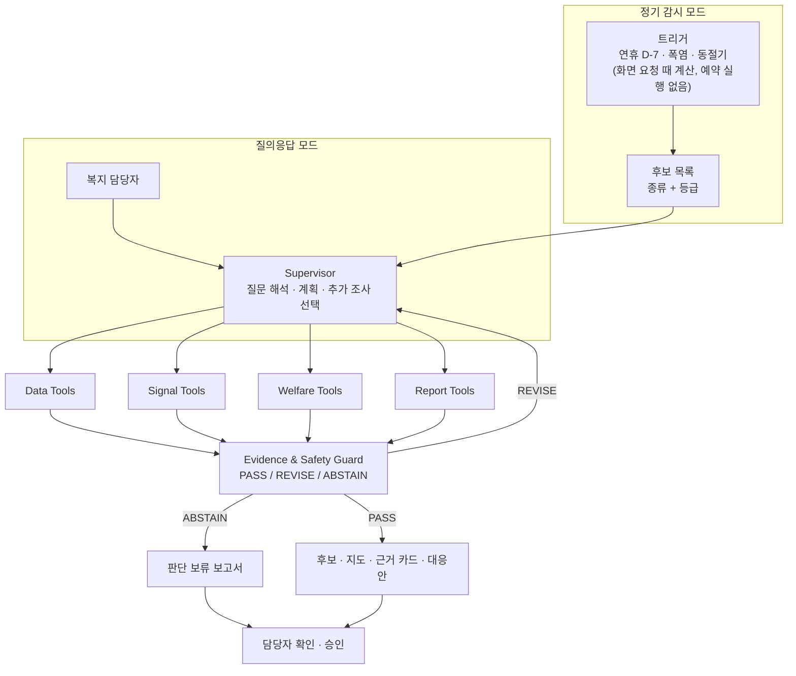

# LINK-Radar 설계 문서 (v5.8)

2026 제14회 빅콘테스트 AI데이터 활용 분야 「사회적 고립 예방 및 대응을 위한 AI 에이전트 개발」

- 이 문서는 "무엇을 만드는가"를 정합니다. 만든 순서와 남은 일은 [개발 과정](개발_과정.md)에 있습니다.
- 바꾼 내용은 §11 이력에 남깁니다.
- 확정도: 🟢 확정(데이터로 확인) · 🟡 잠정(근거는 있으나 추가 확인 필요) · 🔴 가설(확인 전)
- 제출 설명자료: [대응 체계](대응_체계.md)(5단계 조치표·운영 순환), [기대효과](기대효과.md), [불확실성 표](불확실성_표.md), [가상 데이터 설명](가상데이터_설명.md), [LLM 활용 설명](LLM_사용.md), [발표 스토리](발표_스토리.md)
- v4까지의 초기 리서치(주제·기술 스택, 에이전트 구조, 후보군 기준, 탐색용 EDA)는 레포에 넣지 않았고, 결론만 이 문서에 옮겼습니다.

---

## 0. 한 페이지 요약

**LINK-Radar는 개인의 고립을 판정하지 않습니다.** 통신·카드 집계 데이터와 공공데이터로 **어디**(주민등록 1인세대 비율이 높은 동, 관측된 복지 거점까지 먼 춘천 읍·면), **누구**(고령층, 중장년 남성, 청년 남성), **언제**(연휴·폭염·겨울처럼 공백이 예상되는 때)를 먼저 확인할지 근거와 함께 제안합니다. 근거가 부족하면 스스로 **판단을 보류**합니다.

**역할 범위**: 복지 담당자가 고독사 위험자 판단도구로 **현장 확인할 동·집단의 우선순위와 확인할 영역을 근거와 함께 제안**합니다. 소통·재정 두 영역에는 집계 수준의 간접 참고 지표가 있지만, 개인 판단도구의 어떤 문항도 우리 데이터로 직접 채점할 수 없습니다. 개인 판정은 현장 판단도구와 담당자의 몫입니다.

| 구성 | 결정 | 확정도 |
|---|---|---|
| 문제 정의 | 지역 × 생애단계 집단의 검토 우선순위 제안. 개인 판정·고독사 예측은 하지 않음 | 🟢 |
| 평가 축 | 구조 취약성 / 행동 신호 / 근거 신뢰도 / 서비스 공백을 **따로** 보여 주고 점수 하나로 합치지 않음 | 🟢 |
| 후보 종류 | **예정된 점검**(달력·계절 트리거)과 **예상 밖 이탈**(기대값 대비 하락)을 나눔 | 🟢 |
| 등급 | Level 0~3 + **판단 보류**. 검토 배정(K)과는 분리 | 🟢 체계 / 🟡 임계값 |
| 에이전트 | Supervisor 1개 + 결정론적 도구 4묶음 + Evidence & Safety Guard. 정기 감시와 질의응답 두 모드 | 🟢 구조 / 🟡 세부 |
| 판단과 설명 | 등급·후보는 코드와 `rules.yaml`이 정하고, LLM은 질문 해석·추가 조사 선택·설명 문장만 | 🟢 |
| 기술 | Python 3.13(uv), DuckDB·pandas·Parquet, statsmodels·LightGBM, LangGraph, FastAPI, React | 🟢 |

---

## 1. 문제 정의와 범위

### 1.1 하는 것
1. 행정동 × 생애단계 집단의 **검토 우선순위**와 근거 카드
2. **예정된 공백 시점**(연휴 D-7, 폭염, 동절기)에 맞춘 사전 점검 목록
3. 반례·교란 요인 검토 결과 ("왜 틀릴 수 있는가")
4. 출처·조건·확인일이 있는 복지 자원 후보
5. 담당자가 확인·승인하는 대응 제안서와 재현 가능한 실행 기록

### 1.2 하지 않는 것
- 개인 식별, 개인별 외출·소비 추적
- 고립·고독사 확률의 개인별 추정, "고립 위험 87점" 같은 진단형 점수
- 통신·카드 집계 데이터를 개인 수준으로 결합
- 자동 대상자 선정, 행정 처분, 개인 접촉
- "실시간" 표현 (데이터는 월·일 단위 배치)

### 1.3 공모전 요구와의 대응

| 공모전 흐름 | LINK-Radar |
|---|---|
| 위험 신호 탐지 | Signal 도구: 4개 축 신호 계산 |
| 위험 수준 판단 | 후보 종류 + Level 0~3 + 판단 보류 (§5) |
| 위험 원인 분석 | 반증을 먼저 하고 유형 분류 (§5.5) |
| 대응 방안·복지 자원 추천 | Welfare 도구: 구조화 필터 → (검증되면) 의미 검색 |
| 우선 지원 지역·계층 | 정기 감시의 후보 목록 + 시점 점검 |

공식 주제설명자료(p.8~10)의 필수 포함 요소와 최소 요구 성과물은 위 흐름과 함께 다음 문서로 답합니다: 대응 전략·기대효과 → [대응 체계](대응_체계.md)·[기대효과](기대효과.md), 가상 데이터 생성 방식 → [가상 데이터 설명](가상데이터_설명.md), LLM 활용 방법 → [LLM 활용 설명](LLM_사용.md). 발표에서는 등급을 주최 측 예시에 맞춰 **5단계 대응 체계**로 부릅니다(Level 0~3 + 판단 보류, 위험 점수 아님).

### 1.4 기존 시스템과의 관계

LINK-Radar는 기존 위기가구 발굴 체계를 대신하지 않고, 그 **앞 단계에서 "어느 동·집단을, 언제, 어떤 영역부터" 볼지 순서를 정하는 보조 도구**입니다.

| | 복지사각지대 발굴시스템 · 고독사위기대응시스템 (보건복지부) | LINK-Radar |
|---|---|---|
| 단위 | 개인·가구 | 행정동 × 생애단계 집단 |
| 근거 | 단전·단수·체납 등 행정 위기정보 | 통신·카드 생활 집계, 주민등록 구조, 달력·날씨 |
| 시점 | 정기 배분 (사후 신호 중심) | 연휴·폭염·겨울 전 **예고**, 결제 이탈은 관측 후 |
| 개인정보 | 사용 | 사용하지 않음 |
| 결과 | 확인할 대상자 명단 | 먼저 볼 동·집단·영역과 근거, 어떤 명단을 먼저 꺼낼지 안내 |

- 담당자는 LINK-Radar가 제안한 동·집단·시기에 맞춰, 행복이음 위기정보 명단·고독사 위험군·노인맞춤돌봄 대상자 같은 **기존 명단을 먼저 꺼내 확인**합니다. 대상자 선정과 개인 판단은 기존 체계와 현장 판단도구가 맡습니다.
- 보고서는 후보마다 "내일 아침 체크리스트"(꺼낼 명단, 연락할 곳, 방법, 기한, 확인할 영역)를 냅니다. 확인할 영역은 판단도구 문항 채점이 아니라 현장에서 먼저 물어볼 영역입니다. 시스템은 명단을 만들지 않습니다.
- 보고서는 내부용(대외비)입니다. 대외용 문구는 "특정 동네가 위험하다는 뜻이 아니라, 명절·계절에 돌봄이 끊기기 쉬운 이웃을 먼저 살피는 기간입니다"입니다.
- 고독사위기대응시스템은 2026년 2월 개통했습니다(보건복지부, [KDI 경제정보센터 정리](https://eiec.kdi.re.kr/policy/materialView.do?num=277335)).

---

## 2. 데이터 계약

데이터별 컬럼과 정리 방법은 [데이터 설명](데이터_설명.md)에 있습니다.

### 2.1 데이터별 단위와 허용 주장

| 데이터 | 단위 | 역할 | 해도 되는 주장 | 하면 안 되는 주장 | 확정도 |
|---|---|---|---|---|---|
| SK 성연령 | 50m 칸 × 월 × 성 × 연령(60+ 묶음) | 생활권 구성 | "이 생활권에 머무는 사람의 연령 구성" | 두 도시 모두 인원수를 주민 수로 읽기(체류·활동 집계라 같은 사람이 여러 칸에 나옴), "주민" 단정 | 🟢 |
| SK 시간대 | 칸 × 월 × 시간 | 동네 유형 | "이 생활권의 리듬 유형" | 특정 연령의 리듬 | 🟢 |
| SK 요일 | 칸 × 월 × 요일 | 주말/평일, 방문객 분리 | "이 생활권의 주말 비중" | 특정 연령의 주말 활동 | 🟢 |
| 카드 데이터2 (주력) | 가맹점 시군구 × 일 × 업종 × **고객 거주 시도** × 성 × 연령 | 시점 신호 | "강원 거주 80대 이상 고객의 춘천 가맹점 생필품 결제가 비교 기준보다 낮음" | 행정동 단위 소비, "춘천 거주"·"강남구 거주"(거주지는 시도까지만), 고립·독거 탐지 | 🟢 |
| 카드 데이터1 (보조) | 가맹점 시군구 × 일 × 시간대(6시간 단위 4구간) × 업종 × 성 × 연령 | 시간대 지표 | "도시 단위 코호트의 시간대 활동" | 거주자 단정, 데이터2와 합산 | 🟢 |
| 주민등록 (2025년 7~12월) | 행정동 × 월 × 성 × 연령, 세대원 수 | **구조 취약성 핵심**, 동별 인구 규모의 유일한 기준 | "1인세대 비율", 동별 인구 규모 | "1인가구"(개념이 다름) | 🟢 |
| 서울 시민생활 데이터 | 행정동 × 성 × 5세 연령 × 파일 기준월 (강남만) | **탐색적 검증 참고** | "통신 기반 고립 지표(상대 기준)를 부분 재현" | "고립을 예측했다", 춘천 적용, 독립 검증이라고 부르기 | 🟢 |
| 기상청 ASOS | 관측소 × 일 (서울 108, 춘천 101) | 날씨 반증·트리거 | "서울 관측소 기준 폭염일" | 동별 날씨 | 🟢 |
| 복지자원 원장 | 시설·서비스 745건 | 서비스 공백, 매칭 | "출처·확인일이 있는 자원 후보" | 두 도시 직접 비교(목록 구성이 다름) | 🟡 |
| 춘천 독거노인 현황 | 행정동 | **핵심 등급·검증에서 제외** | — | 수준값·순위 모두 (정의 불명확. 확인 후 재도입) | 🟢 |

**시민생활 데이터 주의**
- SKT 자료로 만든 로지스틱 회귀 추정치이고 정의가 상대적입니다(예: 1인가구 중 소통 지수 하위 10%). 대회 통신 데이터와 공급자가 같아 완전히 독립된 출처가 아닙니다.
- 가설을 고를 때 이미 본 자료라 "독립 검증"이 아니라 **탐색적 검증 참고**로 부릅니다. 강남 22개 동뿐이라 강한 관계만 확인할 수 있습니다.
- **관측 기간이 파일 기준월과 다를 수 있습니다.** 「2022년 서울시민생활데이터 매뉴얼」(p.6 각주, p.37)은 기준월 직전 3개월 평균, 20일경 공개라고 적습니다(예: 7월 파일 = 4~6월 관측). 2025년 파일에도 같은 정의를 쓴다는 문장은 찾지 못해 **현재 파일 적용은 미확인**, 공개일도 미확인입니다(`external/README.md`). 확인 전에는 통신·카드와 "같은 달"로 결합하지 않습니다. 인접 월 파일은 관측 기간이 겹쳐 6번의 독립 관측으로 보지 않습니다.
- **개포3동(구 일원2동, 2022-12-23 명칭 변경)은 7개 지표가 6개월 모든 행에서 0**입니다(공개 원본 XLSX에서도 같음, 원인은 미확인). 그 7개 지표만 품질 의심으로 결측 처리하고(n=21), 나머지 지표는 22개 동을 씁니다. 넣은 결과와 뺀 결과를 함께 보고합니다.
- 원본의 0, 비공개 표시(`*`), 실제 결측은 다른 상태로 보존합니다. 지금 강남 원본에는 `*`가 없습니다.
- **춘천의 '주민형 격자'**는 주민을 확인한 값이 아니라 운영상 대리 규칙입니다.

### 2.2 필수 전처리 규칙 🟢

1. 통신: 완전 중복 제거(202512 시간대·요일 파일), 제거 전후 행 수 기록
2. 통신: 강남(11230)·춘천(32010) 외 칸 제외. `BLOCK_CD[:8]` = 행정동 코드
3. 통신: 구성(연령 비중 등)은 250m 격자 이상, 변화는 행정동이나 목적별 격자 묶음으로 봄 (칸 단위 월변화는 잡음이 큼)
4. 통신: 요일 값은 그달의 요일 수로 가중평균. 세 표는 서로 결합하지 않음
5. 카드: cp949로 읽기, 법인 제외, 본사 주소 업종 제외, 데이터1 시간대 지표에서 LPG 제외
6. 카드: `USE_CNT`·`TS_AT`는 연령별 배율값 → 같은 연령 안에서만 비교. 80대 이상 묶음. 행 없음 = 0건은 가정(민감도로 확인)
7. 카드: 데이터1과 데이터2는 합산 금지 (데이터2는 데이터1의 개인 결제를 거주지별로 나눈 것)
8. 비율은 **분자와 분모를 같은 모집단·같은 출처**로. 같은 자료 안에서도 모집단이 다름: 시민생활 '(전체)' 집단의 분모는 총인구, 나머지는 1인가구 추정 수. 주민등록 1인세대, 센서스 1인가구, 시민생활 1인가구는 서로 다른 개념
9. 행정동 코드는 대응표 한 곳에서만 관리합니다. 원천 코드 문자열을 그대로 보존하고 **앞자리를 잘라 맞추는 방식으로 연결하지 않습니다**. 대응표에는 원천 체계·원천 코드·대상 코드·유효 기간·변경 유형·근거를 둡니다. 결합 후 키 중복, 미매칭, 일대다, 양방향 일대일, 결합 전후 인구 합계를 확인합니다. 신사동·개포3동은 회귀 테스트 사례로 고정합니다
10. 숫자 변환에 실패한 값은 0으로 바꾸지 않고 결측 + 사유로 남김
11. 공휴일 목록(`configs/project.yaml`, 출처: 한국천문연구원 2025년 월력요항, `src/bigcontest/holidays.py`로 대조): 8/15, 10/3, 10/5~10/9, 12/25
12. 강수량이 빈 ASOS 일자료는 비가 오지 않은 날(0)로 봄. 그 밖의 누락·단위·관측소 점검은 따로 함

### 2.3 근거마다 붙는 정보

모든 도구 결과(근거)는 아래 정보를 함께 가집니다. 필드 이름의 기준 정의는 [에이전트 설계 §5.1](에이전트_설계.md#51-반환-봉투-toolresult--기준-정의)입니다.

| 정보 | 뜻 |
|---|---|
| `measured_grain` | 실제로 측정한 단위 (예: 도시 × 성 × 연령 × 일) |
| `applied_scope` | 이 근거를 적용한 범위 (예: 춘천 남면) |
| `is_shared_context` | 도시 단위 신호를 동에 공유했는지. `true`면 "이 동의 결제가 줄었다"는 금지 |
| `merchant_region`, `customer_residence` | 카드: 가맹점 시군구, 고객 거주 시도 |
| `analysis_cohort`, `service_eligibility_group` | 데이터가 지원하는 연령 구간과 정책 대상 연령 (§5.3) |
| `direction` | 절대 변화 방향. 도시보다 덜 늘어난 것은 "감소"가 아님 |
| `observed_from`, `observed_to` | 실제 관측 기간 (파일 기준월과 다를 수 있음) |
| `interpretation_status` | 직접 확인 / 계산 재현 / 가설 / 미확인 |

### 2.4 시간 계약

- 분석 모드: `retrospective`(사후 분석) / `simulated_replay`(가정한 공개 지연으로 과거 재생) / `strict_as_of`(실제 공개일이 확인된 자료만)
- 공개일은 확인된 실제 값(`actual_available_at`, 모르면 비움)과 재생용 가정 값(`simulated_available_at`)을 따로 둡니다.
- 규칙·모델도 언제까지의 자료로 만들었는지(`trained_until`, `rule_derived_from`) 기록합니다. 2025 추석 이후 관측으로 만든 규칙을 그 추석 D-7에 쓰면 사후 참고로만 표시합니다.
- 우리 자료는 대부분 실제 공개일을 모르므로 시연은 `simulated_replay`로 하고, 화면과 보고서에 "가정한 공개 시점"을 표시합니다.
- **날씨**
  - 이미 지난 날을 판정할 때: 그날의 ASOS 실측값 (다음 날 확정)
  - 미리 점검할 때(폭염·기상특보)와 미래 예측: 그 시점의 **예보**만
  - 예보 기록이 없으면(2025년) "예보 자료 없음 → 확인 필요". 기준일 뒤 실측은 시연 설정(`allow_scenario`)일 때만 "상황 시연(미래 실측 사용)"으로 표시하고, strict·성능·기준일 평가에서 제외
  - ASOS를 쓰는 이유는 정확도(재분석 자료와 폭염일 수가 크게 다름)와 공식 출처. 관측소 한 곳의 값이라 동·격자별 날씨는 아님

---

## 3. 핵심 인사이트 (레포 EDA-5 기준)

| # | 인사이트 | 수치 | 확정도 |
|---|---|---|---|
| I-1 | 고령층의 외출·소통 적음 비율은 **주민등록 1인세대 비율이 높은 동**에서 높음. 이유(구성인지 맥락인지)는 미확정 | 강남 1인세대 비율 ↔ 고령 외출·소통 고립(표준화) ρ=0.83, 순열 p<0.001, 동 하나 빼도 0.81~0.86. 같은 집단 지표(60세 이상 1인가구 중 소통 적음)로도 ρ=0.87(n=21) / 0.84(n=22) — 맥락 쪽 보조 근거지만 지표 정의가 달라 이유는 단정하지 않음 | 🟢 관계(강남) / 🟡 이유 / 춘천 미확인 |
| I-2 | **중장년(40~64) 남성 1인가구**의 소통 결핍이 여성의 약 1.8배 | 개포3동 지표 결측 처리(n=21): 1.82배(CI 1.73~1.95), 21/21개 동. 원본 0 포함(n=22): 1.83배(CI 1.74~1.96), 21/22개 동. 결론 같음 | 🟢 강남 |
| I-3 | ~~강남 1인세대 밀집 동 = 서비스 공백~~ **재현 안 됨**. 춘천 면은 관측된 거점까지 **직선거리가 큼**(5~19km) | 강남 ρ=−0.26(p=0.242) | 🔴 강남 / 🟢 춘천 면 거리 (실제 공급 부족과는 다른 주장) |
| I-4 | 연휴에 고령층은 **진료 결제가 더 깊이 끊김**(두 도시). **연휴 뒤 장보기 회복 지연은 춘천 가맹점의 강원 거주 80대+ 고객**에서 보임. 연휴 전 준비 부족은 근거 약함 | 추석 연휴 병원·의원 결제(평소 대비) 70대+ 10~17% vs 30~50대 20~32%. 연휴 뒤 10일 장보기 평소의 84% | 🟡 (추석 1회) |
| I-5 | 춘천 읍·면 주민형 격자(운영상 대리 규칙)의 고령 체류가 겨울에 감소 | 60대+ −9.7%(읍·면 10곳 단위 CI −18.0~−3.6%) vs 동지역 +0.6%. 전 연령보다 더 줄었는지(−3.7%p)는 CI −5.2~+0.5%p로 불확실, 10곳 중 6곳만 더 줄어듦 | ⚠️ (6개월, 고령만의 변화인지 불확실) |
| I-6 | 폭염일 80대+ 생필품 결제가 다른 연령보다 더 낮음 (탐색적) | ASOS 폭염일(강남 24일·독립 묶음 7개, 춘천 30일·10개). 비교 연령에 따라 강남 −3.1~−7.0%, 춘천 −6.1~−8.3%. 생필품이 아닌 업종도 80대+ −4.5%/−5.5%라 장보기만의 효과로 단정 못 함. 묶음 옮기기 p≤0.016(이동 60회 중 0회) | 🟡 탐색적 (휴가·방학과 겹침) |
| I-7 | 20~29세에서 남성의 '외출·소통 모두 적음' 비율이 여성보다 높음 | 남 3.1% vs 여 2.3%(1.34배). '(전체)' 집단은 서울 연령대별 상위 2%라 **연령 사이 비교는 할 수 없음** | 🟢 강남 (같은 연령 안 비교만) |
| I-8 | 카드 일별 변동의 상당 부분은 같은 날 도시 전체가 함께 움직인 변화 | 30~60대 잔차의 64~78%(대상 집단 제외 계산), 80대+는 30~45%. 날씨·달력의 인과 설명률이 아님 | 🟢 |
| 경보 | **관측 후 활동 하락 감지 성능** (EDA-6, 과거 기준값, 반증 전 raw 경보) | 코호트 전체 결제를 14일간 15% 낮춘 합성 하락 90%(736/817, 코호트 단위 CI 81~98%), 지연 중앙값 2일. 하락 폭별: 10% 77%, 5% 32%, 3% 9%, 2% 2%. 강남 15% 98%, 춘천 82%, 춘천 80대+ 17%. 점진 하락 77%. 평소 경보는 두 도시 합쳐 주 1.8건(10월 집중). 배경 경보율 코호트·일당 2.8% | 🟡 (합성 주입 기준, 개인 고립 감지 아님) |

효과 크기·군집 단위 신뢰구간·독립 단위 수·탐색/확인 구분과 다음 자료에서 볼 사전 등록 목록은 [불확실성 표](불확실성_표.md)에 있습니다. I-1~I-8은 모두 **탐색적**입니다(6개월, 추석·여름·겨울 각 1회).

**폐기한 가설** 🟢: 고령 비중 = 위험(분모 오류), 청년·원룸 혼재 지수, 생활 리듬 월별 위축, 고령 겨울 저녁 감소(계절 효과), 카드 기반 독거·고립 탐지, 고령 남성 연휴 식사 공백, 강남 서비스 공백(I-3)

**알려진 해석 함정** (팀원 외부 데이터 검토)
- SK 유동인구는 "머문 사람"의 활동 집계입니다. 강남은 주민 수와 순위 상관이 거의 없고(ρ≈0.08), 춘천은 높지만(ρ≈0.89) 순위가 비슷하다는 뜻이지 인원이 같다는 뜻이 아닙니다. 두 도시 모두 동 규모는 주민등록으로만 말합니다. 순위상관을 "일치율"로 부르지 않습니다 (팀원 계산 값)
- 강수·달력(명절·방학)을 넣으면 결제 감소의 설명력이 높아집니다. 그렇다고 "고립이 아니었다"거나 "지원이 필요 없다"는 뜻은 아닙니다(비 때문에 장보기가 어려웠을 수도 있음). 날씨로 설명되는 부분과 보정 후 남는 이탈을 함께 기록합니다
- 청년은 소비 흔적(심야·편의점)이 많아도 공식 고립률은 낮음. 소비 패턴 자체를 고립으로 읽지 않음
- 연령 구성만으로 동의 외출·소통 지표를 설명하기 어렵고 1인세대 비율과의 관계도 보입니다. 고령이 중요하지 않다는 뜻은 아닙니다
- 경제적 취약집단은 지표 정의·지역 평균 때문에 덜 잡힐 수 있습니다. 매뉴얼(p.21)에서 '(전체)' 집단의 **모형 학습용 정답 정의**가 기초생활수급자·장애인을 빼고 있어, 그들의 고립을 덜 반영할 수 있습니다(추정 대상 자체는 서울시민 전체, p.23). 별도 구조 자료로 보완합니다

---

## 4. 평가 축 4개

점수 하나로 합치지 않고 따로 보여 줍니다. 행동 신호가 강해도 근거 신뢰도가 낮으면 우선순위를 올리지 않고 판단을 보류합니다.

| 축 | 질문 | 지표 (현재) | 확정도 |
|---|---|---|---|
| 구조 취약성 | 원래 취약한 생활권인가 | 주민등록 1인세대 비율(성·연령별), 고령·중장년 1인세대 수. 취약 주거·소득 자료(수급자·임대주택·고시원) 추가 검토. 지역 낙인 점수로 쓰지 않고 비율·규모·기준일을 따로 표시 | 🟡 |
| 행동 신호 | 공백·위축이 예정되었거나 관측되었나 | 예정: 연휴·폭염·동절기 트리거. 관측: 기대 활동 대비 이탈(absolute·local 두 경로), 춘천 읍·면 계절 수축 | 🟡 |
| 근거 신뢰도 | 믿을 만한가 | 반증 결과, 필수 근거 충족, 재현성, 표본 크기, 데이터 품질 표시, 분석 모드 | 🟢 항목 |
| 서비스 공백 | 도울 거점이 가까이 있고 이용 가능한가 | 필요 유형별 거점 거리(전화형은 거리와 무관), 자격·운영 상태. 도시 안 상대 순위로만 | 🟡 |

**위치 레이어 (보조)**: 통신 기반 1인가구·청년 밀집 250m 격자는 "동 안의 어디"를 보여 주는 지도 레이어로만 씁니다.

---

## 5. 후보와 등급

### 5.1 후보 두 종류

| 종류 | 언제 생기나 | 필수 근거 | 부르지 말 것 |
|---|---|---|---|
| 예정된 점검 `scheduled_access_review` | 연휴 D-7, 폭염 예보, 동절기(춘천 읍·면). 트리거 당일 바로 생성, 같은 사건은 한 번만 | 달력·계절·기상특보 트리거 + (구조 취약성 상위 또는 접근성 근거) + 대상 집단 | "활동 위축이 확인된 후보" |
| 예상 밖 이탈 `unexpected_activity_deviation` | 기대값 대비 이탈 경보가 반증을 통과 (도시 × 코호트 단위) | 이탈 크기(절대 최소값 이상) + 유효 표본 + 반증 통과 | "고립 발생", "이 동의 결제 감소" |

- 예정된 점검에서는 "평소에도 있는 연휴 감소"가 점검 **사유**이고, 예상 밖 이탈에서는 같은 연휴 감소가 **기각 사유**입니다. 두 경로를 섞지 않습니다.
- 후보 종류마다 **필수 근거**(`required_inputs`)와 **선택 맥락**(`optional_context`)을 정합니다. 필수가 빠지면 보류·부분 판정, 선택만 빠지면 경고만 붙입니다.
- 예상 밖 이탈은 카드가 도시 단위라 동을 직접 가리키지 않습니다. 동 목록은 그 집단의 구조 취약성 순위로 "먼저 확인할 동"을 제안하고 `is_shared_context=true`로 표시합니다.

### 5.2 등급

| 등급 | 이름 | 기준 (초안) | 대응 |
|---|---|---|---|
| Level 0 | 일반 관찰 | 해당 없음 | 정기 모니터링 |
| Level 1 | 변화 관찰 | 근거 하나만 있음, 또는 반증에서 기각됨(기각 사유 기록) | 추세 관찰 |
| Level 2 | 검토 후보 | (구조 취약성 상위 또는 접근성 근거) + (예정된 트리거 또는 반증 통과 이탈) | 담당자 추가 분석 |
| Level 3 | 우선 현장 검토 | Level 2 + 두 번째 근거(구조·접근성 중 나머지, 또는 재현된 계절 수축) + 근거 신뢰도 '보통' 이상 + 필수 근거 모두 있음. 예상 밖 이탈은 도시 단위 신호라 Level 2가 상한. 부분 판정·근거 신뢰도 낮음도 Level 2가 상한 | 현장 확인·자원 연계 제안 |
| 판단 보류 | 근거 불충분 | 계약 위반, 필수 근거 결측, 기준선 불안정, 결정적 반례 (Guard ABSTAIN) | 추가 자료 확보 |

- 접근성 근거는 지금은 **관측된 거점까지 직선거리**뿐입니다. 실제 서비스 공급 부족이라고 부르지 않습니다.
- 이 거리는 **지금(2026) 자원 원장** 기준입니다. `strict_as_of`에서는 등급 축으로 세지 않고 참고로만 보입니다. 시연(`simulated_replay`)과 사후 분석(`retrospective`)에서는 사유에 "현재 원장 기준 접근성 … 과거 당시 확인 안 됨"이라고 적고 셉니다. 그래서 2025 기준일 시연의 Level 3는 **2025 생활 신호와 현재 원장을 합친 대응 우선순위 시연**입니다. 2025년 당시 이 원장으로 Level 3를 미리 정할 수 있었다는 증거가 아닙니다.
- 등급은 근거로만 정합니다. 담당자가 한 번에 볼 수 있는 수(검토 예산 K)는 **배정과 화면 목록**에만 적용하고, 적격 후보는 모두 보존합니다.
- 상대 순위만으로 후보를 만들지 않습니다. 절대 최소값(예: 이탈 크기, 기준선 학습일)을 함께 둡니다.
- 임계값은 rules-v1.0(`configs/rules.yaml`)으로 정했습니다. 시민생활을 보기 전에 정했고 근거는 파일 주석에 있습니다: 구조 도시 안 상위 30% + 1인세대 비율 0.35 이상, 관측 거점까지 직선 5km 이상, 이탈 10% 이상 하락, 기준선 28일 이상.
- 0.35는 **운영상 정한 탐색 기준**입니다. 참고점으로 2023 인구주택총조사 1인가구 비율(35.5%)을 봤지만, 입력은 주민등록 **1인세대** 비율이라 다른 지표입니다(세대와 가구, 등록과 실제 거주가 다름). "전국 평균 이상인 동"이라는 뜻으로 쓰지 않습니다. 0.30·0.40은 민감도로 공개합니다.
- 임계값 경계·민감도 시험은 규칙이 **일관되게 실행된다**는 확인입니다. 그 지역의 고립 위험을 맞힌다는 검증은 아닙니다.
- 순위는 도시 × 기준월 행정동 전체에서 매깁니다(조회 필터와 무관). 분모가 100세대 미만이면 근거 신뢰도 낮음입니다.
- 예정된 점검은 구조 상위나 접근성 근거가 있는 동만 후보가 됩니다. 넘는 동이 없으면 도시 단위 한 건(Level 1)만 남깁니다. 같은 사건은 같은 `event_id`(예: `강남:R1:20251003`)로 한 번만 만듭니다.
- 후보 수는 범위와 함께만 말합니다(`reports/r1_등급규칙`). 예: 강남 추석 D-7 중장년 남성 7곳(임계값을 바꾸면 5~11곳), 춘천 동절기 고령층 8곳(7~9곳).

### 5.3 감시 대상 3집단 🟡

데이터가 지원하는 연령(**분석 코호트**)과 정책 대상 연령(**서비스 대상 집단**)을 나눠 적습니다. 원천이 요청 집단을 정확히 지원하지 않으면 경고하거나 보류합니다.

| 집단 | 서비스 대상 | 분석 코호트 (원천별) | 어디서 | 언제 |
|---|---|---|---|---|
| 고령층 | 65세 이상 | 통신 60+, 카드 60대·70대·80대+, 주민등록 1세 단위 | 1인가구 많은 동, 춘천 읍·면 | 연휴, 폭염, 동절기 |
| 중장년 남성 1인가구 | 40~64세 남성 | 카드 40·50대, 시민생활 5세 단위, 주민등록 1세 단위 | 강남 역삼1·논현1·논현2·대치4 등 | 연휴 |
| 50~69세 남성 (보조 판) | 정책 대상 아님. 60~64세 남성을 놓치지 않기 위한 보조 | 카드 50·60대, 주민등록 1세 단위 (통신 60+는 70세 이상이 섞여 쓰지 않음) | 동별 60~64세 남성 인구 비중 표시 | 연휴 |
| 청년 남성 | 20~34세 남성 | 카드 20·30대, 시민생활 5세 단위 | 강남 원룸가, 춘천 대학가 | 방학·종강·연휴 (학사일정 반증. 대학생은 주로 20대 구간이며, 춘천 카드 10대 변동을 대학 일정으로 설명하는 것은 가설) |

- 집단마다 섞이는 연령이 다릅니다: 고령층은 카드 60대가 들어가 60~64세가 섞이고, 중장년은 카드 60대를 빼서 60~64세가 빠지며, 청년은 카드 30대를 넣어 35~39세가 섞입니다. 계약 코드(`configs/cohorts.yaml`)가 이 차이를 경고 문구로 붙입니다.
- 예: 통신 60+를 "70대 이상"으로 말하지 않음. 1인세대 비율 × 남성 비율로 "독거 중장년 남성 수"를 추정하지 않음
- 춘천은 시민생활 데이터가 없어 중장년·청년 고립률을 직접 볼 수 없습니다. 주민등록 1인세대로 대신하고 한계를 적습니다.

### 5.4 시점 규칙 🟡

| 규칙 | 트리거 | 대응 |
|---|---|---|
| R1 연휴 준비 | 3일 이상 연휴 D-7 | 휴일 운영 약국·의료기관 안내, 상시 복용약 확인 |
| R2 명절 당일 | 명절 당일·다음 날 | 안부 확인, 도시락 |
| R3 연휴 후 회복 | 연휴 끝난 뒤 10일 (춘천 고령층) | 장보기·진료 재개 확인 |
| R4 폭염 | 폭염 예보일 (최고 33℃ 이상 예보. 예보 기록이 없으면 확인 필요, 실측 사용은 상황 시연으로만) | 80대 이상 생필품 접근 확인 |
| R5 반증 달력 | 단일 공휴일, 평상 일요일, 학사일정, 연말 | 이탈 경보의 반증용으로만 |
| R6 기상특보 | 호우·대설·한파 특보 예보 (예보 기록이 없으면 확인 필요, 실측 사용은 상황 시연으로만) | 하위 유형별: 호우 → 안부·이동·주거 안전, 대설·한파 → 안부·난방 창구·생필품 (예정된 점검) |
| W 동절기 | 11~2월, 춘천 읍·면 | 계절 점검. 관광형 동(여름 방문객 비중 큼)은 따로 표시 |

대응은 주체·방법·기한·확인할 영역·연계 자원 5칸 템플릿입니다(`configs/action_templates.yaml`). 단계별 조치표(하지 말 것 포함)와 운영 순환 그림은 [대응 체계](대응_체계.md)에 있습니다. 기한: R1 D-n → 연휴 전날, W → 2주 안, 예상 밖 이탈 → 3일 안. 청년 남성은 방문 대신 안내 강화(문자·SNS·청년 지원 안내). 위급 시 안내는 연계 자원과 따로 둡니다.

연휴 뒤 회복으로 기각하려면 **평소 수준(absolute)으로 돌아온 것**을 확인해야 합니다. 도시 대비 차이만 사라지고 도시 전체가 계속 낮으면 "도시 공통 변화 / 확인 필요"로 남깁니다. 도시 공통 하락은 공휴일이 원인이라는 증거가 아닙니다. 연휴 뒤 기대 경로: 명절(5일 이상 연휴) 뒤 4일입니다. 이 4일은 2025 추석 뒤 자료를 **보고 나서 정한 규칙**입니다. 그래서 같은 추석에서 나온 기각·확인 필요 결과는 기준일 재생과 민감도로만 설명하고, 독립된 미래 성능으로 부르지 않습니다. 다음 명절 전에 값을 고정해 따로 확인합니다([불확실성 표](불확실성_표.md) P-2). 경로가 끝난 뒤 3일 평균이 평소 수준이고 도시 대비 추가 이탈도 없을 때만 기각, 아니면 "확인 필요"입니다.

강수는 이탈 경보를 **자동으로 기각하지 않습니다.** "날씨로 설명되는 부분"과 "보정 후 남는 이탈"을 함께 기록합니다. 남는 이탈이 작으면 예상 밖 이탈 후보는 만들지 않되, 기상특보 점검(R6)은 따로 둡니다.

### 5.5 원인 유형 🟡

| 유형 | 정의 | 대표 자원 |
|---|---|---|
| 1인가구 밀집형 | 구조 취약성 상위 | 외로움안녕120(전화), 중장년 자조모임. (서울잇다플레이스는 강남구 밖 성동구 거점이고 위치·연락처 미확인이라 대표 자원에서 뺌) |
| 달력 공백형 | 연휴 진료 단절·회복 지연 | 휴일 운영 약국·의료기관, 도시락, 안부 확인 |
| 계절 공동화형 | 춘천 읍·면 겨울 수축 | 순회 안부 확인, 경로당 운영, 이동 지원 |
| 폭염형 | 폭염일 고령 생필품 감소 | 무더위 쉼터, 생필품 배달 |
| 한파·대설형 | R6 한파·대설 특보 | 난방(에너지바우처·한파쉼터 미수집 → 행정복지센터 창구), 안부 확인, 이동 지원, 생필품 |
| 호우형 | R6 호우 특보 | 안부 확인, 이동 지원, 주거 안전(행정복지센터 창구) |
| 거점 원거리형 | 필요한 거점이 멀거나 위치 미확인 | **위기 전화가 아닌 전화형 자원 우선**(외로움안녕120 등). 원래 원인은 함께 남김(예: 거점 원거리형+계절 공동화형). 자살예방·정신건강 위기상담 전화는 순위 밖 "위급 시 안내"로 맨 아래. 고령층 안부·관계는 행정복지센터 → 경로당 → 찾아가는 서비스 → 노인복지관 먼저 |

---

## 6. 에이전트 구조

상세(상태, 노드, 분기, 도구, Guard 규칙)는 [에이전트 설계](에이전트_설계.md)에, 전체 구성과 데이터 흐름은 [아키텍처](아키텍처.md)에 있습니다.

- **도구는 LLM이 아닙니다.** Data·Signal·Welfare·Report 도구와 Guard는 결정론적 Python 코드입니다. LLM은 질문 해석·추가 조사 선택·설명 문장에만 씁니다.
- **등급 계산 경로는 고정**입니다. 후보 종류의 필수 근거에 해당하는 도구는 LLM이 고르지 않아도 항상 실행합니다. 같은 요청과 같은 스냅샷이면 LLM이 무엇을 골라도 등급이 같습니다.
- **LLM 없이도 동작**합니다. LLM이 꺼지거나 실패하면 근거 카드와 템플릿 보고서로 끝까지 갑니다.
- **Guard는 두 번** 돌립니다(신호 직후, 보고서 직후). 보고서 Guard는 **사실 검사**(지표·지역·기간·값·단위·방향·근거 ID를 근거 카드와 하나씩 대조)와 **표현 검사**(진단 문장, 거주민 단정 등)를 따로 합니다. 숫자만 대조하지 않습니다.
- **승인은 버전에 묶습니다.** 실행마다 스냅샷·근거·보고서 버전을 저장하고, 오래된 보고서 버전에 대한 승인은 거절합니다. 계약 위반은 사람이 승인해도 풀리지 않습니다.

### 6.1 Guard 규칙

| ID | 규칙 | 실패 시 |
|---|---|---|
| G-01 | 요청한 차원이 원천 데이터에 있는가 | ABSTAIN |
| G-02 | 결합 키와 집계 단위가 맞는가 (예: 연령 × 시간대 결합 금지) | ABSTAIN |
| G-03 | 가맹점 소재지·유동인구를 거주민으로 단정하지 않았는가 ("춘천 거주" 등) | REVISE |
| G-04 | 개인 고립·고독사 진단 문장이 없는가 (바꿔 말한 표현 포함: 외롭게, 방치, 고독 위험군, 위험 가구 등) | REVISE |
| G-05 | 모든 숫자·지도·주장에 근거 ID가 있고, 인용한 사실이 근거 카드와 같은가 (설명 문장의 방향·지역·등급·한글 수량 포함) | REVISE |
| G-06 | 대안 설명과 반대 근거를 검토했는가 | 반증 기록 누락·다시 하면 풀릴 수 있는 시간 초과 → REVISE. 일반 도구 오류는 그 후보만 보류. REVISE 한도를 넘으면 ABSTAIN |
| G-07 | 자원 추천에 출처·지역·대상·확인일이 있는가. 추천은 이 제외를 먼저 적용한 뒤 상위 K를 뽑고, 빠진 자원은 "확인할 자원"에 사유와 함께 보임 | 추천 제외 |
| G-08 | 작은 칸·재식별 보호 기준을 지키는가 (인원 칸과 비율의 분모 모두, 기준 10) | 출력 차단 |
| G-09 | 정답 라벨 없이 '예측 정확도'를 주장하지 않는가 | REVISE |
| G-10 | 최종 판단을 사람에게 남기는가 (설명이 "확정·승인"을 대신 말하지 않는가) | 출력 차단 |
| G-11 | 폐기한 지표를 근거로 쓰지 않았는가 | REVISE |
| G-12 | 카드로 고립·독거를 탐지했다고 주장하지 않았는가 | REVISE |
| G-13 | 시간 계약: 기준일 뒤의 자료·모델을 쓰지 않았는가, 가정한 공개 시점을 표시했는가 | ABSTAIN 또는 표시 추가 |
| G-14 | 지표를 다른 뜻으로 바꾸지 않았는가: 집계 지표 → 개인 판단도구 점수, 전국 비율 → 지역 확률, 체류 인구 → 주민 수, 순위상관 → 일치율 | REVISE |

"추천 제외", "출력 차단", "표시 추가"가 PASS / REVISE / ABSTAIN 중 무엇이 되는지는 [에이전트 설계 §6](에이전트_설계.md#6-guard)에 있습니다.

### 6.2 저장소

| 저장소 | 내용 | 쓰는 주체 |
|---|---|---|
| 정리된 데이터 (`data/interim` Parquet, `external/`) | 통신·카드 집계, 외부 공공데이터 | 적재 명령만 씀. API·에이전트는 읽기만. 신호·후보·등급은 미리 저장하지 않고 실행 때 도구가 계산 |
| SQLite (상태, `data/state/linkradar.sqlite`) | 실행 기록, 보고서 판, 승인, 담당자 메모(가린 글), 감사 로그, LLM 호출 기록 | FastAPI만 |
| SQLite (체크포인트, `<상태 DB>.agent.sqlite`) | 그래프 상태(가린 질문), 확정 기록 | 그래프 (API 프로세스 안) |
| `data/runs/*.json` | 실행 기록 파일 (`write_run_metadata`) | 스크립트 경로의 도구만. API 경로는 상태 DB `run_metadata` 표에 남김 |

스냅샷 한계: 지금 스냅샷 id는 dev 파일 해시입니다. 실행은 시작 때 id를 고정하고 파일이 바뀌면 `SNAPSHOT_MISMATCH`로 멈추지만, 그 id의 파일을 따로 보존하지 않습니다. 불변 발행 폴더(`data/snapshots/<id>/`)를 만드는 코드는 있지만 도구가 아직 읽지 않습니다([데이터 모델](데이터_모델.md) 운영 메모).

### 6.3 근거 카드 예시 (형식)

> **Level 2 검토 후보 · 예정된 점검 · 강남 논현1동 · 중장년 남성 1인가구 · 추석 D-7 (R1)**
> 구조 취약성: 1인세대 비율 구 내 상위 [주민등록, 행정동 × 월]
> 외부 참고: 중장년 남성 1인가구 '소통 적음'이 여성의 약 1.8배 [시민생활, 강남 전체 · 탐색적]
> 근거 신뢰도: 보통 (필수 근거 충족, 연휴 효과는 추석 1회 관측)
> 분석 모드: 과거 재생 (가정한 공개 시점)
> 한계: 개인 판단 아님 · 동 단위 카드 소비는 알 수 없음
> 권고: 외로움안녕120 안내, 연휴 전 안부 연락, 중장년 자조모임 연계 검토 (자격 확인 필요) · **최종 판단은 담당자**

---

## 7. 성능평가 계획

모든 기능을 하나의 "고립 정확도"로 합치지 않습니다. 각 숫자가 무엇을 입증하고 무엇을 입증하지 못하는지 함께 적습니다. 말하는 규칙은 [개발 과정](개발_과정.md) 7장에 있습니다.

| 평가 | 입증하는 것 | 입증하지 못하는 것 | 현재 |
|---|---|---|---|
| 짝지은 합성 하락 주입 (과거만 쓰는 기준선) | 정해진 하락을 얼마나 빨리 잡나 | 실제 고립 사건 탐지율 | EDA-6: 15% 계단형 90%(736/817, 순증 +89%p, 1→0 없음), 점진형 77%(628/817). 반증 전 raw 경보 기준이며 하락 시작 전 예측 성능이 아님 |
| 배경 경보율 (실제 자료, 무주입) | 평소 경보 빈도 | 오경보율 (그 기간이 정상이었는지 모름) | EDA-6: 평가창당 2.4%, 코호트·일당 2.8% |
| 오경보율 (정상 합성 시계열) | 확실히 정상인 자료에서 잘못 울리는 비율 | 실제 자료의 오경보율 | EDA-6(AR(1) 합성): 평가창당 1.6%, 코호트·일당 0.47% |
| 기대 활동 예측 오차 (h=1·h=7) | 평소 활동 예측 | 고립 예측 | M1: 상대 MAE h=1 강남 0b 6.8% / STL 4.5% / LightGBM 5.4%. 사전 채택 규칙을 넘은 복잡 모델 없음 → 0b 채택. 같은 분모(524쌍) 15% 감지 EDA-6 규칙 92.0%, 0b 91.6%, STL 85.7%, LightGBM 87.4% |
| 반증 **기각률** | 경보 중 달력·공통요인으로 설명되어 기각된 비율. 강수로 설명되는 부분은 따로 셈 | 반증이 "맞았는지". 경보가 줄어도 실제 오탐이 준 것인지는 모름 | EDA-6 실제 경보 38건(사후 목록): 통과 16, **확인 필요 19**(평소 수준으로 돌아오지 않았지만 도시 전체도 함께 낮음, 주로 추석 직후), 보류 1, 기각 2. 강수로 설명되는 12건은 따로 표시. 경보 당일 기준일 카드로는 통과 16, 검토 중 21, 확인 필요 1 |
| 시민생활 수렴 (강남 22개 동) | 구조 지표와 통신 기반 고립 지표의 연관 (탐색적) | 개인 고립, 등급 전체의 정확도 | I-1 ρ=0.83 |
| 등급 안정성·민감도 | 임계값에 결과가 얼마나 흔들리나 | 순위가 옳은가 | r1: 임계값을 하나씩 바꿀 때 Top-10 겹침률 0.70~1.0. 구조를 빼면 0.44, 접근성을 빼면 0.71이고 Level 3가 0 |
| 비교안 A~D | 공공통계만 쓸 때보다 근거가 어떻게 달라지나 (잘못된 주장·미확인 자격 추천·확인 누락 수) | 복지 효과의 개선 | r1: 강남 동 순위는 A~D 같음(주민등록이 정함). C(카드)는 이탈 25건 중 Level 2 이상 2건이라 주로 반증 몫. D(접근성)에서 춘천 Level 3 27건. 잘못된 단위 주장 0 |
| 자원 검색 | 필요 유형·자격에 맞는 자원을 찾나 (Recall@5, 부적격 추천 수) | 실제 이용·효과 | 미실시 |
| Guard 테스트 | 금지 요청·진단 문장·사실 바꿔치기를 막나 | 모든 오용 방지 | 규칙 14개 사례(`tests/guard_cases.yaml`), 적대 질문 세트(`tests/adversarial_questions.yaml`) |
| 대리 과제 B (보조) | 통신 지표끼리의 예측 가능성 | 고립 예측 | M2: 시간대 패턴 → 60대+ 체류 비중, 행정동 GroupKFold R² 강남 0.70 · 춘천 0.60 (LightGBM) |

### 7.1 자료 역할

한 자료는 **입력이나 검증 중 하나로만** 씁니다(순환 방지). 검증은 두 자료 중 더 큰 공간 단위로 올려서 하고, 구·시 값을 동에 복사해 표본을 늘리지 않습니다.

| 자료 | 역할 | 비고 |
|---|---|---|
| 주민등록 1인세대 | 입력 (구조 취약성) | 검증에 쓰지 않음 |
| 서울 시민생활 데이터 | 탐색적 검증 참고 (강남) | 등급 입력으로 쓰는 단계에서는 그 단계 검증에서 제외. 임계값은 시민생활을 보지 않고 먼저 정함 |
| 사회조사 사회적 고립도 (성·연령, 전국) | 근거 카드의 배경 정보 | 정의(도움받을 사람이 없음)가 우리 지표와 다르고 지역 차이가 없어 위험 점수·확률로 쓰지 않음. 정의·연령·연도를 함께 표시 |
| 고독사 위험자 판단도구 | 역할 범위의 근거 | 어떤 문항도 직접 채점할 수 없음. 소통·재정 영역에 집계 수준의 간접 참고 지표만 있음 |
| 춘천 2025 사회조사, 서울서베이, KOSIS, 지역사회건강조사 | 배경 설명 | 숫자 검증 금지 (단위가 크거나 n이 작음) |
| 복지시설·프로그램 | 서비스 공백 | 시설 수는 고립 검증 지표가 아님 |

**시각화**: "고립 위험지도" 대신 "구조 취약성 × 행동 신호" 2차원 지도, 순위-순위 산점도, 임계값 민감도 표.

---

## 8. 기술 스택

| 계층 | 선택 | 조건 |
|---|---|---|
| 환경 | Python 3.13 (uv), GitHub Actions | `uv sync --frozen` |
| 데이터 | DuckDB + pandas, Parquet. 스냅샷 id = dev 파일 해시 (불변 발행 폴더 읽기는 다음 단계) | 적재 명령만 쓰기 |
| 분석·모델 | robust z/MAD, statsmodels(STLForecast), LightGBM + SHAP, ruptures | 기준선보다 나을 때만 채택. SHAP은 원인 아님, PELT는 사후 분석만 |
| 에이전트 | LangGraph, Pydantic, `rules.yaml`, `guard_rules.yaml`, SQLite 체크포인터 | |
| LLM | Claude Sonnet 5.5 (Supervisor·서술), Haiku 5.5 (대량 브리핑) | 모델 ID는 `configs/llm.yaml` 한 곳 |
| 자원 검색 | 구조화 필터(필요 유형 → 자격 → 운영 상태 → 거리) | 한국어 임베딩 검색(KURE-v1·bge-m3)은 **미채택·미구현**. 정답 자원 세트로 키워드 검색보다 낫고 부적격 추천이 늘지 않을 때만 넣을 후보([개발 과정](개발_과정.md) 다음 할 일) |
| 서비스 | FastAPI + React(Vite·TypeScript·Tailwind) | |
| 날씨 | 기상청 ASOS | Open-Meteo는 비교용 |

Fay-Herriot 소지역추정은 핵심 경로에서 빼고 **별도 연구 과제**로 둡니다.

---

## 9. 진행

만든 순서와 남은 일은 [개발 과정](개발_과정.md)에 있습니다.

## 10. 남은 결정·확인 사항

| 항목 | 현재 | 다음 |
|---|---|---|
| 등급 임계값, 진입·해제 규칙, 검토 예산 K | rules-v1.0 | 다음 명절에 값을 고정한 채 다시 확인 |
| 춘천 중장년·청년 고립 근사 | 방법 없음 | 주민등록 1인세대 성·연령별 근사 검토 |
| 연휴 효과 재현 | 추석 1회 | 설 연휴 자료 확보 가능성 |
| 취약 주거·소득 자료 | 미수집 | 동별 비율로 따로 표시 (낙인 점수 아님) |
| 춘천 대학 학사일정 | 미수집 | 10~20대 변동 반증에 추가 |
| 휴일 운영 의료기관 | E-Gen 269곳 수집 (평소 공휴일 기준) | 명절 당일 운영은 응급의료포털로 다시 확인 |
| 좌표 출처 | 탐색용(ArcGIS·원천 제공) | 도로명주소 좌표 API 승인 뒤 교체 |
| 데이터1 사용 근거, 작은 칸 억제 기준 | 보조로 사용 | 주최 측 문의(보류) |
| 제출물 형식·모델 요구 | 주제설명자료 p.8~10 확인: 최소 요구 성과물 4개(인사이트·대응 전략·기대효과, 분석 근거, 예측·분류 모델링, 에이전트 설계)와 설명자료(외부 데이터 출처·원본, 가상 데이터 생성 방식, LLM 활용 방법) | 파일 형태·분량은 자료에 없음 → 주최 측 접수 공지 확인 |
| 시민생활 관측 기간·공개일 | 2022 매뉴얼 정의는 확인, 2025 파일 적용·공개일은 미확인 | 서울시 문의 |
| 시민생활 '(전체)' 집단과 기초수급자 등 | 매뉴얼 p.21: 학습용 정답 정의에서 제외(범례 없어 해석), 추정 대상은 전체 | 필요하면 서울시 문의 |
| 개포3동 0값 원인, 경계 변경 여부 | 원인 미확인 | 제공기관 문의, 강남구 고시 확인 |

---

## 11. 변경 관리

### 11.1 원칙
- 새 결과가 나오면 §3 확정도를 바꾸고, 영향받는 절을 고친 뒤 아래 이력에 한 줄로 남깁니다.
- 반박된 항목은 "폐기한 가설"로 옮기고, 그 지표를 쓰지 못하게 Guard 규칙을 더합니다.
- 가설을 철회하면 README·리포트 요약·규칙·발표 자료도 함께 고칩니다.

### 11.2 변경 이력

| 날짜 | 버전 | 변경 |
|---|---|---|
| 2026-10-13 | v1~v4 | 초기 리서치와 탐색 EDA로 설계. "섞여 사는 고립" 폐기(분모 오류) → 1인세대 밀집, 감시 대상 3집단, Supervisor + 도구 + Guard 구조, Level 0~3 + 판단 보류 |
| 2026-10-13 | v4.1~v4.5 | 레포 EDA-1~5 재현 결과 반영 (I-3 강남 ❌, I-6 강남만, 경보 80대+ 55% 등) |
| 2026-10-13 | v5 | 후보 두 종류, 등급과 검토 배정 분리, 분석 코호트/서비스 대상, 시간 계약 모드, 시민생활 "탐색적 검증 참고", 저장소 분리, 화면 React, G-13 |
| 2026-10-13 | v5.1 | 판단도구 "2점" 표현 삭제, 시민생활 관측 기간, 개포3동 7개 지표만 결측 처리, 강수는 자동 기각 아님 + 기상특보 점검(R6), 체류 ≠ 주민, 코드 결합 검사, Level 2 조건(구조 또는 접근성), 수치 정정(I-4 20~32%, I-6 %p), G-14 |
| 2026-10-13 | v5.2 | EDA-6 사전 경보 성능, I-6 ASOS 재계산(춘천도 방향 재현), I-5 고령 추가 감소 3.7%p, I-2 n=21/22, I-1 같은 집단 지표 ρ=0.87, 반환 봉투 칸 추가 |
| 2026-10-13 | v5.3 | 연휴 뒤 회복을 평소 수준·도시 대비·도시 공통으로 나눔 → 실제 경보 기각 21 → 2, 확인 필요 19. 경보 당일 기준일 카드와 사후 목록 분리 |
| 2026-10-13 | v5.4 | 인사이트 수치·표현(I-5 ⚠️, I-6 탐색적, I-7 같은 연령 비교, I-8 64~78%, 하락 폭별 감지율), Guard 규칙 G-04·05·08·10 강화, 기존 시스템과의 관계(§1.4) |
| 2026-10-13 | v5.5 | 2025 예보 기록 없음 → 날씨 트리거는 확인 필요(실측은 상황 시연으로만), 2026 원장 접근성은 "현재 원장 기준", 기상 하위 유형별 원인·대응, 위기 전화 "위급 시 안내" 분리 |
| 2026-10-14 | v5.6 | 등급 규칙 rules-v1.0(임계값·상한·진입 규칙·event_id·연휴 뒤 기대 경로), 50~69세 남성 보조 판, 민감도·비교안 결과, 대응 5칸·체크리스트 |
| 2026-10-14 | v5.7 | 제출 설명자료(대응 체계, 기대효과, 불확실성 표, 가상 데이터 설명, 발표 스토리), §7 M1·M2·Guard 결과, M1 같은 분모 비교 |
| 2026-10-14 | v5.8 | 0.35는 운영상 탐색 기준, 연휴 뒤 4일은 사후 설계 규칙, 현재 원장 거리로 낸 2025 Level 3는 "2025 생활 신호 + 현재 원장" 대응 우선순위 시연 |
| 2026-10-14 | v5.9 | 문서를 코드에 맞춤: 저장소(상태 DB·체크포인트·실행 기록 파일), 스냅샷 id는 dev 파일 해시, 신호·등급은 실행 때 계산, 정기 감시 예약 없음, 임베딩 검색 미채택·미구현 |
