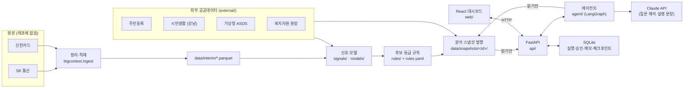

# 아키텍처

LINK-Radar 전체 구성과 데이터 흐름입니다. 만든 순서와 남은 일은 [개발 과정](개발_과정.md)에 있습니다.

## 1. 전체 구성



**원칙**
- 분석 데이터는 배치만 씁니다. 새 스냅샷 폴더를 만들고 검증한 뒤 `active.json`만 바꿔 발행합니다. API·에이전트는 발행된 스냅샷만 읽습니다.
- 실행 상태(SQLite)는 FastAPI만 씁니다. 화면은 API만 부릅니다.
- 등급과 후보는 코드가 정하고, LLM은 질문 해석·추가 조사 선택·설명 문장만 맡습니다.

## 2. 컴포넌트

| 컴포넌트 | 위치 | 역할 | 상태 |
|---|---|---|---|
| 정리·적재 | `src/bigcontest/ingest.py` | 원본 zip → 중복 제거·정리 → Parquet | ✅ |
| 외부 데이터 읽기 | `src/bigcontest/external.py`, `weather.py` | 주민등록, 시민생활, 자원 원장, ASOS | ✅ |
| 분석 공통 | `telecom.py`, `card.py`, `stats.py`, `categories.py` | 통신·카드 집계, 통계 검정 | ✅ |
| 리포트 | `report.py`, `gallery.py`, `notebooks/` | 분석 스크립트 → `reports/<이름>/` | ✅ |
| 계약 | `src/bigcontest/contracts/` | 단위·시간·연령·주장 계약 | ✅ |
| 스냅샷 | `src/bigcontest/snapshot.py` | 발행, manifest, 고정 읽기 | ✅ |
| 신호 | `src/bigcontest/signals/`, `agent/tools/signal.py` | 이탈 경보, 연휴, 겨울, 폭염, 반증 | ✅ |
| 모델 | `src/bigcontest/models/` | 기대 활동 예측, 평가 | ✅ |
| 규칙 | `src/bigcontest/rules/`, `configs/rules.yaml` | 후보 종류, 등급, 비교안, 민감도 | ✅ |
| 자원 | `src/bigcontest/resources/` | 원장, 수집, 매칭 | ✅ |
| 에이전트 | `src/bigcontest/agent/` | 상태 그래프, 도구, Guard, LLM | ✅ |
| API | `api/` (routes → services → agent / store) | REST, 상태 쓰기 | ✅ |
| 화면 | `web/` (React + Vite + TypeScript + Tailwind) | 대시보드 | ✅ |

## 3. 폴더 구조

```
src/bigcontest/
  ingest.py, external.py, weather.py, telecom.py, card.py, stats.py ...   # 정리·분석 공통
  contracts/   snapshot.py   runmeta.py                                   # 계약·스냅샷·실행 기록
  signals/     models/       rules/       resources/                      # 경보·모델·등급 규칙·자원
  agent/       state.py  graph.py  guard.py  checkpoint.py  llm.py  schemas.py  tools/
api/           main.py  routes/  services/  store.py
web/           src/api/  src/pages/  src/components/
configs/       rules.yaml  guard_rules.yaml  candidate_inputs.yaml  cohorts.yaml  grain_contract.yaml  models.yaml  llm.yaml  prompts/
notebooks/     eda*.py  m*.py  r*.py  w*.py
reports/       <이름>/README.md + figs/ + *.csv
external/      공공데이터 원본과 출처
docs/          설계·계획·아키텍처·에이전트·API·데이터 모델·화면
tests/
```

## 4. 데이터 흐름

### 4.1 배치 (정리 → 스냅샷)

1. `bigcontest.ingest`: 원본 zip을 읽어 중복 제거, 강남·춘천만 남기고 Parquet로 저장 (`data/interim/`)
2. 신호·모델: 코호트 시계열, 기대 활동, 이탈 경보, 연휴·겨울·폭염 신호 계산. 기준일보다 뒤의 자료는 쓰지 않음
3. 규칙: 후보 종류와 등급 계산, `rule_id`·`rule_version` 기록
4. 스냅샷: 새 폴더에 결과를 쓰고 검증(행 수, 결합 동 수, 0값 검사) → 통과하면 `active.json` 교체. 실패하면 이전 스냅샷 유지

### 4.2 질의응답 실행 1건

1. 담당자가 화면에서 질문 → `POST /runs` → 202 + `run_id`
2. API가 활성 `snapshot_id`를 실행에 고정하고 에이전트 실행 시작
3. 에이전트: 요청 정규화 → 질문 분류 → 계약 검사 → 근거 수집(필수 도구는 항상) → 후보 종류 → 반증(이탈 후보만, 후보별) → 신호 Guard → 등급(후보별) → 검토 배정 → 자원 매칭 → 근거 카드 → 보고서 → 보고서 Guard. 자세한 그래프는 [에이전트 설계 §4](에이전트_설계.md#4-그래프)
4. 승인 대기(`interrupt`): 상태를 SQLite 체크포인터에 저장
5. 화면이 `GET /runs/{id}`로 상태 조회 → 근거 카드 먼저 표시, 검사가 끝난 설명 문장 표시
6. 담당자가 근거 확인·자원 판정·메모 저장(`POST /runs/{id}/review`) → 바뀌면 보고서 다시 생성
7. 승인(`POST /runs/{id}/approve`, `report_revision` 포함) → 확정 기록 1건

### 4.3 정기 감시

1. 기준일 선택(과거 재생) 또는 월간 갱신
2. 트리거(연휴 D-7, 폭염 예보, 기상특보, 동절기) 계산 → 예정된 점검 후보 생성 (같은 사건은 한 번만)
3. 이탈 경보 → 반증 → 예상 밖 이탈 후보
4. 등급 → 검토 배정(K) → 보고서 Guard → 후보 목록 발행 → 현황 화면. 승인은 담당자가 후보를 열어 조사할 때 받음

## 5. 오류·재시도

| 위치 | 정책 |
|---|---|
| 적재·스냅샷 | 검증 실패 시 발행하지 않고 이전 스냅샷 유지. 같은 월 재적재는 거절 |
| 도구 | 오류와 빈 결과를 구분. 필수 근거 오류는 판단 보류 |
| LLM | 1회 재시도 후 규칙 기반·템플릿으로 대신 |
| Guard | REVISE 최대 2회, 넘으면 ABSTAIN |
| 외부 수집 | 실패 시 이전 값 유지, 수집 기록 남김 |
| API | 오류 코드와 사유만 응답 |

## 6. 설정과 보안

- 키는 `.env`(커밋 안 함)에 둡니다: `ANTHROPIC_API_KEY`, `DATA_GO_KR_API_KEY`. 필요한 이름은 `.env.example`에 있습니다.
- 원본 제공 데이터(`*.zip`, `data/`)는 레포에 올리지 않습니다. 원본 위치는 `configs/project.yaml`의 `raw_dir`(기본 `data/raw`) 또는 환경 변수 `BC_RAW_DIR`.
- API의 CORS는 화면 주소만 허용합니다.
- 화면과 보고서에는 항상 "개인 판정 아님 · 최종 판단은 담당자"를 표시합니다.

## 7. 실행 방법

```bash
uv sync
uv run python -m bigcontest.ingest      # 원본 → data/interim
uv run python notebooks/eda1_data_quality.py   # 리포트 다시 만들기 (notebooks/*.py)
uv run python -m bigcontest.weather     # 기상청 ASOS 다시 받기 (키 필요)
uv run pytest
```

API·화면 실행은 [README 시작하기](../README.md#-시작하기)에 있습니다.
