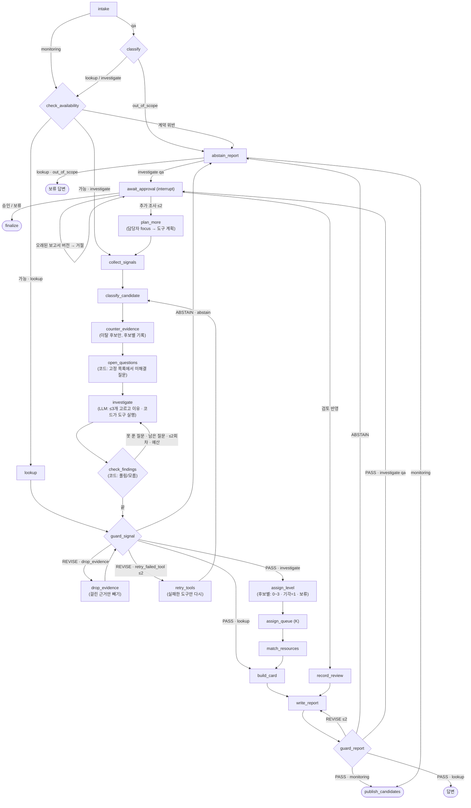

# 에이전트 설계

LINK-Radar 에이전트의 상태, 노드, 분기, 도구, Guard, 승인·재개 규칙입니다. 무엇을 판단하는지는 [설계 문서](설계_문서.md), 만든 순서는 [개발 과정](개발_과정.md)에 있습니다. **반환 봉투 필드와 그래프는 이 문서가 기준**입니다.

## 1. 개요

- **LangGraph 상태 그래프** 하나로 만듭니다. 노드 함수는 LangGraph와 무관한 일반 함수로 작성해서 그래프 없이도 테스트합니다. 그래프 연결은 `agent/graph.py` 한 곳에만 둡니다.
- **세 가지 경로**
  - 정기 감시: 기준일(`as_of`)을 넣으면 그날의 트리거와 후보 목록을 만듭니다 (질문 없음, 승인 없이 목록 발행).
  - 단순 조회: "강남 1인세대 비율 상위 동은?" 같은 질문에 값과 근거로 답합니다.
  - 조사: "이번 추석 전에 어디부터 확인해야 해?" → 후보·등급·자원·보고서 → 담당자 승인.
- **판단은 코드, 설명은 LLM.** 등급과 후보는 도구와 `rules.yaml`이 정합니다. LLM은 **질문 해석, 추가 조사 선택, 근거를 본 뒤 더 확인할 질문 고르기(조사 루프), 설명 문장**만 맡습니다. LLM이 꺼져 있으면 규칙 기반 분류·우선순위 고르기와 템플릿 보고서로 대신합니다.
- **실패하면 기본값으로 채우지 않습니다.** 판단 보류 + 사유로 끝냅니다.
- **후보는 여러 개입니다.** 반증·등급 결과는 후보마다 따로 기록하고, 후보 하나가 보류라고 실행 전체를 보류하지 않습니다. 실행 전체 보류는 계약 위반이나 Guard ABSTAIN일 때만입니다.

## 2. 상태 (`RunState`)

| 필드 | 타입 | 설명 | 설정 주체 |
|---|---|---|---|
| `run_id` | str | 실행 ID. LangGraph `thread_id`로도 씀 | API |
| `mode` | `monitoring` / `qa` | 진입점 | API |
| `question` | str \| None | 담당자 질문 | API |
| `as_of` | date | 분석 기준일 | API (질문에서 추출 시 `intake`) |
| `analysis_mode` | `retrospective` / `simulated_replay` / `strict_as_of` | 시간 계약 모드 | API |
| `snapshot_id` | str | 이 실행이 읽는 분석 스냅샷. 실행 내내 고정 | API (실행 시작 시) |
| `request` | `NormalizedRequest` | 도시·지역·집단·기간·지표로 정규화한 요청 | `intake` |
| `route` | `lookup` / `investigate` / `out_of_scope` | 경로 (정기 감시는 `investigate`로 고정) | `classify` (정기 감시는 `intake`) |
| `contract_check` | `ContractResult` | 단위·시간·연령 계약 검사 결과 | `check_availability` |
| `evidence` | list[`ToolResult`] | 모은 근거 (반환 봉투) | `lookup`, `collect_signals`, `counter_evidence`, `match_resources` |
| `candidates` | list[`Candidate`] | 후보. 후보마다 종류, 필수 근거 충족, 반증 결과(기각/보류/통과/해당 없음), 등급, 배정 여부를 가짐 | `classify_candidate`, `counter_evidence`, `assign_level`, `assign_queue` |
| `resources` | list | 후보별 추천 자원 (자격·운영 상태, "확인 필요") | `match_resources` |
| `evidence_card` | `EvidenceCard` | 결정론적 근거 카드 (숫자·사실은 여기서만 만듦). 상태에는 근거 대신 근거 ID 목록(`evidence_ids`)만 둠 | `build_card`, `abstain_report` |
| `report` | `Report` | 근거 카드 + 설명 문장. 상태에는 카드 대신 카드 ID(`card_id`)만 둠 | `write_report`, `abstain_report` |
| `guard` | list[`GuardResult`] | Guard 판정 기록 (어느 Guard, 사실·표현 따로) | `guard_signal`, `guard_report` |
| `revise_count` | dict | Guard별 REVISE 횟수 (최대 2) | `guard_signal`, `guard_report` |
| `extra_rounds` | int | 추가 조사 횟수 (최대 2) | `await_approval` |
| `evidence_revision`, `report_revision` | int | 근거·보고서 버전 | `collect_signals`, `write_report` |
| `decision` | `approved` / `held` / `more` / None | 담당자 결정 | `await_approval` |
| `abstain_reason` | str \| None | 실행 전체 판단 보류 사유 | `check_availability`, `guard_signal`, `guard_report`, `classify` |
| `errors` | list | 도구 오류 기록 (오류 코드 + 사유) | 어느 노드든 |

골격 밖 추가 칸 `decision_trace`(list[TraceStep]): 노드마다 고른 것, 다음 노드, 규칙 ID 또는 LLM 이유, 입력 요약(질문 원문 없음), 시작 시각, ms. 노드 래퍼가 붙이고 최근 80칸만 둡니다. 보고서에는 시각·ms를 뺀 사본을 싣습니다(같은 입력이면 같은 보고서).

F3에서 더한 골격 밖 칸 (`agent/state.py`)

| 칸 | 내용 | 설정 |
|---|---|---|
| tool_timings | 도구 한 번마다 `{tool, ms, status, n, round}`. 끝점·승인 대기 직전에 노드·도구별 합계를 `run_meta.perf`로 합침 | `call_tool`·`find_resources` → 도구를 부르는 노드 |
| focus | 추가 조사 범위 (`MoreFocus`: 후보 ID, 추가 도구, 확인할 반증, 메모). 실제 그래프 API는 메모 원문 대신 받을 때 정한 계획(`plan`)과 `memo_given`을 넣음. 메모 원문을 받은 경우(그래프 직접 호출)는 `plan_more`가 쓰고 지움 | `await_approval` |
| extra_plan | 다음 회차 도구 계획 `{tools, counter_checks, candidate_ids, cities, source, reason, memo_used}` | `plan_more` |
| prev_round | 지난 회차 요약 (근거 열쇠 → 값, 후보 열쇠 → 등급, 도구). "N회차 대비 달라진 점"에 씀 | `await_approval` |
| review | 담당자 검토 (자원 판정, 확인한 근거 ID, 후속 확인일, 검토 ID). 메모 원문은 담지 않음 | `await_approval`(검토 재개) |
| place_scope | 질문한 동으로 거른 결과 `{adm_cds, names, city, city_total, kept}`. 등급은 도시 전체로 정한 뒤 거름 | `assign_queue` |
| investigation | 조사 루프 기록 `{extra_round, questions, rounds, items, stopped, continue}`. 질문마다 고른 이유·상태(풀림/여전히 모름/자료 없음/도구 오류/Guard 가 뺌/확인 못 함)·사유 코드·근거 ID. 보고서 `investigation`("추가로 확인한 것")의 원본 | `open_questions`, `investigate`, `check_findings`, `drop_evidence` |
| investigation_evidence | 조사 루프 도구가 낸 근거. **등급 입력인 `evidence`와 따로** 둠. `build_card`가 등급이 정해진 뒤 "추가로 확인한 것"에 인용한 것만 카드에 붙임 | `investigate`, `drop_evidence` |
| quarantine | 신호 Guard 에 걸려 쓰지 않은 참고 근거 `{evidence_id, metric, tool, phase, rule_ids, reason}` (값 없음, §4.1) | `collect_signals`, `investigate` |
| evidence_tools | 근거 ID → `도구·도시`. Guard 처치가 실패한 도구만 다시 부를 때 씀 | `collect_signals`, `retry_tools` |
| remedy | 마지막 신호 Guard 처치 `{remedy, rule_ids, targets}` (§6) | `guard_signal`, `retry_tools` |
| scope_candidate_ids | 후보로 연 조사: 이 후보만 남김. `assign_queue`가 도시 전체로 등급·순서를 정한 뒤 거르고(정기 감시와 같은 등급), `build_card`는 그 후보 근거 + 그 동 근거 + 도시 공통 근거만 카드에 담고 제목을 후보 하나로. 없는 후보면 거르지 않고 `SCOPE_CANDIDATE_MISSING` | API (시작 시) |

## 3. 노드

| 노드 | 입력 | 출력 | 로직 | 실패 시 |
|---|---|---|---|---|
| `intake` | `question`, `mode` | `request`, `as_of` | 도시·동·집단·기간·지표를 화이트리스트 값으로 정규화. **동을 먼저** 찾고 그 동으로 도시를 정함(§3.1). 질문에 적힌 성별·연령을 먼저 지키고, 감시 집단 별칭은 조건이 맞을 때만 씀. 정기 감시는 질문 없이 `as_of`만, `route=investigate` | 정규화 불가 → `out_of_scope`. **개인 지목 질문**(사람 이름 — 이름+호칭·이름+에게/한테/께·이름+조사+연락 말·영문 이름 등, `agent/pii.py` —, 명단·호수·번지·전화번호·주소 등)은 LLM 없이 `out_of_scope` + `OUT_OF_SCOPE_INDIVIDUAL`, "동·집단 단위로 바꿔 물어보세요". 동을 고를 수 없으면(역삼동, 강남 남면) LLM 없이 `AMBIGUOUS_PLACE` + 선택지 |
| `classify` | `request` | `route` | 단순 조회 / 조사 / 범위 밖. LLM 구조화 출력, LLM이 없으면 규칙 기반. 규칙이 정규화한 요청이면 LLM은 경로를 **올리기만**(조회 → 조사) 가능, 낮추기는 무시하고 기록. 규칙이 비운 동·기간 칸만 LLM 값(enum)으로 채움(`llm_filled` 기록). 경로가 정해지면 동·기간을 경로에 맞게 반영(`scope_request`). LLM에는 개인정보를 가린 질문만 보냄(가린 개수만 기록) | LLM 오류 → 규칙 기반. 질문 기간이 기준일 뒤·자료 기간 밖이면 `TIME_PERIOD_*` 보류 |
| `check_availability` | `request`, `as_of`, `analysis_mode` | `contract_check` | **모든 경로**에서 실행. 차원 존재(G-01), 단위 호환(G-02), 연령 계약, 시간 계약(G-13). 두 도시 정기 감시는 도시마다 검사하고 결과가 다르면 사유 앞에 `[도시]`를 붙여 합침 | 위반 → `abstain_reason` |
| `lookup` | `request` | `evidence` | Data 도구로 값 조회 | 도구 오류 → `abstain_reason` |
| `collect_signals` | `request`, `snapshot_id` | `evidence` | 후보 종류별 **필수 근거 도구는 항상 실행**. LLM은 추가 조사 도구만 고름 | 필수 근거 오류·결측 → 해당 후보에 "필수 근거 일부 없음" |
| `classify_candidate` | `evidence` | `candidates` | 예정된 점검 / 예상 밖 이탈. 필수 근거 충족 여부 | — |
| `counter_evidence` | `candidates` | `candidates`(반증 결과) | **예상 밖 이탈 후보만**: 공휴일 기대값, 도시 공통요인, 강수, 학사일정. "날씨로 설명되는 부분"과 "보정 후 남는 이탈"을 함께 기록. 예정된 점검은 `해당 없음` | 반증 자료 결측 → 그 후보만 보류 |
| `open_questions` | `candidates` | `investigation.questions` | 조사 루프 관찰(§4.1). 후보마다 아직 풀리지 않은 질문을 **고정 목록**에서 만듦. 질문마다 쓸 도구가 정해져 있음 | — |
| `investigate` | `investigation`, `candidates` | `investigation`, `investigation_evidence` | 계획 + 실행. 남은 질문 중 많아야 3개를 LLM이 고르고 이유를 씀(enum 구조화 출력). 코드가 화이트리스트 도구 실행. 결과는 등급 입력에 넣지 않음 | LLM 없음·실패·예산 초과 → 우선순위 규칙. 도구 시간 한도 → 멈춤 |
| `check_findings` | `investigation` | `investigation` | 확인. 질문마다 풀림/여전히 모름/자료 없음/도구 오류. 못 푼 질문이 있고 남은 질문·회차(≤2)·예산이 있으면 `investigate`로 한 번 더 | — |
| `guard_signal` | `evidence`, `investigation_evidence`, `candidates` | `guard`, `remedy` | 신호·조회용 Guard (§6). REVISE면 규칙별 처치(remedy)를 정함 | 처치: 근거 빼기 → `drop_evidence`, 실패 도구만 다시 → `retry_tools`(≤2회), 바로 보류 → `abstain_report` |
| `drop_evidence` | `remedy` | `evidence`, `investigation_evidence`, `errors` | 처치 drop_evidence: 걸린 근거(G-11 폐기 지표, G-14 지표 뜻 바꾸기)만 빼고 경고를 남긴 뒤 `guard_signal`로. Guard 횟수를 쓰지 않음 | 후보 등급 근거면 뺄 수 없어 ABSTAIN |
| `retry_tools` | `remedy`, `evidence_tools` | `evidence` | 처치 retry_failed_tool: 다시 시도할 수 있는 오류(TOOL_TIMEOUT·TOOL_IO)로 실패한 도구만 같은 도시에서 다시 → `classify_candidate`부터. LLM 도구 선택은 다시 하지 않음 | 2회 넘으면 ABSTAIN |
| `assign_level` | `candidates` | `candidates`(등급) | `rules.yaml`로 **후보마다** 등급. 기각 → Level 1 + 기각 사유, 반증 보류·필수 근거 결측 → 판단 보류 | 규칙 해당 없음 → Level 0 |
| `assign_queue` | `candidates`, K | `candidates`(배정) | 검토 예산 K로 `queue_rank`, `selected_for_review`. 등급은 바꾸지 않음 | — |
| `match_resources` | `candidates`, `request` | `resources` | 관할 → 대상·자격 → 필요 유형 → 운영 상태 → 거리/전화형 | 자격 미상 → "확인 필요" |
| `build_card` | 위 전부 | `evidence_card` | 결정론적 근거 카드 (조회 결과도 같은 형식) | — |
| `write_report` | `evidence_card` | `report` | 핵심 사실 문장·대응안은 템플릿(Level 2·3 후보마다 확인할 영역, 대응 5칸, 내일 아침 체크리스트. `configs/action_templates.yaml`), 설명 문장만 LLM. 후보에 `rule_checks`가 있으면 등급 설명(`explain_level`)을 붙임. LLM이 없으면 템플릿만 | LLM 오류 → 템플릿만 |
| `guard_report` | `report`, `evidence_card` | `guard` | 보고서 Guard: 사실 검사 + 표현 검사 (§6) | REVISE → `write_report`(≤2회), ABSTAIN → `abstain_report` |
| `abstain_report` | `abstain_reason`, `contract_check`, `guard` | `report` | **템플릿만**(LLM 없음). 무엇이 부족했고 무엇을 더 확보하면 되는지 | — |
| `publish_candidates` | `candidates`, `report` | 후보 목록 | 정기 감시: 후보 목록 발행 (승인은 후보를 열어 조사할 때) | — |
| `await_approval` | `report`, `report_revision` | `decision` | 조사 경로: `interrupt`로 멈춤. 승인 / 보류 / 추가 조사(≤ 2회, 담당자 `focus`를 함께 받음) / 검토 반영(`kind=review`) | 오래된 `report_revision` → 거절 |
| `plan_more` | `focus`, `candidates` | `extra_plan` | 추가 조사 계획. 담당자가 고른 도구·반증 + 메모를 LLM 구조화 출력(화이트리스트 enum)으로 도구 계획으로 바꿈. 확인할 반증 "공휴일 기대값"은 `calc_holiday_gap`으로. 다음 `collect_signals`는 필수 도구 + 이 계획만 실행(집중 후보가 있으면 그 도시에서만). 보고서에 "N회차 대비 달라진 점". 계획 만들기는 `make_plan`(상태를 바꾸지 않음). `focus.plan`이 있으면(API가 받을 때 정해 저장한 계획) 화이트리스트·이 실행 후보로 다시 거른 뒤 그대로 쓰고 LLM을 다시 부르지 않음 | LLM 없음·실패 → 메모 낱말 규칙. 개인 지목 메모는 쓰지 않음 |
| `record_review` | `review` | `revise_count` | 검토 반영: 판정이 바뀌면 API가 승인 대기를 `kind=review`로 재개 → `report.needs_regeneration=true` → 여기서 Guard 횟수를 다시 세고 `write_report`(보류 보고서면 `abstain_report`)로. 새 판에는 검토 문장과 `review_ids`가 들어가고, 부적합 자원은 대응안에서 빠짐 | — |
| `finalize` | `decision` | 확정 또는 보류 기록 | `run_id + 단계` 키로 한 번만 기록 (멱등) | 이미 기록됨 → 그대로 반환 |

### 3.1 질문 속 동·기간 (`agent/places.py`, `agent/periods.py`)

- **동 먼저**: `ref/adm_cd_names.csv`로 만든 동 이름 사전에서 긴 이름부터 찾습니다. 공식 이름(역삼1동)과 흔한 줄임(역삼동·역삼 → 역삼1동·역삼2동)이 들어 있습니다. 두 글자 이름(남면·서면)은 낱말 경계일 때만 잡습니다("서면으로"는 서면이 아님).
- **도시는 동에서**: 찾은 동 글자를 지운 뒤 남은 글자에서 "강남/춘천"을 찾습니다. 그래서 "춘천 강남동"은 춘천 강남동, "강남동"만 써도 춘천입니다. Guard 도시 검사(`guard._cities_in`)와 이어 묻기도 같은 함수를 씁니다.
- **애매하면 되묻기**: 줄임이 여러 동을 가리키거나(역삼동), 동과 적힌 도시가 다르면(강남 남면) 짐작하지 않고 `AMBIGUOUS_PLACE` + 선택지로 보류합니다.
- **조사 경로의 동**: 등급·순서는 지금처럼 **도시 전체**로 정하고, `assign_queue`에서 그 동(또는 먼저 확인할 동) 후보만 남깁니다. 그래서 같은 스냅샷·기준일이면 정기 감시와 등급이 같습니다(테스트). 보고서에 "질문한 동: … 도시 전체 후보 N건으로 정한 뒤 이 동 후보만 남김"을 적고, 그 동 후보가 없으면 없다고 적습니다.
- **조회 경로의 동**: 동이 하나면 `adm_cd`. 카드 결제는 동 단위가 없어 계약이 보류합니다.
- **기간 말**: 한 규칙으로 창을 정합니다. 지난주 = 기준일 앞 주 월~일, 이번 주 = 이번 주 월요일~기준일, 지난달·이번 달, 최근 7·14·30일, 추석 전 = 연휴(10/3~10/9) 앞 7일, 추석 연휴, 추석 후 = 연휴 뒤 7일, 날짜(10월 7일, 2025-10-07, 10/7)·두 날짜·달(9월).
  - 조회: 그 창으로 봅니다. 기준일 뒤는 자르고, 창 시작이 기준일 뒤면 `TIME_PERIOD_AFTER_AS_OF`, 자료 기간 밖이면 `TIME_PERIOD_OUT_OF_DATA`로 보류.
  - 조사: 등급은 언제나 실행 기준일까지 자료로 정합니다. 기간 말은 기록만 하고 "조사 등급에 쓰지 않음"을 보고서에 적습니다("추석 전에 점검"은 자료 기간이 아니라 할 일의 때).
- **LLM 칸**: `classify` 스키마에 `adm_names`(동 이름 enum 47개)와 `period`(기간 이름 enum)를 두고, 규칙이 비운 칸만 채웁니다. 동이 요청 도시와 다르면 버립니다(`llm_fill_rejected`).

## 4. 그래프

- 끝점은 다섯 가지입니다: 답변, 보류 답변, 후보 목록 발행, 확정 기록, 보류 기록(`finalize`가 결정에 따라 기록).
- 기각된 후보는 실행을 끝내지 않습니다. `assign_level`에서 Level 1 + 기각 사유로 남고 보고서에 함께 나옵니다.
- 보류 보고서(`abstain_report`)는 템플릿만 써서 다시 Guard를 돌리지 않습니다.
- 신호 Guard의 REVISE는 더 이상 `collect_signals` 전체를 다시 돌리지 않습니다. 처치(remedy)가 없는 예전 체크포인트만 예전처럼 다시 수집합니다.

### 4.1 조사 루프 (관찰 → 계획 → 실행 → 확인, `agent/investigation.py`)

반증 뒤, 등급을 매기기 전에 도는 짧은 루프입니다. **에이전트가 근거를 본 뒤 "무엇을 더 확인할지" 정하는 자리**이고, 등급·순서·반증 판정은 바꾸지 않습니다.

| 단계 | 누가 | 하는 일 |
|---|---|---|
| 관찰 `open_questions` | 코드 | 후보마다 미해결 질문을 고정 목록에서 만듦 (아래 표). 같은 질문·도시·동은 하나로 묶고 후보 ID를 모음. 우선순위 순 8개까지 |
| 계획 `investigate` | LLM (없으면 규칙) | 질문 목록 + 후보 요약 + 이미 확인한 것을 보고 많아야 3개를 고르고 질문마다 이유를 씀. 출력은 질문 key enum. 목록 밖 key·중복은 버리고, 이유에 숫자·진단 말이 있으면 싣지 않음(Guard 표현 검사) |
| 실행 | 코드 | 고른 질문의 화이트리스트 도구를 그 도시(동)에서 실행. 결과 근거는 `investigation_evidence`에만 |
| 확인 `check_findings` | 코드 | 후보 집단에 드는 근거만 답으로 보고 풀림 / 여전히 모름 / 자료 없음 / 확인 못 함(격리). 못 푼 질문이 있고 남은 질문이 있으면 한 회차 더 (최대 2회차) |

| 질문 (고정 목록) | 언제 | 도구 |
|---|---|---|
| 연휴 회복 미확인 | 기각되지 않은 이탈 후보, 연휴 트리거가 있는 예정된 점검 | `calc_holiday_gap` |
| 날씨로 설명되는 부분 | 반증이 "설명 일부"이거나 강수·날씨 사유가 있는 이탈 후보 | `calc_weather_effect`(있으면) → `check_confounders`의 강수 반증 |
| 의료 접근 | 연휴 트리거 후보의 동, 이탈 후보의 먼저 볼 동 (도시마다 3곳까지) | `find_resources`(필요 유형 "의료 접근": 휴일 운영 약국·병의원·응급) |
| 동절기 수축 | 춘천 읍·면 후보, 11~2월 | `calc_winter_contraction` |
| 먼저 볼 동의 체류 변화 | 먼저 볼 동이 있는 이탈 후보 | `get_mobility_layer` |
| 폭염 반응 | 6~8월 | `calc_heat_response` |

- **결과는 보고서 "추가로 확인한 것"(`Report.investigation`)에만** 들어갑니다. 질문·고른 이유·누가 골랐나(LLM/규칙)·상태·템플릿 결과 문장·근거 ID. 근거는 등급이 정해진 뒤 카드에 붙어 화면에서 근거로 이동할 수 있습니다.
- **등급 입력에는 넣지 않습니다.** `assign_level`·`counter_evidence`는 `evidence`만 읽고, 조사 근거는 `investigation_evidence`에 따로 있습니다. 가짜 LLM 8종(뒤쪽부터 고름·안 고름·목록 밖 key·실패 등)과 시나리오 7개에서 등급·순서·반증·후보 근거 ID가 같다는 테스트가 있습니다(`test_determinism.py`).
- **조사 근거가 Guard 에 걸리면 격리 (실행은 계속)**: 조사 루프 도구가 낸 근거가 신호 Guard 검사(G-08 작은 칸·비공개 값, G-11 폐기 지표, G-14 지표 뜻 바꾸기)에 걸리거나 도구 오류(`status=ERROR`)면, 그 근거만 `investigation_evidence`에 넣지 않습니다. 질문은 "확인 못 함"(`quarantined`) + 사유 코드(`reason_code`: G-08·G-11·G-14·TOOL_ERROR 등)로 남기고, 상태 `quarantine`과 `decision_trace`(`investigate` 칸의 `quarantined`, 값 없이 근거 ID·지표·도구·규칙)에 기록합니다. 작은 칸 값은 근거 표·보고서·답 어디에도 나가지 않습니다. 예전에는 같은 근거가 신호 Guard 에서 실행 전체를 보류(G-08 ABSTAIN)시켜, LLM이 그 도구를 골랐는지에 따라 끝 상태가 달라졌습니다(외부 점검 K-05).
- **정책 정리**

  | 근거 | Guard 실패 시 | 등급·끝 상태 |
  |---|---|---|
  | 정상 근거 (실패 없음) | — | LLM 이 무엇을 골라도 같음 |
  | 조사 루프 근거 | 격리: 그 근거만 빼고 "확인 못 함" + 사유 코드, 실행은 계속 | LLM 선택과 무관하게 같음 |
  | 선택 추가 도구 근거 (`collect_signals`에서 LLM·담당자가 고른 도구) | 작은 칸(G-08)은 격리. 폐기 지표·지표 뜻 바꾸기는 기존 처치(`drop_evidence`로 그 근거만 뺌) | 같음 (경로에 `drop_evidence`가 들어갈 수는 있음) |
  | 기본(필수) 근거 | 기존 정책: G-08 바로 보류, G-11·G-14 근거 빼기(후보가 쓴 근거면 보류), G-06 실패 도구만 다시 | 기존과 같음 |

  시험: `tests/test_quarantine.py`가 `calc_holiday_gap`에 작은 칸·폐기 지표·오류를 넣고(조사 루프에서만 / 수집 때도) 가짜 LLM 8종에서 등급·순서·반증·끝점·판정이 실패 없는 실행과 같은지 봅니다.
- **한도**: 회차마다 LLM 1번·질문(도구) 3개, 추가 조사 회차마다 2회차까지(`configs/llm.yaml` `slots.investigate`). 실행 예산(LLM 호출·비용)을 넘으면 규칙으로 고르고, 도구 시간 한도를 넘으면 조사를 멈추고 이유를 남깁니다.
- **판단 기록**: `open_questions`(질문 목록), `investigate`(고른 질문·도구·LLM 이유, 새 근거 ID), `check_findings`(상태별 개수, 다음 노드, 질문별 결과)가 `decision_trace`에 남습니다. 화면의 판단 기록 위에 "추가로 확인한 것"이 함께 보입니다.
- Guard 처치로 `retry_tools` 뒤 다시 들어오면 이미 확인한 질문과 회차 수를 이어서 셉니다. 담당자 추가 조사(새 회차)면 처음부터.

## 5. 도구

모든 도구는 같은 반환 봉투(`ToolResult`)를 돌려줍니다. 자유 SQL은 없고, 입력은 Pydantic으로 검증합니다.

| 묶음 | 도구 | 하는 일 |
|---|---|---|
| Data | `get_data_capabilities` | 데이터별 지원 차원·기간·단위 |
| Data | `check_request_contract` | 요청이 단위·시간·연령 계약에 맞는지 |
| Data | `get_structure(adm_cd)` | 1인세대 비율 등 구조 지표 |
| Data | `get_mobility_layer(city, grain)` | 통신 구성·계절 레이어 |
| Data | `get_card_cohort_series(city, sex, age, period)` | 코호트 일별 시계열 (기준일까지만, 질문 기간이 있으면 그 창) |
| Data | `get_card_time_band(city, age, time_of_day)` | 카드 데이터1(보조): 같은 연령 결제 중 그 시간대 비중, 바로 앞 같은 길이 기간과 비교. 가맹점 기준이고 거주지가 없음. 체류·외출을 뜻하지 않음 |
| Data | `get_validation_reference(adm_cd)` | 시민생활 지표 (탐색적 참고, 등급 입력 아님) |
| Signal | `get_calendar_triggers(as_of)` | 연휴 D-7·폭염 예보·기상특보·동절기 트리거 |
| Signal | `calc_expected_activity(cohort, as_of)` | 이탈 기대값 = EDA-6 기준선(같은 요일 과거 8주), 다음 1~7일 = 모델 비교에서 채택한 0b (맥락) |
| Signal | `calc_cohort_deviation(cohort, as_of)` | 이탈 경보 (absolute·local 두 경로) |
| Signal | `calc_holiday_gap(cohort, holiday)` | 연휴 깊이·회복 |
| Signal | `calc_winter_contraction(adm_cd)` | 춘천 읍·면 겨울 변화 (연령 간 상대 변화) |
| Signal | `calc_heat_response(cohort)` | 폭염 반응 (탐색) |
| Signal | `check_confounders(signal_id)` | 반증: 공휴일 기대값, 공통요인, 강수, 학사일정 |
| Signal | `classify_candidate_type(signals)` | 예정된 점검 / 예상 밖 이탈 |
| Signal | `assign_level(candidate_id)` | `rules.yaml`로 등급 |
| Welfare | `find_resources(adm_cd, need_type, group)` | 필요 유형·자격 필터 → 제외 규칙(확인일·출처 없음, 관할 밖 물리 거점) → 상위 K + "위급 시 안내" 묶음. 봉투(`ToolResult`)는 건수 요약과 원장 수집 시점·확인할 자원·부족 수, 자원별 상세(출처 URL, 확인일, 거리, 판정과 "확인 필요" 이유 코드)는 `ResourceRecommendation` 목록으로 따로 |
| Welfare | `get_access_gap(adm_cd)` | 관측 거점까지 직선거리, 전화형 대안 |
| Welfare | `check_eligibility(resource_id, group)` | 자격 확인 / "확인 필요" |
| Report | `build_evidence_card(candidate_id)` | 근거 카드 (결정론적) |
| Report | `generate_response_plan(candidate_id)` | 대응안 서술 (LLM, 없으면 템플릿) |
| Report | `write_run_metadata(run_id)` | 실행 메타데이터 저장 (멱등) |

### 5.1 반환 봉투 (`ToolResult`) — 기준 정의

코드는 `src/bigcontest/agent/schemas.py`이고, 이 표와 필드 이름이 같은지 `tests/test_schemas.py`가 확인합니다.

| 필드 | 뜻 | 예 |
|---|---|---|
| `evidence_id` | 근거 번호 (보고서에서 인용) | `EV-20251001-0007` |
| `metric` | 지표 이름 | `생필품 결제 평소 대비` |
| `value`, `unit` | 값, 단위 | `0.84`, `평소 대비 비율` |
| `denominator`, `n_obs` | 분모(집단·출처 포함), 관측 수. 분모가 사람·세대 수인 비율은 `n_obs`가 분모 크기(G-08 비교) | `최근 같은 요일 4주 평균`, `4` |
| `direction` | 절대 변화 방향. 도시보다 덜 늘어난 것은 `증가`. 판정할 수 없으면 비우고(null) 사유를 `warnings`에 | `감소` / `증가` / `변화 없음` / null |
| `measured_grain`, `applied_scope` | 측정 단위, 적용 범위 | `도시×성×연령×일`, `춘천 남면` |
| `merchant_region`, `customer_residence` | 카드: 가맹점 시군구, 고객 거주 **시도** | `춘천시`, `강원` |
| `is_shared_context` | 도시 신호를 동에 공유했는지 | `true` |
| `analysis_cohort`, `service_eligibility_group` | 데이터가 지원하는 연령 구간, 정책 대상 | `80대+`, `65세 이상` |
| `observed_from`, `observed_to` | 실제 관측 기간 (파일 기준월과 다를 수 있음) | `2025-10-01`, `2025-10-14` |
| `analysis_mode`, `as_of` | 시간 계약 모드, 기준일 | `simulated_replay`, `2025-10-20` |
| `actual_available_at`, `simulated_available_at`, `availability_basis` | 실제 공개일(모르면 null), 가정 공개일, 근거 | `null`, `2025-10-20`, `assumed` |
| `trained_until`, `calibrated_until`, `rule_derived_from` | 모델 학습 자료의 마지막 날, 임계값을 정한 자료의 마지막 날, 규칙을 만든 근거 기간 | `2025-09-30`, `2025-09-30`, `2025-07~09` |
| `snapshot_id`, `data_version`, `rule_version` | 스냅샷, 원본·정제 버전, 규칙·모델 버전 | `snap-20251020-01`, `card2@sha256:…/clean-v1`, `rules-v0.3` |
| `interpretation_status` | 직접 확인 / 계산 재현 / 가설 / 미확인 | `계산 재현` |
| `valid_claims`, `forbidden_claims` | 해도 되는 / 안 되는 주장 | `["강원 거주 80대 이상 고객의 춘천 가맹점 생필품 결제가 비교 기준보다 낮음"]`, `["춘천 거주 80대의 결제 감소", "고립 발생"]` |
| `missing_inputs`, `warnings` | 빠진 자료, 주의 | `["통신 12월"]`, `["추석 1회 관측"]` |
| `status`, `error_code` | `OK` / `EMPTY` / `ERROR`, 오류면 오류 코드 필수 | `ERROR`, `GRAIN_FORBIDDEN_COMBO` |
| `value_state` | 값 상태: observed / zero(원본 0) / suppressed(비공개 `*`) / missing / quality_suspect | `quality_suspect` |

### 5.2 후보와 동 연결

- 접근성(거점 거리)은 2026년 원장 기준이라 과거 공개 시점을 알 수 없습니다. 과거 재생에서는 "현재 원장 기준 접근성"으로 표시해 등급 축으로 쓰고, `strict_as_of`에서는 등급 축으로 쓰지 않습니다.
- 예정된 점검은 동(춘천 읍·면 등) 또는 동 × 집단 단위로 생깁니다.
- 예상 밖 이탈은 카드가 도시 단위라 **도시 × 코호트** 단위로 생깁니다. 동 목록을 붙일 때는 그 집단의 구조 취약성 순위로 "먼저 확인할 동"을 제안하고, 근거에 `is_shared_context=true`를 표시합니다. "이 동의 결제가 줄었다"고 말하지 않습니다.

## 6. Guard

규칙 목록(G-01~G-14)은 [설계 문서 §6.1](설계_문서.md#61-guard-규칙)에 있습니다. 규칙은 `configs/guard_rules.yaml`에 두고, 규칙마다 테스트 사례를 하나 이상 만듭니다.

| | 신호·조회 Guard (`guard_signal`) | 보고서 Guard (`guard_report`) |
|---|---|---|
| 규칙 | G-06, G-08, G-11, G-14 (G-01·02·13은 `check_availability`에서 먼저) | 사실 검사: G-05. 표현 검사: G-03, G-04, G-07, G-09, G-10, G-12, G-14 |
| REVISE | 규칙별 처치 (아래). 다시 시도는 최대 2회 (조회는 바로 ABSTAIN) | 처치 rewrite: `write_report`로, 최대 2회 |
| ABSTAIN | `abstain_report` | `abstain_report` |

**규칙별 처치 (remedy, `guard_rules.yaml`)**: REVISE를 "전부 다시 모으기"로 처리하지 않고, 걸린 규칙에 맞는 처치 하나를 고릅니다. 여러 규칙이 함께 걸리면 `remedy_order`(abstain → drop_evidence → retry_failed_tool → rewrite) 순서로 하나를 하고 다시 검사합니다.

| 처치 | 규칙 | 하는 일 |
|---|---|---|
| `drop_evidence` | G-11 폐기 지표, G-14(신호 Guard), G-07(자원) | 걸린 근거만 빼고 `errors`에 "G-11 처치: 근거에서 뺌"을 남긴 뒤 다시 검사. Guard 횟수를 쓰지 않음. 후보가 등급 근거로 쓴 근거면 ABSTAIN |
| `retry_failed_tool` | G-06 다시 시도할 수 있는 반증 오류 | 다시 시도할 수 있는 오류(`retriable_error_codes`: TOOL_TIMEOUT·TOOL_IO)로 실패한 도구만 다시. 없으면 ABSTAIN |
| `abstain` | G-01·G-02·G-08, G-13(신호 Guard, `strict_as_of`) | 바로 판단 보류 |
| `rewrite` | G-03·G-04·G-05·G-09·G-10·G-12, G-13·G-14(보고서 Guard) | 보고서를 다시 씀 (걸린 규칙·문장을 LLM에 피드백) |

실측(가짜 도구 + 가짜 LLM, `scripts/eval_agent.py`): 폐기 지표(G-11) 사례 신호 수집 도구 호출 27 → 9회, LLM 도구 선택 3 → 1회, 결과도 보류 → 통과(그 근거만 빠짐). 반증 시간 초과 한 번(G-06) 18 → 10회, 계속(G-06) 27 → 11회(두 번 다시 시도 뒤 보류).

**규칙별 처리 → 세 판정**

| 규칙 처리 | 판정 |
|---|---|
| G-07 "추천 제외" | PASS. 해당 자원만 빼고 경고를 붙임 |
| G-08 "출력 차단" | ABSTAIN. 인원·세대 칸 값, 또는 사람 수 분모의 크기가 10 미만 (통계 공표 관행 5~10 중 보수적 값) |
| G-10 "출력 차단" | REVISE (템플릿이 "최종 판단은 담당자" 문장을 넣음). 2회 넘으면 ABSTAIN |
| G-13 "표시 추가" | `simulated_replay`: REVISE (가정 표시 자동 추가). `strict_as_of`에서 기준일 뒤 자료: ABSTAIN |

**사실 검사 방법**
- LLM 설명 문장에는 숫자와 한글 수량 말(절반, 두 배, 열 명 중 세 명, 대부분 등)을 쓸 수 없습니다.
- 방향 말(늘다·줄다·회복 등)과 도시·동 이름은 같은 문장이 인용한 근거와 대조합니다. 대조할 수 없으면 REVISE입니다.
- 등급은 후보 ID와 함께, 그 후보의 실제 등급과 같을 때만 쓸 수 있습니다. 코호트·트리거 이름은 인용한 근거·후보의 정확한 이름만 허용합니다.
- 부정 주의 문장 예외("체류인구는 주민 수가 아님")는 템플릿 문장에만 적용합니다. 반어·이중 부정·부정 뒤 다시 단정하는 문장은 예외가 아닙니다. 금지 표현은 공백을 뺀 문장에도 검사합니다.
- 보고서 문장에서 숫자만 뽑아 대조하지 않습니다. 사실마다 **(지표, 지역, 기간, 값, 단위, 방향, 근거 ID)** 묶음을 만들어 근거 카드와 하나씩 대조합니다.
- 핵심 사실 문장은 근거 카드에서 템플릿으로 넣고, LLM이 쓴 설명 문장에서 새 사실이 나오면 REVISE입니다.
- 테스트: 감소 → 증가, 춘천 → 강남, 10월 → 11월, 단위 바꾸기, 근거 ID 섞기, "강원 거주" → "춘천 거주"를 모두 잡아야 합니다.
- **카드 거주지 한계 (G-03)**: "고객 거주지는 시도까지만 앎"이라는 한계는 템플릿 문장 한 곳("한계: 카드 자료는 고객이 사는 곳을 시도 단위까지만 …")에서만 말하고, 설명 프롬프트(`explain_v4`, `followup_v2`)는 거주지를 다시 쓰지 않게 합니다. 그래도 LLM이 한계를 그대로 말하면("고객 거주지는 강원까지만 알 수 있음", "고객 거주지는 시군구·동 단위로는 알 수 없음") 통과합니다. "고객 거주지는 춘천", "고객 거주지 기준으로 줄었다", 한계 뒤에 "사실상·보인다·아니라" 같은 말로 다시 단정하는 문장, 근거와 다른 시도는 그대로 G-03입니다(`contracts/claims.residence_caveat`, 회귀 사례 `tests/narrative_redteam.yaml` "카드 거주지 한계").

**사실 검사와 표현 검사는 따로** 실행하고 결과도 따로 기록합니다. 화면의 질의응답은 사실 검사가 끝난 뒤에 보여 줍니다.

## 7. 승인과 재개

- 체크포인터: SQLite (LangGraph), `thread_id = run_id`
- `await_approval`에서 `interrupt`로 멈추고, 프로세스가 재시작돼도 같은 `run_id`로 이어서 실행합니다.
- 승인 요청은 `report_revision`을 함께 보냅니다. 그 사이 근거나 자원 판정이 바뀌어 보고서가 "다시 만들어야 함" 상태면 승인을 거절합니다.
- 같은 승인을 두 번 보내거나 동시에 보내도 확정 기록은 1건입니다 (`run_id + 단계` 키).
- 승인 대기 중 새 스냅샷이 발행돼도 이 실행은 처음 고정한 `snapshot_id`를 계속 읽습니다. 재분석은 새 실행으로 합니다.
- 계약 위반(Guard ABSTAIN)은 사람이 승인해도 풀리지 않습니다.
- 상태는 FastAPI만 씁니다. CLI로 실행할 때도 API를 거칩니다.
- **멱등 규칙 (`Agent.approve`, API와 같음)**: 같은 키 + 같은 결정·판 → `duplicate`(첫 기록), 같은 키 + 다른 결정·판 → `conflict IDEMPOTENCY_KEY_REUSED`, 확정·보류가 끝난 뒤 다른 키(반대 결정·다른 판 포함) → `conflict RUN_NOT_AWAITING_APPROVAL`(기존 기록을 같이 줌), 승인 대기가 아니고 기록도 없음 → `not_waiting`. 예전에는 확정 뒤 반대 결정도 `duplicate`로 돌려줬습니다.
- **검토 반영** (`Agent.review`): 같은 검토 키로는 한 번만 재개합니다. API는 다시 만든 판의 `review_ids`가 저장된 검토를 모두 담았는지 확인합니다.
- **두 DB 맞추기**: 그래프 확정 기록(`<이름>.agent.sqlite`의 `run_records`)과 API 기록(`approvals`·`finalizations`·`runs.status`)은 다른 DB라 한 트랜잭션이 아닙니다. API는 ① 승인 의도(`approval_intents`)를 먼저 적고 ② 그래프를 재개하고 ③ 승인·확정 행을 한 트랜잭션으로 적고 ④ 상태를 맞춥니다. ①~④ 사이 어디서 멈춰도 다음 승인·검토 요청과 재시작 때 `AgentRunService._reconcile`이 그래프 확정 기록의 멱등 키로 의도를 찾아 빠진 행을 원래 결정·판·승인자·키·받은 시각으로 채우고, 그래프 기록이 없으면 대기 의도로 그래프를 끝까지 재개합니다. 그래프 기록이 기준이라 반대 결정·새 판으로 바뀌지 않고, 같은 실행의 다른 대기 의도는 거절로 닫힙니다. 승인·확정은 각각 1건입니다(`tests/test_reconcile.py`: 의도 전·그래프 재개 전/후·승인 INSERT 뒤·`_sync` 전/후 실패 주입).
- **추가 조사 범위 보존**: API가 추가 조사를 받을 때 `make_plan`으로 계획을 정해(메모는 마스킹해 계획에만 씀) 범위·계획을 의도에 저장하고, 그래프에는 메모 원문 없이 계획을 넘깁니다. 받은 직후·재개 키를 차지한 직후·도구 실행 중 어디서 멈춰도 재시작하면 같은 계획으로 회차를 한 번만 끝냅니다(재개 전이면 재개, 키만 차지했으면 `resume_pending`, 회차 도중이면 `continue_run`). 메모 원문은 API·그래프 DB 어디에도 남지 않습니다.
- **스냅샷 한계**: 실제 그래프의 스냅샷 id는 지금 dev 파일 해시입니다(`AgentSnapshotService`). 파일이 바뀌면 진행 중 실행은 조용히 새 자료를 읽지 않고 `SNAPSHOT_MISMATCH`로 멈추지만, 그 id의 파일을 따로 보존하지 않아 오래 멈춘 실행의 추가 조사·검토 반영은 이어 갈 수 없습니다(새 실행). 불변 발행 폴더(`data/snapshots/<id>/`)를 도구가 읽는 경로는 아직 없습니다(데이터 모델 운영 메모).
- **이어 묻기** (`Agent.followup`): 끝난 실행의 근거 카드·후보만 읽습니다. 새 도구를 부르지 않고 상태도 바꾸지 않습니다. 개인 지목 질문은 `intake`와 같은 규칙으로 막고, 카드에 없는 도시를 물으면 보류합니다. 질문에 적힌 후보 ID·동·성별·연령·집단·등급은 엄격한 조건이라, 카드에 맞는 후보가 없으면 다른 후보를 대신 설명하지 않고 `NO_TARGET`("이 카드에 맞는 대상이 없습니다" + 새 조사 안내)으로 답합니다. 대상 조건이 없는 일반 질문만 검토 배정 순. 핵심 문장은 템플릿(후보 문장 + 그 후보 근거의 사실 문장), LLM은 카드 안 근거 ID만 인용하는 설명 문장만 씁니다. 같은 보고서 Guard(사실·표현)를 지나야 답하고, 걸리면 LLM 문장을 빼고 다시 검사, 그래도 걸리면 보류합니다(`agent/followup.py`).
- **근거 ID 는 계산을 가리킴**: 근거 ID는 `EV-<기준일>-<도시>-<도구 코드>[-<대상>]`이고, 같은 대상이라도 계산 인자에 따라 결과가 달라지는 도구(자원 찾기 `find_resources`: 집단·필요 유형·원인 유형·limit, 자격 확인: 집단)는 인자와 스냅샷의 짧은 해시 8자리를 끝에 붙입니다(`tools/common.py` `id_params`). 같은 계산이면 같은 ID, 다른 계산이면 다른 ID입니다. 예: 춘천 09/26 신동면의 기본 추천 봉투(원인 유형 기준 상위 5 + 위급 시 안내 2 = 7건)와 조사 루프의 의료 접근 봉투(5건)는 ID가 다르고, 보고서 "추가로 확인한 것"의 인용은 의료 접근 봉투를 엽니다. 같은 ID 에 다른 내용이 들어오면 조용히 한쪽을 버리지 않습니다: `investigate`·`match_resources`는 `errors`에 `EVIDENCE_ID_CONFLICT`를 남기고, 카드를 만들 때(`investigation_card_evidence`)와 상태에서 카드를 펼칠 때(`state.card_dict`)는 `EvidenceIdConflict` 예외로 멈춥니다(외부 점검 K-01, `tests/test_evidence_ids.py`).
- **근거는 상태에 한 번만**: 근거(`ToolResult`)는 `evidence`에만 둡니다. `evidence_card`는 근거 ID 목록, `report`는 카드 ID만 담고, 필요할 때 `state.card_of`·`state.report_of`로 펼칩니다. API가 보고서 판(`report_revisions`)을 저장할 때는 펼친 전체 모양으로 남겨서 판마다 그때의 근거를 그대로 봅니다. 예전 체크포인트(카드 안에 근거가 들어 있는 모양)도 그대로 읽습니다. 실측(`durability="exit"`, 정기 감시 두 도시 12/20 + D2 조사·추가 조사 1회, 실제 도구): 상태 크기 정기 감시 1.20MB → 0.54MB, D2 조사 681KB → 351KB, 체크포인트 DB 2.29MB → 1.14MB. 가짜 도구(정기 감시 + 조사·추가 조사): 88KB → 46KB, DB 279KB → 172KB.
- **체크포인트 크기**: 정기 감시는 승인 대기가 없어 언제나 `durability="exit"`(끝날 때 한 번 저장). API는 조사 실행도 `exit`로 씁니다(승인 대기에서 멈출 때 저장). 도중에 꺼지면 고정 입력으로 다시 돌립니다. 실측(실제 도구, 정기 감시 두 도시 12/20 + D2 조사·추가 조사 1회): 체크포인트 41개 → 3개, 체크포인트 DB 16.9MB → 2.2MB. 상태 하나의 크기(정기 감시 약 1.1MB)와 실행 시간(정기 감시 약 57초, 대부분 `find_resources`·`get_access_gap` 첫 읽기)은 그대로입니다.

**담당자 업무 기록** (실행 하나에 연결)

| 항목 | 내용 |
|---|---|
| 근거 확인 | 담당자가 본 근거 ID |
| 자원별 판정 | 적합 / 보류 / 부적합 + 메모 |
| 후속 확인일 | 날짜 |
| 보고서 버전 | 판정이 바뀌면 "다시 만들어야 함" → 새 버전 |

## 8. LLM 사용

| 자리 | 모델 | 출력 | LLM이 없을 때 |
|---|---|---|---|
| `classify` | Sonnet 5.5 | 구조화 (`route`, 정규화 요청) | 규칙 기반 분류 |
| `collect_signals` 추가 조사 선택 | Sonnet 5.5 | 구조화 (도구 이름 목록, 화이트리스트) | 추가 조사 없음 |
| `write_report` 설명 문장 | Sonnet 5.5 | 문장 (사실은 템플릿에서) | 템플릿만 |
| 정기 감시 대량 브리핑 | Haiku 5.5 | 문장 | 템플릿만 |
| `plan_more` 추가 조사 메모 → 도구 계획 | Sonnet 5.5 | 구조화 (도구·반증 이름 목록, 화이트리스트 enum) | 메모 낱말 규칙 |
| `investigate` 조사 루프 질문 고르기 | Sonnet 5.5 | 구조화 (질문 key enum ≤3 + 질문별 이유) | 우선순위 규칙 |
| 이어 묻기 질문 종류 (규칙이 못 정할 때만) | Sonnet 5.5 | 구조화 (종류 enum 5개) | 기타 |
| 이어 묻기 설명 문장 | Sonnet 5.5 | 문장 (카드 안 근거 ID만 인용) | 템플릿만 |

- 모델 ID는 `configs/llm.yaml` 한 곳에 둡니다. 프롬프트는 `configs/prompts/`에서 버전 관리합니다.
- 호출마다 모델 ID, 토큰, 비용, 프롬프트 버전, 소요 시간을 기록합니다. 프롬프트 버전은 자리별 프롬프트 파일 이름(`classify_v3` 등)이고, 설정 판(`llm-v1`)이 아닙니다.
- LLM은 등급·후보를 바꾸지 못합니다. 같은 요청과 같은 스냅샷이면 LLM이 무엇을 골라도 등급이 같아야 합니다 (테스트).
- LLM이 낸 경로·도구 선택 이유는 버리지 않고 `llm_log[].reason`과 `decision_trace`에 남깁니다 (200자까지).
- **실행 예산** (`agent/budget.py`, `configs/llm.yaml` `budget`): LLM 호출 수·비용과 도구 시간 합. API가 켜는 실행 예산에 `call_llm`·`call_tool`이 더하고, 조사 루프는 상태(`llm_log`·`tool_timings`)와 켜진 예산을 함께 봅니다(`state_check`). 넘으면 LLM 자리는 규칙·템플릿, 조사 루프는 멈춤. 필수 근거 도구는 등급 입력이라 예산과 무관하게 돕니다.
- **이어 묻기 질문 종류** (`agent/followup.py`): 등급 이유 / 자원·대응 / 비교 / 자료 한계 / 기타. 규칙 낱말 먼저, 못 정하면 LLM(enum). 종류마다 템플릿 근거가 다르고(등급 이유 → `explain_level`, 자원 → 그 후보의 G-07 통과 자원·대응안, 자료 한계 → 카드 한계·빠진 근거), 카드에 없는 비교(지난주 등)는 `NO_DATA` + "기준일을 바꾼 새 조사" 안내. "그 동네·거기"는 같은 실행의 직전 대상(후보 ID·동 코드만, 질문 원문 없음)으로 풀고, 앞선 대상이 없으면 `NO_TARGET`.

## 9. 오류 정책

| 상황 | 처리 |
|---|---|
| 도구 오류·타임아웃 | `status=ERROR` + 오류 코드. "결과 없음"(`EMPTY`)과 구분. 필수 근거면 해당 후보 보류. 조사 루프 도구면 그 근거만 격리하고 질문은 "확인 못 함"(§4.1). 도구마다 제한 시간(`configs/llm.yaml` `tools.timeout_s`, 기본 20초, 첫 읽기가 큰 `get_access_gap`·`calc_expected_activity` 60초)을 넘으면 기다리지 않고 `TOOL_TIMEOUT`. 오류 코드로 다시 시도 가능(TOOL_TIMEOUT·TOOL_IO)과 아님(자료·계약 오류, TOOL_ERROR)을 나누고, 가짜 도구 예외도 같은 봉투로 바꿈 |
| LLM 호출 실패 | 1회 재시도 → 규칙 기반 / 템플릿으로 대신. LLM 초기화 실패(키 없음·SDK·설정 오류)도 실행을 멈추지 않고 규칙·템플릿으로 진행하며 오류 코드를 기록 |
| Guard REVISE 반복 | 2회 넘으면 ABSTAIN |
| 추가 조사 반복 | 2회 넘으면 보류 기록 |
| 승인 충돌 | 오래된 버전 거절, 중복 승인은 1건만 |
| API 오류 응답 | 오류 코드와 사유만. 내부 예외 문장을 그대로 보내지 않음 |

## 10. 테스트

| 테스트 | 확인하는 것 |
|---|---|
| `test_graph_paths.py` | 다섯 끝점(답변, 보류 답변, 후보 목록 발행, 확정, 보류)에 모두 도달. 조회도 계약 검사를 거침("강남 60대의 밤 활동" → 보류 답변 + 결제 기준 대안 안내). 기각 후보가 Level 1로 남음 |
| `test_resume.py` | 승인 대기 중 종료 → 재시작 → 승인 → 확정 1건, 중복 승인 1건, 오래된 버전 거절 |
| `test_guard.py` + `guard_cases.yaml` | 규칙마다 기대 판정, 사실 바꿔치기, 지표 변환(G-14) |
| `test_determinism.py` | LLM 분류·도구 선택·조사 루프 고르기를 바꿔도(가짜 LLM 8종 × 시나리오 7개) 등급·순서·반증·후보 근거 ID 같음, LLM 없이도 같음. 조사 근거는 후보 등급 근거에 섞이지 않음 |
| `test_quarantine.py` | 선택 도구(`calc_holiday_gap`)에 작은 칸·폐기 지표·도구 오류를 넣어도(조사 루프에서만 / 수집 때도) 가짜 LLM 8종에서 등급·끝 상태가 실패 없는 실행과 같음. 그 질문은 "확인 못 함" + 사유 코드, 판단 기록에 격리, 작은 칸 값은 출력 없음. 필수 근거 작은 칸은 여전히 보류 |
| `test_evidence_ids.py` | 근거 ID 가 계산 인자·스냅샷을 담음, 같은 ID 다른 내용 검출(오류·예외), 실제 도구 춘천 09/26 의료 접근 인용 = 5건 봉투, 기본 추천 봉투 7건 그대로 |
| `test_privacy_names.py` | 호칭 없는 이름·조사·영문 이름 가리기와 개인 지목 보류, 흔한 말·지명 오탐 없음, API DB·체크포인트에 이름 원문 없음 |
| `test_investigation.py` | 조사 루프 위치·판단 기록·회차당 3개·2회차·규칙 대체·LLM 이유 Guard, Guard 처치(G-11 근거 빼기 27→9, G-06 실패 도구만 다시, G-08 바로 보류), 느린 가짜 도구 `TOOL_TIMEOUT`·오류 분류, 도구 시간·LLM 예산 |
| `test_followup_intents.py` | 이어 묻기 종류 15문장, 자원 답에 자원 이름·확인일·대응안, 비교 `NO_DATA`, "그 동네" 직전 대상(원문 없이) |
| `test_eval_golden.py` + `tests/eval/golden.yaml` | 골든 질문 20개(경로·대상·끝점), 이어 묻기 골든 15개(종류·상태), 설명 지표 |
| `test_llm_replay.py` | 녹화한 Claude 응답 재생(키·네트워크 없음): 녹화에 없음 0, 등급은 LLM 없음과 같음, 설명 지표 계산 |
| `test_demo_cases.py` | 시연 사례 D1~D4의 끝점·등급·Guard 판정. D4는 진짜로 없는 조합("강남 60대의 밤 체류 인구" → 보류 + 대안), D4B는 결제 기준("강남 60대의 밤 카드 결제" → 카드 데이터1로 답함, 거주지 모름·체류 아님 한계). 남면 질문 등급 = 정기 감시 등급, "춘천 강남동" = 춘천, 춘천 카드에서 "강남은 어때?" → 보류 |
| `test_question_understanding.py` | 동 이름 사전·줄임·되묻기, 기간 말 규칙, 조회·조사에서 동·기간 쓰는 법, LLM 빈칸 채우기, 프롬프트 판 기록 |
| `test_adversarial.py` + `adversarial_questions.yaml`, `narrative_redteam.yaml` | 개인 지목·주입·범위 밖·대상 조건 질문 25개, 적대 설명 문장 45개 차단, 정상 질문·문장 오탐 없음 |
| `test_agent_review_followup.py` | 추가 조사 계획(화이트리스트·규칙 대체·등급 그대로·개인 메모 안 씀), 검토 반영 재작성, 이어 묻기, 정기 감시 체크포인트 1번, 도구별 ms, 근거는 상태에 한 번만 |
| `test_scope.py` | 후보로 연 조사: 그 후보만 남고 등급·순서·근거 ID가 정기 감시와 같음(가짜 도구, 실제 도구 춘천 12/20·강남 10/13), 카드 제목 후보 하나, 없는 후보면 거르지 않음 |
| `test_reconcile.py` | 승인 단계별 실패 주입 뒤 재시작해도 같은 결정·승인 1건·확정 1건, 반대 결정 막힘. 추가 조사 범위가 받은 직후·재개 키 차지 직후·도구 실행 중 중단 뒤에도 같은 계획으로 1번, 메모 원문 없음 |
| `test_followup_target.py` | 카드에 없는 동·집단·후보 ID·충돌 조건은 `NO_TARGET`, "남면 고령층"은 남면만, 성별·연령 엄격 |
| `test_api_real.py` | 실제 그래프 API: 상태 매핑, 발행 판, 실행 자원, 검토 재작성·합치기, 멱등, 거절 감사, abstain, 추가 조사 2회, 질의응답·이어 묻기, 스냅샷 고정, 재시작 복구, 실제 도구 D2 |
