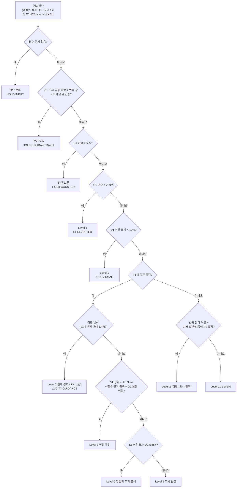

# 위험 지표 정의서

LINK-Radar가 "어디를, 누구를, 언제 먼저 볼지" 정할 때 쓰는 지표 7개입니다. 한 줄에 지표 하나씩, 산식·단위·임계값·근거·한계와 코드 위치를 적었습니다.

- 임계값은 [`configs/rules.yaml`](../configs/rules.yaml) **rules-v1.1** 값입니다. 판이 바뀌면 이 문서도 같이 고칩니다.
- **위험도는 점수가 아닙니다.** 지표를 하나의 점수로 더하지 않고, 규칙이 5단계 대응 체계(Level 3 · Level 2 · Level 1 · Level 0 · 판단 보류)를 정합니다. 사람이나 가구를 판정하지 않고 행정동·생애단계 집단 단위로만 씁니다.
- 결과(동 × 집단 × 기준일 등급표)는 [R-2 위험도 결과](../reports/r2_위험도결과/README.md)에 있습니다.

## 1. 지표 한눈에

| ID | 지표 (현장 말) | 무엇을 보나 | 자료 | 단위 | 산식 | 임계값 (rules-v1.1) | 등급에 쓰는 방식 |
|---|---|---|---|---|---|---|---|
| **S1** | 1인세대 비율 | 어디 (구조 취약성) | 주민등록 세대원수별 세대수 | 행정동 × 월 | 1인세대 ÷ 전체 세대 | 도시 안 상위 30% **이고** 0.35 이상 | 구조 상위 = 등급 축 하나 |
| **A1** | 안부·관계 거점까지 거리 | 어디 (서비스 공백) | 복지자원 원장 v2, 행정동 중심점 | 행정동, km | 동 중심 → 가장 가까운 안부·관계 거점 직선거리 | 5km 이상 | 접근성 = 등급 축 하나 |
| **T1** | 예정된 점검 시점 | 언제 | 공휴일 달력, 기상(ASOS 체감온도), 동절기 달력 | 도시 × 날짜 | R1 연휴 D-7, R2 명절 당일, R3 연휴 뒤 회복, R4 폭염 특보 단계, R6 특보, W 동절기 | 있음/없음 (R4는 주의보·경보·중대경보) | 예정된 점검 후보를 여는 조건 |
| **D1** | 생활 변화 (결제 이탈) | 언제 (관측된 변화) | 카드 데이터2 | 도시 × 성 × 연령 × 일 | robust z (아래 2-4) | z < −2.5 가 7일 중 3일 **그리고** 창 평균 10% 이상 하락 | 예상 밖 이탈 후보 (Level 2 상한) |
| **C1** | 다른 설명 확인 (반증) | 아닌지 | 공휴일 기대값, 도시 공통요인(카드), 연휴 외지 손님 비중(카드), ASOS 강수 | 경보 하나 | 연휴·도시 전체 변화·연휴 이동·비로 설명되는지 | 연휴 뒤 기대 경로 4일, 회복 −5% 안, 외지 손님 +3%p | 통과 / 확인 필요(보류) / 연휴 이동 보류 / 기각 |
| **W1** | 날씨·계절 | 언제 (계절) | 통신 성연령(춘천 읍·면 겨울 체류), ASOS | 읍·면 격자 × 월, 관측소 × 일 | 겨울 ÷ 여름 60+ 체류 | 동절기 점검의 필수 근거 (값 기준 없음) | 동절기 점검의 필수 근거 |
| **Q1** | 근거 신뢰도 | 얼마나 믿나 | 위 지표들의 상태 | 후보 하나 | 낮음 / 보통 / 높음 (규칙) | 낮음이면 Level 3 불가 | 등급 상한 |

## 2. 지표별 정의

### 2-1. S1 구조: 1인세대 비율

| 항목 | 내용 |
|---|---|
| 산식 | 1인세대 수 ÷ 전체 세대수 (주민등록, 행정동 × 월). 기준일에 공개된 가장 최근 달 |
| 방향 | 높을수록 먼저 |
| 임계값 | 같은 도시·같은 달 행정동 전체에서 상위 30% (`top_share: 0.30`) **이고** 0.35 이상 (`abs_min: 0.35`). 동이 5곳 미만이면 순위 없이 0.35만 (`small_n`) |
| 순위 모집단 | 도시 × 기준월의 행정동 전체. 조회 필터(동 하나만 조회)와 무관 ([R-1 4-3절](../reports/r1_등급규칙/README.md)) |
| 근거 | 강남 22개 동에서 1인세대 비율과 시민생활 고령 고립률의 순위상관 ρ=0.83 ([EDA-4 4절](../reports/eda4_외부데이터결합/README.md)). 강남 60세 이상에서 1인세대 비율 하나로 '외출·소통 모두 적음' 상위 동을 가르는 AUC가 동 특징 8개 모델과 비슷 ([M4](../reports/m3_모델링결과/M4.md)) |
| 한계 | 세대 ≠ 가구, 등록 ≠ 실제 거주. 연령·성별 1인세대 수는 동 단위 공개 자료가 없음. 0.35는 운영상 정한 탐색 기준(2023 인구주택총조사 1인가구 35.5%는 참고점일 뿐 다른 지표). 분모 100세대 미만이면 근거 신뢰도 낮음 |
| 코드 | [`rules.yaml thresholds.structure`](../configs/rules.yaml), [`rules/candidates.py`](../src/bigcontest/rules/candidates.py) `top_cut`·`structure_facts`, 도구 [`agent/tools/data.py`](../src/bigcontest/agent/tools/data.py) `get_structure` |

### 2-2. A1 접근성: 안부·관계 거점까지 거리

| 항목 | 내용 |
|---|---|
| 산식 | 행정동 중심점([`ref/adm_cd_names.csv`](../ref/adm_cd_names.csv)) → 필요 유형 '안부·관계' 관측 거점 중 가장 가까운 곳의 직선거리(km) |
| 거점 | [`configs/need_types.yaml`](../configs/need_types.yaml)의 안부·관계: 노인복지관·경로당 등 관계형성·여가, 사회복지관, 노인맞춤돌봄 수행기관, 돌봄·안부 사업 등. **행정복지센터는 넣지 않습니다** (신청 창구라 모임·관계 거점이 아님) |
| 방향 | 멀수록 먼저 |
| 임계값 | 5km 이상 (`far_km: 5.0`, 걸어서 1시간 넘는 거리) |
| 근거 | 춘천 면(5~19km)과 동 지역(5km 미만)을 가르는 값 ([W-1](../reports/w1_자원원장/README.md) 동별 접근거리, R-2 산점도) |
| 한계 | 직선거리라 이동시간·대중교통을 모름. 원장은 2026년 수집이라 2025년 기준일에는 "현재 원장 기준 접근성"으로 표시하고, strict_as_of 에서는 등급 축으로 세지 않음. 좌표 대부분이 탐색용 지오코더 값. **EDA-4의 '가장 가까운 거점'(행정복지센터 포함)과 다른 값**입니다 (예: 동내면 EDA-4 5.08km, A1 4.65km → 기준 미달) |
| 코드 | [`rules.yaml thresholds.access`](../configs/rules.yaml), [`resources/match.py`](../src/bigcontest/resources/match.py) `access_gap`, 도구 [`agent/tools/welfare.py`](../src/bigcontest/agent/tools/welfare.py) `get_access_gap`, [`agent/tools/signal.py`](../src/bigcontest/agent/tools/signal.py) `access_axis` |

### 2-3. T1 시점: 예정된 점검 트리거

| 코드 | 언제 | 범위 | 자료 |
|---|---|---|---|
| R1 | 연휴(3일 이상, 공휴일 포함) 시작 7일 전 | 도시 | 공휴일 달력 ([`configs/project.yaml`](../configs/project.yaml)) |
| R2 | 명절 당일·다음 날 | 도시 | 같음 |
| R3 | 연휴 뒤 회복 확인 (연휴 끝 뒤 10일) | 도시 | 같음 |
| R4 | 폭염 특보 단계 (rules-v1.1): 주의보 = 일 최고 체감온도 33℃ 이상 2일, 경보 = 35℃ 이상 2일, 중대경보 = 체감 38℃ 또는 기온 39℃ 하루 | 도시 | ASOS 일 최고기온 × 일 최소 상대습도로 기상청 체감온도 식 근사 ([`rules/heat.py`](../src/bigcontest/rules/heat.py)). 2025년 예보 발표 기록이 없어 기본은 "예보 자료 없음 → 확인 필요", 실측은 상황 시연으로만 |
| R6 | 기상특보(호우·대설·한파) 근사 | 도시 | ASOS 일자료 근사 (호우 80mm, 신적설 5cm, 최저 −12℃). 특보 기준과 같지 않음 |
| W | 동절기 (11~2월) | 춘천 읍·면 | 달력 + W1 |

- 트리거가 여럿이면 R1 → R2 → R3 → R6 → R4 → W 순서로 사건 id를 정합니다 (`trigger_priority`).
- 근거: 연휴 병원·의원 결제 깊이(나이가 많을수록, 춘천일수록 깊음), 춘천 80대+ 연휴 뒤 회복 지연 ([EDA-5 3절](../reports/eda5_인사이트재현/README.md)).
- 한계: 추석 한 번 관측. 강남에는 동절기·한파 규칙이 아직 없음.
- 코드: [`rules.yaml candidate_types`·`thresholds.heat`](../configs/rules.yaml), [`agent/tools/signal.py`](../src/bigcontest/agent/tools/signal.py) `get_calendar_triggers`·`weather_triggers`·`r4_stage`·`holiday_blocks`, [`rules/heat.py`](../src/bigcontest/rules/heat.py) `heat_stage`.
- 명절 R1·R2·R3 는 화면·보고서에서 전·중·후 한 묶음으로 보여 줍니다 (rules-v1.1).

### 2-4. D1 이탈: 결제 생활 변화

| 항목 | 내용 |
|---|---|
| 산식 | e(t) = log(결제건수+1) − (t 이전 같은 요일 8주 평균, 공휴일 제외). local 경로는 e(t)에서 같은 날 같은 도시 코호트 중앙값(도시 공통요인)을 뺌. robust z = (e − 과거 56일 중앙값) ÷ (1.4826 × MAD) |
| 단위 | 도시(가맹점 시군구) × 성 × 연령(카드 10세 구간) × 일 |
| 임계값 | z < −2.5 인 날이 7일 창 중 3일 이상 (local 또는 absolute) + 창 평균이 평소보다 10% 이상 낮음 (`min_drop: 0.10`) + 학습일 28일 이상 |
| 근거 | 합성 주입: 15% 하락 감지 약 90%, 10% 약 77%, 5% 약 32% ([EDA-6 4-1절](../reports/eda6_사전경보재평가/README.md)). z·창 조건 9개를 비교한 곡선 ([M3 ①](../reports/m3_모델링결과/README.md)) |
| 등급 | 동을 가리키지 않는 도시 단위 신호라 **Level 2 상한** (`CAP-SHARED-CONTEXT`). 동은 '먼저 확인할 동(공유 맥락)'으로만 붙음 |
| 한계 | 정답이 합성. 카드 연령은 '가맹점 도시 × 고객 거주 시도'라 '그 도시 거주'라고 말할 수 없음. 결제가 적은 춘천 80대+는 15% 하락 감지 17% → 예정된 점검으로 봄. 행 없음 = 0건 가정 |
| 코드 | [`signals/alarm.py`](../src/bigcontest/signals/alarm.py) `Panel`·`robust_z`·`window_alarm`, [`rules.yaml thresholds.deviation`](../configs/rules.yaml), 도구 `calc_cohort_deviation` ([`signal.py`](../src/bigcontest/agent/tools/signal.py)) |

### 2-5. C1 반증: 다른 설명 확인

| 결과 | 조건 | 등급 |
|---|---|---|
| 통과 | 공휴일 기대값·도시 공통요인을 빼도 이탈이 남음 | 다음 규칙으로 (구조 상위 동이 있으면 Level 2) |
| 연휴 이동 보류 (rules-v1.1) | 도시 공통 하락(확인 필요)이 연휴 창에 걸리고, 연휴 외지 손님 비중이 직전 8주 주말 평균보다 3%p 이상 높음 = 연휴 이동과 일관 | 판단 보류 (`HOLD-HOLIDAY-TRAVEL`), 다음 할 일 = 연휴 뒤 기대 경로가 끝난 뒤 회복 확인. 자동 기각하지 않음 |
| 확인 필요 (보류) | 도시 대비 추가 이탈은 없지만 연휴 뒤에도 평소보다 낮음 = 도시 공통 변화, 또는 연휴 뒤 회복을 아직 못 봄 | 판단 보류 (`HOLD-COUNTER`) |
| 기각 | 연휴 뒤 바로 평소 수준 회복, 또는 연휴 뒤 기대 경로(명절 뒤 4일) 안의 도시 공통 하락이고 경로 뒤 회복 | Level 1 (`L1-REJECTED`, 사유 기록) |

- 강수: 비로 설명되는 부분을 적지만 **자동 기각하지 않습니다.** 판정 불가이면 근거 신뢰도 낮음.
- 근거: 2025년 하반기 실제 경보 38건 중 19건이 '도시 공통 변화'로 분류 ([EDA-6 2절](../reports/eda6_사전경보재평가/README.md)). 반증 자료가 없으면 이탈 후보는 모두 판단 보류 ([R-2 5절](../reports/r2_위험도결과/README.md)).
- 한계: 연휴 뒤 기대 경로 4일은 2025 추석 한 번을 보고 사후에 정한 값 (다음 설 연휴 전에 고정해 다시 확인).
- 외지 손님 비중 = 가맹점 도시 결제 중 다른 시도 거주 고객 비중 (카드 데이터2, 도시 단위). 비교 기준을 평일이 아닌 주말로 잡아 쉬는 날 효과를 뺐습니다. 조사 단계에서 평일 기준 숫자(춘천 17.7% → 28.6%)를 이미 봐서 완전한 사전 설정은 아닙니다.
- 코드: [`rules.yaml thresholds.holiday_path`·`card_context`](../configs/rules.yaml), [`rules/context.py`](../src/bigcontest/rules/context.py), [`rules/candidates.py`](../src/bigcontest/rules/candidates.py) `post_path_review`, [`signals/alarm.py`](../src/bigcontest/signals/alarm.py) `holiday_review`·`weather_review`, [`signal.py`](../src/bigcontest/agent/tools/signal.py) `check_confounders`·`judge_counter`.

### 2-6. W1 날씨·계절

| 항목 | 내용 |
|---|---|
| 겨울 체류 변화 | 춘천 읍·면 '주민형 격자'(밤 체류가 있고 주말·평일 차이가 작은 250m 격자)의 60대+ 체류: 겨울(11·12월) ÷ 여름(7·9월) − 1. 기준일에 공개된 달만 |
| 쓰는 곳 | 동절기(W) 점검의 **필수 근거**. 값에 기준을 두지 않고, 없으면 부분 판정 → Level 3 불가 (`CAP-PARTIAL`) |
| 근거 | 읍·면 주민형 격자 −9.7% (읍·면 단위 CI −18.0~−3.6%), 동 지역 +0.6% ([EDA-5 4절](../reports/eda5_인사이트재현/README.md)). 이 근거가 없으면 춘천 동절기 Level 3 9건(집단 합)이 Level 2가 됨 ([R-2 5절](../reports/r2_위험도결과/README.md)) |
| 폭염·특보 | T1 R4·R6 (ASOS 관측소 한 곳, 동별 날씨 아님). 폭염일 고령 생필품 반응은 탐색적이라 등급에 쓰지 않음 |
| 한계 | 6개월 자료라 매년 반복되는 계절 변화인지 모름(재현된 계절 수축 아님). 통신은 60대+ 한 묶음, 체류는 주민 수가 아님. 강남에는 같은 계산이 없음 |
| 코드 | [`signal.py`](../src/bigcontest/agent/tools/signal.py) `calc_winter_contraction`, [`weather.py`](../src/bigcontest/weather.py) |

### 2-7. Q1 근거 신뢰도

| 값 | 조건 (하나라도) | 효과 |
|---|---|---|
| 낮음 | 필수 근거 일부 없음 / 구조 지표 값 상태가 observed 아님 / 분모 100세대 미만 / 강수 반증 판정 불가 | Level 3 불가 (`CAP-CONF-LOW`) |
| 보통 | 공개 시점이 가정(simulated_replay) / 현재 원장 기준 접근성 / 계절 변화 한 해 관측 | 그대로 |
| 높음 | 위 어느 것도 아님 (실제 공개일이 확인된 자료만) | 그대로 |

- 코드: [`rules.yaml confidence·caps`](../configs/rules.yaml), [`signal.py`](../src/bigcontest/agent/tools/signal.py) `evidence_confidence`, [`rules/levels.py`](../src/bigcontest/rules/levels.py) `decide`.

## 3. 지표에서 등급까지 (산출 방식)

`rules.yaml levels`를 위에서부터 보고 처음 맞는 규칙으로 정한 뒤, 상한(caps)을 겁니다.

- 청년 남성은 rules-v1.1 부터 동을 고르지 않고 사건마다 도시 단위 '안내 강화' 후보 한 건입니다 (`thresholds.city_guidance`, `L2-CITY-GUIDANCE`, Level 3 불가). 강남 시민생활에서 청년 남성 고립 지표와 1인세대 비율이 반대 방향(ρ −0.41)이라 1인세대 상위 동으로 청년 대상 동을 고르지 않습니다.
- 같은 등급 안의 점검 순서 = 등급 → 도시 → 후보 종류 → 집단 → S1 값(높은 순) → 행정동 코드 (`selection.order`). 새 점수를 만들지 않습니다.

## 4. 맥락 칸 (rules-v1.1, 등급·순서에 쓰지 않음)

후보에 붙어 화면·결과표에 보이지만 등급·순서·반증 결과를 바꾸지 않는 칸입니다 (`context_only`, 후보의 `context`).

| 칸 | 산식·자료 | 쓰는 곳 | 한계 | 코드 |
|---|---|---|---|---|
| 대상 성·연령 인구 비중 | 그 동 주민등록 인구 중 대상 집단(예: 40~64세 남성) 비중, 같은 기준월 | 구조 별도 칸. 초안은 남성 집단 구조 상위 조건이었으나 강남 근거와 반대로 움직여 등급 조건에서 뺌 (`apply_to_structure: false`, R-1 7-1) | 1인 여부를 담지 못함 | `thresholds.structure.target_population` |
| 기초생활수급자 비율 | 서울 동별 수급자 인원(2024-12) ÷ 주민등록 인구(2025-07), 강남만 | 구조 별도 칸. 도시 안 상위 30%면 원인 유형 **경제 취약형** (필요 유형 연결에만) | 춘천 동 자료 없음, 연도 다름. 1인세대 비율과 합치지 않음 | `context_only.recipients`, `signal.py recipient_top` |
| 1인세대 월 순증률 | (기준월 − 전월 1인세대) ÷ 전월, 주민등록 | 전입 맥락 표시 | 이사 직후 관계망 약화 근거는 방향이 섞여 위험 요인으로 쓰지 않음 | `context_only.net_one_person` |
| 연휴 외지 손님 비중 | 위 C1 | 반증 맥락 (`HOLD-HOLIDAY-TRAVEL` 사유) | 도시 단위 | `card_context.visitor_surge_pp` |
| 시간대 상대 리듬 | 카드 데이터1 오전(6~11시) 결제 비중, 고령 − 40대, 같은 달 | 맥락 | 카드1은 거주지 정보 없음 | `card_context.rhythm_band` |
| 업종 다양성 | 하루 결제에서 200건을 뽑았을 때 기대 업종 수 (희박화, 결제량 보정), 평소 대비 | 맥락 | 도시 단위 | `card_context.diversity_draws` |

R-2 결과표의 '맥락:' 칸이 이 값들입니다 ([`동별_등급표.csv`](../reports/r2_위험도결과/동별_등급표.csv)).

## 5. 점수로 합치지 않는 이유

1. 구조(S1·A1)와 시점(T1·D1)은 다른 대응으로 이어집니다. 더하면 "왜 이 동인가"를 설명할 수 없습니다.
2. 카드(D1)는 도시 단위라 동 점수에 더하면 잘못된 단위 주장이 됩니다.
3. 고립 정답 자료가 없어 가중치를 정할 근거가 없습니다. 그래서 규칙과 민감도(임계값 범위)를 함께 공개합니다 ([R-1 3절](../reports/r1_등급규칙/README.md)).

## 6. 참고만 하고 등급에 쓰지 않는 값

| 값 | 쓰는 곳 | 등급에 안 쓰는 이유 |
|---|---|---|
| 서울 시민생활 '외출·소통 적음' | 검증 참고 (EDA-4, R-1 2절, M4) | 같은 통신 공급자의 모형 추정치, 강남만, 한 자료는 입력이나 검증 중 하나로만 |
| 통신 60대+ 체류 비중 | 대리 과제 (M2), 화면 맥락 | 체류는 주민 수가 아님 |
| 폭염일 생필품 반응 | 탐색 (EDA-5 5절) | 폭염일이 휴가철과 겹침 |
| 1인세대 수·대상 집단 인구 | 결과표 인원 칸 (R-2) | 규모 설명용. 위험한 사람 수가 아님 |
