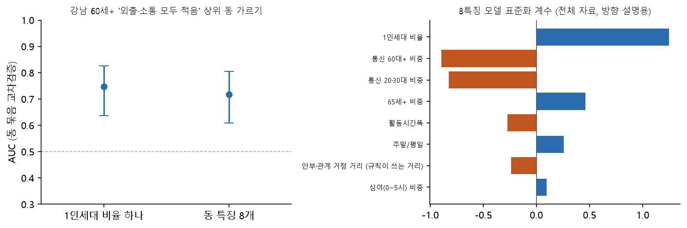

# M4 위험 요인 확인 모델 (강남 60세 이상, 탐색적)

[← 모델링 결과](README.md)

**등급에 쓰지 않습니다.** 등급 규칙의 구조 축(S1 1인세대 비율)을 왜 하나로 정했는지 모델로 확인하는 탐색적 실험입니다. 설계는 결과를 보기 전에 [`configs/models_m3.yaml`](../../configs/models_m3.yaml) `m4` 에 적었습니다.

- 자료: 서울 시민생활 '외출·소통 모두 적은 집단(전체)' ÷ 총인구, 강남 22개 동 × 남녀 × 60~64·65~69·70~74·75+ (6개월 합). 품질 의심 칸(개포3동 등)은 뺐습니다. 행 176개.
- 정답: 같은 성·연령 칸 안에서 비율 상위 1/3 동 = 1 (기저율 0.32). 시민생활은 SKT 통신 기반 추정치라 **독립된 고립 정답이 아닙니다.**
- 모델: 로지스틱(표준화). ① 1인세대 비율 하나 ② 동 특징 8개(1인세대 비율, 65세+ 비중, 안부·관계 거점 거리 (규칙이 쓰는 거리), 통신 60대+ 비중, 통신 20·30대 비중, 심야(0~5시) 비중, 주말/평일, 활동시간폭).
- 검증: 행정동 GroupKFold 5겹(같은 동은 같은 접기), 동 배정을 바꿔 50번 반복. CI = 반복 평균 out-of-fold 점수로 동 군집 부트스트랩 2,000번.

## 결과

| 모델 | AUC | 95% CI 하한 | 95% CI 상한 | 반복 범위 | Brier |
|---|---|---|---|---|---|
| 1인세대 비율 하나 | 0.75 | 0.64 | 0.83 | 0.72~0.77 | 0.180 |
| 동 특징 8개 | 0.72 | 0.61 | 0.81 | 0.60~0.77 | 0.189 |
| 차이 (8개 − 1개) | -0.03 | -0.09 | 0.02 | -0.16~+0.02 | nan |

| 특징 | 표준화 계수 |
|---|---|
| 1인세대 비율 | +1.25 |
| 통신 60대+ 비중 | -0.89 |
| 통신 20·30대 비중 | -0.83 |
| 65세+ 비중 | +0.46 |
| 활동시간폭 | -0.28 |
| 주말/평일 | +0.26 |
| 안부·관계 거점 거리 (규칙이 쓰는 거리) | -0.24 |
| 심야(0~5시) 비중 | +0.10 |

## 읽는 법

- 고령층에서 **1인세대 비율 하나(AUC 0.75)가 동 특징 8개를 섞은 모델(AUC 0.72)과 비슷하게** 맞힙니다(차이 CI가 0을 포함). 등급 규칙이 구조 축을 1인세대 비율 하나로 둔 선택을 뒷받침하는 방향입니다.
- 1인세대 비율 계수는 양(+)입니다(1인세대가 많은 동일수록 상위 동일 가능성).
- 22개 동이라 CI가 넓습니다. 이 결과로 특징을 더하거나 빼지 않습니다.

## 한계

- 22개 동, 강남만. 춘천에는 시민생활 자료가 없어 옮겨 쓰지 않습니다.
- 시민생활은 같은 통신 공급자의 모형 추정치이고 관측 기간·모형이 공개되지 않았습니다. 통신 특징(60대+·20·30대·심야 등)과 같은 자료에서 나와 그 특징의 힘은 과대평가될 수 있습니다.
- 등급 임계값은 시민생활을 보기 전에 정했습니다. 이 모델은 등급·순서에 쓰지 않습니다.
