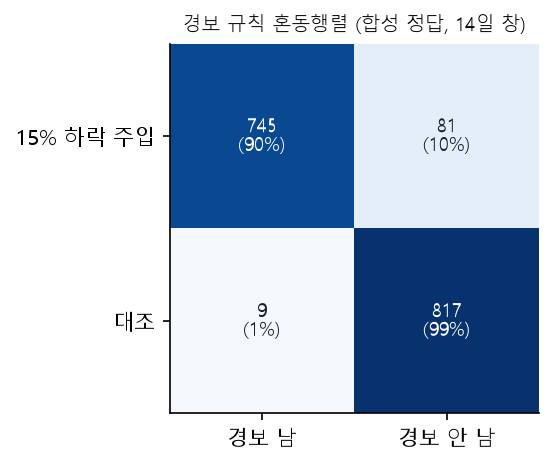
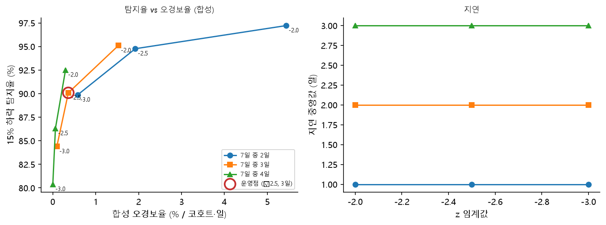
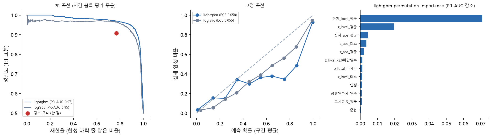

# M3 모델링 결과: 분류 성능과 위험 요인 확인

[← 전체 리포트 목록](../README.md)

> **rules-v2.0 안내**: 에이전트는 지금 카드 이탈 기준으로 z −2.0, 7일 중 4일, 최소 하락 5%를 씁니다([규칙 개정 4절](../r3_규칙개정/README.md), LINK-Sim으로 고름). 아래 z 임계값 표의 −2.0 / 4일 행이 그 기준입니다: 탐지율 92.5% (753/814), 대조 쌍 경보율 1.7%, 합성 오경보율 0.30%, 지연 중앙값 3일. 이 장의 '운영점'(−2.5, 7일 중 3일)은 v1.1 기준이고 비교를 위해 그대로 둡니다.

**등급은 규칙이 정하고, 이 장의 모델은 규칙의 근거와 검증입니다.** 고립 정답 자료가 없으므로 분류 성능은 모두 **합성 정답**(일부러 넣은 코호트 결제 하락)으로 쟀습니다. 실제 고립 탐지율이 아닙니다.

- M3·M4 설계와 채택 기준은 결과를 보기 전에 [`configs/models_m3.yaml`](../../configs/models_m3.yaml)에 커밋했습니다 (최근 커밋 -).
- 결과 보기: ① 경보 규칙을 분류기로 → ② M3 이탈 분류 모델 → ③ [M4 위험 요인 확인 모델](M4.md) → ④ 모델 카드와 평가 숫자 한 장.

## ① 경보 규칙을 분류기로 보기 (EDA-6 와 같은 쌍)

EDA-6 의 짝지은 주입 실험(840쌍, 같은 난수)을 분류 언어로 다시 적습니다. 양성 = 15% 계단 하락 14일 주입, 음성 = 같은 쌍의 원 자료(대조). 시작 전날 이미 경보 중인 쌍은 뺍니다. 경로는 local 입니다.

| 합성 정답 \ 경보 규칙 | 경보 남 | 경보 안 남 |
|---|---|---|
| 15% 하락 주입 (양성) | 745 | 81 |
| 주입 없음 = 대조 (음성) | 9 | 817 |

- TPR(주입 쌍 중 경보) 90.2%, 대조 쌍 경보율(14일 창) 1.1%. EDA-6 의 '탐지율'은 대조에서 울린 쌍을 뺀 0→1 / (0→0+0→1) = 736/817 = 90.1%입니다 (EDA-6 하락폭별 표와 같음).

| 대조 \ 주입 | 주입 뒤 경보 없음 | 주입 뒤 경보 있음 |
|---|---|---|
| 대조 경보 없음 | 81 | 736 |
| 대조 경보 있음 | 0 | 9 |

### z 임계값 곡선: 왜 −2.5, 7일 중 3일인가

z 임계값 −2.0/−2.5/−3.0 × 창 조건 2/3/4일 9개 설정으로 같은 쌍을 다시 돌렸습니다. 합성 오경보율은 EDA-6 와 같은 AR(1) 정상 합성 시계열 5개 평균(코호트·일당). **결과를 보고 운영점을 바꾸지 않습니다** (운영점은 EDA-6 에서 이미 정함).

| z 임계값 | 창 조건(7일 중) | 운영점 | 탐지율(0→1 / 대조 음성) | 새 탐지 | 대조 음성 | 주입 쌍 경보율(TPR) | 대조 쌍 경보율(14일 창) | 합성 오경보율(코호트·일) | 배경 경보율(실제, 코호트·일) | 지연 중앙값(일) |
|---|---|---|---|---|---|---|---|---|---|---|
| -2.0 | 2 | False | 97.2% | 698 | 718 | 97.5% | 8.7% | 5.44% | 9.61% | 1 |
| -2.0 | 3 | False | 95.1% | 756 | 795 | 95.3% | 3.3% | 1.53% | 3.69% | 2 |
| -2.0 | 4 | False | 92.5% | 753 | 814 | 92.6% | 1.7% | 0.30% | 2.07% | 3 |
| -2.5 | 2 | False | 94.8% | 742 | 783 | 94.9% | 3.5% | 1.92% | 6.18% | 1 |
| -2.5 | 3 | True | 90.1% | 736 | 817 | 90.2% | 1.1% | 0.36% | 2.80% | 2 |
| -2.5 | 4 | False | 86.3% | 712 | 825 | 86.4% | 0.4% | 0.06% | 1.43% | 3 |
| -3.0 | 2 | False | 89.9% | 727 | 809 | 90.0% | 1.6% | 0.58% | 4.42% | 1 |
| -3.0 | 3 | False | 84.4% | 692 | 820 | 84.6% | 1.1% | 0.09% | 2.11% | 2 |
| -3.0 | 4 | False | 80.4% | 668 | 831 | 80.4% | 0.0% | 0.00% | 1.13% | 3 |

- 왼쪽 위로 갈수록 좋습니다. 운영점은 탐지율이 높은 구간에서 오경보율을 낮게 둔 자리입니다. 숫자는 위 표를 그대로 읽습니다.

## ② M3 이탈 분류 모델 (합성 정답)

질문: 코호트 × 7일 창이 '평소와 다른 하락'인지 확률로 맞힐 수 있나, 지금 경보 규칙보다 나은가. 표본 7,106개 (양성 3,553 = 5·10·15·20% 하락 무작위 주입, 음성 = 같은 코호트·시작일의 원 자료), 결정일 = 주입 7일째. 특징 19개는 결정일까지의 자료만 씁니다: z_local_최소, z_local_평균, z_local_-2.5미만일수, z_local_-2.0미만일수, z_local_마지막, z_abs_최소, z_abs_평균, z_abs_-2.5미만일수, z_abs_-2.0미만일수, z_abs_마지막, 잔차_local_평균, 잔차_abs_평균, 도시공통_평균, 공휴일까지_일수, 창_공휴일무렵_일수, 창_비온날, 연령, 춘천, 남성.
검증: 결정일 4주 블록으로 나눠 앞 블록으로 학습하고 다음 블록을 평가(평가 블록 4개, 평가 표본 5,566), 학습 표본 중 결정일이 평가 블록 시작 14일 전 이후인 것은 뺐습니다. 임계값은 학습 블록 안의 교차 예측(코호트 묶음)에서 규칙의 학습 오경보율과 같아지게 정했습니다. CI 는 코호트 군집 부트스트랩 2,000번.

| 모델 | PR-AUC | ROC-AUC | 탐지율 | 오경보율 | Brier | ECE |
|---|---|---|---|---|---|---|
| 경보 규칙 (둘 중 하나, 7일 안) | nan | nan | 76.9% | 7.9% | nan | nan |
| logistic | 0.950 | 0.956 | 96.2% | 20.7% | 0.077 | 0.055 |
| lightgbm | 0.970 | 0.970 | 95.7% | 13.5% | 0.067 | 0.058 |

- 여기 규칙 오경보율이 ①보다 높은 이유: ①은 공휴일 무렵 주입을 빼고 local 경로·14일 창이지만, M3 표본은 공휴일 무렵을 포함하고 '둘 중 하나' 경로가 결정일까지 7일 안에 한 번이라도 울렸는지를 봅니다(반증 전 원 경보).
- lightgbm PR-AUC 95% CI 0.956~0.982. 규칙의 PR 한 점: 재현율 76.9%, 정밀도 90.7% (양성:음성 = 1:1 표본이라 정밀도는 실제 운영 값이 아님).

### 채택 판정 (미리 정한 기준)

| 조건 | 값 | 충족 |
|---|---|---|
| (1) 같은 오경보율 임계값에서 탐지율 +5%p 이상, CI 하한 > 0 | +18.8%p (95% CI +12.5~+26.0) | True |
| (2) 80대+ (두 도시 각각) 탐지율이 규칙보다 낮지 않음 | 강남 93% vs 규칙 61%; 춘천 94% vs 규칙 27% | True |
| (3) 평가 블록 오경보율이 규칙보다 1%p 넘게 높지 않음 | 13.5% vs 규칙 7.9% (+5.6%p) | False |
| (참고) 확률을 숫자로 보이려면 ECE ≤ 0.05 | 0.058 | False |

- 읽을 때 주의: 임계값은 **학습 블록**에서 규칙과 오경보율을 맞춘 값입니다. 평가 블록에서는 lightgbm 13.5% 대 규칙 7.9%로 같지 않았습니다(조건 3). 그래서 (1)의 +18.8%p를 '평가에서도 같은 오경보율로 더 많이 잡았다'로 읽지 않습니다.
**판정: lightgbm 미채택. 경보 규칙을 그대로 씁니다.** 채택돼도 등급을 모델이 정하지 않습니다.

### 하락 폭별·80대+·블록별

| 주입 하락 | 양성 | 규칙 탐지율 | lightgbm 탐지율 | logistic 탐지율 |
|---|---|---|---|---|
| 5% | 684 | 39.9% | 84.6% | 86.3% |
| 10% | 689 | 79.1% | 98.3% | 98.4% |
| 15% | 672 | 91.5% | 99.6% | 100.0% |
| 20% | 738 | 95.9% | 100.0% | 100.0% |

| 도시 | 양성 수 | 규칙 탐지율 | lightgbm 탐지율 | logistic 탐지율 |
|---|---|---|---|---|
| 강남 | 202 | 60.9% | 93.1% | 94.6% |
| 춘천 | 202 | 26.7% | 93.6% | 95.5% |

| _block | 평가 기간 | 학습 표본 | 평가 표본 | 규칙 TPR | 규칙 FPR | lightgbm TPR | lightgbm FPR | lightgbm PR-AUC |
|---|---|---|---|---|---|---|---|---|
| 1 | 09/08~10/05 | 772 | 1,514 | 74.5% | 5.4% | 92.5% | 9.0% | 0.979 |
| 2 | 10/06~11/02 | 2,324 | 1,144 | 81.5% | 29.7% | 92.5% | 19.6% | 0.938 |
| 3 | 11/03~11/30 | 3,532 | 1,568 | 74.0% | 0.0% | 98.7% | 11.9% | 0.994 |
| 4 | 12/01~12/24 | 4,982 | 1,340 | 79.3% | 1.2% | 98.5% | 15.2% | 0.991 |

- 중요도 상위: 잔차_local_평균, z_local_평균, 잔차_abs_평균, z_abs_최소, z_abs_평균. 모두 경보 규칙이 쓰는 것과 같은 잔차·z 요약입니다. 모델은 새 자료를 쓰지 않고 같은 신호를 연속값으로 읽어 작은 하락(5~10%)을 더 잡습니다.
- 오경보는 기간에 따라 크게 흔들립니다: 규칙 FPR 이 가장 높은 블록은 10/06~11/02(30%, 추석 연휴 포함). 학습 블록에서 맞춘 임계값이 다음 블록에서 그대로 지켜지지 않아 (3) 조건을 넘지 못했습니다.
- 보정 곡선이 대각선 아래에 있으면 확률이 실제보다 높게 나온다는 뜻입니다(ECE 0.058). 그래서 채택되더라도 확률 숫자를 화면에 보이지 않습니다.
- **한계**: 정답이 합성 계단 하락이라 쉬운 과제입니다. 실제 고립은 천천히 줄 수 있고, 결제 하락이 고립을 뜻하지도 않습니다. 5% 하락은 규칙·모델 모두 잘 못 잡습니다(위 하락 폭별 표). 블록이 4개뿐이고 첫 블록은 학습 표본이 적습니다.

## ③ M4 위험 요인 확인 모델 (강남 60세 이상, 탐색적)

| 모델 | AUC | 95% CI 하한 | 95% CI 상한 | 반복 범위 | Brier |
|---|---|---|---|---|---|
| 1인세대 비율 하나 | 0.75 | 0.64 | 0.83 | 0.72~0.77 | 0.180 |
| 동 특징 8개 | 0.72 | 0.61 | 0.81 | 0.63~0.75 | 0.190 |
| 차이 (8개 − 1개) | -0.02 | -0.07 | 0.02 | -0.13~+0.01 | nan |

- 1인세대 비율 하나가 동 특징 8개 모델과 비슷하게 맞힙니다 → 구조 축을 1인세대 비율 하나로 둔 등급 규칙의 근거. 등급에는 쓰지 않습니다. 자세한 내용: [M4.md](M4.md)

## ④ 모델 카드와 평가 숫자 한 장

### 평가 숫자 한 장

고립 정답 자료가 없으므로 하나의 '정확도'로 합치지 않고, 평가마다 입증하는 것과 입증하지 못하는 것을 함께 적습니다.

| 평가 | 숫자 | 입증하는 것 | 입증하지 못하는 것 | 출처 |
|---|---|---|---|---|
| 경보 규칙 (EDA-6, local) | 15% 하락 90% (CI 81%~98%), 10% 77% (CI 64%~89%), 5% 32% (CI 22%~42%) | 코호트 결제가 그만큼 줄면 몇 %를 잡나 (합성 하락) | 실제 고립 탐지율, 개인 변화 | EDA-6 4-1절 |
| 경보 규칙 = 분류기 (이 장 ①) | TPR 90%, 대조 14일 창 경보율 1%, 합성 오경보 0.36%/코호트·일 | 임계값을 바꿨을 때 탐지와 오경보가 어떻게 바뀌나 | 현장 정확도 (정답이 합성) | 이 리포트 ① |
| M1 기대 활동 (채택 0b) | h=1 상대 MAE 강남 6.8% · 춘천 7.6% (STL·LightGBM 미채택) | 평소 결제를 얼마나 맞히나 | 고립 예측 | M1 1·2절 |
| M3 이탈 분류 (lightgbm, 합성 정답) | PR-AUC 0.97 (CI 0.96~0.98). 학습 블록에서 규칙과 FPR을 맞춘 임계값으로 탐지율 차 +18.8%p, 그러나 평가 블록 오경보율 13.5% vs 규칙 7.9% (+5.6%p, 허용 +1%p) → 미채택 | 규칙보다 나은 분류가 가능한가 (미리 정한 기준) | 실제 고립 분류 성능 | 이 리포트 ② |
| M2 대리 과제 B (릿지) | 순위상관 ρ 강남 0.79 · 춘천 0.66 (GroupKFold) | 격자 고령 비중을 다른 칸으로 맞히나 | 고립 | M2 |
| M4 위험 요인 (강남 60+, 탐색적) | AUC 1인세대 하나 0.75 (0.64~0.83) vs 8특징 0.72 | 구조 축을 1인세대 비율 하나로 둔 선택의 근거 | 개인 고립, 춘천 | M4.md |
| 등급 규칙 (R-1) | 강남 추석 D-7 고령층 후보 8건 (예정된 점검·이탈 합, 임계값 범위 6~10건), 페르소나 5/5 | 규칙이 일관되게 돌고 임계값에 얼마나 민감한가 | 등급의 정확도 (정답 없음) | R-1 1·3·5절 |
| 자원 추천 (W-2, 30쌍) | 상위 5개 충족도 (k-정규화 Recall@5, 분모 min(5, 정답 수)) 0.6733; 정답 전체 재현율 0.3439, 정밀도@5 0.56, Hit@5 0.90; 명시적 부적격 추천 0건, 자격 확인 필요 71건 | 미리 적은 기준대로 고르나 (공개 원장 정답) | 정답 전체의 75% 회수, 자원이 실제로 도움이 되나·이용 가능한가 | W-2 |

### 모델 카드

| 모델 | 종류 | 자료 | 검증 | 지표 | 쓰는 곳 | 한계 |
|---|---|---|---|---|---|---|
| 경보 규칙 (EDA-6) | 규칙 기반 이진 분류기 | 카드2 28개 코호트 × 184일 | z < −2.5 가 7일 중 3일 (local·absolute) | 합성 주입 탐지율·합성 오경보율·배경 경보율 | D1 이탈 신호 (등급 입력, 반증 뒤) | 합성 정답, 추석 1회, 도시 단위 |
| M1 기대 활동 | 시계열 회귀 (기준선·STL·LightGBM) | 같음 | rolling-origin, 채택 기준 선커밋 (models.yaml) | 상대 MAE·구간 포함률·같은 쌍 탐지율 | 경보 기대값 = EDA-6 규칙 유지, 예측 0b | 184일, 공휴일 학습 1일 |
| M3 이탈 분류 (lightgbm) | 이진 분류 (로지스틱 기준 + LightGBM) | 합성 주입 표본 (위 패널) | 시간 블록 4주 전진 검증, 채택 기준 선커밋 (models_m3.yaml) | PR-AUC·ROC-AUC·학습 블록 FPR을 맞춘 임계값의 탐지율·평가 블록 FPR·Brier·ECE·permutation importance | 미채택 (규칙 유지) | 정답이 합성, 실제 고립 아님 |
| M2 대리 과제 B | 회귀 (릿지·LightGBM) | 통신 격자 | 행정동 GroupKFold | R²·MAE·ρ | 보조 (등급 입력 아님) | 대리 과제 |
| M4 위험 요인 | 로지스틱 (탐색적) | 강남 시민생활 60+ × 22개 동 | 동 GroupKFold 5겹 × 50번, 동 군집 부트스트랩 | AUC·Brier·계수 | 요인 설명만 (등급 입력 아님) | 22개 동, 같은 공급자 추정치 |
| 등급 규칙 rules-v1.1 | 결정 규칙 | 주민등록·달력·통신·카드·원장 근거 | 민감도·지표 빼기·비교안 A~D·페르소나 | 후보 수 범위·Top-K 겹침률 | 등급 결정 (유일한 결정 주체) | 정답이 없어 정확도 아님 |

- M1 의 자세한 모델 카드는 [M1 리포트](../m1_기대활동모델/README.md#모델-카드)에 있습니다.
- **하지 않는 것**: 모델 출력으로 등급을 바꾸기, '고립 확률'을 내기, 합성 정답 성능을 '고립 탐지율'로 부르기, 강남 시민생활 모델을 춘천에 옮기기.
