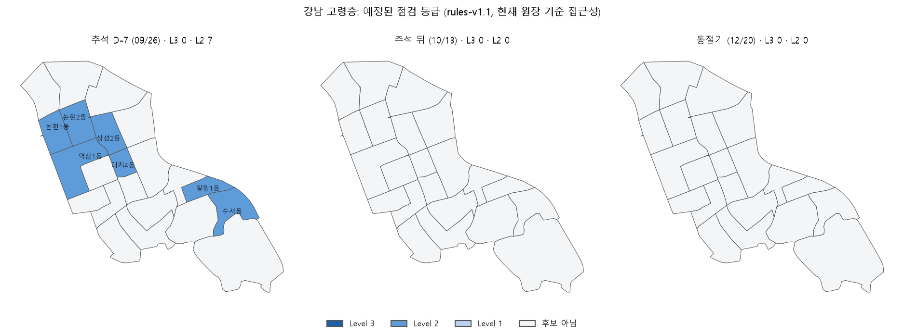
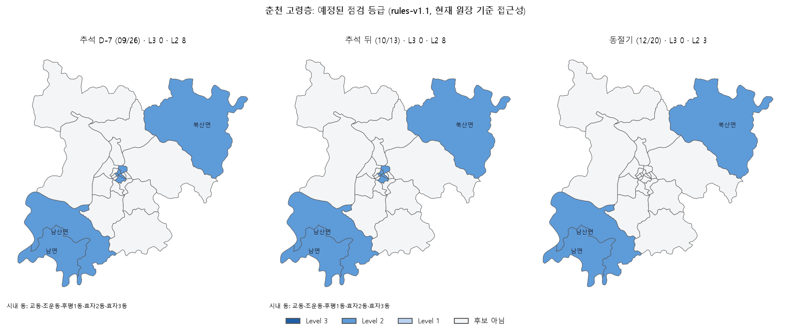
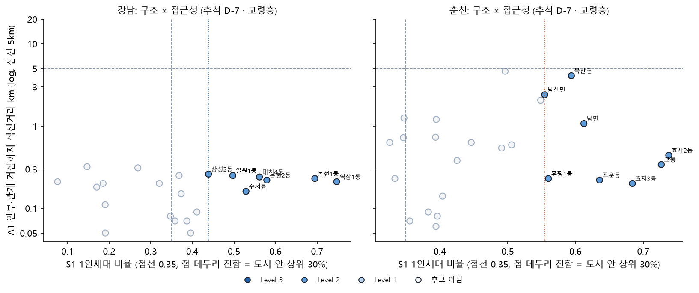
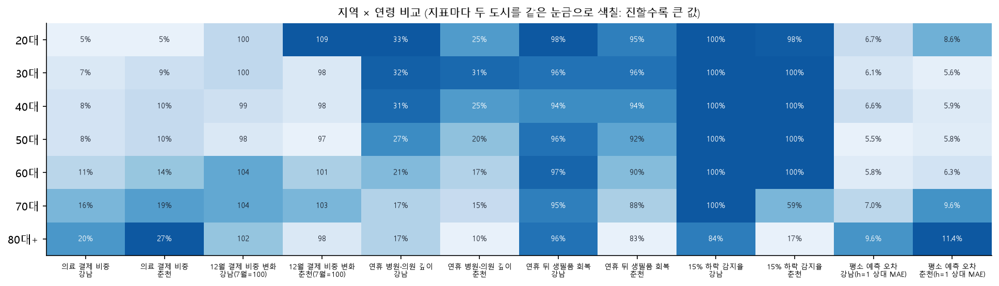

# R-2 위험도 결과표: 동 × 집단 × 기준일

[← 전체 리포트 목록](../README.md)

R-1 등급 규칙([`configs/rules.yaml`](../../configs/rules.yaml) **rules-v1.1**)을 동 이름·근거 값·대상 인구와 한 줄로 붙인 결과표입니다. **위험도는 점수가 아니라 5단계 대응 체계**(Level 3 우선 현장 확인 / Level 2 담당자 추가 분석 / Level 1 추세 관찰 / Level 0 정기 모니터링 / 판단 보류 자료 더 필요)입니다. 등급은 규칙이 정하고, 사람이나 가구를 판정하지 않습니다.

- 지표 정의(S1 구조·A1 접근성·T1 시점·D1 이탈·C1 반증·W1 날씨·Q1 근거 신뢰도)는 [위험 지표 정의서](../../docs/위험_지표.md)에 있습니다.
- 등급은 R-1 과 같은 함수(비교안 D)로 다시 냈습니다. 아래 요약표의 등급별 후보 수는 [R-1 결과표](../r1_등급규칙/README.md)와 같습니다(테스트로 확인).
- **A1 거리**는 규칙이 쓰는 '안부·관계 유형 관측 거점(노인복지관·사회복지관·경로당·돌봄 수행기관 등)까지 직선거리'입니다. EDA-4 의 '가장 가까운 거점'(행정복지센터 포함)과 다른 값입니다. 행정복지센터는 신청 창구라 안부·관계 거점으로 세지 않습니다.
- 청년 남성은 rules-v1.1 부터 동을 고르지 않고 도시 단위 '안내 강화' 후보 한 건(`L2-CITY-GUIDANCE`)입니다. 그래서 동 행은 모두 '후보 아님'이고 '(도시 전체)' 행이 따로 있습니다.
- '맥락:' 칸(대상 성·연령 인구 비중, 수급자 비율, 경제 취약형, 1인세대 월 순증)은 rules-v1.1 의 표시용 칸이며 등급·순서에 쓰지 않습니다.
- 접근성은 2026년 수집 원장이라 '현재 원장 기준 접근성'입니다(2025년 당시 운영·위치는 확인 안 됨).
- **인원 칸**: 주민등록 세대 자료에는 연령·성이 없어 '65세 이상 1인세대 수'·'중장년 남성 1인세대 수'는 동 단위로 알 수 없습니다. 그래서 **1인세대 수(전 연령)**와 **대상 집단 인구(주민등록 성·연령, 1인 여부 모름)**를 따로 적었습니다. 10 미만은 '<10'으로 가립니다.

## 1. 요약: 도시 × 기준일 × 집단 (등급별 후보 수)

| 도시 | 기준일 | 집단 | 후보 종류 | 후보 수 | Level 0 | Level 1 | Level 2 | Level 3 | 판단 보류 |
|---|---|---|---|---|---|---|---|---|---|
| 강남 | 추석 D-7 (09/26) | 고령층 | 예정된 점검 | 7 | 0 | 0 | 7 | 0 | 0 |
| 강남 | 추석 D-7 (09/26) | 고령층 | 예상 밖 이탈 | 1 | 0 | 1 | 0 | 0 | 0 |
| 강남 | 추석 D-7 (09/26) | 중장년 남성 1인가구 | 예정된 점검 | 7 | 0 | 0 | 7 | 0 | 0 |
| 강남 | 추석 D-7 (09/26) | 청년 남성 | 예정된 점검 | 1 | 0 | 0 | 1 | 0 | 0 |
| 강남 | 추석 D-7 (09/26) | 50~69세 남성 | 예정된 점검 | 7 | 0 | 0 | 7 | 0 | 0 |
| 강남 | 추석 D-7 (09/26) | 50~69세 남성 | 예상 밖 이탈 | 1 | 0 | 1 | 0 | 0 | 0 |
| 강남 | 추석 뒤 (10/13) | 고령층 | 예상 밖 이탈 | 6 | 0 | 1 | 0 | 0 | 5 |
| 강남 | 추석 뒤 (10/13) | 중장년 남성 1인가구 | 예상 밖 이탈 | 2 | 0 | 0 | 0 | 0 | 2 |
| 강남 | 추석 뒤 (10/13) | 청년 남성 | 예상 밖 이탈 | 2 | 0 | 1 | 0 | 0 | 1 |
| 강남 | 추석 뒤 (10/13) | 50~69세 남성 | 예상 밖 이탈 | 2 | 0 | 1 | 0 | 0 | 1 |
| 춘천 | 추석 D-7 (09/26) | 고령층 | 예정된 점검 | 13 | 0 | 0 | 10 | 3 | 0 |
| 춘천 | 추석 D-7 (09/26) | 고령층 | 예상 밖 이탈 | 1 | 0 | 1 | 0 | 0 | 0 |
| 춘천 | 추석 D-7 (09/26) | 중장년 남성 1인가구 | 예정된 점검 | 16 | 0 | 0 | 13 | 3 | 0 |
| 춘천 | 추석 D-7 (09/26) | 청년 남성 | 예정된 점검 | 1 | 0 | 0 | 1 | 0 | 0 |
| 춘천 | 추석 D-7 (09/26) | 50~69세 남성 | 예정된 점검 | 13 | 0 | 0 | 10 | 3 | 0 |
| 춘천 | 추석 D-7 (09/26) | 50~69세 남성 | 예상 밖 이탈 | 1 | 0 | 1 | 0 | 0 | 0 |
| 춘천 | 추석 뒤 (10/13) | 고령층 | 예정된 점검 | 13 | 0 | 0 | 10 | 3 | 0 |
| 춘천 | 추석 뒤 (10/13) | 고령층 | 예상 밖 이탈 | 6 | 0 | 0 | 2 | 0 | 4 |
| 춘천 | 추석 뒤 (10/13) | 중장년 남성 1인가구 | 예상 밖 이탈 | 1 | 0 | 0 | 0 | 0 | 1 |
| 춘천 | 추석 뒤 (10/13) | 50~69세 남성 | 예상 밖 이탈 | 2 | 0 | 0 | 0 | 0 | 2 |
| 춘천 | 동절기 (12/20) | 고령층 | 예정된 점검 | 8 | 0 | 0 | 5 | 3 | 0 |
| 춘천 | 동절기 (12/20) | 중장년 남성 1인가구 | 예정된 점검 | 10 | 0 | 0 | 7 | 3 | 0 |
| 춘천 | 동절기 (12/20) | 50~69세 남성 | 예정된 점검 | 8 | 0 | 0 | 5 | 3 | 0 |

### 후보 동에 사는 사람 (공개 주민등록, Level 2 이상)

| 도시 | 기준일 | 집단 | 도시 단위 후보 | Level 2 이상 동 | 그 동 1인세대 수 | 그 동 대상 집단 인구 | Level 3 동 | Level 3 동 1인세대 수 | Level 3 동 대상 집단 인구 |
|---|---|---|---|---|---|---|---|---|---|
| 강남 | 추석 D-7 (09/26) | 고령층 | 0 | 7 | 53,005 | 26,237 | 0 | 0 | 0 |
| 강남 | 추석 D-7 (09/26) | 중장년 남성 1인가구 | 0 | 7 | 53,005 | 27,542 | 0 | 0 | 0 |
| 강남 | 추석 D-7 (09/26) | 청년 남성 | 1 | 0 | 0 | 0 | 0 | 0 | 0 |
| 춘천 | 추석 D-7 (09/26) | 고령층 | 0 | 13 | 22,106 | 19,497 | 3 | 1,854 | 2,557 |
| 춘천 | 추석 D-7 (09/26) | 중장년 남성 1인가구 | 0 | 16 | 31,249 | 22,879 | 3 | 1,854 | 1,137 |
| 춘천 | 추석 D-7 (09/26) | 청년 남성 | 1 | 0 | 0 | 0 | 0 | 0 | 0 |
| 춘천 | 추석 뒤 (10/13) | 고령층 | 0 | 13 | 22,126 | 19,556 | 3 | 1,849 | 2,558 |
| 춘천 | 동절기 (12/20) | 고령층 | 0 | 8 | 7,326 | 10,776 | 3 | 1,856 | 2,578 |
| 춘천 | 동절기 (12/20) | 중장년 남성 1인가구 | 0 | 10 | 12,990 | 12,744 | 3 | 1,856 | 1,120 |

- '대상 집단 인구'는 그 동에 등록된 해당 성·연령 인구 전체입니다(혼자 사는지 모름). '1인세대 수'는 모든 연령의 1인세대입니다. 두 값을 곱하거나 나눠 '고령 1인세대 수'를 만들지 않습니다.
- '도시 단위 후보'는 청년 남성 안내 강화처럼 동을 고르지 않는 후보입니다. 동 인원 칸에 넣지 않습니다.

## 2. 결과표 A: 동 × 집단 × 기준일 (Level 2 이상, 추석 D-7 · 고령층)

전체 566행 = **564개 동·집단·기준일 행**(두 도시 47개 동 × 집단 4 × 기준일 3) + **도시 단위 2행**(청년 남성 안내 강화, 동을 고르지 않음)이고 [`동별_등급표.csv`](동별_등급표.csv)에 있습니다. 본문에는 추석 D-7 고령층의 Level 2 이상만 싣습니다.

| 도시 | 동 | 유형 | 등급 | 규칙 id | S1 1인세대 비율 | S1 도시 안 순위 | S1 동 수 | A1 안부·관계 거점 거리(km) | 1인세대 수(전 연령) | 대상 집단 인구(성·연령) | 동 안 안부·관계 자원 수(원장) |
|---|---|---|---|---|---|---|---|---|---|---|---|
| 강남 | 역삼1동 | 동 | Level 2 | L2-STRUCT-TRIGGER | 0.75 | 1 | 22 | 0.2 | 17885.0 | 4079.0 | 12.0 |
| 강남 | 논현1동 | 동 | Level 2 | L2-STRUCT-TRIGGER | 0.69 | 2 | 22 | 0.2 | 9362.0 | 3201.0 | 5.0 |
| 강남 | 논현2동 | 동 | Level 2 | L2-STRUCT-TRIGGER | 0.58 | 3 | 22 | 0.2 | 6489.0 | 3335.0 | 9.0 |
| 강남 | 대치4동 | 동 | Level 2 | L2-STRUCT-TRIGGER | 0.56 | 4 | 22 | 0.2 | 5470.0 | 2282.0 | 4.0 |
| 강남 | 수서동 | 동 | Level 2 | L2-STRUCT-TRIGGER | 0.53 | 5 | 22 | 0.2 | 4040.0 | 5364.0 | 13.0 |
| 강남 | 일원1동 | 동 | Level 2 | L2-STRUCT-TRIGGER | 0.50 | 6 | 22 | 0.1 | 3700.0 | 3760.0 | 5.0 |
| 강남 | 삼성2동 | 동 | Level 2 | L2-STRUCT-TRIGGER | 0.44 | 7 | 22 | 0.3 | 6059.0 | 4216.0 | 14.0 |
| 춘천 | 남면 | 면 | Level 3 | L3-STRUCT-ACCESS-TRIGGER | 0.61 | 5 | 25 | 18.6 | 406.0 | 544.0 | 0.0 |
| 춘천 | 북산면 | 면 | Level 3 | L3-STRUCT-ACCESS-TRIGGER | 0.59 | 6 | 25 | 15.6 | 367.0 | 530.0 | 0.0 |
| 춘천 | 남산면 | 면 | Level 3 | L3-STRUCT-ACCESS-TRIGGER | 0.55 | 8 | 25 | 14.7 | 1081.0 | 1483.0 | 0.0 |
| 춘천 | 효자2동 | 동 | Level 2 | L2-STRUCT-TRIGGER | 0.74 | 1 | 25 | 0.5 | 6354.0 | 2915.0 | 2.0 |
| 춘천 | 교동 | 동 | Level 2 | L2-STRUCT-TRIGGER | 0.73 | 2 | 25 | 1.0 | 1974.0 | 935.0 | 0.0 |
| 춘천 | 효자3동 | 동 | Level 2 | L2-STRUCT-TRIGGER | 0.68 | 3 | 25 | 1.1 | 1969.0 | 1072.0 | 0.0 |
| 춘천 | 조운동 | 동 | Level 2 | L2-STRUCT-TRIGGER | 0.64 | 4 | 25 | 0.8 | 985.0 | 853.0 | 0.0 |
| 춘천 | 후평1동 | 동 | Level 2 | L2-STRUCT-TRIGGER | 0.56 | 7 | 25 | 1.5 | 3539.0 | 3051.0 | 0.0 |
| 춘천 | 사북면 | 면 | Level 2 | L2-ACCESS-TRIGGER | 0.55 | 9 | 25 | 10.3 | 744.0 | 1133.0 | 0.0 |
| 춘천 | 동산면 | 면 | Level 2 | L2-ACCESS-TRIGGER | 0.51 | 10 | 25 | 10.1 | 391.0 | 661.0 | 0.0 |
| 춘천 | 서면 | 면 | Level 2 | L2-ACCESS-TRIGGER | 0.50 | 11 | 25 | 9.6 | 977.0 | 1692.0 | 0.0 |
| 춘천 | 신동면 | 면 | Level 2 | L2-ACCESS-TRIGGER | 0.39 | 19 | 25 | 6.2 | 489.0 | 1005.0 | 0.0 |
| 춘천 | 동면 | 면 | Level 2 | L2-ACCESS-TRIGGER | 0.35 | 22 | 25 | 9.4 | 2830.0 | 3623.0 | 2.0 |

### 예상 밖 이탈 후보 (카드, 도시 단위)

카드 자료는 도시 × 성 × 연령 단위라 동을 직접 가리키지 않습니다. 동은 '먼저 확인할 동(공유 맥락)'으로만 붙고, 등급은 Level 2가 상한입니다.

| 도시 | 기준일 | 집단 | 분석 코호트 | 반증 결과 | 등급 | 규칙 id | 대응 종류 | 이탈 크기(평소 대비 하락) | 먼저 확인할 동(공유 맥락) |
|---|---|---|---|---|---|---|---|---|---|
| 강남 | 추석 D-7 (09/26) | 고령층 | 60대 남성 | 통과 | Level 1 | L1-DEV-SMALL | 추세 관찰 | 2.3% | 역삼1동, 논현1동, 논현2동 |
| 강남 | 추석 D-7 (09/26) | 50~69세 남성 | 60대 남성 | 통과 | Level 1 | L1-DEV-SMALL | 추세 관찰 | 2.3% | 역삼1동, 논현1동, 논현2동 |
| 강남 | 추석 뒤 (10/13) | 고령층 | 60대 남성 | 통과 | Level 1 | L1-DEV-SMALL | 추세 관찰 | 2.3% | 역삼1동, 논현1동, 논현2동 |
| 강남 | 추석 뒤 (10/13) | 고령층 | 60대 여성 | 보류 | 판단 보류 | HOLD-COUNTER | 추가 자료 확보 | 23.4% | 역삼1동, 논현1동, 논현2동 |
| 강남 | 추석 뒤 (10/13) | 고령층 | 70대 남성 | 보류 | 판단 보류 | HOLD-COUNTER | 추가 자료 확보 | 24.7% | 역삼1동, 논현1동, 논현2동 |
| 강남 | 추석 뒤 (10/13) | 고령층 | 70대 여성 | 보류 | 판단 보류 | HOLD-COUNTER | 추가 자료 확보 | 25.0% | 역삼1동, 논현1동, 논현2동 |
| 강남 | 추석 뒤 (10/13) | 고령층 | 80대+ 남성 | 보류 | 판단 보류 | HOLD-COUNTER | 추가 자료 확보 | 26.6% | 역삼1동, 논현1동, 논현2동 |
| 강남 | 추석 뒤 (10/13) | 고령층 | 80대+ 여성 | 보류 | 판단 보류 | HOLD-COUNTER | 추가 자료 확보 | 26.1% | 역삼1동, 논현1동, 논현2동 |
| 강남 | 추석 뒤 (10/13) | 중장년 남성 1인가구 | 40대 남성 | 보류 | 판단 보류 | HOLD-COUNTER | 추가 자료 확보 | 1.9% | 역삼1동, 논현1동, 논현2동 |
| 강남 | 추석 뒤 (10/13) | 중장년 남성 1인가구 | 50대 남성 | 보류 | 판단 보류 | HOLD-COUNTER | 추가 자료 확보 | 14.8% | 역삼1동, 논현1동, 논현2동 |
| 강남 | 추석 뒤 (10/13) | 청년 남성 | 30대 남성 | 통과 | Level 1 | L1-DEV-SMALL | 추세 관찰 | 6.0% | - |
| 강남 | 추석 뒤 (10/13) | 청년 남성 | 20대 남성 | 보류 | 판단 보류 | HOLD-COUNTER | 추가 자료 확보 | 16.3% | - |
| 강남 | 추석 뒤 (10/13) | 50~69세 남성 | 60대 남성 | 통과 | Level 1 | L1-DEV-SMALL | 추세 관찰 | 2.3% | 역삼1동, 논현1동, 논현2동 |
| 강남 | 추석 뒤 (10/13) | 50~69세 남성 | 50대 남성 | 보류 | 판단 보류 | HOLD-COUNTER | 추가 자료 확보 | 14.8% | 역삼1동, 논현1동, 논현2동 |
| 춘천 | 추석 D-7 (09/26) | 고령층 | 60대 남성 | 통과 | Level 1 | L1-DEV-SMALL | 추세 관찰 | 2.9% | 효자2동, 교동, 효자3동 |
| 춘천 | 추석 D-7 (09/26) | 50~69세 남성 | 60대 남성 | 통과 | Level 1 | L1-DEV-SMALL | 추세 관찰 | 2.9% | 효자2동, 교동, 효자3동 |
| 춘천 | 추석 뒤 (10/13) | 고령층 | 70대 남성 | 보류 | 판단 보류 | HOLD-COUNTER | 추가 자료 확보 | 15.3% | 효자2동, 교동, 효자3동 |
| 춘천 | 추석 뒤 (10/13) | 고령층 | 60대 남성 | 보류 | 판단 보류 | HOLD-COUNTER | 추가 자료 확보 | 10.4% | 효자2동, 교동, 효자3동 |
| 춘천 | 추석 뒤 (10/13) | 고령층 | 60대 여성 | 통과 | Level 2 | L2-STRUCT-DEVIATION | 담당자 추가 분석 | 14.9% | 효자2동, 교동, 효자3동 |
| 춘천 | 추석 뒤 (10/13) | 고령층 | 70대 여성 | 보류 | 판단 보류 | HOLD-COUNTER | 추가 자료 확보 | 23.4% | 효자2동, 교동, 효자3동 |
| 춘천 | 추석 뒤 (10/13) | 고령층 | 80대+ 남성 | 보류 | 판단 보류 | HOLD-COUNTER | 추가 자료 확보 | 26.5% | 효자2동, 교동, 효자3동 |
| 춘천 | 추석 뒤 (10/13) | 고령층 | 80대+ 여성 | 통과 | Level 2 | L2-STRUCT-DEVIATION | 담당자 추가 분석 | 28.9% | 효자2동, 교동, 효자3동 |
| 춘천 | 추석 뒤 (10/13) | 중장년 남성 1인가구 | 50대 남성 | 보류 | 판단 보류 | HOLD-COUNTER | 추가 자료 확보 | 12.5% | 효자2동, 교동, 효자3동 |
| 춘천 | 추석 뒤 (10/13) | 50~69세 남성 | 60대 남성 | 보류 | 판단 보류 | HOLD-COUNTER | 추가 자료 확보 | 10.4% | 효자2동, 교동, 효자3동 |
| 춘천 | 추석 뒤 (10/13) | 50~69세 남성 | 50대 남성 | 보류 | 판단 보류 | HOLD-COUNTER | 추가 자료 확보 | 12.5% | 효자2동, 교동, 효자3동 |

- 반증 사유 전문은 [`이탈_후보.csv`](이탈_후보.csv)에 있습니다. 이탈 크기 = 경보 창 평균이 평소보다 낮은 비율(D1).

## 3. 지도와 산점도

- 색 = 등급(대시보드와 같은 색). 흰 칸 = 후보 아님(정기 모니터링). 동 경계: vuski/admdongkor (CC BY 4.0).

- 오른쪽 위(1인세대 상위 + 거점 5km 이상)에 있으면 Level 3, 한쪽만 넘으면 Level 2입니다. 강남은 모든 동이 거점 0.4km 안이라 Level 3가 없습니다.

## 4. 읽는 법 (해석 문단)

**① 강남은 '어디'가 1인세대로 정해지고 Level 3가 없습니다.** 추석 D-7 고령층 후보 7곳(역삼1동·논현1동·논현2동·대치4동·수서동·일원1동·삼성2동)은 모두 1인세대 비율 상위 동이고, 22개 동 모두 안부·관계 거점이 0.3km 안이라 접근성 근거가 없습니다. 그래서 대응은 '담당자 추가 분석'입니다. 이 7개 동의 전 연령 1인세대는 53,005세대, 65세 이상 주민등록 인구 전체는 26,237명입니다(1인 여부와 별개). 청년 남성은 동을 고르지 않고 도시 단위 '안내 강화' 1건입니다. 임계값을 바꾸면 후보 수(이탈 후보 포함)는 6~10건입니다(기본 8건).

**② 춘천은 면 지역 3곳이 '우선 현장 확인'(Level 3)입니다.** 남면·북산면·남산면은 1인세대 비율 상위이면서 안부·관계 거점까지 15~19km입니다. 세 기준일 모두 Level 3인 곳: 남면·남산면·북산면. 이 3곳의 65세 이상 주민등록 인구 전체는 2,557명, 전 연령 1인세대는 1,854세대입니다(고령 1인세대 수가 아님). 거리는 2026년 원장 기준이라, 이 Level 3는 2025 생활 신호 + 현재 원장으로 계산한 대응 우선순위 시연입니다.

**③ 강남 동절기 후보는 0곳입니다.** 강남에는 동절기·한파 규칙이 아직 없기 때문이지 '강남은 겨울에 안전하다'는 뜻이 아닙니다. 동절기(W) 트리거는 춘천 읍·면 겨울 체류 변화(통신, W1)를 근거로 하는 춘천 규칙입니다.

**④ 생활 변화 신호(카드)는 동을 가리키지 않습니다.** 카드가 도시 단위라 이탈 후보는 Level 2가 상한이고, 추석 뒤 춘천 고령층 신호 6건 중 4건은 '자료 더 필요'(판단 보류), 2건은 반증을 통과해 Level 2입니다. 2025년 하반기 실제 경보 38건 중 19건은 도시 전체가 함께 낮아진 '도시 공통 변화'로 분류됐습니다(EDA-6). rules-v1.1 의 연휴 이동 보류(`HOLD-HOLIDAY-TRAVEL`, 외지 손님 급증)는 이 기준일들에서 0건입니다.

## 5. 카드·통신이 바꾼 판단

같은 근거에서 카드·통신 근거만 빼고 규칙을 다시 돌렸을 때 등급이 달라지는 후보입니다. 바뀌지 않은 후보는 싣지 않습니다. ('카드 반증 자료 뺌' = 연휴 기대값·도시 공통요인·연휴 외지 손님 비중만 뺌, '카드 전체 뺌' = 결제 시계열·이탈·반증 모두 뺌, '통신 뺌' = 체류 구성·읍·면 겨울 변화 뺌)

| 도시 | 기준일 | 바뀐 것 | 후보 수(집단 합) | 동 |
|---|---|---|---|---|
| 강남 | 추석 D-7 | 이탈: Level 1 → 반증 자료 없으면 판단 보류 | 2 | (도시 단위) |
| 강남 | 추석 뒤 | 이탈: Level 1 → 반증 자료 없으면 판단 보류 | 3 | (도시 단위) |
| 춘천 | 동절기 | 예정된 점검: Level 3 → 통신 없으면 Level 2 | 9 | 남면, 남산면, 북산면 |
| 춘천 | 추석 D-7 | 이탈: Level 1 → 반증 자료 없으면 판단 보류 | 2 | (도시 단위) |
| 춘천 | 추석 뒤 | 이탈: Level 2 → 반증 자료 없으면 판단 보류 | 2 | (도시 단위) |

- **카드 반증**: 기준일·집단을 합친 이탈 후보 행 25개는 반증 자료(연휴 기대값·도시 공통요인, 카드)가 없으면 모두 '판단 보류'입니다. 반증 자료가 있으면 9행이 결론(통과 → Level 1·2)을 얻고, 16행은 연휴 뒤 회복을 아직 못 봐 보류로 남습니다 (행 수이지 고립 사례 수가 아님). 카드를 모두 빼면 이탈 후보 자체가 없습니다(예정된 점검은 그대로).
- **통신**: 춘천 동절기 Level 3 9행(후보 동 3곳 × 집단 3개)은 읍·면 겨울 체류 변화(W1, 통신)가 없으면 필수 근거가 빠져 부분 판정(CAP-PARTIAL) → Level 2입니다. 통신은 동 순위를 바꾸지 않지만 Level 3의 필수 근거를 채웁니다.
- EDA-6 실제 경보 38건의 반증 결과: 확인 필요 19 · 통과 16 · 기각 2 · 보류 1. '확인 필요' 19건은 모두 도시 공통 변화(도시 대비 추가 이탈 없음)입니다.
- 역할 정리는 [데이터 역할](../../docs/데이터_역할.md)에 있습니다: 어디 = 주민등록, 언제 = 달력·날씨, 아닌지 = 통신·카드, 무엇을 = 자원.

## 6. 지역 × 연령 비교 매트릭스

이미 있는 리포트의 숫자를 한 장에 모았습니다(새 분석 없음). 출처: 주민등록(인구 비중, 2025-08), [EDA-3](../eda3_카드기초/README.md) 1·6절, [EDA-5](../eda5_인사이트재현/README.md) 3절, [EDA-6](../eda6_사전경보재평가/README.md) 4절, [M1](../m1_기대활동모델/README.md) 1절. 카드 연령은 '가맹점 도시 × 고객 거주 시도' 기준입니다.

| 연령 | 인구 비중 강남 | 인구 비중 춘천 | 의료 결제 비중 강남 | 의료 결제 비중 춘천 | 12월 결제 비중 변화 강남(7월=100) | 12월 결제 비중 변화 춘천(7월=100) | 연휴 병원·의원 깊이 강남 | 연휴 병원·의원 깊이 춘천 | 연휴 뒤 생필품 회복 강남 | 연휴 뒤 생필품 회복 춘천 | 15% 하락 감지율 강남 | 15% 하락 감지율 춘천 | 평소 예측 오차 강남(h=1 상대 MAE) | 평소 예측 오차 춘천(h=1 상대 MAE) |
|---|---|---|---|---|---|---|---|---|---|---|---|---|---|---|
| 20대 | 11.6% | 12.4% | 5% | 5% | 100 | 109 | 33% | 25% | 98% | 95% | 100% | 98% | 6.7% | 8.6% |
| 30대 | 14.5% | 12.1% | 7% | 9% | 100 | 98 | 32% | 31% | 96% | 96% | 100% | 100% | 6.1% | 5.6% |
| 40대 | 18.0% | 13.6% | 8% | 10% | 99 | 98 | 31% | 25% | 94% | 94% | 100% | 100% | 6.6% | 5.9% |
| 50대 | 15.9% | 16.3% | 8% | 10% | 98 | 97 | 27% | 20% | 96% | 92% | 100% | 100% | 5.5% | 5.8% |
| 60대 | 11.4% | 15.9% | 11% | 14% | 104 | 101 | 21% | 17% | 97% | 90% | 100% | 100% | 5.8% | 6.3% |
| 70대 | 7.7% | 8.5% | 16% | 19% | 104 | 103 | 17% | 15% | 95% | 88% | 100% | 59% | 7.0% | 9.6% |
| 80대+ | 3.5% | 6.0% | 20% | 27% | 102 | 98 | 17% | 10% | 96% | 83% | 84% | 17% | 9.6% | 11.4% |

- **나이가 많을수록, 춘천일수록 연휴 진료 공백이 깊습니다**: 연휴 병원·의원 결제가 평소의 33%(강남 20대) → 10%(춘천 80대+).
- **춘천 80대+는 연휴 뒤 회복이 가장 느립니다**: 생필품 83% (강남 80대+ 96%). 추석 한 번 관측.
- **춘천 80대+는 결제 하락 경보로 잘 안 잡힙니다**: 15% 하락 감지 17% (강남 80대+ 84%). 그래서 이 집단은 예정된 점검(연휴·동절기)으로 봅니다. 감지율은 합성 하락 주입 값이며 실제 고립 탐지율이 아닙니다.
- 6개월 동안 특정 연령 결제가 도시보다 꾸준히 줄어드는 흐름은 없습니다(12월 비중 97~109). 고령층은 '지속 감소'보다 '특정 시점 공백'을 봅니다.

### 자료가 한쪽에만 있는 비교

시민생활(외출·소통)은 강남만, 통신 연령은 60대+ 한 묶음이라 위 표에 넣지 않고 따로 적습니다.

| 생애단계 | 1인가구 비율 남 | 1인가구 중 소통 적음 남 | 1인가구 비율 여 | 1인가구 중 소통 적음 여 | 소통 적음 남/여 배율 |
|---|---|---|---|---|---|
| 청년(20~39) | 26.8% | 13.4% | 27.2% | 8.5% | 1.57 |
| 중장년(40~64) | 11.7% | 15.2% | 11.3% | 8.3% | 1.83 |
| 노년(65+) | 18.3% | 7.3% | 22.3% | 6.7% | 1.10 |

- 강남 시민생활(SKT 추정, 6개월 합): 1인가구 중 '소통 적음' 비율. 같은 생애단계 안 남녀 비교만 합니다. EDA-5 1절과 같은 계산(개포3동 포함 여부에 따라 소수점 차이).

| 지역 | 격자 | 격자 수 | 60대+ 체류 변화 |
|---|---|---|---|
| 읍·면 | 주민형 격자 | 453 | -9.7% |
| 읍·면 | 그 밖 | 3,522 | -15.8% |
| 동지역 | 주민형 격자 | 152 | +0.6% |
| 동지역 | 그 밖 | 508 | -1.1% |

- 춘천 통신(60대+): 읍·면 주민형 격자 겨울 체류 변화. 강남에는 같은 계산이 없습니다(동절기 규칙 없음).

## 7. 한계

- 접근성은 2026년 원장(좌표 일부 탐색용). 2025년 당시 거점 운영은 확인하지 않았습니다.
- 기준일 3개는 2025년 하반기의 재생(simulated_replay)입니다. 추석 한 번, 6개월 자료입니다.
- 인원 칸은 '그 동에 사는 사람 수'이지 위험한 사람 수가 아닙니다. 고령 1인세대 수는 동 단위 공개 자료가 없어 만들지 않았습니다.
- 춘천 독거노인 현황(공공데이터포털 15081202) 파일은 같은 동·연령이 서로 다른 값으로 두 번 나오고, 일부 읍·면은 독거노인 수가 1인세대 수보다 많아 정의를 확인하지 못했습니다. 그래서 이 표의 인원 칸에 쓰지 않았습니다.
- 결과표는 후보 목록이고 판정이 아닙니다. 담당자가 확인할 순서를 정하는 데만 씁니다.
