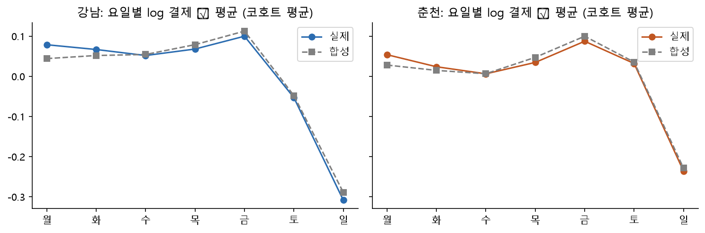
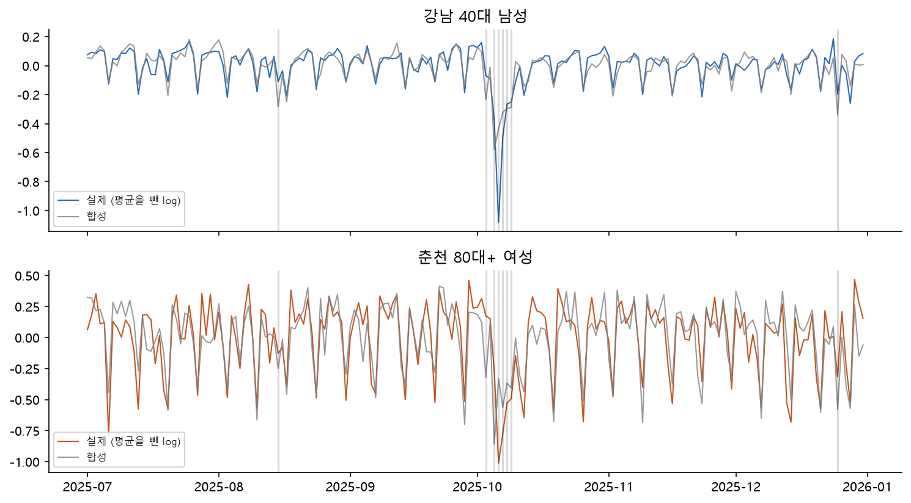
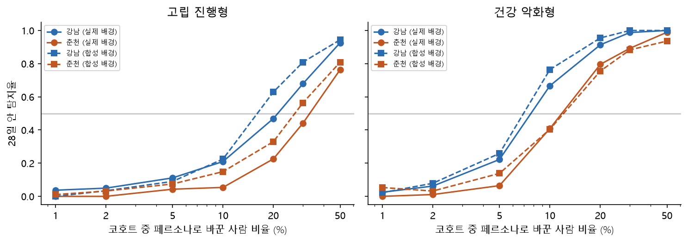

# S-1 LINK-Sim: 페르소나 기반 가상 데이터 (합성)

[← 전체 리포트 목록](../README.md)

> **이 리포트의 숫자는 모두 합성(synthetic)입니다.** 가상 사람의 결제·체류를 만들어 같은 파이프라인에 넣은 결과이며, 실제 고립을 찾은 성능이 아닙니다. 생성 방식 설명은 [docs/LINK-Sim_생성방식.md](../../docs/LINK-Sim_생성방식.md).

LINK-Sim은 공개 통계(주민등록·날씨·공휴일)와 제공 데이터의 **집계 통계**(비율·로그 효과·흔들림 크기)만으로 가상 사람을 만들고, 페르소나 7종의 상태(평소·위축·단절)에 따라 하루 결제·체류를 생성한 뒤, 제공 데이터와 **같은 단위**(카드: 도시 × 연령 × 성 × 일 × 업종, 통신: 50m 칸 × 월)로 집계합니다. 기존 경보·반증·등급 코드는 그대로 두고 자료 읽기(`SimDataSource`)만 바꿔 돌립니다.

- 시드 20261014, 축소 배율 1:40 (가상 1명 = 실제 약 40명 묶음), 기간 2025-07-01~2025-12-31 (184일)
- 스냅샷 `sim-87c97a77b7ef`, 보정 목표 `src/bigcontest/sim/targets.json`, 생성기 `link-sim-v1`

## 1. 인구 합성 (IPF)

주민등록 **동 × 성 × 연령대 인구**와 **동 1인세대 수**(공개)를 주변분포로 IPF를 돌려 동 × 성 × 연령대 × 1인 여부 칸을 채우고, 1:40로 줄여 확률 반올림으로 가상 사람을 뽑았습니다. 1인 생활 사전 확률(성 × 연령대)은 가정값이라 **동 총량은 정확하지만 연령 배분의 모양은 가정을 따릅니다**.

|  | 값 |
|---|---|
| IPF 반복 | 13 |
| IPF 칸 최대 상대 오차 | 3.13e-14 |
| 가상 사람 수 | 19,784 |
| 축소 배율 | 40 |
| 표본 동×성×연령 칸 상대 오차 중앙값(실제 400명 이상 칸) | 1.3% |
| 표본 동×성×연령 칸 상대 오차 90%(실제 400명 이상 칸) | 4.3% |
| 표본 동 1인 인구 상대 오차 중앙값 | 1.8% |
| 도시 10세 이상 인구 상대 오차 | 6.50e-04 |

페르소나 배정 (배경 세계, 가상 사람 수). 확률은 모두 가정값이며 실제 유병률이 아닙니다.

| persona | 강남 | 춘천 | 합계 |
|---|---|---|---|
| S1 고립 진행형 | 13 | 8 | 21 |
| S2 연휴 단절형 | 20 | 20 | 40 |
| S3 계절 수축형 | 99 | 102 | 201 |
| S4 건강 악화형 | 65 | 41 | 106 |
| S5 정상 변동형 | 12827 | 6490 | 19317 |
| S6 은둔 청년 | 36 | 12 | 48 |
| S7 이사 직후형 | 32 | 19 | 51 |


## 2. 충실도 (fidelity)


### 2-1. 카드: 코호트 28개, 실제 vs 합성 (같은 식으로 다시 잼)


| 요일 모양 상관 (최소) | 공휴일 효과 차 (최대) | 월 효과 차 (최대) | local MAD 비 (범위) | lag1 차 (최대) | 업종 비중 TVD (최대) | 통과 코호트 |
|---|---|---|---|---|---|---|
| 0.985 | 0.043 | 0.044 | 0.97~1.06 | 0.121 | 0.006 | 25/28 |

통과 기준(미리 정함): 요일 모양 상관 ≥ 0.9, 공휴일 효과 차 ≤ 0.05, 월 효과 차 ≤ 0.03, local MAD 비 0.8~1.25, lag1 차 ≤ 0.1, 업종 비중 TVD ≤ 0.02. 요일·월·공휴일·흔들림·업종 비중은 **보정한 값**이라 맞는 것이 당연합니다. 보정하지 않은 값(잔차 lag7·첨도, 아래 유용성)이 진짜 검사입니다.
보정하지 않은 모양 (코호트 중앙값)

| 잔차 lag7 실제 (중앙값) | 잔차 lag7 합성 (중앙값) | 잔차 첨도 실제 (중앙값) | 잔차 첨도 합성 (중앙값) | 실제·합성 일별 잔차 상관 (중앙값) |
|---|---|---|---|---|
| -0.079 | -0.029 | 23.740 | -0.039 | -0.001 |

- 첨도: 실제 잔차는 꼬리가 두껍고(가끔 큰 하루 변화), 합성 잡음은 정규 AR(1)이라 꼬리가 얇습니다 → 합성에서 헛경보가 덜 날 수 있습니다 (3절 배경 경보율).
- 실제·합성 일별 잔차 상관이 0에 가까움 = 합성이 실제의 날짜별 흔들림을 베끼지 않았다는 뜻 (7절 안전성).

| 도시 | 공통 변화 MAD 실제 | 공통 변화 MAD 합성 | 공통 lag1 실제 | 공통 lag1 합성 | MAD 비 | 통과 |
|---|---|---|---|---|---|---|
| 강남 | 0.038 | 0.039 | 0.255 | 0.242 | 1.045 | True |
| 춘천 | 0.051 | 0.043 | 0.415 | 0.361 | 0.844 | True |








### 2-2. 통신: 동 구성·월 지수(보정함), 시간대·밤낮 비(일부만 보정)


| 동 60대+ 비중 차 최대(%p) | 월 체류 지수 차 최대 (60대+, 도시×동유형×월) | 시간대 모양 상관 최소 | 요일 모양 차 최대 |
|---|---|---|---|
| 0.001 | 0.002 | 0.986 | 0.018 |

250m 격자 밤(0~5시)/낮(11~15시) 비 분위수: 이 값은 보정하지 않았습니다 (가상 칸은 동 중심점 둘레에 만든 칸이라 실제 격자 모양과 다름).

| city | ('실제', 0.1) | ('실제', 0.5) | ('실제', 0.9) | ('합성', 0.1) | ('합성', 0.5) | ('합성', 0.9) |
|---|---|---|---|---|---|---|
| 강남 | 0.106 | 0.150 | 0.209 | 0.094 | 0.217 | 0.217 |
| 춘천 | 0.000 | 0.056 | 0.196 | 0.123 | 0.311 | 0.311 |

- 통신 합성은 '동 × 성연령 구성, 시간대·요일 모양, 월별 체류 지수'를 맞춘 가상 칸입니다. 칸 위치·격자 모양은 실제와 다르므로 격자 단위 분석(예: 핵심 주거 격자 고르기)의 결과는 실제와 같지 않을 수 있습니다.

## 3. 유용성 (utility): 같은 파이프라인, 실제 vs 합성


### 3-1. 배경 경보율 (주입 없음, 판정 가능한 코호트·일 중 either 경보)


| 도시 | 실제 | 합성 |
|---|---|---|
| 강남 | 8.27% | 6.58% |
| 전체 | 6.65% | 4.86% |
| 춘천 | 5.03% | 3.15% |

- 합성 배경에서 경보가 덜 나면(정규 잡음, 얇은 꼬리) 합성으로 낸 오경보 관련 숫자는 **낙관적**입니다.

### 3-2. 계단형 하락 주입 감지율 (EDA-6 방식, 같은 시작일 280쌍, 코호트 단위 부트스트랩 CI)


| 주입 | 배경 | 쌍 | 탐지율 | CI 하한 | CI 상한 | 지연 중앙값(일) |
|---|---|---|---|---|---|---|
| 계단 5% × 14일 | 실제 | 258 | 32.9% | 23.4% | 43.2% | 4 |
| 계단 5% × 14일 | 실제 (강남) | 122 | 45.1% |  |  | 3 |
| 계단 5% × 14일 | 실제 (춘천) | 136 | 22.1% |  |  | 5 |
| 계단 5% × 14일 | 합성 | 262 | 40.1% | 29.1% | 51.0% | 3 |
| 계단 5% × 14일 | 합성 (강남) | 127 | 56.7% |  |  | 3 |
| 계단 5% × 14일 | 합성 (춘천) | 135 | 24.4% |  |  | 3 |
| 계단 15% × 14일 | 실제 | 258 | 89.9% | 80.5% | 97.3% | 2 |
| 계단 15% × 14일 | 실제 (강남) | 122 | 96.7% |  |  | 2 |
| 계단 15% × 14일 | 실제 (춘천) | 136 | 83.8% |  |  | 2 |
| 계단 15% × 14일 | 합성 | 262 | 90.8% | 81.7% | 97.6% | 2 |
| 계단 15% × 14일 | 합성 (강남) | 127 | 99.2% |  |  | 2 |
| 계단 15% × 14일 | 합성 (춘천) | 135 | 83.0% |  |  | 2 |


### 3-3. 등급 규칙 (rules-v1.1, 비교안 D, K=10): 후보 수


| 도시 | 기준일 | 집단 | 예정된 점검 후보 (실제) | 예정된 점검 후보 (합성) | 이탈 Level 2+ (실제) | 이탈 Level 2+ (합성) | 이탈 후보 (실제) | 이탈 후보 (합성) | 점검 Level 3 (실제) | 점검 Level 3 (합성) |
|---|---|---|---|---|---|---|---|---|---|---|
| 강남 | 동절기 | 고령층 | 0 | 0 | 0 | 0 | 0 | 0 | 0 | 0 |
| 강남 | 동절기 | 중장년 남성 1인가구 | 0 | 0 | 0 | 0 | 0 | 0 | 0 | 0 |
| 강남 | 추석 D-7 | 고령층 | 7 | 7 | 0 | 0 | 1 | 0 | 0 | 0 |
| 강남 | 추석 D-7 | 중장년 남성 1인가구 | 7 | 7 | 0 | 0 | 0 | 0 | 0 | 0 |
| 강남 | 추석 뒤 | 고령층 | 0 | 0 | 0 | 0 | 6 | 6 | 0 | 0 |
| 강남 | 추석 뒤 | 중장년 남성 1인가구 | 0 | 0 | 0 | 0 | 2 | 2 | 0 | 0 |
| 춘천 | 동절기 | 고령층 | 3 | 3 | 0 | 0 | 0 | 0 | 0 | 0 |
| 춘천 | 동절기 | 중장년 남성 1인가구 | 10 | 10 | 0 | 0 | 0 | 0 | 3 | 3 |
| 춘천 | 추석 D-7 | 고령층 | 8 | 8 | 0 | 0 | 1 | 0 | 0 | 0 |
| 춘천 | 추석 D-7 | 중장년 남성 1인가구 | 16 | 16 | 0 | 0 | 0 | 0 | 3 | 3 |
| 춘천 | 추석 뒤 | 고령층 | 8 | 8 | 2 | 0 | 6 | 6 | 0 | 0 |
| 춘천 | 추석 뒤 | 중장년 남성 1인가구 | 0 | 0 | 0 | 0 | 1 | 0 | 0 | 0 |


| 도시 | 기준일 | 집단 | 점검 후보 동 같은 비율 | 같은 동의 등급 일치 |
|---|---|---|---|---|
| 강남 | 동절기 | 고령층 | nan | nan |
| 강남 | 동절기 | 중장년 남성 1인가구 | nan | nan |
| 강남 | 추석 D-7 | 고령층 | 1.00 | 1.00 |
| 강남 | 추석 D-7 | 중장년 남성 1인가구 | 1.00 | 1.00 |
| 강남 | 추석 뒤 | 고령층 | nan | nan |
| 강남 | 추석 뒤 | 중장년 남성 1인가구 | nan | nan |
| 춘천 | 동절기 | 고령층 | 1.00 | 1.00 |
| 춘천 | 동절기 | 중장년 남성 1인가구 | 1.00 | 1.00 |
| 춘천 | 추석 D-7 | 고령층 | 1.00 | 1.00 |
| 춘천 | 추석 D-7 | 중장년 남성 1인가구 | 1.00 | 1.00 |
| 춘천 | 추석 뒤 | 고령층 | 1.00 | 1.00 |
| 춘천 | 추석 뒤 | 중장년 남성 1인가구 | nan | nan |

- 예정된 점검(구조·접근성·달력)은 주민등록·자원 원장이 공개 자료 그대로라 거의 같아야 정상입니다. 다른 곳은 통신(계절 수축) 합성 때문입니다.
- 이탈 후보는 카드 시계열에서 나오므로 합성과 실제가 **날짜별로 같을 이유가 없습니다** (합성은 실제의 날짜별 흔들림을 베끼지 않음). 개수·등급 분포의 크기만 비교합니다.

## 4. (a) 정답 있는 평가


### 4-1. 최소 감지 고립 비율

코호트(도시 × 연령 × 성) 가상 사람 중 비율 f를 '고립 진행형'(몇 주에 걸쳐 위축→단절) 또는 '건강 악화형'(하루에 단절, 뒤에 일부 회복)으로 바꾸고, 시작일 7개 × 코호트 28개에서 28일 안에 경보(either)가 울리는지 봤습니다. 대조(같은 날, 주입 없음)가 이미 울린 쌍은 뺐습니다. 배경 '합성' = 합성 결제(같은 난수로 짝), '실제' = **실제 결제 × 합성 기대 변화 비율**(하이브리드: 실제 배경 + 가상 변화량).

| 배경 | 페르소나 | 도시 | 탐지율 50% 최소 비율 | 탐지율 80% 최소 비율 | 가장 큰 비율에서 탐지율 | 대조 경보율 |
|---|---|---|---|---|---|---|
| 실제 | 건강 악화형 | 강남 | 10% | 20% | 100% | 17% |
| 실제 | 건강 악화형 | 춘천 | 20% | 30% | 99% | 5% |
| 실제 | 고립 진행형 | 강남 | 30% | 50% | 93% | 17% |
| 실제 | 고립 진행형 | 춘천 | 50% | 50%에서도 못 미침 | 76% | 5% |
| 합성 | 건강 악화형 | 강남 | 10% | 20% | 100% | 9% |
| 합성 | 건강 악화형 | 춘천 | 20% | 30% | 94% | 4% |
| 합성 | 고립 진행형 | 강남 | 20% | 30% | 94% | 9% |
| 합성 | 고립 진행형 | 춘천 | 30% | 50% | 81% | 4% |




고립 진행형, 연령별 (탐지율 50%·80%를 넘는 최소 비율)

| 배경 | 도시 | 연령 | 탐지율 50% 최소 비율 | 탐지율 80% 최소 비율 | 가장 큰 비율에서 탐지율 | 대조 경보율 |
|---|---|---|---|---|---|---|
| 실제 | 강남 | 20대 | 20% | 50% | 100% | 21% |
| 실제 | 강남 | 30대 | 20% | 30% | 100% | 43% |
| 실제 | 강남 | 40대 | 20% | 30% | 100% | 21% |
| 실제 | 강남 | 50대 | 20% | 50% | 100% | 14% |
| 실제 | 강남 | 60대 | 20% | 50% | 100% | 14% |
| 실제 | 강남 | 70대 | 30% | 50% | 85% | 7% |
| 실제 | 강남 | 80대+ | 50% | 50%에서도 못 미침 | 71% | 0% |
| 실제 | 춘천 | 20대 | 50% | 50% | 83% | 14% |
| 실제 | 춘천 | 30대 | 30% | 50% | 100% | 0% |
| 실제 | 춘천 | 40대 | 30% | 50% | 92% | 14% |
| 실제 | 춘천 | 50대 | 30% | 50% | 100% | 0% |
| 실제 | 춘천 | 60대 | 30% | 50% | 100% | 7% |
| 실제 | 춘천 | 70대 | 50% | 50%에서도 못 미침 | 50% | 0% |
| 실제 | 춘천 | 80대+ | 50%에서도 못 미침 | 50%에서도 못 미침 | 14% | 0% |
| 합성 | 강남 | 20대 | 30% | 30% | 100% | 14% |
| 합성 | 강남 | 30대 | 20% | 30% | 100% | 29% |
| 합성 | 강남 | 40대 | 20% | 30% | 100% | 0% |
| 합성 | 강남 | 50대 | 20% | 20% | 100% | 14% |
| 합성 | 강남 | 60대 | 20% | 30% | 100% | 0% |
| 합성 | 강남 | 70대 | 20% | 50% | 93% | 0% |
| 합성 | 강남 | 80대+ | 50% | 50%에서도 못 미침 | 69% | 7% |
| 합성 | 춘천 | 20대 | 50% | 50% | 86% | 0% |
| 합성 | 춘천 | 30대 | 30% | 50%에서도 못 미침 | 79% | 0% |
| 합성 | 춘천 | 40대 | 20% | 50% | 100% | 0% |
| 합성 | 춘천 | 50대 | 20% | 30% | 100% | 14% |
| 합성 | 춘천 | 60대 | 20% | 30% | 100% | 7% |
| 합성 | 춘천 | 70대 | 50% | 50%에서도 못 미침 | 77% | 7% |
| 합성 | 춘천 | 80대+ | 50%에서도 못 미침 | 50%에서도 못 미침 | 29% | 0% |

- 은둔 청년(S6, 처음부터 단절): 20·30대 코호트에 10%·30%를 넣어도 탐지 0% (쌍 52개). 처음부터 낮아 '변화'가 없으므로 이 시스템이 **원리상 못 잡는** 집단입니다.
- 읽는 법: '코호트 사람의 x%가 몇 주 안에 단절 상태로 가야 도시 단위 카드 경보가 절반쯤 울린다'. 개인 한 명, 몇 명의 고립은 카드 집계로 보이지 않는다는 것을 숫자로 보여 줍니다. 이 숫자는 페르소나 배율(가정값)에 따라 달라집니다.

### 4-2. 정답 있는 등급 순위 (동 단위)

동마다 고립 부담을 다르게 준 두 세계(1:10 축소, 고립 페르소나 비율을 배경보다 높임)에서, 규칙의 동 순위(예정된 점검: 등급 → 검토 순서, 후보가 아닌 동은 맨 뒤)와 **합성 정답**(기준일 앞 28일 대상 집단 중 단절 상태 비율·인원)의 Spearman 순위상관을 봤습니다.
- A 구조 일치: 1인 비율이 높은 동일수록 고립 페르소나가 더 많음 (규칙이 가정하는 구조와 같음)
- B 구조 무관: 동마다 무작위 배수, 1인 구성 효과도 상쇄 (규칙의 가정이 틀린 세계)

|  | Spearman(단절 비율) | Spearman(단절 인원) | 정답 상위 25% 중 Level 3 |
|---|---|---|---|
| ('A 구조 일치', '강남') | 0.81 | 0.77 | 0.00 |
| ('A 구조 일치', '춘천') | 0.58 | 0.22 | 0.21 |
| ('B 구조 무관', '강남') | -0.44 | -0.42 | 0.00 |
| ('B 구조 무관', '춘천') | -0.05 | -0.31 | 0.08 |


| 정답 시나리오 | 도시 | 기준일 | 집단 | Spearman(단절 비율) | Spearman(단절 인원) | Level 3 동 수 | Level 3 중 정답 상위 25% | 정답 상위 25% 중 Level 3 |
|---|---|---|---|---|---|---|---|---|
| A 구조 일치 | 강남 | 추석 D-7 | 고령층 | 0.83 | 0.79 | 0 | nan | 0.00 |
| A 구조 일치 | 강남 | 추석 D-7 | 중장년 남성 1인가구 | 0.80 | 0.74 | 0 | nan | 0.00 |
| A 구조 일치 | 강남 | 동절기 | 고령층 | nan | nan | 0 | nan | 0.00 |
| A 구조 일치 | 강남 | 동절기 | 중장년 남성 1인가구 | nan | nan | 0 | nan | 0.00 |
| A 구조 일치 | 춘천 | 추석 D-7 | 고령층 | 0.68 | 0.34 | 0 | nan | 0.00 |
| A 구조 일치 | 춘천 | 추석 D-7 | 중장년 남성 1인가구 | 0.57 | 0.15 | 3 | 0.67 | 0.33 |
| A 구조 일치 | 춘천 | 동절기 | 고령층 | 0.52 | 0.26 | 0 | nan | 0.00 |
| A 구조 일치 | 춘천 | 동절기 | 중장년 남성 1인가구 | 0.56 | 0.12 | 3 | 1.00 | 0.50 |
| B 구조 무관 | 강남 | 추석 D-7 | 고령층 | -0.53 | -0.52 | 0 | nan | 0.00 |
| B 구조 무관 | 강남 | 추석 D-7 | 중장년 남성 1인가구 | -0.34 | -0.32 | 0 | nan | 0.00 |
| B 구조 무관 | 강남 | 동절기 | 고령층 | nan | nan | 0 | nan | 0.00 |
| B 구조 무관 | 강남 | 동절기 | 중장년 남성 1인가구 | nan | nan | 0 | nan | 0.00 |
| B 구조 무관 | 춘천 | 추석 D-7 | 고령층 | -0.31 | -0.47 | 0 | nan | 0.00 |
| B 구조 무관 | 춘천 | 추석 D-7 | 중장년 남성 1인가구 | -0.20 | -0.46 | 3 | 0.33 | 0.17 |
| B 구조 무관 | 춘천 | 동절기 | 고령층 | -0.01 | -0.27 | 0 | nan | 0.00 |
| B 구조 무관 | 춘천 | 동절기 | 중장년 남성 1인가구 | 0.33 | -0.06 | 3 | 0.33 | 0.17 |

- 강남 동절기는 예정된 점검 후보가 없어(규칙상 동절기 점검은 춘천 읍·면) 순위상관을 계산하지 않았습니다(빈칸). B는 1인 구성 효과까지 상쇄해 만들었으므로 1인 비율 순위와 음의 상관이 나올 수 있습니다.
- A에서 순위상관이 양수이고 B에서 0 근처라면: 규칙의 동 순위는 **'1인 구조가 고립 부담을 따른다'는 가정이 맞을 때만** 정답을 따라갑니다. A의 상관은 생성 가정에서 나온 것이라 규칙의 실제 성능 근거가 아닙니다. B는 그 가정이 틀리면 순위가 아무 정보도 주지 않음을 보여 줍니다.

## 5. (b) 스트레스 시험 (합성)


### 5-1. 연휴 + 한파 겹침

12/29~12/31을 가상 공휴일로 넣어 12/27~12/31 연휴를 만들고, 같은 날 두 도시 모두 한파(최저 −12℃ 이하)로 바꿨습니다. 배경 효과(공휴일·한파 로그 효과)는 보정값 그대로, 연휴 단절형·계절 수축형 페르소나도 반응합니다. 공휴일 달력은 미리 알 수 있으므로 경보 규칙에 넣었습니다.

| 조건 | 12/27 뒤 경보 묶음 | 반증 '기각' | '통과'(평소 하락으로 남음) | '확인 필요'·'검토 중' | 고립 진행형 15% 시작 12-01 탐지 | 고립 진행형 15% 시작 11-10 탐지 |
|---|---|---|---|---|---|---|
| 평소 (배경) | 1 | 0 | 0 | 1 | 48% (27쌍) | 36% (28쌍) |
| 가상 연휴 + 한파 (12/27~12/31) | 26 | 0 | 1 | 25 | 50% (2쌍) | 36% (28쌍) |

- 연휴 + 한파를 겹치면 **배경(주입 없음)만으로도** 경보 묶음이 크게 늘고, 반증은 기각하지 않고 '확인 필요·검토 중'으로 남깁니다 (회복을 볼 날이 자료 끝에 걸림). 그래서 대조가 이미 울린 쌍이 많아져 12/01 시작 주입의 '짝 비교'가 거의 남지 않습니다 (쌍 수 참고). → 겹친 계기 기간에는 카드 이탈 경보가 '고립 신호'로서 정보를 거의 주지 못하고, 예정된 점검(구조·달력) 쪽이 주된 근거가 되어야 합니다.
- 연말 연휴 묶음 뒤에는 기대값을 잴 과거 같은 요일이 공휴일로 비고, 회복을 볼 날이 자료 끝(12/31)에 걸려 '검토 중'으로 남기 쉽습니다.

### 5-2. 카드 공급 지연


| 공급 지연(일) | 배정 비율 | 시작 뒤 21일 안에 담당자가 볼 수 있는 탐지율 | 볼 수 있는 날(시작 뒤) 중앙값 |
|---|---|---|---|
| 0 | 10% | 12.0% | 20 |
| 0 | 20% | 32.8% | 17 |
| 0 | 30% | 57.9% | 12 |
| 3 | 10% | 8.2% | 22 |
| 3 | 20% | 27.3% | 20 |
| 3 | 30% | 50.8% | 15 |
| 7 | 10% | 6.6% | 26 |
| 7 | 20% | 18.0% | 24 |
| 7 | 30% | 40.4% | 19 |

- 지연 L일이면 경보를 볼 수 있는 날이 L일 늦어집니다 (규칙은 관측일 기준이라 탐지 자체는 같음). '21일 안' 같은 대응 기한이 있으면 그만큼 놓칩니다.

### 5-3. 한 달(11월) 빠짐


| 시작일 | 자료 | 고립 진행형 20% 탐지 | 창 안 보류 비율 |
|---|---|---|---|
| 2025-11-17 | 빠짐 없음 | 61% | 0% |
| 2025-11-17 | 11월 빠짐 | 64% | 64% |
| 2025-12-01 | 빠짐 없음 | 68% | 0% |
| 2025-12-01 | 11월 빠짐 | 54% | 14% |
| 2025-12-08 | 빠짐 없음 | 61% | 0% |
| 2025-12-08 | 11월 빠짐 | 36% | 0% |


| 11월 빠짐 패널 | absolute | local |
|---|---|---|
| z 없음 (경보도 보류) | 1568 | 1568 |
| z 있음, 경보창 판정 불가 | 224 | 224 |
| 경보 보류 합계 | 1792 | 1792 |
| 경보 판정 가능 | 3360 | 3360 |
| z 없음, 경보 판정 가능 | 56 | 56 |
| 전체 | 5152 | 5152 |
| 첫 경보 판정 가능일 | 2025-08-02 | 2025-08-02 |

- 11/17 시작은 창(28일)의 절반 이상이 빠진 달이라 보류가 많고, 12월 자료가 들어온 뒤 늦게 울린 경우가 탐지로 잡혀 숫자가 오히려 조금 높습니다 (언제 볼 수 있느냐는 늦어짐).
- 빠진 달은 '관측 없음(미공급)'으로 보류하고 0으로 바꾸지 않습니다. 빠진 달 바로 뒤에는 과거 관측이 모자라 한동안 판정을 못 합니다.

## 6. (d) M3 이탈 분류기용 정답 있는 자료

`bigcontest.sim.inject.labeled_dataset(world, n_scenarios, seed)` → `data/sim/link_sim_labeled_v1.parquet` (618,240행 = 시나리오 120개 × 184일 × 코호트 28개, git 추적 안 함, 다시 만들기 몇 초). 형식은 생성 방식 문서 9절.

| persona_name | 시나리오 | 평균_비율 | 최대_기대감소_중앙값 |
|---|---|---|---|
| 건강 악화형 | 17 | 0.12 | 0.042 |
| 계절 수축형 | 17 | 0.14 | 0.051 |
| 고립 진행형 | 17 | 0.13 | 0.065 |
| 대조 | 25 | 0.00 | 0.000 |
| 연휴 단절형 | 17 | 0.11 | 0.001 |
| 은둔 청년 | 16 | 0.17 | 0.194 |
| 이사 직후형 | 11 | 0.15 | 0.000 |

지금 경보 규칙(either)을 이 자료에 그대로 돌린 기준 성능 (대상 코호트의 판정 가능한 날, 정답 = 자기 평소 대비 기대 결제 5% 이상 감소)

| persona | 맞은 경보 | 헛경보 | 놓침 | 맞은 무경보 | 재현율(정답 이탈일 중 경보) | 정밀도(경보일 중 정답 이탈) |
|---|---|---|---|---|---|---|
| 건강 악화형 | 98.0 | 103.0 | 103.0 | 2280.0 | 48.8% | 48.8% |
| 계절 수축형 | 76.0 | 120.0 | 234.0 | 2154.0 | 24.5% | 38.8% |
| 고립 진행형 | 30.0 | 123.0 | 537.0 | 1894.0 | 5.3% | 19.6% |
| 대조 | 0.0 | 140.0 | 0.0 | 3660.0 | nan% | 0.0% |
| 연휴 단절형 | 55.0 | 113.0 | 20.0 | 2396.0 | 73.3% | 32.7% |
| 은둔 청년 | 0.0 | 117.0 | 0.0 | 2315.0 | nan% | 0.0% |
| 이사 직후형 | 0.0 | 42.0 | 0.0 | 1630.0 | nan% | 0.0% |

- M3는 이 자료로 학습·평가할 수 있지만, 정답은 **페르소나 배율(가정값)이 만든 정답**입니다. 여기서 좋은 분류기가 실제 고립을 잘 찾는다는 뜻이 아닙니다.

## 7. 안전성 (privacy)


| 항목 | 값 |
|---|---|
| LINK-Sim 이 읽는 파일 (공개) | adm_code_map, adm_names, asos, asos_heat, config, resident_hh, resident_pop, resources, seoul_living, welfare_recipients |
| 합성 자료로 바꾸는 원천 | card2, card1, card2_visitors, tel_age, tel_time, tel_wkdy |
| 보정 목표(targets.json) 최상위 항목 | version, dates, card, city_noise, mct_share, visitor_ratio, visitor_log_sd, card1_band, tel_comp, tel_month_index, tel_hour, tel_wkdy, tel_grid_nightday_q |
| 보정 목표에 원천 값 이름(USE_CNT·TS_AT·체류량 등) | 0개 |
| 가상 사람 속성 | 임의 ID(SIM-…), 행정동, 성, 10년 연령대, 1인 여부, 동 유형, 페르소나, 활동량 (이름·1세 나이·주소·실제 ID 없음) |
| 가상 사람이 속한 실제 칸(동×성×연령대) 인구 최솟값 | 18명 |
| 실제 인구 10명 미만 칸에 속한 가상 사람 | 0명 |
| IPF 추정 10명 미만 칸(1인 여부 포함)에서 뽑힌 가상 사람 | 6명 (칸 51개) |
| 실제·합성 일별 잔차 상관 (중앙값, 최대 절대값) | -0.001, 0.269 |

- 입력은 공개 통계와 제공 데이터의 **집계 통계**뿐입니다 (개인 단위 행 입력 0개). 제공 데이터 자체도 이미 비식별 집계입니다.
- 가상 사람 1명은 실제 약 40명 묶음이고, 칸 안에서 무작위로 뽑은 속성 조합이라 **어떤 행도 특정 실제 사람과 대응하지 않습니다**. 1인 여부 칸이 작은(IPF 추정 10명 미만) 곳에서 뽑힌 가상 사람도 실제 그 사람의 기록이 아니라 확률 반올림 결과입니다.
- 합성 결제·체류의 날짜별 흔들림은 실제와 상관이 없습니다(위 잔차 상관). 공휴일·요일·날씨처럼 **모두가 아는 달력 효과**만 같습니다.

## 8. (c) 원본 없는 시연과 재현

```bash
uv run python -m bigcontest.sim.serve          # 합성 스냅샷으로 API (X-Data-Source: synthetic)
uv run python -m bigcontest.sim.calibrate      # 보정 목표 다시 만들기 (원본 필요)
uv run python notebooks/s1_link_sim.py         # 이 리포트
```
실행 시간 202초.
